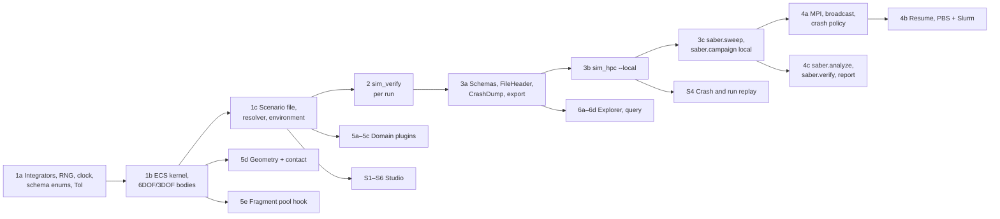

# SABER build plan

Status: v1.36 (2026-11-28; v1.1 marks steps 1a and 1b done, adds O8 and records D19; v1.2 marks step 1c done, moves `FileHeader` from 3a to 1c, and adds Earth rotation to 5a; v1.3 marks step 2 done, which also brought the kernel's in-memory event channel forward from the telemetry work; v1.4 marks step 3a done; v1.5 marks step 3b done, which also brought the kernel's Tier 2 and 3 run log forward; v1.6 marks step 3c done and adds a CI job where Python drives freshly built binaries; v1.7 marks step 4a done, built on the recommended answer to O8, and adds a CI job that runs `sim_hpc` under `mpiexec`; v1.8 marks step 4b done and closes O8 as D20; v1.9 marks step 4c done, built on the recommended answer to O9; v1.10 marks step 5a done for the M1 and M2 oracles, with M3 still waiting on T1, and narrows T2; v1.11 marks step 5b done and adds T5; v1.12 splits step 5c into two pull requests and marks its first part, turbulence, actuators and sensors, done; v1.13 marks its second part, rotorcraft and control, done, with the RotorPy cross-check still open; v1.14 splits step 5d into two pull requests and marks its first part, geometry and compliant contact, done; v1.15 marks its second part, impulsive contact, done, and moves range sensors and the persistent-penetration watchdog to a new step 5d-3; v1.16 marks step 5d-3 done; v1.17 splits step 5e into the kernel hook (5e-1, done) and the output side (5e-2); v1.18 marks step 5e-2 done; v1.19 adds step S1-0, the Rust 1.97.1 toolchain that Bevy 0.20.1 needs, in its own pull request as `rust-toolchain.toml` asks; v1.20 splits S1 out of S1–S6, marks it done, and closes O9 as D21, which keeps what 4c built; v1.21 splits S2 into the scene document with Outliner, Inspector and Lint (S2-1, done), Parameters and the bind menu (S2-2) and the Requirements panel (S2-3); v1.22 marks S2-2 done; v1.23 marks S2-3 done; v1.24 splits S3–S6 into the Preview Run (S3-1, done), the 3D viewport (S3-2), Run and Crash Replay (S4), `sim_assets` and models (S5) and Campaign Setup (S6); v1.25 marks S3-2 done and adds S3-3, a symbol font for the kit's icons; v1.26 marks S3-3 done; v1.27 splits S4 into Crash Replay over recorded frames (S4-1, done) and Run Replay with re-simulation (S4-2); v1.28 (2026-11-23) marks S4-2 (re-simulation, ghost run, Open in Builder) done, moves Run Replay from Tier 3 snapshots to S4-3, and notes that steps 4a to S4-1 reached main through PR #32; v1.29 (2026-11-23) marks S4-3 (Run Replay from Tier 3 snapshots, re-simulation at full rate) done and moves requirement overlays to a new S4-4; v1.30 (2026-11-23) marks S4-4 (requirement overlays) done; v1.31 (2026-11-25) splits S5 into the model catalogue, built-in library and models in the viewport (S5-1, done), the Library and Appearance panels with import (S5-2), collision derived from a model and Align mode (S5-3), and OBJ conversion (S5-4, stretch); v1.32 (2026-11-25) marks S5-2 (the 3D Models tab, the Appearance section, import and model lint) done; v1.33 (2026-11-26) marks S5-3 (collision derived from a model, inertia from a shape, Align and the viewport's collision overlay) done; v1.34 (2026-11-26) marks S5-4 (OBJ and MTL conversion) done and moves LOD files to a new S5-5; v1.35 (2026-11-28) marks S5-5 (LOD files and the far marker) done; v1.36 (2026-11-28) splits S6 into the form, summary and `saber.study` (S6-1, done), execution targets and submission (S6-2) and the sample preview, manifests from a file and the Sobol-indices design (S6-3)). Turns the roadmap in `design/subsystems-and-interfaces.md` §12 into build
steps, one reviewable pull request each, in the order they are built. Each step names its scope, the
design sections it implements, and the test that proves it done (its exit criterion, in the roadmap's
style). Design changes ride in the same PR as the code (`CONTRIBUTING.md`).

## Principles

- **Kernel first, then outward.** Every later piece (verification, the cluster runner, the studio)
  sits on a deterministic, verified kernel, so the kernel's numerics and determinism tests come first.
- **Each step ends green and usable.** A step is merged only when its exit test passes in CI. No step
  leaves a stub that a later step has to rip out.
- **Tests come with the code.** Each physics feature meets the definition of done in
  `design/verification-and-test-strategy.md` §12 in the same PR (two oracle rungs, convergence order,
  determinism, zero allocations after Tick 0).
- **Open questions go to Alex, not into the code.** Steps that need an undecided answer stop at the
  hook and list the question (see "Blocked on decisions" below).

## Order

## Steps

| Step | Scope | Design | Exit test |
|---|---|---|---|
| **1a** | `sim_schema` on-disk enums (`SimStatus`, `CrashKind`, `IntegratorKind`); `sim_core::integrator` (all eight methods from one Butcher-tableau stepper plus semi-implicit Euler, fixed and adaptive substeps landing on tick boundaries, PI control, `StepSizeUnderflow` and `SubstepLimit`, error telemetry), `SimClock` and `RateDivider`, `SimRng` with named substreams; `sim_testkit` `Tol` comparators, convergence helpers, counting allocator; `saber.testing.close` | physics §10; subsystems §5.1, §5.4; verification §3.2, §4.2 (R9, R11), §5.4.1 | Exact tableau order conditions for every method; observed convergence order equals nominal for every method; adaptive error tracks tolerance; ticks land on the grid bitwise; zero allocations per tick; R9, R11; Rust and Python `Tol` agree on shared vectors |
| **1b** | `bevy_ecs`/`bevy_reflect` pinned `=0.20.1`; `SimAppBuilder`, `SimTickSchedule` with the `SimSet` chain on a single-threaded executor, `SimTypeRegistry`; `RigidBody6`, `PointMass3`, `MassProps`, `ForceModel`; packed `OdeSystem` over the World; `Core.Watchdog` (finite and energy checks), `TerminationPolicy`, `state_hash` and rolling hash, `RunningStats`, `FlightRecorder`, `RunSink`; World reset | subsystems §5.1, §6, §10.1; physics §4.3; verification §4, §7.2 | Free fall, vacuum projectile, quadratic-drag closed forms, torque-free symmetric top precession, asymmetric-top invariants, RK4 order 4 on 6DOF, MMS on 6DOF; R1, R2, R10; zero allocations after Tick 0; schedule order and single-threaded executor guarded |
| **1c** | `.scn.ron` envelope (IB-01) through `bevy_reflect` serde and `SimTypeRegistry` (not `DynamicScene`, IB-01), `FileHeader`, `scene_hash`, `sim_config_hash`, `SceneError`; `Core.Resolver` (`ParamBindings`, `Uncertainties` drawn in `SimId` order, typed setters); `EnvironmentPlugin` (flat and J2 gravity, USSA 1976 atmosphere, constant wind), `AeroTable`; `saber-cli validate` | subsystems §5.2, §7, IB-01, IB-08; verification §7.1 | USSA 1976 against the published table; scene export/import round-trip exact; every `SceneError` variant from a broken scene; a scenario loaded from disk runs to its stop condition |
| **2** | `sim_verify`: `.req.ron` loader, `MetricDef` compiler, probes, reducers, `RequirementMonitor`, early stop, `RunVerdictRow`; `saber-cli --emit-req-json`; in `sim_core` the per-tick `SimEvents` channel with declared names, `FieldPath` and the custom-check catalogue | subsystems §5.3, §8, IB-03, IB-09; verification §7.8 | §8.2 verdict semantics for every `SimStatus`; each reducer and requirement kind against hand-computed signals |
| **3a** | `sim_schema` Arrow schemas (summaries, events, snapshots, impacts, manifest, verdicts), `FileHeader` on every IB file (the type exists since 1c), `CrashDump`, `build_id`, `export-schemas`; `Verdict` discriminants; Python schema loaders | subsystems §5.4, §10.4, IB-07, IB-10 | Every IB file written in Rust is read back by Rust and Python with schema validation |
| **3b** | `sim_hpc --local`: rayon pool, thread-local Worlds with reset, `IO.Mux` and rolling parts, crash capture to `crashes.zst`, `catch_unwind`, exit codes | subsystems §5.6, IB-06, IB-07; seq §6–§8 | R3, R4; a deliberately crashing run is captured; a tiny campaign completes on one machine |
| **3c** | `saber.sweep` (manifest writer), `saber.campaign` local runs and preflight through `saber-cli` | subsystems §5.7, IB-02, IB-04 | Tiny campaign end to end on one machine from Python |
| **4a** | MPI dispatch (`REQUEST_WORK`/`ASSIGN_WORK`/`TERMINATE`/`ABORT`), scene and manifest broadcast with hash check, `build_id` gather, campaign-wide crash quota and crash-storm abort (exit 6), `campaign_status.json` | IB-05, IB-15; seq §5, §8 | R5 with `mpiexec -n 4 --oversubscribe` in CI; crash storm exits 6 with evidence kept |
| **4b** | Attempts, `_MANIFEST.json`, `IO.Stager` commit rule, drain before walltime, `--resume`; PBS then Slurm templates | IB-04, IB-07; seq §7, §12 | R6: a run killed mid-part and resumed has every `run_id` exactly once with the same hash |
| **4c** | `saber.analyze`, `saber.verify` (`AllPass`, Clopper–Pearson `Probability`, `Quantile`), `verdicts.parquet`, `report.html` | subsystems §5.7, §8, IB-11, IB-12 | End-to-end campaign whose `verdicts.parquet` equals a hand-computed expectation |
| **5a** | `AeroBallisticsPlugin`: 3DOF point mass, then McCoy 6DOF; Earth rotation in ECEF (Coriolis and centrifugal terms) | subsystems §5.2; verification §6, §7.3 | McCoy M1 and M2 oracles; M3 once T1 and T2 are answered |
| **5b** | `FixedWingPlugin`; force-model integrated states, trim hook and derivative probe in the kernel | subsystems §5.2, IB-08, D9; `flight-dynamics-sources.md` §2 | Stevens–Lewis–Johnson F-16 check case and trims |
| **5c-1** | Dryden turbulence, `ActuatorPlugin`, `SensorPlugin` (IMU, GNSS, barometer); `FieldPath::write` | subsystems §5.2; verification §7.1, §7.6 | Dryden spectrum test; servo and sensor oracles in verification §7.6 |
| **5c-2** | `RotorcraftPlugin` (lumped rotors, motor lag, mixer, frame drag), `ControlPlugin` (`Controller` trait, PID loops) | subsystems §5.2; verification §7.6 | Hover, motor lag, mixer round trip, PID closed loop in verification §7.6; the RotorPy cross-check waits for a way to run RotorPy or exported reference trajectories |
| **5d-1** | `sim_core::geometry` over Parry (pinned `=0.31.1`): `CollisionShape` parts, static colliders, height fields and meshes; `ContactSolver` broad phase (sort and sweep on swept boxes, `max_contact_pairs`, `ContactCapacity`), compliant contact in every stage (Hunt–Crossley or linear dashpot, regularised friction), materials combined or overridden per pair, landing-gear ray points and wheels, `EventOnly` at tick ends, `contact` and `contact_end` events, the Tick-0 stiffness check | IB-19; physics §9.2–§9.6 | Spring–damper drop and gear drop against the closed form, static deflection, Hertz impact, friction creep and slide on a slope, the regularised stop distance; contact determinism under spawn order, far-from-origin, capacity crash, zero allocations |
| **5d-2** | `Impulsive` contact: time of impact located inside the step by re-integrating every body (no dense output needed), restitution and friction impulses, the resting switch, `max_events_per_tick` and `contact_deferred`; swept `EventOnly` checks; penetration recovery; the impulse energy check | IB-19; physics §9.2, §9.4, §9.6 | Bouncing ball (restitution), ricochet of a glancing spinning projectile, resting without jitter; determinism and allocation |
| **5d-3** | Range sensors (`SensorPlugin` ray casts on the shared geometry); the persistent-penetration watchdog (`max_penetration` for N ticks) | IB-19; physics §9.6, §10.4; verification §7.6 | Range sensor against the closed form over flat ground and a box; a sinking stack ends the run with the penetration crash |
| **5e-1** | `FragmentPool` kernel hook: `Fragmentable`, the `FragmentationModel` trait, slots claimed in order, parent retirement, fragment motion (both methods, BC drag), swept impacts against every collider, in memory | IB-16; physics §10.3; verification §7.7 | Pool claims in deterministic order; drag and impact-time closed forms; zero allocations through a scripted 30k-fragment event |
| **5e-2** | Fragment output: `impacts.parquet` from `sim_hpc`, `fragments_dropped` summary column, per-parent aggregates (Tier 1 and 3, recorder), `impacts(SimId)` signals, `[output] fragment_impacts`, `sim_models::import::fragment_drag`, Inconclusive when fragments were dropped | IB-07, IB-13, IB-16 | Impact rows round-trip; aggregates against hand-computed sums; the Inconclusive rule |
| **S1-0** | Rust 1.97.1: `bevy` 0.20.1 and its shader crates need it (rust-version 1.97.1); a toolchain change gets its own pull request (`rust-toolchain.toml`) | verification §11 | Every exact golden and state hash unchanged (numerics-neutral) |
| **S1** | Studio frame on Bevy Feathers: the `sim_studio_ui` kit (theme tokens, `StudioDock`, toasts, widget facade), `AppState`s and the activity rail, workspaces (`saber.workspace.ron`) and starter packs, the recent list, the Launcher, the shell (title bar, dock, status bar, console), opening a crash stream's index | `sim_studio_ux.md` §5, §6, §7.1, §8, §10.1, §11; subsystems §5.5 | Headless: every token in both themes at WCAG AA, dock bounds, every pack's starter runs with its requirements passing, commands drive the states, the UI stack without a window driven by button presses |
| **S2-1** | Scenario Builder document: an editable copy of the open scenario (`Scenario::from_parts`), Outliner, reflected Inspector, undo and redo, the autosave sidecar, Export, Lint (scene validation, Tick-0 setup, step against time constants) | `sim_studio_ux.md` §7.2, §9.2, §9.4, §9.5; subsystems §5.5 | Every reference scenario survives the editor with the same `scene_hash`; export → import → export is exact; edits undo exactly; bad input refused; lint blocks Export |
| **S2-2** | Parameters and Uncertainty panel, the field bind menu (sweep parameter, per-replicate distribution), adding and removing components | `sim_studio_ux.md` §7.2, §7.3 | Bindings made in the UI resolve at Tick 0 as hand-written ones; manifest columns match |
| **S2-3** | Requirements panel: `.req.ron` editing, metric builder, compiled against the scene | `sim_studio_ux.md` §7.4; IB-03 | A requirement set written in the UI equals the hand-written one; unknown signals are lint errors |
| **S3-1** | Preview Run without the viewport: one run of the open scenario in-process, built as `sim_hpc` builds it; parameter corners and seed, play, pause, step, speeds, reset; live state, live requirements (`VerifyState::progress`), perf, plots; a crash opens Crash Replay from memory | `sim_studio_ux.md` §7.5; subsystems §5.3, §5.5 | R7 against `sim_hpc --local`; speeds and frames never change results; the screen driven headless |
| **S3-2** | The 3D viewport in Preview Run: bodies drawn from the recorder's frames, camera focus, state HUD, force and velocity gizmos, the ground grid | `sim_studio_ux.md` §7.10, §10.3 | Headless: camera focus, HUD values and grid labels from known states |
| **S3-3** | A bundled symbol font as the kit's fallback, so ✓ ✖ ⚠ ◐ ☰ ▸ ▶ ⏸ and the like draw (Fira Sans and Mono lack them; the S3-2 render showed empty boxes); the buttons S3-2 named in words stay words | `sim_studio_ux.md` §6.1, §7.10.4, §10.2 | No character the studio writes draws an empty box, on any screen the tests visit |
| **S4-1** | Crash Replay: the scrubber over a crash dump's or a crashed preview's recorded frames, jump buttons, energy and event tracks, the growth inspector, the NaN-origin highlight, the viewport shared with Preview | `sim_studio_ux.md` §7.9; D15 | Scrubbing shows each frame's recorded state exactly; jumps land on the right frames |
| **S4-2** | Re-simulation in Crash Replay: re-simulating a crashed run from Tick 0 (G9), checked against its recorded frames; re-running another build's dump as an approximation; the ghost run; Open in Builder at a run's parameters | `sim_studio_ux.md` §7.9; D15; G9 | A re-simulated crash matches its recorded frames bit for bit on the same build; the ghost aligns by tick; the pinned Preview reproduces the crash |
| **S4-3** | Run Replay: a campaign's committed runs listed from its summaries, one run's Tier 3 snapshots at the recorded cadence, a re-simulation at full rate checked against them, its verdicts and metrics | `sim_studio_ux.md` §7.9; subsystems `Studio.RunReplay`; IB-07 | A completed run's snapshots replay exactly; its re-simulation matches them on the same build |
| **S4-4** | Requirement overlays in Run Replay: each requirement's signal and threshold in a plot track, and levels on a body's position as planes in 3D (corridor, cone and impact circle wait for requirement kinds that carry geometry) | `sim_studio_ux.md` §7.9; IB-03 | Each overlay draws its requirement's threshold and agrees with the run's verdict |
| **S5-1** | `sim_assets` and built-in models (P2v): manifests, the `visual:` section, the catalogue (built-in, workspace, library roots), the glTF inspector and import rules, the built-in library, bodies drawn with their models in the viewport, `saber-cli model inspect` | `sim_studio_ux.md` §7.11.6; subsystems §5.10, IB-20 | Built-in models load; `visual_hash` outside `scene_hash` |
| **S5-2** | The Library's 3D Models tab with thumbnails, the Inspector's Appearance section (pick, offset, scale, tint, visible), the Import dialog and `saber-cli model import`, lint and Outliner warnings for missing or changed models | `sim_studio_ux.md` §7.11.1–§7.11.3; IB-20 | An imported `.gltf` is packed into one `.glb` whose hash its manifest records; a linked model survives export and re-import |
| **S5-3** | Derive collision from model (box, capsule, hull, convex decomposition, triangle mesh on static bodies), Show collision, Align mode, Estimate mass properties | `sim_studio_ux.md` §7.11.4–§7.11.5; IB-19 | A derived shape records `derived_from` and changes `scene_hash`; a model change is flagged, never re-derived silently |
| **S5-4** | (Stretch) OBJ + MTL conversion to glTF (`saber-cli model convert`) | subsystems §5.10 | A converted OBJ draws as its source and records the OBJ's hash |
| **S5-5** | LOD files (a manifest's `lods`, drawn by screen size) and the constant-size far marker | `sim_studio_ux.md` §7.11.6; subsystems §5.10 | A model switches to its LOD file, then to the marker, at the sizes its manifest gives |
| **S6-1** | Campaign Setup's form (scenario and requirements, study design, telemetry, this machine's threads, notes), the summary card (counts, cost estimate from a timed run, runs a probability requirement needs), Show generated, and Write campaign: `campaigns/<id>/study.json` built by `python -m saber.study` (new) with preflight | `sim_studio_ux.md` §7.6; subsystems §5.5, §5.7 | The campaign written equals one written by `saber.sweep` for the same choices |
| **S6-2** | Execution targets: run on this machine from the studio with progress from the heartbeat, cluster profiles (nodes, ncpus, threads, queue, walltime, account), `submit_campaign.pbs` in Show generated, **Submit…** with its confirmation (`saber.campaign.submit`), the campaign's model archive (D17) | `sim_studio_ux.md` §7.6; seq §5, §7; D17 | The job script equals `saber.campaign.render_job`'s for the same profile; a local run's heartbeat shows on the Launcher |
| **S6-3** | The sample preview (pair plot of the drawn points), a manifest from a file, the Sobol-indices option (Saltelli design in `saber.sweep`) | `sim_studio_ux.md` §7.6; seq §10 | The preview shows the manifest's points; a Saltelli manifest has `N × (d + 2)` rows |
| **6a–6d** | `sim_query` embedded; `sim_explorer` monitor, results and query views with IB-18 handoff; `sim_query serve` | subsystems §5.8, §5.9, IB-17, IB-18 | Same scorecard embedded, through `sim_query serve`, and from `saber.verify` |
| **7** | Fragmentation physics on the IB-16 hook | IB-16 | Blocked on O1 |

## Blocked on decisions

| Question | Blocks | Where |
|---|---|---|
| O1: fragmentation trigger, fragment mass and velocity distributions, lifetime when nothing is hit | Step 7 (5e builds the hook without them) | subsystems §11 |
| T1: which McCoy projectiles have complete data for M3 | The M3 part of 5a | verification §13 |
| T2: exact `H`, `T` definitions and signs for the M2 linear-theory oracle | Nothing for M2, whose oracle 5a derived from the plugin's own force laws; M3 still needs the transcribed tables' signs checked | verification §6.2, §13 |
| T4: access to STANAG 4355 | An optional modified-point-mass reference in 5a | verification §13 |
| T5: five F-16 table cells to read off the printed book | Nothing: no published case reaches them; 5b uses the values in `case.ron` | verification §13 |

## Done

| Step | PR |
|---|---|
| Scaffold (workspace, CI, design-change loop, D18 rename) | #1 |
| 1a Integrators, clock, random streams, schema enums, `Tol` | #2 |
| 1b ECS kernel, 6DOF and 3DOF bodies, watchdog, recorder, state hash | #3 |
| 1c Scenario file, Resolver and samplers, `EnvironmentPlugin`, `AeroTable`, `saber-cli validate` | #4 |
| 2 Requirement sets, metrics, per-run monitor, early stop, verdict row, `saber-cli` requirement JSON | #5 |
| 3a Output tables and Parquet I/O, crash-dump stream, `build_id`, schema export, `saber.schema`, golden files | #6 |
| 3b `sim_hpc --local`: preflight, worker threads with World reuse, crash and panic capture, `IO.Mux` parts, stager, `_MANIFEST.json`, exit codes; kernel event and snapshot log | #7 |
| 3c `saber.sweep` (samplers, replicate seeds, manifest writer), local `saber.campaign` (`campaign.toml`, preflight, `run_local`, statuses), scene-hash check in preflight, end-to-end CI job | #8 |
| 4a MPI dispatch over a `Transport` (rsmpi behind the `mpi` feature), init broadcast with BLAKE3 checks and `build_id` gather, campaign-wide dump quota, crash-storm and setup-error aborts (exit 6), `campaign_status.json`, `saber.campaign.read_heartbeat`, MPI CI job | #10 |
| 4b Resume from committed footers (attempts, campaign-wide counts restored, refusals), walltime drain, SIGTERM, fresh-output check, `saber.campaign` resume, PBS and Slurm job scripts with `auto_resume` resubmissions | #11 |
| 4c `saber.analyze` (committed parts, coverage, uncertainty, unstable regions), `saber.verify` (`AllPass`, Clopper–Pearson `Probability`, `Quantile`, crash and timeout policy, envelope, per parameter set, recompute), `verdicts.parquet` with its `saber.verify` footer, `report.html` with the traceability matrix, `python -m saber.verify` | #12 |
| 5a `AeroBallisticsPlugin` (McCoy 6DOF `ProjectileAero`, 3DOF `PointMassAero`, `C(Mach)` coefficients, `AeroState`), Earth rotation (`EarthRotation`, Coriolis and centrifugal terms in the kernel), McCoy M1 and M2 tests; M3 waits on T1 | #13 |
| 5b `FixedWingPlugin` (`FixedWingAero` term buildup, `ControlSurfaces`, `Propulsion` with the Stevens–Lewis turbofan, `EngineState`, `AirData`, `TrimCondition` trim at Tick 0); kernel model-owned states, `after_setup`, `derivatives`; the F-16 check case, trims and envelope sweep against an independent port | #14 |
| 5c-1 `Wind::Dryden` (exact discretisation of the MIL spectra, stationary start, linear within a tick), `ActuatorPlugin` (limits, rate limit, first- and second-order lags, backlash, `hold_start`), `SensorPlugin` (`Imu`, `Gnss`, `Barometer`: noise, bias walk, quantisation, divided rates, latency); kernel `FieldPath::write` and `SimEnvironment::downcast_mut`. Range sensors wait for 5d's geometry, encoders for robotics | #15 |
| 5c-2 `RotorcraftPlugin` (`Rotorcraft` with lumped rotors, tilted axes, motor lag as integrated states, frame and rotor drag, spin-up and gyroscopic moments; `MixerCommand` through the minimum-norm inverse of the allocation matrix), `ControlPlugin` (`PidControl` loops on fields by path with cascades, filtered derivative on the measurement, conditional integration, angle wrap; the `Controller` trait run by `ControllerPlugin<C>`), the quadrotor example scenario. Ground effect, battery and blade flapping are not built; the RotorPy cross-check is open | #16 |
| 5d-1 `sim_core::geometry` (Parry `=0.31.1`; ball, capsule, cuboid, cylinder, convex hull, half-space, height field, triangle mesh; multi-part colliders, static colliders), `sim_core::contact` (`ContactSolver` in `Dynamics`: sort-and-sweep broad phase, compliant contact in every stage, combined and per-pair materials, gear and wheel ray points, `EventOnly` at tick ends, `Contacts`, `contact` and `contact_end` events, Tick-0 stiffness check with warnings in `ResolveReport`, `config.contact.max_contact_pairs` and `ContactCapacity`); `SimEvent` and the event log carry the other entity and a position | #17 |
| 5d-2 `Impulsive` contact in `sim_core::contact::impact`: impacts located inside the tick by re-integrating every body (rate-informed cubic search with a conservative fallback), Newton impulses with Coulomb friction in fixed sequential sweeps, Poisson and plastic fallbacks when Newton would add energy, the resting switch, `max_events_per_tick` and `contact_deferred`, `max_projection` and `contact_projected`, swept `EventOnly` checks with the time of the touch, `CrashedEnergy` on energy growth; `SimEvent` carries an event time | #18 |
| 5d-3 Kernel ray query `Dynamics::ray_cast` (first collider along a ray, statics included, skipping one `SimId`, allocation-free), `RangeFinder` in the `SensorPlugin` (mount, beam in body or world axes, `max_range`, noise, rate and latency; `LIBRARY_VERSION` 0.1.5), the persistent-penetration watchdog (`config.contact.max_penetration`, off by default, and `penetration_ticks`; `CrashKind::Penetration`); tests: slant range from a tilted body, sloped terrain, a box, another body, out of range, latency, the zero floor; a ball sinking into soft ground crashes at the exact tick, a brief overshoot does not | #19 |
| 5e-1 `sim_core::fragments`: `FragmentPool` (struct of arrays sized to `config.fragments.capacity` when a `Fragmentable` body exists), `FragmentationModel` (`setup`, `triggers`, `generate` through `FragmentWriter`) registered with `add_fragmentation_model`, slots by (tick, parent `SimId`, index) with per-parent streams, parent retirement (frozen, out of contact and ray queries), fragment motion with `integrator.fragments` (gravity, `FragmentDrag` BC against Mach, wind, rotating frame), swept segment impacts against every collider relative to its motion, `fragments.lifetime`, `fragmentation` and `fragments_dropped` events, fragments in the state hash; tests against closed forms and a 30k-fragment zero-allocation run | #20 |
| 5e-2 Fragment outputs: per-parent `FragmentCloud` (count, mass, centroid, velocity, covariance, range, kinetic energy) and per-target `ImpactTally` components, updated allocation-free at each tick's end and held by the flight recorder (`TickFrame::fragments`; crash stream 2.0 with an upgrader for 1.x) and Tier 3 snapshots (20 `ch_frag_*` channels on the parent's rows); `RunOutput` totals and impacts; `sim_hpc` writes `fragments_*` summary columns (summaries 1.1.0), `*_impacts.parquet` per part and `[output] fragment_impacts`; `impacts(N).count/mass/max_ke` signals and the Inconclusive rule after an overflow in `sim_verify`; `sim_models::import::fragment_drag` (BC in kg/m² or lb/in², or Cd with mass per area) | #21 |
| S1-0 Toolchain 1.97.1 (`rust-toolchain.toml`, workspace `rust-version`), needed by `bevy` 0.20.1; `cargo test --workspace` passes unchanged, so every exact golden and state hash holds (numerics-neutral) | #22 |
| S1 Studio frame: `sim_studio_ui` (Feathers theme with every §10.1 token in Dark and Light, `StudioDock` with splitters and collapse, toasts with a log, widget facade), `sim_studio` `AppState`s and rail, `saber.workspace.ron` and three starter packs (aero-ballistics shell, quadrotor hold, blank) with starter requirements, per-user recent list, Launcher (recent workspaces and campaigns with their heartbeat, new from a pack, open by path), shell (breadcrumb, theme switch, dock regions, status bar, console), crash stream index in Crash Replay, `sim_studio [PATH]`; headless tests including the full UI stack without a window or GPU | #23 |
| S2-1 Scenario Builder document: `Scenario::from_parts`, `Scenario::meta`, `SceneEntity::try_clone` in `sim_core`; `sim_studio::builder` (`ScenarioDoc`: reflected fields as paths with exact text, typed edits, undo and redo, `.scn.ron~autosave` sidecar restored on open, Export refused on lint errors; Lint: scene validation, Tick-0 setup error and warnings, step against time constants); Outliner, Inspector updated in place, scenario summary, Lint panel, Undo, Redo and Export in the title bar, Ctrl+Z, Ctrl+Shift+Z, Ctrl+E; kit `value_field` and `KitSubmit` (Enter or leaving a field) | #24 |
| S2-2 Parameters and uncertainty: `ScenarioDoc::bind`, `unbind`, `jitter` (added to a swept value, "both"), `unjitter`, `add_component` (a `Default` or every field defaulted), `remove_component`, all undoable and refused when they would break a valid scene; the bind menu on every number in the Inspector, the Parameters list with its manifest columns under the Outliner, `+ Component` and `Remove` in the Inspector; tests: bindings made in the UI give the hand-written scene's `scene_hash` and Tick-0 values | #25 |
| S2-3 Requirements panel: `sim_studio::builder::RequirementDoc` (the IB-03 set edited field by field, refused when it would not validate, undo and redo, `.req.ron~autosave`, Save refused on lint errors, new sets under `requirements/<scenario>.req.ron`), kind and campaign-rule switches that keep what a requirement watches; lint compiles every metric and requirement against the open scenario's Tick 0 with `sim_verify::VerifyState::compile`; the Builder's Scene and Requirements tabs with the list, the editor (metric builder), the set's summary and joint lint; tests: a set written in the UI equals the hand-written one (same `req_set_hash`), unknown entities, fields and events are lint errors | #26 |
| S3-1 Preview Run: `sim_studio::preview::PreviewRun` (built as `sim_hpc` builds a run; Nominal, Min and Max corner parameters, seed, whole-tick stepping at x1, x10 and max within a frame budget, Reset, channels, crash capture with the recorder's frames), `sim_verify::VerifyState::progress`, CPU-drawn plots in `sim_studio_ui::plot`; the Preview screen (toolbar, live state, read-only Outliner, live requirements, perf, plots, F5) and a crashed preview in Crash Replay; tests: R7 against `sim_hpc`'s `run_local` row by row, results independent of frames and speed, the screen driven headless through to a crash | #27 |
| S3-2 3D viewport in Preview Run: `sim_studio::viewport` (ENU display frame for ENU, NED and ECEF scenarios, floating origin at the f64 camera pivot, orbit rig, focus Frame, Follow, Chase and Track from here with a critically damped spring, State HUD values, grid decades and 10 m distance labels, marker and arrow sizes) and `sim_studio::ui::viewport` (camera into a `ViewportNode` on its own render layer, unlit spheres, gizmo grid, axes and velocity arrows, label pool, HUD panel, focus and toggle buttons, F, Shift+F, H, Esc); Preview controls named in words; `sim_studio_ui::ThemeColors`; tests: the f64 logic without rendering (G7 at 100 km), the screen driven headless, and one local render on a software GPU | #28 |
| S3-3 Symbol font: `sim_studio_ui::fonts` bundles DejaVu Sans 2.37's symbol blocks (160 KB, `scripts/make_symbol_font.sh`, license beside it) and puts it behind every text's font, so ✓ ✖ ⚠ ◐ ☰ ▸ ⚙ ℹ ● draw; tests: symbols come from that font in regular, bold and mono, every non-ASCII character in the studio's literals has a glyph, and every screen test ends with no empty box (all fail without the font) | #29 |
| S4-1 Crash Replay: `sim_studio::replay` (a dump or a crashed preview's frames shown exactly as recorded, matched to its scenario by `scene_hash`; scrubber with 1/2/5/25 fps playback and loops; jumps to first contact, first ×10 growth, first non-finite and energy over bound; energy and event tracks; growth inspector; entity order) and `sim_studio::ui::replay` (dump list, transport, tracks that take clicks and drags, entities, snapshot, growth, ← → Home End Space); the viewport fed through `ViewSource` so Preview and Crash Replay share it, with a red ring at the NaN origin and a held focus that resumes; tests: the logic on synthetic frames, a written stream replayed bit for bit through the commands, the screen driven headless for a crashed preview and the golden stream | #30 |
| S4-2 Re-simulation in Crash Replay: `sim_studio::rerun` (`Rerun` built as `sim_hpc` builds a run from the scenario, `RunSeed` and the dump's parameters, stepped 12 ms per frame in the background, `Keep` with a stride under 20 000 frames and 1 000 000 snapshots, `compare` bit for bit by tick), re-simulate from Tick 0 or re-run on this build (approximate, D15), show recorded or re-simulated frames, a ghost replicate at the replay's ticks (viewport rings and energy line), Open in Builder pinning the run's parameter row and seed for Preview; `sim_studio_ui::plot::draw_series`; tests: a `sim_hpc --local` crash re-simulated in the studio matches its 50 recorded frames bit for bit (G9), the ghost equals a standalone run, the pinned Preview crashes the same way | #33 |
| S4-3 Run Replay: `sim_studio::runs` (`CampaignRuns` reads a campaign's committed summaries parts once per `run_id` and one run's committed snapshots as frames; `sim_schema::io::committed_parts`, with `parse_part_name` moved there from `sim_hpc`), a run opened as a `Replay` (`ReplaySource::Run`, its verdicts, metrics and stop reason), the run list and **Back to the run list**, snapshots shown without force, flags or energy (no tracks or jumps, an unknown force not "non-finite"), the run's Requirements and Metrics, **Re-simulate at full rate** (`Keep::StrideAnd`, every snapshot tick kept, compared on the snapshot fields with `rerun::Fields::Snapshot`), the Launcher's **Replay a run of ‹id›** and **Replay a campaign's runs**, the replay screen rebuilt in the frame a job finishes; tests: snapshot comparison and stride, a two-run campaign from `sim_hpc --local` listed, replayed exactly and re-simulated bit for bit against its 9 snapshots, the screen driven headless; requirement overlays move to S4-4 | #34 |
| S4-4 Requirement overlays: `sim_studio::overlay` (each requirement's signal, levels with their passing comparison, window, scope and the run's verdict; the signals the frames keep; planes on a body's position; the set found by `req_set_hash` in the workspace's and the campaign's `requirements/`), `Rerun::with_signals` sampling other signals at the kept ticks, requirement tracks under the timeline on snapshots and re-simulated frames (levels in the verdict's color, breaking samples in red, time outside the window dimmed), level planes in the 3D view; tests: every requirement kind, the end-to-end quadrotor campaign with a mass requirement drawn only from the re-simulation, the screen's tracks and planes | #35 |
| S5-1 Models: `sim_assets` (`VisualAssetManifest` in `model.ron` with the body-frame mapping `ModelFrame` and `Origin`; the `visual:` section's `VisualSection`, `VisualModel`, `Scenery` and `VisualAssetRef`; `Catalog` over the built-ins, a workspace's `models/` and library roots, with version and hash notices; the inspector and import rules; a GLB writer), the built-in library of 16 project-authored CC0 models generated by `examples/make_builtins.rs` (`build.rs` embeds every manifest and the primitives' files), `Studio.Assets` (each body's look from the `visual:` section or its Domain Pack default, files handed to Bevy's glTF loader through `embedded://` by content hash, model trees under a `ModelRoot` placed on the body's f64 pose, a sun and ambient light, the marker hidden near and the model hidden far, placeholders and a warning for missing models), `saber-cli model inspect`; tests: every built-in keeps the rules, manifests and the section round-trip, the catalogue's sources and notices, URIs that leave the folder refused, `visual_hash` outside `scene_hash`, looks resolved and the drone model drawn headless at its body | #36 |
| S5-2 Library and Appearance: `sim_assets::import` (`Candidate`: a file read, inspected and previewed with settings; `ImportSettings` with `OriginChoice`; `pack` a `.gltf` and its files into one `.glb` through `serde_json`; `commit` writing `model.glb`, `model.ron` and `thumb.png`; `duplicate`; `refresh` for Re-import) and `sim_assets::thumb` (thumbnails and the import preview drawn on the CPU, axis triad and reference bar; built-ins ship `thumb.png`, embedded by `build.rs`), `Catalog::verify_files` and the users of a model, `saber-cli model import`; in the studio, the Builder's 3D Models tab (search, source filter, thumbnail tiles, details with users, Link, Duplicate to workspace and Re-import), the Import dialog (live preview, units guessed, axes, origin, destination, license, replace, findings, a dropped file opens it), the Inspector's Appearance section (picker with Default and None, offset, scale, tint and visible fields, status) as undoable edits of the `visual:` section only, and lint warnings by `SimId` for missing, changed and re-imported models (the Outliner's ⚠); tests: a packed `.gltf` whose hash its manifest records, unit, axes and origin in the manifest, refusals that write nothing, Duplicate and Re-import, thumbnails, a linked model surviving export and re-import with `scene_hash` unchanged, five edits undone and redone, the CLI import, and the tab and dialog driven headless | #37 |
| S5-3 Collision from a model and Align: `sim_core::geometry::derive` (`ModelMesh`, `derive` for box, capsule and cylinder along the longest axis, hull ≤ 256 points, V-HACD decomposition merged down to ≤ 32 parts, triangle mesh on static colliders only; `solid` for volume, centroid and inertia about the body origin; `wireframe`), the `DerivedCollision` record as its own scene component, `sim_assets::derive` (triangles placed as the entity draws them, refused while the file is stale; lint notes) and `import::fold_offset` (Save as model default, quarter turns only); in the studio, the Inspector's Collision section on the 3D Models tab, the Derive dialog (background job, picture with the shape over the model in four views, volume and how far the model sticks out, Apply as one sim-section edit), Estimate inertia, Align as quick steps on the picture squashed into one undo step with Save as model default, lint warnings for an out-of-date shape, long lists of small items as one Inspector row, and the viewport's Collision overlay; tests: every method on every built-in and on synthetic meshes, mass properties against closed forms, notes after a model change, the fold, `scene_hash` moving with an applied shape, Align as one undo step, and the dialog, Align and overlay driven headless | #38 |
| S5-4 OBJ conversion: `sim_assets::obj` (`tobj` without `ahash`: one node per object or group, MTL to metallic-roughness with a `map_Kd` texture inside the file, flat normals where missing, a missing or out-of-folder file left out with a warning, a frame bakeable into a root node), the GLB writer extended (texture coordinates, images, blending, double-sided, scale, written only when used), `Candidate::open` converting an `.obj` with `FrameChosen` keeping Import refused until unit, up and forward are chosen, the manifest recording the OBJ's hash, `import::unpack`, `saber-cli model convert` and OBJ in `model import` and `model inspect`; the Import dialog takes `.obj`; tests: conversion, materials and texture, left-out files, the baked frame, import with the hash, built-ins byte for byte, the CLI, and the dialog driven headless | #39 |
| S5-5 LOD files and the far marker: a manifest's `lods` entries with their hash and triangle count and the rules on them, `import::add_lod` (read as an import reads a file, stored as `lodN.glb`, warned when heavier than the model or off its bounds) and `remove_lod`, LOD files carried by Duplicate, re-hashed by Re-import and dropped by a replacing import, `Catalog::lods_changed` and its lint warning, `saber-cli model lod add|remove|list`; in the studio, one tree per level under each model, `level_for` choosing the level from the model's size in pixels, the far marker (a camera-facing diamond 12 px across in the look's tint or the accent, the focus target's name beside it) under 4 px, a click within 10 px of a body's marker focusing the camera, the Library's LOD line; tests: the importer and manifest rules, levels and picking, the viewport driven headless through every level to the far marker and a click, the CLI | #40 |
| S6-1 Campaign Setup: `sim_studio::setup` (the study plan checked as `saber.sweep` checks it, each sampler's count, `study.json` with paths relative to `campaigns/<id>/`, the telemetry the requirement set implies, the runs a `Probability` requirement needs, the estimate from a timed run, `python -m saber.study --preflight --json` in the background with `SABER_PYTHON`), the screen (form, summary card, Show generated, Write campaign, the workspace's studies); `saber.study` (`Study`, `build`, the command with `--dir`); tests: the studio's `study.json` equals the golden one, which the end-to-end job builds and compares with the API's campaign file by file, then runs | #41 |
