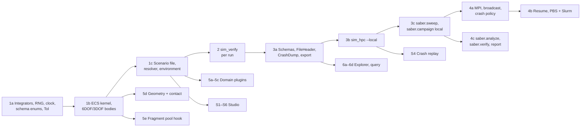

# SABER build plan

Status: v1.12 (2026-11-03; v1.1 marks steps 1a and 1b done, adds O8 and records D19; v1.2 marks step 1c done, moves `FileHeader` from 3a to 1c, and adds Earth rotation to 5a; v1.3 marks step 2 done, which also brought the kernel's in-memory event channel forward from the telemetry work; v1.4 marks step 3a done; v1.5 marks step 3b done, which also brought the kernel's Tier 2 and 3 run log forward; v1.6 marks step 3c done and adds a CI job where Python drives freshly built binaries; v1.7 marks step 4a done, built on the recommended answer to O8, and adds a CI job that runs `sim_hpc` under `mpiexec`; v1.8 marks step 4b done and closes O8 as D20; v1.9 marks step 4c done, built on the recommended answer to O9; v1.10 marks step 5a done for the M1 and M2 oracles, with M3 still waiting on T1, and narrows T2; v1.11 marks step 5b done and adds T5; v1.12 splits step 5c into two pull requests and marks its first part, turbulence, actuators and sensors, done). Turns the roadmap in `design/subsystems-and-interfaces.md` §12 into build
steps, one reviewable pull request each, in the order they are built. Each step names its scope, the
design sections it implements, and the test that proves it done (its exit criterion, in the roadmap's
style). Design changes ride in the same PR as the code (`CONTRIBUTING.md`).

## Principles

- **Kernel first, then outward.** Every later piece (verification, the cluster runner, the studio)
  sits on a deterministic, verified kernel, so the kernel's numerics and determinism tests come first.
- **Each step ends green and usable.** A step is merged only when its exit test passes in CI. No step
  leaves a stub that a later step has to rip out.
- **Tests come with the code.** Each physics feature meets the definition of done in
  `design/verification-and-test-strategy.md` §12 in the same PR (two oracle rungs, convergence order,
  determinism, zero allocations after Tick 0).
- **Open questions go to Alex, not into the code.** Steps that need an undecided answer stop at the
  hook and list the question (see "Blocked on decisions" below).

## Order

## Steps

| Step | Scope | Design | Exit test |
|---|---|---|---|
| **1a** | `sim_schema` on-disk enums (`SimStatus`, `CrashKind`, `IntegratorKind`); `sim_core::integrator` (all eight methods from one Butcher-tableau stepper plus semi-implicit Euler, fixed and adaptive substeps landing on tick boundaries, PI control, `StepSizeUnderflow` and `SubstepLimit`, error telemetry), `SimClock` and `RateDivider`, `SimRng` with named substreams; `sim_testkit` `Tol` comparators, convergence helpers, counting allocator; `saber.testing.close` | physics §10; subsystems §5.1, §5.4; verification §3.2, §4.2 (R9, R11), §5.4.1 | Exact tableau order conditions for every method; observed convergence order equals nominal for every method; adaptive error tracks tolerance; ticks land on the grid bitwise; zero allocations per tick; R9, R11; Rust and Python `Tol` agree on shared vectors |
| **1b** | `bevy_ecs`/`bevy_reflect` pinned `=0.20.1`; `SimAppBuilder`, `SimTickSchedule` with the `SimSet` chain on a single-threaded executor, `SimTypeRegistry`; `RigidBody6`, `PointMass3`, `MassProps`, `ForceModel`; packed `OdeSystem` over the World; `Core.Watchdog` (finite and energy checks), `TerminationPolicy`, `state_hash` and rolling hash, `RunningStats`, `FlightRecorder`, `RunSink`; World reset | subsystems §5.1, §6, §10.1; physics §4.3; verification §4, §7.2 | Free fall, vacuum projectile, quadratic-drag closed forms, torque-free symmetric top precession, asymmetric-top invariants, RK4 order 4 on 6DOF, MMS on 6DOF; R1, R2, R10; zero allocations after Tick 0; schedule order and single-threaded executor guarded |
| **1c** | `.scn.ron` envelope (IB-01) through `bevy_reflect` serde and `SimTypeRegistry` (not `DynamicScene`, IB-01), `FileHeader`, `scene_hash`, `sim_config_hash`, `SceneError`; `Core.Resolver` (`ParamBindings`, `Uncertainties` drawn in `SimId` order, typed setters); `EnvironmentPlugin` (flat and J2 gravity, USSA 1976 atmosphere, constant wind), `AeroTable`; `saber-cli validate` | subsystems §5.2, §7, IB-01, IB-08; verification §7.1 | USSA 1976 against the published table; scene export/import round-trip exact; every `SceneError` variant from a broken scene; a scenario loaded from disk runs to its stop condition |
| **2** | `sim_verify`: `.req.ron` loader, `MetricDef` compiler, probes, reducers, `RequirementMonitor`, early stop, `RunVerdictRow`; `saber-cli --emit-req-json`; in `sim_core` the per-tick `SimEvents` channel with declared names, `FieldPath` and the custom-check catalogue | subsystems §5.3, §8, IB-03, IB-09; verification §7.8 | §8.2 verdict semantics for every `SimStatus`; each reducer and requirement kind against hand-computed signals |
| **3a** | `sim_schema` Arrow schemas (summaries, events, snapshots, impacts, manifest, verdicts), `FileHeader` on every IB file (the type exists since 1c), `CrashDump`, `build_id`, `export-schemas`; `Verdict` discriminants; Python schema loaders | subsystems §5.4, §10.4, IB-07, IB-10 | Every IB file written in Rust is read back by Rust and Python with schema validation |
| **3b** | `sim_hpc --local`: rayon pool, thread-local Worlds with reset, `IO.Mux` and rolling parts, crash capture to `crashes.zst`, `catch_unwind`, exit codes | subsystems §5.6, IB-06, IB-07; seq §6–§8 | R3, R4; a deliberately crashing run is captured; a tiny campaign completes on one machine |
| **3c** | `saber.sweep` (manifest writer), `saber.campaign` local runs and preflight through `saber-cli` | subsystems §5.7, IB-02, IB-04 | Tiny campaign end to end on one machine from Python |
| **4a** | MPI dispatch (`REQUEST_WORK`/`ASSIGN_WORK`/`TERMINATE`/`ABORT`), scene and manifest broadcast with hash check, `build_id` gather, campaign-wide crash quota and crash-storm abort (exit 6), `campaign_status.json` | IB-05, IB-15; seq §5, §8 | R5 with `mpiexec -n 4 --oversubscribe` in CI; crash storm exits 6 with evidence kept |
| **4b** | Attempts, `_MANIFEST.json`, `IO.Stager` commit rule, drain before walltime, `--resume`; PBS then Slurm templates | IB-04, IB-07; seq §7, §12 | R6: a run killed mid-part and resumed has every `run_id` exactly once with the same hash |
| **4c** | `saber.analyze`, `saber.verify` (`AllPass`, Clopper–Pearson `Probability`, `Quantile`), `verdicts.parquet`, `report.html` | subsystems §5.7, §8, IB-11, IB-12 | End-to-end campaign whose `verdicts.parquet` equals a hand-computed expectation |
| **5a** | `AeroBallisticsPlugin`: 3DOF point mass, then McCoy 6DOF; Earth rotation in ECEF (Coriolis and centrifugal terms) | subsystems §5.2; verification §6, §7.3 | McCoy M1 and M2 oracles; M3 once T1 and T2 are answered |
| **5b** | `FixedWingPlugin`; force-model integrated states, trim hook and derivative probe in the kernel | subsystems §5.2, IB-08, D9; `flight-dynamics-sources.md` §2 | Stevens–Lewis–Johnson F-16 check case and trims |
| **5c-1** | Dryden turbulence, `ActuatorPlugin`, `SensorPlugin` (IMU, GNSS, barometer); `FieldPath::write` | subsystems §5.2; verification §7.1, §7.6 | Dryden spectrum test; servo and sensor oracles in verification §7.6 |
| **5c-2** | `RotorcraftPlugin` (lumped rotors, motor lag, mixer, frame drag), `ControlPlugin` (`Controller` trait, PID loops) | subsystems §5.2; verification §7.6 | Hover, motor lag, mixer round trip, PID closed loop in verification §7.6 |
| **5d** | `GeometryService` (Parry pinned) and `ContactSolver`: compliant, impulsive, event-only; dense output and event location | IB-19; physics §9, §10.4 | Bouncing ball, sliding block, gear drop test, glancing spinning projectile; contact determinism and allocation |
| **5e** | `FragmentPool`, per-entity DOF and impact recording, without fragmentation physics | IB-16 | Pool claims in deterministic order; zero allocations through a scripted 30k-fragment event |
| **S1–S6** | Studio on Bevy Feathers: `sim_studio_ui` kit and shell, Launcher; Scenario Builder; LocalRun and RunReplay with viewport tools; CrashReplay; `sim_assets` and built-in models (P2v); CampaignSetup | `sim_studio_ux.md`; subsystems §5.5, §5.10 | Headless studio tests in verification §8.3, R7 |
| **6a–6d** | `sim_query` embedded; `sim_explorer` monitor, results and query views with IB-18 handoff; `sim_query serve`; OBJ converter (stretch) | subsystems §5.8, §5.9, IB-17, IB-18 | Same scorecard embedded, through `sim_query serve`, and from `saber.verify` |
| **7** | Fragmentation physics on the IB-16 hook | IB-16 | Blocked on O1 |

## Blocked on decisions

| Question | Blocks | Where |
|---|---|---|
| O1: fragmentation trigger, fragment mass and velocity distributions, lifetime when nothing is hit | Step 7 (5e builds the hook without them) | subsystems §11 |
| O9: judge `Probability` requirements over all runs pooled, or per parameter set | Nothing: 4c pools by default and judges per set on request (`by_param_set=True`); only the default would change | subsystems §11 |
| T1: which McCoy projectiles have complete data for M3 | The M3 part of 5a | verification §13 |
| T2: exact `H`, `T` definitions and signs for the M2 linear-theory oracle | Nothing for M2, whose oracle 5a derived from the plugin's own force laws; M3 still needs the transcribed tables' signs checked | verification §6.2, §13 |
| T4: access to STANAG 4355 | An optional modified-point-mass reference in 5a | verification §13 |
| T5: five F-16 table cells to read off the printed book | Nothing: no published case reaches them; 5b uses the values in `case.ron` | verification §13 |

## Done

| Step | PR |
|---|---|
| Scaffold (workspace, CI, design-change loop, D18 rename) | #1 |
| 1a Integrators, clock, random streams, schema enums, `Tol` | #2 |
| 1b ECS kernel, 6DOF and 3DOF bodies, watchdog, recorder, state hash | #3 |
| 1c Scenario file, Resolver and samplers, `EnvironmentPlugin`, `AeroTable`, `saber-cli validate` | #4 |
| 2 Requirement sets, metrics, per-run monitor, early stop, verdict row, `saber-cli` requirement JSON | #5 |
| 3a Output tables and Parquet I/O, crash-dump stream, `build_id`, schema export, `saber.schema`, golden files | #6 |
| 3b `sim_hpc --local`: preflight, worker threads with World reuse, crash and panic capture, `IO.Mux` parts, stager, `_MANIFEST.json`, exit codes; kernel event and snapshot log | #7 |
| 3c `saber.sweep` (samplers, replicate seeds, manifest writer), local `saber.campaign` (`campaign.toml`, preflight, `run_local`, statuses), scene-hash check in preflight, end-to-end CI job | #8 |
| 4a MPI dispatch over a `Transport` (rsmpi behind the `mpi` feature), init broadcast with BLAKE3 checks and `build_id` gather, campaign-wide dump quota, crash-storm and setup-error aborts (exit 6), `campaign_status.json`, `saber.campaign.read_heartbeat`, MPI CI job | #10 |
| 4b Resume from committed footers (attempts, campaign-wide counts restored, refusals), walltime drain, SIGTERM, fresh-output check, `saber.campaign` resume, PBS and Slurm job scripts with `auto_resume` resubmissions | #11 |
| 4c `saber.analyze` (committed parts, coverage, uncertainty, unstable regions), `saber.verify` (`AllPass`, Clopper–Pearson `Probability`, `Quantile`, crash and timeout policy, envelope, per parameter set, recompute), `verdicts.parquet` with its `saber.verify` footer, `report.html` with the traceability matrix, `python -m saber.verify` | #12 |
| 5a `AeroBallisticsPlugin` (McCoy 6DOF `ProjectileAero`, 3DOF `PointMassAero`, `C(Mach)` coefficients, `AeroState`), Earth rotation (`EarthRotation`, Coriolis and centrifugal terms in the kernel), McCoy M1 and M2 tests; M3 waits on T1 | #13 |
| 5b `FixedWingPlugin` (`FixedWingAero` term buildup, `ControlSurfaces`, `Propulsion` with the Stevens–Lewis turbofan, `EngineState`, `AirData`, `TrimCondition` trim at Tick 0); kernel model-owned states, `after_setup`, `derivatives`; the F-16 check case, trims and envelope sweep against an independent port | #14 |
| 5c-1 `Wind::Dryden` (exact discretisation of the MIL spectra, stationary start, linear within a tick), `ActuatorPlugin` (limits, rate limit, first- and second-order lags, backlash, `hold_start`), `SensorPlugin` (`Imu`, `Gnss`, `Barometer`: noise, bias walk, quantisation, divided rates, latency); kernel `FieldPath::write` and `SimEnvironment::downcast_mut`. Range sensors wait for 5d's geometry, encoders for robotics | #15 |
