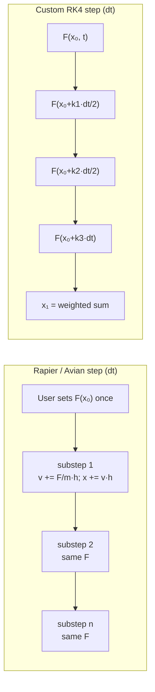
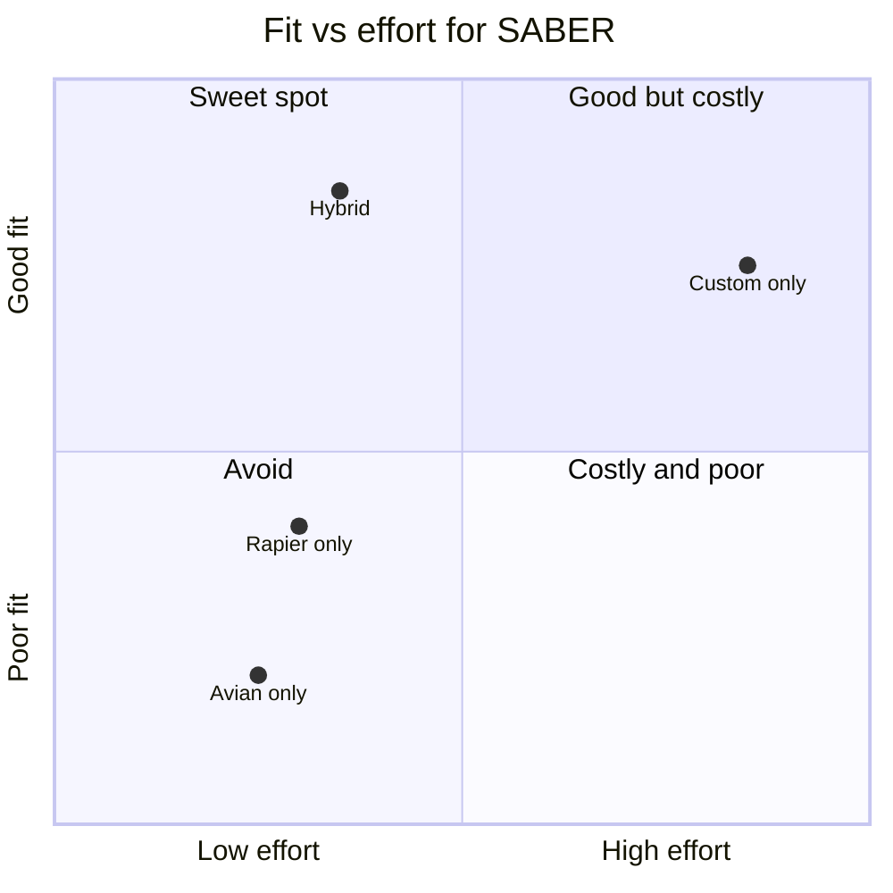
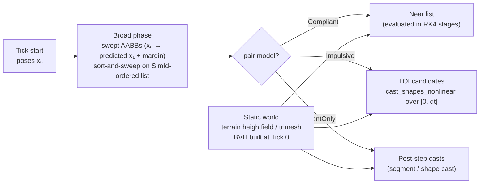
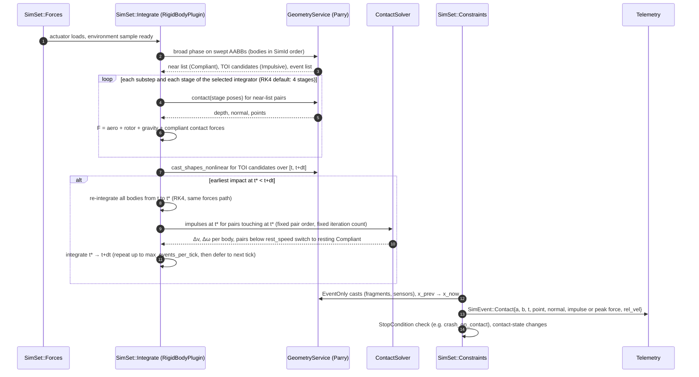
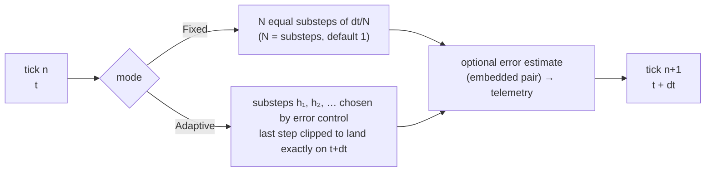

# SABER — Physics Engine Trade-offs: Rapier vs Avian vs Custom Kernel

Status: **decided, D13** (Alex, 2026-11-01): custom physics kernel with Parry for collision detection;
robotics deferred. §1–§7 are the analysis that led there; §8 records the decision, §9 designs the
contact handling it needs, and §10 the selectable integrators (D14). Written 2026-11-01.
v1.1 (2026-11-02, build step 1a): §10 records what implementing the integrators settled: the error-norm
scale uses the old and new state, DOP853's composite estimator, first-same-as-last reuse only within a
tick, `SubstepLimit` and non-finite errors, Fixed-mode estimate weights, `atol.model`, how
semi-implicit Euler uses state classes, and the interface as built (§10.7). Dense output moves to the
contact step.
Companion to `subsystems-and-interfaces.md` (§5.1 `sim_core`, §5.2 `sim_models`, §6 tick pipeline,
IB-16 fragmentation, G8) and `flight-dynamics-sources.md`.

Versions checked on 2026-11-01: **rapier3d-f64 0.36.1** (10 Oct 2026), **bevy_rapier 0.35.0**
(12 Jul 2026, Bevy 0.19), **avian3d 0.8.0** (20 Oct 2026, Bevy 0.20). Facts marked *(unverified)* were
not confirmed against source or docs and should be checked before they are relied on.

---

## 1. Short answer

> **Superseded in part by D13 (§8).** Alex chose a fully custom kernel with Parry and deferred robotics,
> so the Rapier part of the recommendation below no longer applies.

**Use a hybrid.** SABER owns the integrator for everything that flies (projectiles, fixed-wing,
multirotors, fragments), uses **Parry** (`parry3d-f64`, Rapier's geometry library) for collision
*queries*, and brings in **Rapier** (`rapier3d-f64`, the core crate, *not* `bevy_rapier`) only for
the robotics domain, where contacts, friction and articulated multibodies are the hard part.
**Avian is not a fit for `sim_core`.**

Why, in one paragraph each:

- **Accuracy.** Rapier and Avian both integrate with first-order semi-implicit (symplectic) Euler and
  hold your applied force constant across the whole step. That is the right choice for stacking boxes and
  wrong for aerodynamics, where force depends on the state you are integrating (velocity, angle of attack,
  spin). McCoy 6DOF and the NASA 6DOF check-cases need a higher-order integrator (RK4 or better) that
  re-evaluates aero forces at each stage. Neither engine lets you plug that in.
- **f64.** Rapier ships a true f64 build (`rapier3d-f64`). Avian 0.8 changed its `f64` feature to mean
  *f64 positions only*; velocities, forces and the solver are now f32. That breaks the SABER f64 rule.
- **Determinism.** All three can be bit-identical within one build if each World is single-threaded,
  which is already the SABER design. Rapier is the strongest here (an `enhanced-determinism` feature that
  is now bitwise identical even with its parallel solver).
- **Contacts and robotics.** This is where an engine earns its keep. Writing a robust contact solver and
  Featherstone multibody in house is many months. Rapier now has reduced-coordinate multibodies, URDF and
  MJCF loaders, joint motors, springs and tendons. That replaces the custom Featherstone item in G8.
- **Your forces question.** Rapier's API is not hard, it is just surprising: **user forces persist
  across steps and accumulate**. Each tick you must `reset_forces` then `add_force`. §4 shows the exact
  code for all three options.

---

## 2. What SABER needs from physics

From Architecture.md, the design docs and Alex's decisions (D1 to D9):

| # | Requirement | Source |
|---|---|---|
| R1 | f64 state for all integration (positions, velocities, attitude, rates, forces). | Architecture.md §3.1 |
| R2 | Bit-identical results within one cluster `build_id`; single-threaded inside each World, rayon across Worlds, MPI across nodes. | D1, §10.1 |
| R3 | Zero heap allocation in the hot loop after Tick 0. | Architecture.md principle 3, §10.1 conformance harness |
| R4 | McCoy 6DOF projectile dynamics, 3DOF point-mass option. Spin rates up to tens of thousands of rad/s (a 5.56 mm round at 900 m/s with 1:7 twist spins at ≈ 32,000 rad/s). | D2 |
| R5 | Fixed-wing and multirotor 6DOF with state-dependent aero and rotor forces re-evaluated every tick (and ideally every integrator stage). | D9, `flight-dynamics-sources.md` |
| R6 | Pass NASA TM-2015-218675 6DOF check-cases in `sim_verify`. | `flight-dynamics-sources.md` §1 |
| R7 | Robotics: rigid articulated arms, joint limits, motors, contacts with friction, URDF import. Flexible links later. | D2, §5.2 `MultibodyPlugin` |
| R8 | Up to a few hundred authored bodies, plus up to ~30k short-lived 3DOF fragments (gravity + drag only, no fragment–fragment collisions, impacts on bodies recorded). | D8, IB-16 |
| R9 | Fits the fixed `SimSet` pipeline (Environment → … → Forces → Integrate → Constraints → …) with deterministic ordering, and the kernel's own `DVec3`/`DQuat` components. | §6 |
| R10 | Long-lived: the cluster build must be reproducible for years; Bevy is pinned exactly and upgraded one minor at a time (D11). | D1, D11 |

The split that matters: **R4, R5, R6 and R8 are free-flight problems** (ODE accuracy, no contacts
between flyers). **R7 is a contact and constraint problem.** Physics engines are built for the second
kind.

---

## 3. The three options at a glance

| | **Rapier** (`rapier3d-f64` 0.36) | **Avian** (`avian3d` 0.8) | **Custom kernel** |
|---|---|---|---|
| Integrator | Semi-implicit Euler with substeps (solver iterations = substeps). Gyroscopic term applied per substep in the principal inertia frame. | Semi-implicit (symplectic) Euler, "the only scheme currently supported" (source docs). Substeps via `SubstepCount`. Gyroscopic solve with angular momentum clamp. | Whatever we choose per DOF: RK4 for 6DOF and 3DOF flight, semi-implicit Euler where cheap is fine, RK45 / higher-order optional. |
| Order of accuracy | 1st order in dt, force held over the step. | 1st order in dt, force held over the step. | 4th order with RK4, force re-evaluated at 4 stages. |
| f64 | Full f64 crate (positions, velocities, solver). Math is glam-based (via `glamx`) since 0.32. | **0.8: positions f64 only; velocities, forces, contacts, joints and solver f32** (lib.rs "Large Worlds"). 0.7 and earlier had f64 internals. | Full f64, our own `DVec3`/`DQuat`. |
| Determinism | `enhanced-determinism` feature: libm-pinned transcendentals, canonical signed zeros; bitwise identical for any thread-pool size since 0.35 (not with `simd8`, which is f32 only). Cross-machine claim if IEEE 754-2008 compliant. | `enhanced-determinism` feature (libm). No stated guarantee for its default `parallel` feature. Fine single-threaded. | Fully under our control (fixed order, no FMA surprises, own libm policy). |
| Per-tick forces | `RigidBody::reset_forces` + `add_force` / `add_torque` / `add_force_at_point`. Forces persist until reset. | `Forces` query helper (`apply_force`, …), cleared automatically after each step; or persistent `ConstantForce` / `ConstantLocalForce` components. | A plain function `forces(state, t) -> (F, M)` called at every RK stage. |
| Contacts | Mature: persistent contact graph, new 3D friction model, sweep-based CCD, collision filters, contact force events. | Good: contact recycling (Box2D-style), swept CCD by default for fast bodies, collision hooks. | None unless we write them. Parry gives queries (ray, segment, shape casts, distances) but no solver. |
| Multibody / robotics | Reduced-coordinate multibodies, joint motors, per-DoF springs, DoF coupling, armature, URDF and MJCF loaders, MJCF tendons and equality constraints (0.33 to 0.35). | Impulse joints (fixed, distance, prismatic, revolute, spherical), revolute/prismatic motors. No articulations. | Featherstone ABA from scratch (G8 plan). |
| ECS fit | Core crate is engine-agnostic: it owns its own body/collider sets, we sync in and out. `bevy_rapier` exists but its `enhanced-determinism` build is currently broken with Bevy. | Native Bevy ECS: owns `Position`, `Rotation`, `LinearVelocity` and its own schedules. | Native: lives in our `SimSet`s on our components. |
| Bevy coupling | None (core crate). | Tight: one Avian minor per Bevy minor. | Only `bevy_ecs`, which we already pin. |
| Maintenance (2025–26) | Dimforge. ~14 releases in 2025, gap Jan–Jun 2026, then 0.33 → 0.36 by Oct 2026. Big recent work: glam migration, solver rework, determinism, robotics loaders, Python bindings. Apache-2.0. | Joona Aalto (lead) plus contributors. Feature release every 3–4 months, tracks Bevy releases. MIT/Apache-2.0. | Us. Bus factor is our team. |
| Velocity caps | Default per-substep caps: linear 400 units/s, rotation ≈ 45° per step (0.35). **Both bite SABER** (projectiles at 900 m/s, spin 32k rad/s). Configurable *(unverified how)*. | `MaxLinearSpeed`, `MaxAngularSpeed` components. Defaults *(unverified)*. | None unless we add them. |

---

## 4. Applying forces every tick in each option

This is the part Alex found unclear in Rapier's docs. The examples use the SABER pattern: an aero model
reads state, returns force and moment in world frame, and the integrator applies them.

### 4.1 Rapier (core crate, `rapier3d-f64` 0.36)

The rule that the docs bury: **user forces are persistent and accumulate.** "Added forces are persistent
across simulation steps, and can be cleared manually" (rapier.rs rigid-body guide). Successive
`add_force` calls add up. So a per-tick aero force is always *reset, then add*.

```rust
use rapier3d_f64::prelude::*;   // glam-based types since 0.32: Vector is a glam f64 vector

/// SimSet::Forces, one call per tick, before the Rapier step.
fn apply_aero(bodies: &mut RigidBodySet, aero: &[(RigidBodyHandle, AeroModel)], env: &Env) {
    for (h, model) in aero {               // fixed order (sorted by SimId) for determinism
        let rb = &mut bodies[*h];
        rb.reset_forces(false);            // drop last tick's force
        rb.reset_torques(false);
        let (f, m) = model.eval(rb.position(), rb.linvel(), rb.angvel(), env); // getters return by value
        rb.add_force(f, true);             // world frame, at centre of mass
        rb.add_torque(m, true);
        // or: rb.add_force_at_point(f, point_world, true) for a force off the CoM (fin, rotor arm)
    }
}

// SimSet::Integrate: one step with params.dt == FixedDeltaTime
// physics_pipeline.step(&gravity, &params, &mut islands, &mut broad_phase, &mut narrow_phase,
//                       &mut bodies, &mut colliders, &mut impulse_joints, &mut multibody_joints,
//                       &mut ccd_solver, &hooks, &events);
// (argument list as of 0.3x; 0.33 also added a PhysicsWorld wrapper. Check 0.36 docs.)
```

Signatures (docs.rs `RigidBody`, 0.36): `add_force(&mut self, force: Vector, wake_up: bool)`,
`add_torque(&mut self, torque: Vector, wake_up: bool)`,
`add_force_at_point(&mut self, force: Vector, point: Vector, wake_up: bool)`,
`reset_forces(&mut self, wake_up: bool)`, `reset_torques(&mut self, wake_up: bool)`,
`apply_impulse(&mut self, impulse: Vector, wake_up: bool)`, `user_force(&self) -> Vector`.

With **`bevy_rapier`** the component is `ExternalForce { force, torque }`, which "is applied at each
timestep until it is modified or removed". Overwrite it each `FixedUpdate` (don't `+=`), and use
`ExternalForce::at_point(force, point, center_of_mass)` for off-CoM forces. `ExternalImpulse` is one-shot
and reset after each step.

**The accuracy catch.** The force you set is held constant for the whole step, including all
substeps. If the body pitches or slows during the step, the aero force does not follow. You can only
shrink this error by shrinking dt.

### 4.2 Avian (`avian3d` 0.8)

Avian has two styles. One-shot writes through the `Forces` query helper are **cleared automatically
after each physics step**, which is the natural fit for aero:

```rust
use avian3d::prelude::*;

fn apply_aero(mut q: Query<(Forces, &AeroModel)>, env: Res<Env>) {
    for (mut forces, model) in &mut q {
        let (f, m) = model.eval(forces.position(), forces.rotation(),
                                forces.linear_velocity(), forces.angular_velocity(), &env);
        forces.apply_force(f);            // world frame, at CoM; cleared after the step
        forces.apply_torque(m);
        // forces.apply_force_at_point(f, world_point);  forces.apply_local_force(f_body);
    }
}

// Physics runs in FixedPostUpdate by default, so a FixedUpdate system lands before the step.
app.add_systems(FixedUpdate, apply_aero);
```

Persistent alternatives: `ConstantForce(Vector)`, `ConstantTorque`, `ConstantLocalForce`,
`ConstantLocalTorque`, `ConstantLinearAcceleration`, and local variants. These are re-applied every step
until changed. `avian_fdm` (a 6DOF flight-dynamics plugin for Avian, LGPL-3.0, Avian 0.7) accumulates
its aero into `ConstantForce`/`ConstantTorque` on the root body each step.

Same accuracy catch as Rapier, plus in 0.8 `Vector` (force, velocity) is **f32** even with the `f64`
feature; only positions and world points (`RVector`) are f64.

### 4.3 Custom kernel (`sim_core` RigidBodyPlugin)

Forces are a pure function of state, called at every RK stage. This is the shape §6 already describes
("force systems that RK4 needs re-evaluated are exposed as plain functions").

```rust
#[derive(Clone, Copy)]
pub struct State6 { pub p: DVec3, pub v: DVec3, pub q: DQuat, pub w_body: DVec3 }

pub trait ForceModel { fn eval(&self, s: &State6, t: f64, env: &EnvSample) -> (DVec3, DVec3); } // F world, M body

fn deriv(s: &State6, t: f64, mp: &MassProps, fm: &dyn ForceModel, env: &Env) -> State6 {
    let e = env.sample(s.p, t);                         // atmosphere, wind, gravity at this stage
    let (f, m) = fm.eval(s, t, &e);
    let wdot = mp.inv_inertia * (m - s.w_body.cross(mp.inertia * s.w_body)); // Euler's equations, gyroscopic exact
    State6 { p: s.v, v: f / mp.mass + e.gravity,
             q: quat_rate(s.q, s.w_body), w_body: wdot }
}

pub fn rk4_step(s: &mut State6, t: f64, dt: f64, mp: &MassProps, fm: &dyn ForceModel, env: &Env) {
    let k1 = deriv(s, t, mp, fm, env);
    let k2 = deriv(&s.add_scaled(&k1, dt / 2.0), t + dt / 2.0, mp, fm, env);
    let k3 = deriv(&s.add_scaled(&k2, dt / 2.0), t + dt / 2.0, mp, fm, env);
    let k4 = deriv(&s.add_scaled(&k3, dt), t + dt, mp, fm, env);
    *s = s.add_rk4(&k1, &k2, &k3, &k4, dt);
    s.q = s.q.normalize();                              // renormalise once per step
}
```

No reset, no persistence rules, no velocity caps, and the force tracks the state within the step.

---

## 5. Accuracy in more detail

### 5.1 Integrator order



- Semi-implicit Euler: global error **O(dt)**. Good long-run energy behaviour for conservative systems
  (it is symplectic), which is why games like it. Aero systems are dissipative and driven, so that
  property buys little.
- Holding F constant across substeps makes the force term a zero-order hold. Substeps improve contact
  stiffness, not the force's accuracy.
- RK4: global error **O(dt⁴)**. Halving dt cuts error ~16×, versus 2× for Euler. For a given error
  target RK4 can use a much larger dt despite 4 force evaluations per step.

Rule of thumb: to match RK4's accuracy at dt = 1 ms on a smooth trajectory, first-order Euler needs a dt
one to three orders of magnitude smaller. That costs more CPU across 500k-run campaigns than the four
force evaluations RK4 does.

### 5.2 Where this shows up in SABER

| Case | Why first-order with held force hurts |
|---|---|
| McCoy 6DOF spin-stabilised projectile | Fast and slow epicyclic yaw modes (nutation can be hundreds of Hz), Magnus and pitch damping depend on yaw and spin. Yaw-of-repose and drift are small, systematic effects; O(dt) phase error in the yaw modes biases them. 6DOF ballistics codes use RK4 or Adams-type predictor-correctors with small steps. |
| Spin of ~32,000 rad/s | Rapier's default rotation cap (≈ 45° per substep) would clamp spin unless dt < ≈ 25 µs or the cap is lifted. Even uncapped, rotating the quaternion by large angles per step with Euler degrades attitude accuracy. |
| 900 m/s muzzle velocity | Rapier's default 400 units/s linear cap would clamp the projectile unless changed. |
| Fixed-wing short-period mode, phugoid | Stiff-ish pitch dynamics; trims and stability margins (R5 metrics) shift with integrator error. |
| Multirotor attitude loops at 400 Hz–1 kHz | Controller and plant at similar rates; force from a mid-step state matters for loop stability margins. |
| NASA check-cases (R6) | Reference outputs come from tools using higher-order integrators; a first-order engine will need tiny dt to match within tolerance, if at all for the spinning cases. |

### 5.3 What engines do better than our RK4 would

Contacts, friction and joints. RK4 handles stiff unilateral contact badly (penalty springs need tiny
steps, and impulses do not fit the stage structure). Engines use velocity-level constraint solvers with
substepping exactly because of this. That is the reason for the hybrid split.

---

## 6. f64, determinism and HPC fit

**f64.** Rapier f64 is end to end. Avian 0.8's change is deliberate (large-world positions with f32
physics) and suits games, not SABER. Pinning Avian 0.7 for full f64 is a dead end, since 0.7 is tied
to Bevy 0.19 and new releases keep the f32 internals.

**Determinism (within one build, R2).** Our design already runs one World per rayon task, single-threaded
inside. Under that rule:
- Custom: deterministic by construction; we add the §10.1 conformance test.
- Rapier: deterministic single-threaded; turn off its `parallel` feature in `sim_core` so it doesn't start
  its own thread pool inside a rayon task. `enhanced-determinism` is optional for us (D1 only needs one
  build), but cheap insurance. Note it currently fails to compile with `bevy_rapier`, another reason to
  use the core crate.
- Avian: deterministic single-threaded; disable `parallel`.

**Zero allocation after Tick 0 (R3).** Engines grow internal buffers (contact graph, islands, broad
phase) as contacts appear. After warm-up they mostly reuse capacity, but nobody guarantees zero
allocations. *(unverified)* Our conformance harness (counting allocator after Tick 0) will tell us; if
Rapier allocates, run a warm-up step at scenario load or relax R3 to "bounded, amortised" for robotics
scenarios only.

**Fragments (R8).** 30k Rapier or Avian rigid bodies would each carry body, collider, broad-phase proxy
and island data that we don't need, since fragments ignore each other. A struct-of-arrays point-mass
loop over the `FragmentPool` (IB-16), with impacts found by segment casts against the few hundred
authored body shapes, is far cheaper. Parry's `cast_ray`/shape-cast queries in f64 do the exact
segment-vs-shape test, so we don't write geometry code either.

**Memory per World.** A few hundred bodies is small for either engine. Rapier's sets and pipeline per
World are fine to keep inside the reused World from G5 (reset between runs).

---

## 7. Costs and benefits

### 7.1 Rapier for everything

**Benefits:** mature contacts, CCD and multibody; f64; best determinism story; engine-agnostic core;
recent robotics features (URDF, MJCF, motors, springs); active again in 2026.
**Costs:** first-order integrator with held forces fails R4, R5, R6 without tiny dt; default velocity
and rotation caps must be lifted for ballistics; a second state store (Rapier sets) that must be synced
with our ECS components every tick; API churn (glam migration in 0.32, solver rework in 0.35) means
upgrade work; zero-alloc not guaranteed.

### 7.2 Avian for everything

**Benefits:** most Bevy-native, readable ECS code; clean force API (`Forces`, `ConstantForce`); good
contact quality and CCD; `avian_fdm` shows flight models can be built on it.
**Costs:** **f32 internals in 0.8 fail R1**; same first-order integrator issue; owns its own components
and schedules, which would sit beside or replace our `SimSet` pipeline and `DVec3` state; tied to Bevy's
cadence, which conflicts with D11's "upgrade one minor at a time with goldens" (each Bevy bump also
brings an Avian bump, i.e. a physics change); no articulations for robotics; smaller maintainer base.

### 7.3 Custom kernel for everything

**Benefits:** exact integrator we want (RK4, per-stage forces, exact gyroscopics); f64 and determinism
under our control; zero-alloc by design; no second state store; no upstream churn; easiest to verify
against McCoy and NASA check-cases because every line is ours.
**Costs:** contacts, friction and multibody from scratch. A robust contact solver with friction and
CCD is easily 6+ months of specialist work to reach Rapier's quality, and Featherstone with limits,
motors and contacts is another few months. Robotics (one of three target domains) would lag.

### 7.4 Hybrid (recommended before D13)

**Benefits:** free flight gets RK4 accuracy and full control (the bulk of SABER campaigns: ballistics,
aircraft, drones, fragments); robotics gets a mature multibody/contact solver without months of work;
Parry gives exact f64 geometry queries for fragment impacts, ground and sensor ray casts; Rapier core is
not tied to Bevy upgrades.
**Costs:** two integrators to verify; an ownership rule for bodies and a coupling boundary to design
(below); Rapier upgrades still need determinism goldens; a body that both flies and touches things
(a drone landing, a projectile hitting a robot) needs a hand-off.

### 7.5 Effort and risk

Rough, for one experienced Rust developer. Treat as order of magnitude.

| Item | Custom only | Hybrid | Notes |
|---|---|---|---|
| 6DOF/3DOF RK4 integrator, quaternion handling, frames | 2–4 wk | 2–4 wk | Same in both; needed anyway for R4–R6. |
| Fragment SoA loop + impacts | 2–3 wk (+ own geometry) | 1–2 wk (Parry queries) | |
| Ground contact for flyers (landing, skid) | 2–4 wk (penalty/simple impulse) | 1–2 wk (Rapier) or same simple model | Simple models are often fine for "landed / crashed" stop conditions. |
| Contact solver with friction, CCD | 6+ months | 0 (Rapier) | Biggest cost avoided. |
| Featherstone multibody, limits, motors, URDF | 3–5 months | 3–5 wk (Rapier binding + sync + URDF) | |
| Upstream upgrade cost per year | 0 | 1–3 wk | Rapier API moved a lot in 2025–26. |



---

## 8. Decision D13 (Alex, 2026-11-01)

> **SABER builds its own physics kernel and uses Parry (`parry3d-f64`) for collision detection.
> Robotics is dropped as a design consideration for now.** No Rapier, no Avian, no hand-off between
> engines. First contact sometimes ends a run but often does not, so the kernel needs its own contact
> *response*, not only detection.

What this changes from §1 and §7:

| Topic | Before (§1 recommendation) | After D13 |
|---|---|---|
| Free-flight integration | Custom RK4 | Custom RK4 (unchanged) |
| Collision detection | Parry | Parry (unchanged), now for every contact, not only queries |
| Contact response | Rapier for robotics; flyers mostly end at first contact | **Custom**, for flyers that keep going after contact (§9) |
| Robotics, multibody, URDF | Rapier multibody behind `ContactPlugin` | **Deferred.** `MultibodyPlugin` stays a reserved name; no design work now |
| Hand-off between integrators | Needed for post-contact flyers | **Gone.** One integrator owns every body for the whole run |
| Rapier, Avian, `bevy_rapier` | Rapier core crate for robotics | Not used |

Why this is a reasonable trade, given §7: dropping robotics removes the one domain where an engine's
articulated multibody and stacking contact solver were worth their cost (§7.5: 6+ months avoided). What
remains is contact between a few hundred mostly free-flying rigid bodies and the ground: landings,
skids, bounces, glancing hits, things coming to rest. That is a much smaller problem that we can solve
in a way that fits RK4 and our determinism and zero-allocation rules, instead of fighting an engine's
first-order step.

---

## 9. Contact in the custom kernel

### 9.1 What contact has to cover

| Case | Example | Behaviour wanted |
|---|---|---|
| Ground impact that ends the run | projectile hits terrain; drone crash with `crash_on_contact` | detect, record impact point/time/velocity, stop (`StopCondition`) |
| Ground impact that continues | projectile ricochet or skip; drone bounces off a wall and recovers | rigid-ish impact with restitution and friction, then keep flying |
| Landing and ground running | fixed-wing touchdown and rollout; multirotor landing on skids | sustained contact with compliance, damping, friction, braking |
| Coming to rest | drone sits on the ground after a landing or a fall | stable resting contact, no jitter, no slow sinking |
| Body–body contact | two vehicles collide; a projectile strikes a target body and deflects | impact between dynamic bodies, both respond |
| Contact as an event only | fragments hitting bodies (IB-16); proximity sensors; "no ground contact" requirement | detect and record, no response |

Not in scope (robotics-style): stacks of resting bodies, articulated chains, grasping, joints.

### 9.2 Three contact models

Each body has a `ContactMaterial`; each contacting pair resolves to one **contact model** from the two
materials (the more specific wins: `EventOnly` > `Compliant` > `Impulsive`, configurable per pair in the
scenario).

| Model | Physics | Integrates with RK4 how | Use for |
|---|---|---|---|
| **`Compliant`** | Spring–damper normal force (Hunt–Crossley, `F_n = k·δⁿ + c·δⁿ·δ̇`, no sticky pull) plus regularised Coulomb friction (`F_t = −μ·F_n·tanh(v_t / v_ε)`). | Contact force is part of the force model, evaluated at **every RK4 stage** from the stage state. Keeps 4th-order accuracy as long as dt resolves the contact frequency. | landing gear struts, tyres, skids, wheels on runway, soft ground, any resting contact |
| **`Impulsive`** | Rigid impact: Newton restitution `e` on normal relative velocity, Coulomb friction impulse clamped to the cone `|J_t| ≤ μ·J_n`, at the time of impact. | **Event-located**: find time of impact `t*` inside the step with a Parry shape cast, integrate to `t*`, apply the impulse, integrate the rest of the step. RK4 accuracy is kept on both sides of the event. | projectile ricochet, hard body–body collisions, crashes that continue, short hard bounces |
| **`EventOnly`** | No response. | Detection after the step (segment or shape cast over the step), impact time interpolated. | fragments (IB-16), sensors, contact-counting requirements, `crash_on_contact` |

`Impulsive` pairs that keep bouncing with ever smaller speed would otherwise generate unbounded events
(Zeno behaviour). When the normal approach speed falls below `rest_speed` (default 0.05 m/s, per material)
the pair switches to its `Compliant` resting parameters until it separates. Every material therefore
carries resting compliance even when its impact model is `Impulsive`.

### 9.3 Detection with Parry



- **Shapes.** `CollisionShape` component holding a Parry shape: ball, capsule, cuboid, cylinder, convex
  hull, compound (for an airframe: fuselage capsule + wing boxes + gear contact points). Terrain is a
  Parry heightfield or trimesh with its BVH built once at Tick 0. All f64.
- **Broad phase.** A few hundred bodies is small enough for sort-and-sweep on one axis over swept AABBs.
  Deterministic (stable sort keyed by `(min_x, SimId)`), no hashing, all buffers preallocated at Tick 0.
  Static terrain uses its BVH.
- **Narrow phase.** `parry::query::contact` (penetration depth, normal, points) or contact manifolds for
  `Compliant` pairs at each RK4 stage; `parry::query::cast_shapes_nonlinear` (rigid motion with linear and
  angular velocity) for `Impulsive` time of impact; ray, segment or shape casts for `EventOnly`. Function
  names are from Parry 0.2x/0.31 and should be checked against the pinned version.
- **Contact points for gear.** Landing gear, skids and wheels are modelled as **contact points with a
  local strut axis** (a ray cast from the attachment point along the strut, length = uncompressed
  stroke), not as solid shapes. Compression = stroke − hit distance. This is the standard aircraft-model
  approach (JSBSim, flight-dynamics-sources.md) and is cheaper and smoother than shape contact.

### 9.4 One tick with contact

This fits inside the existing `SimSet` chain (§6 of `subsystems-and-interfaces.md`): detection setup at the
start of `Integrate`, compliant forces inside the RK4 stages, impulse events inside `Integrate`, and
`EventOnly` checks plus contact events in `Constraints`.



Notes:
- **Event location re-integrates every body to `t*`**, not just the colliding pair, so all bodies share
  one clock. With a few hundred bodies and rare impacts this costs little. A per-pair local clock would be
  faster but complicates determinism and recording.
- **`max_events_per_tick`** (default 4) bounds work. If more impacts land in one tick, the remainder are
  resolved at the end of the tick (penetration allowed for one tick, logged as `ContactDeferred`), so a
  pathological case can never stall a run.
- **Simultaneous impacts** at the same `t*` (within `t_eps`) are resolved together with a few sequential-
  impulse sweeps in `(SimId a, SimId b)` order, with a fixed iteration count. Fine for a handful of
  contacts; it is not a stacking solver, which is fine because stacking is out of scope.
- **Penetration recovery.** If a pair starts a tick penetrating (deferred event, initial overlap in the
  scenario), a small position projection along the normal runs in `Constraints`, capped per tick, and is
  logged.

### 9.5 Stability and step-size rules

Compliant contact adds a stiff mode with natural frequency `ω = √(k_eff / m_eff)`. RK4 is accurate when
`ω·dt ≲ 0.5` and goes unstable around `ω·dt ≈ 2.8`. So `Core.Resolver` checks every compliant material
against the body masses at Tick 0:

| Check | Action |
|---|---|
| `ω·dt > 2.0` | `SetupError` (the run would blow up), message gives the largest stable dt or stiffest allowed k |
| `0.5 < ω·dt ≤ 2.0` | warning in `ResolveReport` (accuracy), shown in the studio Preview |
| damping ratio `ζ > 1` with `ω·dt > 0.5` | warning (overdamped stiff contact is still stiff) |

Typical numbers: a 1,000 kg aircraft per main gear with `k = 2×10⁵ N/m` gives `ω ≈ 14 rad/s`, trivially
fine at dt = 1 ms. A 2 kg drone skid with `k = 2×10⁴ N/m` gives `ω = 100 rad/s`, `ω·dt = 0.1` at 1 ms.
Hard contacts (`k` ≥ 10⁸) should be `Impulsive`, not `Compliant`.

### 9.6 Determinism, allocation and telemetry

- **Order.** Bodies by `SimId`; pairs by `(min SimId, max SimId)`; contact points within a manifold by
  feature id then position. No `HashMap` iteration. Sequential-impulse sweeps use a fixed iteration count,
  never a convergence test on a float threshold that could change the number of sweeps between builds.
- **Allocation.** Pair, near-list, manifold and event buffers are sized at Tick 0 from the body count
  and a `max_contact_pairs` scenario setting. Overflow is `CrashedSolver(ContactCapacity)` (a scenario error,
  not silent truncation). Parry queries used are allocation-free for primitive and convex shapes; trimesh
  and heightfield queries go through a preallocated BVH traversal stack. *(verify with the allocation test)*
- **Watchdog.** New invariants: penetration depth above `max_penetration` for more than N ticks, and
  energy gained across an impulse (`e ≤ 1` should never add energy).
- **Telemetry.** `SimEvent::Contact` (T2) on contact start, impulse, and end; `SimEvent::ContactDeferred`;
  T1 reductions for peak contact force, peak impulse, total contact time, number of bounces. Fragment
  impacts stay in `impacts.parquet` (IB-16).

### 9.7 Interface boundary (IB-19)

```rust
// sim_core::geometry — the only module that imports parry3d_f64.
#[derive(Component, Reflect, Clone)] #[reflect(Component)]
pub struct CollisionShape { pub shape: ShapeDesc, pub local_pose: DPose }   // ShapeDesc → Parry shape at Tick 0

#[derive(Component, Reflect, Clone)] #[reflect(Component)]
pub struct ContactMaterial {
    pub model: ContactModel,           // Compliant | Impulsive | EventOnly
    pub restitution: f64,              // Impulsive
    pub friction: f64,                 // μ (both models)
    pub stiffness: f64, pub damping: f64, pub exponent: f64,  // Compliant / resting
    pub rest_speed: f64,               // Impulsive → resting switch
}

#[derive(Component, Reflect, Clone)] #[reflect(Component)]
pub struct ContactPoints(pub SmallArray<GearPoint, 8>);  // strut-axis ray contacts (gear, skids, wheels)

pub struct GearPoint { pub attach_body: DVec3, pub axis_body: DVec3, pub stroke: f64,
                       pub material: ContactMaterial, pub brake: Option<SignalRef> }

/// Called by RigidBodyPlugin inside each RK4 stage. Pure: no ECS access, no allocation.
pub trait ContactForces {
    fn eval(&self, stage: &StagePoses, out: &mut [BodyLoads]);
}
```

Rules: `parry3d_f64` types never leave `sim_core::geometry`; shapes are authored once and used by
contact, sensors (`SensorPlugin` range/lidar ray casts) and fragment impacts; the Parry version is pinned
exactly and is part of `build_id`.

### 9.8 Effort

Rough, for one experienced Rust developer.

| Item | Estimate |
|---|---|
| `GeometryService` (shapes, Tick-0 build, broad phase, query wrappers) | 2–3 wk |
| Compliant contact + gear/skid contact points + friction | 2–3 wk |
| Impulsive contact with event location, resting switch, simultaneous impacts | 3–4 wk |
| EventOnly path (shared with IB-16 fragment impacts and sensors) | 1 wk |
| Tests: bouncing ball vs analytic, sliding block vs analytic friction, landing-gear drop test, ricochet case, determinism + allocation | 2 wk |

About 10–13 weeks on top of the RK4 integrator (§7.5), compared with 6+ months for a general contact
solver.

---

## 10. Integrator family (D14)

**Decision (Alex, 2026-11-01):** `sim_core` ships several integrators. RK4 is the default. Embedded
Runge–Kutta pairs (Dormand–Prince, Fehlberg and similar) are available so a scenario can choose between
quick runs and accurate runs with an error estimate.

### 10.1 Methods

| `IntegratorKind` | Order (embedded) | Stages per step | FSAL | Step control | Use for |
|---|---|---|---|---|---|
| `SemiImplicitEuler` | 1 | 1 | – | fixed | quickest screening runs; fragments (IB-16) |
| `Rk2Midpoint` | 2 | 2 | – | fixed | cheap runs where Euler drifts too much |
| `Rk4` **(default)** | 4 | 4 | – | fixed | general use; NASA check-cases at a modest dt |
| `BogackiShampine32` | 3 (2) | 4 (3 effective) | yes | fixed or adaptive | quick runs that still report an error estimate |
| `Fehlberg45` (RKF45) | 4 (5) | 6 | – | fixed or adaptive | classic adaptive choice; propagates the 4th-order solution |
| `CashKarp45` | 5 (4) | 6 | – | fixed or adaptive | alternative 4(5) pair with better error constants than Fehlberg on some problems |
| `DormandPrince54` (DOPRI5) | 5 (4) | 7 (6 effective) | yes | fixed or adaptive | **recommended accurate mode**; 4th-order dense output used for event location |
| `DormandPrince853` (DOP853) | 8 (5, 3) | 12 | – | fixed or adaptive | reference runs, convergence studies, very tight tolerances |

`SemiImplicitEuler` works on the packed state through each component's `StateClass`: velocity-like
components (`Vel`, `Rate`, `Model`) step first with `f(t, yₙ)`, then position-like components (`Pos`,
`Quat`) step with `f` evaluated at the updated velocities, at two right-hand-side evaluations per step.
DOP853 uses Hairer's composite error estimate from its 5th- and 3rd-order embedded solutions,
`|h|·‖e₅‖² / sqrt(n·(‖e₅‖² + 0.01·‖e₃‖²))` per body, which scales as `h⁸`; its coefficients involve √6
and are the published 30-digit decimals (Hairer, Nørsett and Wanner, *Solving ODEs I*, §II.10).

All of these are explicit Runge–Kutta methods, so one generic stepper driven by a Butcher tableau covers
every row except `SemiImplicitEuler`. Adding another method (Verner, Tsitouras 5(4)) is a new tableau
constant, not new stepper code.

Explicit methods are poor on stiff problems. Stiff compliant contact is already caught by the Tick-0
stability check (§9.5); an adaptive method will also shrink its step there on its own, at a CPU cost.
Implicit methods (Radau IIA, Rosenbrock) are left out for now (O-P4, closed 2026-11-02: not needed).

### 10.2 Fixed ticks, adaptive substeps

SABER keeps its **fixed tick** (`FixedDeltaTime`). Sensors, controllers, telemetry, the recorder and the
watchdog all run on ticks, and every run has the same tick grid, which is what makes campaigns
comparable and replays simple. The integrator choice only changes how each tick's interval
`[t, t + dt]` is crossed:



- **Fixed mode.** `N` equal substeps per tick (default 1). With an embedded pair, the difference between
  the two solutions is still computed and reported as a **local error estimate**, at no extra force
  evaluations. That gives quick runs with an accuracy indicator.
  The estimate is weighted by `rtol` and `atol` given in `Fixed` (defaults `1e-6` and the `Atol`
  defaults); they do not change the steps.
- **Adaptive mode.** Standard PI step-size control on a weighted RMS error norm
  `‖e‖ = sqrt(mean((eᵢ / (atol_i + rtol·max(|yₙ,ᵢ|, |yₙ₊₁,ᵢ|)))²))`, the scale taken from the state
  before and after the step (Hairer). A step is accepted when `‖e‖ ≤ 1`. The controller follows Hairer's
  DOPRI5 settings: safety 0.9, step ratio between 0.2 and 10, PI weight β = 0.04, exponent
  `1/(q+1) − 0.75β` with `q` the estimate's order, no growth on the step after a rejection. The first
  step of a run tries `h_max`. The controller's `h` carries over between ticks, and the last substep in
  each tick is clipped to land on the tick boundary (or stretched by up to 1 % to reach it, never past
  `h_max`); when a step was shortened only to land, the next tick starts from the larger of the
  controller's earlier proposal and its new one.
- **First same as last.** FSAL pairs reuse their last stage as the next substep's first stage only within
  a tick. Every tick evaluates its first stage afresh, because inputs change at the tick boundary and the
  previous tick's last stage saw the old inputs. A rejected step reuses its first stage.
- **Why substeps stay inside ticks.** Control inputs, actuator commands and wind samples change at tick
  boundaries (zero-order hold). Embedded RK pairs assume the right-hand side is smooth within a step; a
  step that straddles a discontinuity gets rejected repeatedly. Aligning substeps to ticks puts every
  input discontinuity on a step boundary.
- **Bounds.** `h_min`, `h_max` (≤ dt) and `max_substeps_per_tick` keep the work bounded. If the error
  test still fails at `h_min`, the run ends with `CrashedSolver(StepSizeUnderflow)`, recorded like any other
  crash (seq §8), because that almost always means a modelling problem (stiffness, discontinuous model).
  More than `max_substeps_per_tick` step attempts (accepted and rejected) in one tick ends the run with
  `CrashedSolver(SubstepLimit)`. A non-finite error norm counts as a rejection; if it is still non-finite
  at `h_min`, the run ends as `CrashedNaN` (`CrashKind::NonFinite`), not as a solver failure, and the body
  that produced it is named. The state is left at the last accepted substep. In `Fixed` mode the
  integrator does not judge; the watchdog catches non-finite state.

### 10.3 What the error norm covers

- **One integrator per World.** All coupled bodies share one integrator and one substep sequence, so
  bodies never drift onto different clocks and contact between them stays simple. The error norm is the
  max over bodies of each body's norm, so the hardest body sets the step.
- **State components.** Position, velocity, attitude quaternion (4 components, normalised after each
  accepted step), body rates, plus any model states that the model plugin registers as integrated (motor
  speed, battery charge, actuator lag states). Each component class gets its own `atol`
  (e.g. 1 mm, 1 mm/s, 1e-8, 1e-6 rad/s, and `model` for model states, default 1e-6) so metres and
  quaternion components are not compared raw. The kernel describes the packed state at Tick 0 as a
  `StateLayout`: a `StateClass` per component and one group per body.
- **Fragments are excluded.** `PointMass3` fragments (up to 30k) always use their own fixed integrator
  (`SemiImplicitEuler` or `Rk4`, set in the fragment config) at the tick dt. They do not couple back, and
  letting 30k fragments drive the step size of the main bodies would waste most of the CPU.

### 10.4 Interaction with contact

- **Compliant contact.** Contact forces are part of the right-hand side, so they are evaluated at every
  stage of whatever method is selected. In adaptive mode the step shrinks during touchdown and grows again
  in free flight, which is exactly where the accuracy is needed.
- **Impulsive contact.** Event location (§9.4) uses the method's **dense output** where it has one
  (`DormandPrince54`, `DormandPrince853`, `BogackiShampine32`) to evaluate positions inside the step for
  the time-of-impact search, then restarts the step at `t*`. For methods without dense output the kernel
  uses cubic Hermite interpolation from the step's end points and derivatives. After an impulse the FSAL
  stage is discarded (the derivative jumped). Dense output is built with contact in build step 5d; the
  integrators of step 1a do not have it yet.

### 10.5 Determinism and allocation

- Adaptive stepping is deterministic within one build (D1): the same inputs give the same error norms and
  therefore the same accept/reject decisions and step sizes. The step-size controller uses only
  `f64` arithmetic and `powf` from the pinned libm, no wall-clock or iteration-time limits.
- Different integrators or tolerances give different results by design. The integrator config is part of
  the run's identity: it is hashed into `sim_config_hash`, written next to `scene_hash` in every
  summary row and file header, and studio re-simulation uses the recorded config.
- Stage buffers are sized by the tableau (`const S: usize` stages) times the state length known at Tick 0,
  and allocated once when the World's `Integrator` is built. No allocation per step or per tick (tested
  for every method in both modes).
- Quaternions are renormalised in `post_step` after each accepted step. An FSAL stage reused within the
  tick was evaluated just before that projection; the difference is of the size of the local error and
  does not lower the method's order (the convergence tests confirm it).
- No fused multiply-add: `f64::mul_add` is a disallowed method in `sim_core` and `sim_models`, and Rust
  never fuses on its own.

### 10.6 Configuration and telemetry

```ron
// in the scenario (.scn.ron) SimConfig; campaign.toml [integrator] may override it for a whole campaign
integrator: (
    kind: DormandPrince54,
    mode: Adaptive(rtol: 1e-8, atol: (pos: 1e-3, vel: 1e-3, quat: 1e-8, rate: 1e-6),
                   h_min: 1e-7, h_max: None /* = dt */, max_substeps_per_tick: 1000),
    // or: mode: Fixed(substeps: 1)
    fragments: Rk4,
),
```

A sweep can also vary the integrator or tolerance per row (for example a convergence study), using the
same `Bind*Param` mechanism as other parameters, since the config is resolved at Tick 0.

New T1 summary columns (IB-07): `integrator u8`, `substeps_total u64`, `steps_rejected u64`,
`h_min_used f64`, `h_max_used f64`, `err_est_max f64` (max local error norm over accepted steps, fixed
or adaptive), `err_est_mean f64` (mean over accepted steps). `h_min_used` leaves out steps shortened only
to land on a tick boundary, unless no other step was taken. The two error columns are null for methods
without an estimate. Tier 3 snapshots can include the per-tick error estimate for plots. `sim_verify`
can then state requirements on numerical quality ("`err_est_max` ≤ 1 for every run counted as Pass").

### 10.7 Interface (part of IB-08)

As built in `sim_core::integrator` (build step 1a). The per-method `Stepper` is internal; the kernel holds
one `Integrator` per World.

```rust
pub trait OdeSystem {                       // implemented by sim_core over the World's packed state
    fn dim(&self) -> usize;
    fn rhs(&mut self, t: f64, y: &[f64], dydt: &mut [f64]);        // forces + contact at a stage
    fn post_step(&mut self, y: &mut [f64]) {}                       // quaternion normalisation
}

pub enum StateClass { Pos, Vel, Quat, Rate, Model }                 // picks atol; SIE kick/drift
pub struct StateLayout { /* class per component, one group (body) per range */ }

pub struct Tableau<const S: usize> {        // every coefficient keeps its exact source value
    pub a: [[Coef; S]; S], pub b: [Coef; S], pub c: [Coef; S], pub error: ErrorWeights<S>,
    pub order: u8, pub embedded_order: u8, pub err_order: u8, pub fsal: bool, /* kind */
}
pub enum ErrorWeights<const S: usize> { None, Embedded([Coef; S]), Dop853 { e5: [Coef; S], b_hat3: [Coef; S] } }

impl Integrator {
    pub fn new(config: IntegratorConfig, layout: &StateLayout, dt: f64) -> Result<Self, IntegratorConfigError>;
    // t0 and t1 come from SimClock (start + n·dt), so ticks land on the grid bitwise.
    pub fn advance_tick(&mut self, sys: &mut dyn OdeSystem, t0: f64, t1: f64, y: &mut [f64])
        -> Result<TickReport, SolverFailure>;              // SolverFailure { kind: CrashKind, t, h, group }
    pub fn stats(&self) -> &IntegratorStats;               // the summary columns of §10.6
    pub fn reset(&mut self);                               // World reuse between runs (G5)
}
```

Model plugins keep writing pure force functions (`ForceModel`, `ContactForces`); they never see which
integrator runs, so every model works with every method.

### 10.8 Effort

| Item | Estimate |
|---|---|
| Generic explicit RK stepper + tableaux (RK2, RK4, BS32, RKF45, CK45, DOPRI5, DOP853) | 1–2 wk |
| PI step control, tick alignment, bounds, `StepSizeUnderflow` | 1 wk |
| Dense output + event location hookup (§9.4) | 1 wk |
| Packed state / `OdeSystem` over ECS components, model-registered states | 1–2 wk |
| Tests (below) | 1 wk |

---

## 11. Verification hooks

Tests that gate the custom kernel (these feed `sim_verify` and the test strategy):

- NASA TM-2015-218675 6DOF check-cases and a McCoy reference trajectory on the RK4 path.
- dt convergence: halve dt, global error should drop ~16× on smooth free flight.
- Bouncing ball with restitution `e`: apex heights `h·e²ⁿ` and bounce times vs analytic, event-located.
- Block sliding on a slope with Coulomb friction vs analytic stop distance.
- Landing-gear drop test: peak strut compression and rebound vs closed-form spring–damper solution.
- Spinning projectile glancing off a plane: angular momentum about the contact point conserved (no
  friction case).
- Determinism (2 Worlds, same seed, bit-equal) and zero allocations after Tick 0, with contacts active.
- Integrators (D14): each tableau's observed order of convergence on a smooth problem (Kepler orbit,
  torque-free asymmetric top) matches its nominal order; embedded error estimate tracks the true local
  error within a factor of ~10; adaptive runs meet `rtol` against a DOP853 reference at tight tolerance;
  ticks land exactly on the grid; `StepSizeUnderflow` triggers on a deliberately stiff case; every
  method passes the determinism and allocation tests.

## 12. Open points

- ~~**O-P1.** Default materials library~~ **Out of scope (Alex, 2026-11-02).** No built-in material
  library; each body's `ContactMaterial` parameters are entered in the scenario.
- ~~**O-P2.** Deformable-terrain or penetration models~~ **Out of scope (Alex, 2026-11-02).** Terrain is
  rigid and contact is surface contact only.
- **O-P3.** Confirm Parry query names and allocation behaviour on the pinned version.
- ~~**O-P4.** Implicit or Rosenbrock methods~~ **Not needed for now (Alex, 2026-11-02).** Adaptive
  explicit methods, the Tick-0 stiffness check and exact exponential updates for first-order lags cover
  the stiff parts. Revisit if runs often end in `CrashedSolver` or show stiffness warnings.

---

## Sources

- Rapier changelog: https://github.com/dimforge/rapier/blob/master/CHANGELOG.md
- `rapier3d-f64` docs (0.36.1): https://docs.rs/rapier3d-f64/latest/rapier3d_f64/ and
  `dynamics/struct.RigidBody.html`
- Rapier rigid-body guides (Rust and Bevy plugin): https://rapier.rs/docs/user_guides/rust/rigid_bodies/ ,
  https://rapier.rs/docs/user_guides/bevy_plugin/rigid_bodies
- bevy_rapier changelog: https://github.com/dimforge/bevy_rapier/blob/master/CHANGELOG.md
- Avian releases: https://github.com/avianphysics/avian/releases ; blog posts
  https://joonaa.dev/blog/11/avian-0-5 and https://joonaa.dev/blog/14/avian-0-8 ; 0.7→0.8 migration guide
- Avian source (main): `src/lib.rs` (Large Worlds, features), `src/dynamics/rigid_body/forces/`,
  `src/dynamics/integrator/mod.rs`, `crates/avian3d/Cargo.toml`
- avian_fdm: https://github.com/viccuad/avian_fdm
