# SABER: End-to-End Sequence Diagrams

Companion to `Architecture.md`. This document walks every key runtime flow in SABER, from authoring a scenario in the studio to producing a requirements verdict, as Mermaid sequence diagrams. Each flow shows the happy path first and its failure paths in `alt`/`break`/`critical` blocks.

Anything not in the draft architecture is marked **(proposed)**. Those are gaps the flows exposed, and section 13 collects them as open design questions.

## Contents

0. [Participants and conventions](#0-participants-and-conventions)
1. [Campaign overview](#1-campaign-overview)
2. [Scenario authoring and export](#2-scenario-authoring-and-export) (2.1 [Importing a 3D model](#21-importing-a-3d-model-gltf-glb-or-obj-as-a-stretch-goal), 2.2 [Linking a model to an entity and deriving collision](#22-linking-a-model-to-an-entity-and-deriving-collision), 2.3 [Models at export, on the cluster and in replay](#23-models-at-export-on-the-cluster-and-in-replay))
3. [Sweep generation](#3-sweep-generation)
4. [Campaign submission and job startup](#4-campaign-submission-and-job-startup)
5. [MPI broadcast and dynamic chunking](#5-mpi-broadcast-and-dynamic-chunking)
6. [Per-worker tick-0 resolution and tick loop](#6-per-worker-tick-0-resolution-and-tick-loop) (6.1 [Contact within a tick](#61-contact-within-a-tick))
7. [Telemetry to the I/O thread and rolling Parquet parts](#7-telemetry-to-the-io-thread-and-rolling-parquet-parts)
8. [Crash capture, campaign-wide quota and crash-storm abort](#8-crash-capture-campaign-wide-quota-and-crash-storm-abort)
9. [Crash replay in the studio](#9-crash-replay-in-the-studio)
10. [Post-processing](#10-post-processing) (10.1 [Exploring a campaign in the explorer](#101-exploring-a-campaign-in-the-explorer))
11. [Requirements verification](#11-requirements-verification)
12. [Checkpointing and resume](#12-checkpointing-and-resume)
13. [Gaps and open questions](#13-gaps-and-open-questions)

---

## 0. Participants and conventions

The same short names are used in every diagram, and they match the subsystem and GUI documents.

| Participant | What it is | Lives in |
| :-- | :-- | :-- |
| `Analyst` | The engineer using SABER | |
| `Studio.Builder` | Scenario authoring state (`AppState::ScenarioBuilder`) | `sim_studio/builder.rs` |
| `Studio.LocalRun` | Local single-run preview state (`AppState::LocalRun`) | `sim_studio` |
| `Studio.Replay` | Forensic replay state (`AppState::CrashReplay`) | `sim_studio/replay.rs` |
| `Studio.Assets` / `Studio.ImportDialog` | Loads and draws entities' 3D models (`VisualModelPlugin`); the Import dialog (subsystems D17) | `sim_studio` |
| `Assets.Catalog`, `Assets.Importer`, `Assets.ObjConverter`, `Assets.ShapeDeriver` | 3D model catalogue, import and validation, OBJ conversion (stretch), authoring-time collision derivation | `sim_assets` |
| `Bevy AssetServer` | Bevy's asset loader, used by the studio for glTF | `bevy_asset`, `bevy_gltf` |
| `Explorer.Results` | Campaign results browser (Results Explorer view, separate egui app since subsystems D12) | `sim_explorer` |
| `Explorer.Handoff` / `Studio.Handoff` | IB-18 requests between the explorer and the studio over a local socket, data passed through `~/.saber/cache` | `sim_explorer`, `sim_studio` |
| `Core.Resolver` | `resolve_parametric_scene_system`, the tick-0 resolver | `sim_core/parametric.rs` |
| `Core.Schedule` | `SimTickSchedule`, SystemSets in order: Environment, Sensors, Control, Actuation, Forces, Integrate, Constraints, Telemetry, Verify, Record, Watchdog | `sim_core`, domain plugins in `sim_models` |
| `Core.Verify` | Online per-run requirement checks (`Verify` SystemSet) | `sim_verify` |
| `Core.Telemetry` | `RunningStats`, `SimEvent` collection, Tier 3 sampler | `sim_core/telemetry.rs` |
| `Core.Recorder` | `FlightRecorder` ring buffer | `sim_core/recorder.rs` |
| `Core.Watchdog` | `physics_watchdog_system` | `sim_core/recorder.rs` |
| `SweepGen` | Sobol / LHS manifest generator | `saber.sweep` (was `generate_sweep.py`) |
| `PBS` | PBS Pro scheduler and `mpiexec`, driven by `saber.submit` from `campaign.toml` | `submit_campaign.pbs` |
| `Rank0.Dispatcher` | Rank 0 main thread: MPI, chunk dispatch | `sim_hpc/main.rs` |
| `RankN.Main` | Main (MPI-funneled) thread of any rank other than 0 | `sim_hpc/main.rs` |
| `Pool` | Rayon pool on one node (`RAYON_NUM_THREADS=62`) | `sim_hpc/worker.rs` |
| `Worker` | One Rayon thread owning a thread-local Bevy `World` | `sim_hpc/worker.rs` |
| `Quota` | Per-node `CrashQuota`: this node's view of campaign-wide crash and dump counts per `param_set_id` (`DashMap<u32, AtomicUsize>`), synced through rank 0 | `sim_hpc/worker.rs` |
| `IO.Mux` | Dedicated per-node Arrow/Parquet writer thread, rolls output into parts | `sim_hpc/io_mux.rs` |
| `IO.Stager` | Helper thread that copies closed parts to `SharedFS` and commits them | `sim_hpc/io_mux.rs` |
| `NVMe` | Node-local scratch (`$TMPDIR`) | |
| `SharedFS` | Lustre/GPFS campaign directory | |
| `Analyze` | DuckDB / Polars post-processing | `saber.analyze` (was `analyze_results.py`) |
| `Query.Service` | DataFusion query service next to the data, `sim_query serve` running as a small scheduler job (D10) | `sim_query` |
| `Verify` | Offline campaign-level requirement verdicts | `saber.verify` (Python), schemas in `sim_verify` |

Message vocabulary:

* MPI tags: `TAG_REQUEST_WORK` (payload `ChunkRequest`), `TAG_ASSIGN_WORK` (payload `ChunkAssign`), `TAG_TERMINATE` and `TAG_ABORT` **(the last two are new; the draft has no explicit stop or abort signal)**.
* Channel messages into `IO.Mux` over `crossbeam_channel`: `IoMsg::RunResult` (summary row plus event and snapshot batches), `IoMsg::CrashDump`, `IoMsg::EndOfStream`. `CrashDump` and the Arrow schemas are defined in `sim_schema`.
* Run identity: `run_id`, `param_set_id`, `replicate_seed`. `SimRng` is seeded from `hash(param_set_id, replicate_seed)`.
* Run status: `Completed`, `Terminated` (a stop condition fired), `CrashedNaN`, `CrashedEnergy`, `Panicked`, `Timeout`, `SetupError`.
* Requirement verdicts: `Pass`, `Fail`, `Inconclusive`.
* Files: scenario `*.scn.ron`, requirements `*.req.ron`, `campaign.toml`, `sweep_manifest.parquet`, outputs `node_{rank}_a{attempt}_p{part}_{summaries|events|snapshots}.parquet` and `..._crashes.zst` (section 7), `_MANIFEST.json`, `_SUCCESS.{rank}`, `campaign_status.json`, and `verdicts.parquet`.
* `sim_hpc` exit codes: `0` ok, `2` config, `3` build mismatch, `4` I/O, `5` partial (resumable), `6` aborted by crash policy (new), `70` internal.

The subsystems document numbers interface boundaries IB-01 to IB-20. These flows cross those boundaries but do not restate their contracts.

Arrow styles: `->>` is a synchronous call or blocking send, `-->>` is a reply or return, `-)` is an async message (channel send, non-blocking MPI).

---

## 1. Campaign overview

One diagram for the whole lifecycle, so the detailed flows have a map to hang on. Each numbered note points to the section that expands it.

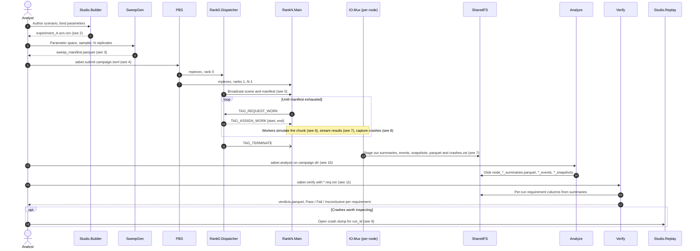

---

## 2. Scenario authoring and export

The Builder edits an ordinary Bevy `World` that holds `Reflect` components. It never steps physics during authoring; a preview run hands off to `Studio.LocalRun`. Export writes a `DynamicScene` as `.scn.ron` plus a sidecar parameter schema **(proposed)** so `SweepGen` knows which `param_key`s exist.

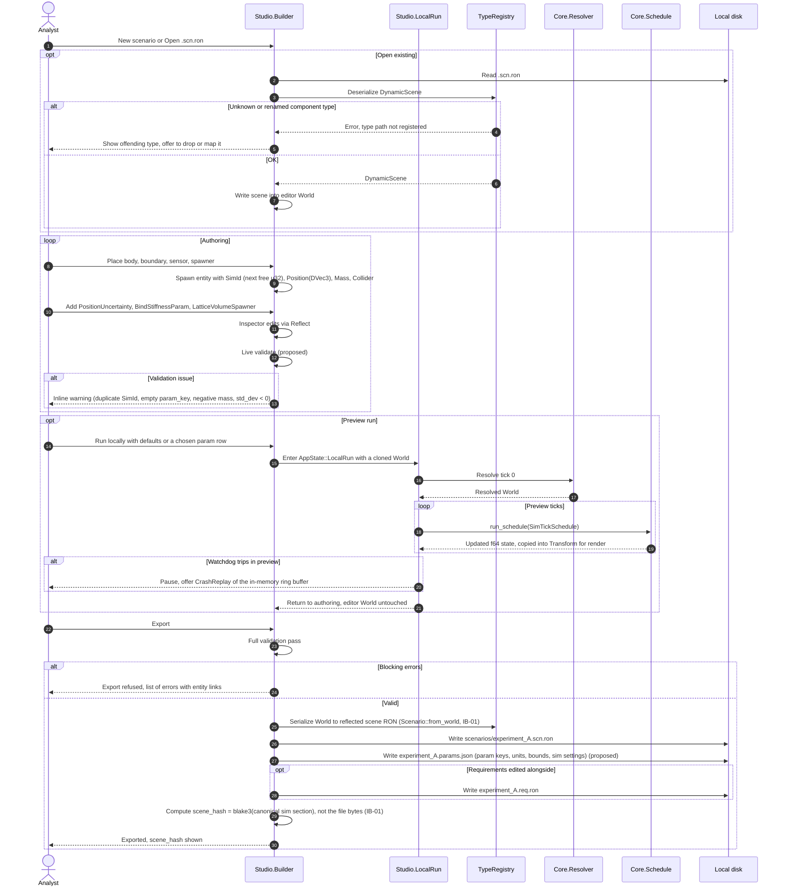

### 2.1 Importing a 3D model (glTF, GLB, or OBJ as a stretch goal)

Models enter a workspace only through `Assets.Importer`, which validates, packs and hashes them (subsystems §5.10, IB-20; UX §7.11.3). The same importer runs headless as `saber-cli model import|convert`, which skips the preview and thumbnail.

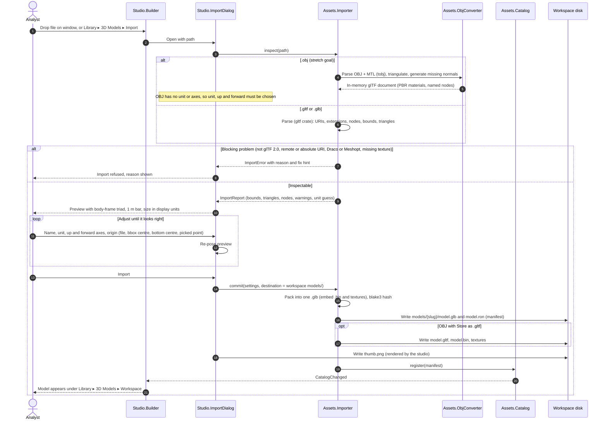

### 2.2 Linking a model to an entity and deriving collision

Linking writes only to the scenario's `visual:` section. Deriving collision is a separate, explicit step that writes a `CollisionShape` into the sim section and therefore changes `scene_hash` (IB-19, IB-20).

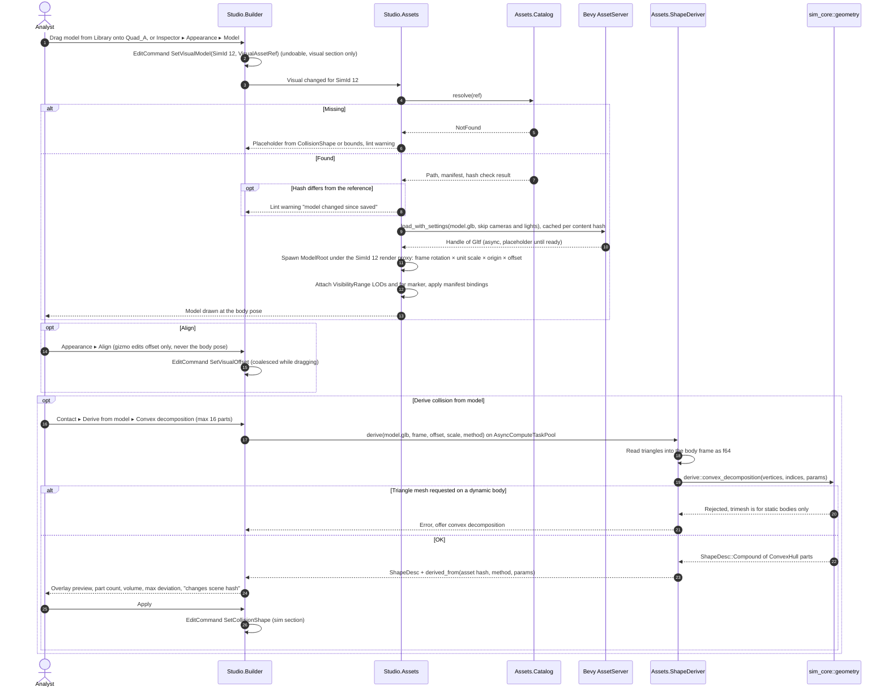

### 2.3 Models at export, on the cluster and in replay

Model files never reach the cluster job. Only shapes derived from them do, as plain data in the scenario and its geometry sidecars.

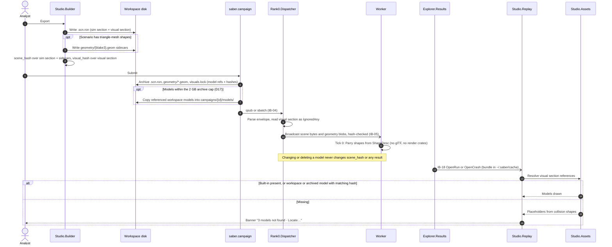

---

## 3. Sweep generation

`SweepGen` reads the parameter schema from export, samples the space, and writes the manifest. Replicates are expanded here so every row in the manifest is exactly one run.

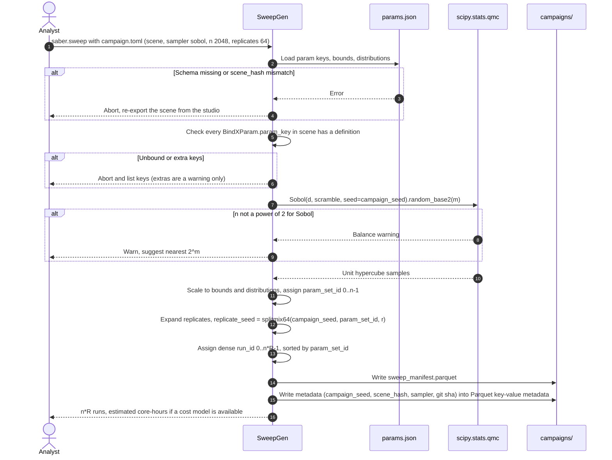

Dense, contiguous `run_id`s matter: section 5 hands out `[start, end)` ranges, which only works if every id in a range is a real row.

---

## 4. Campaign submission and job startup

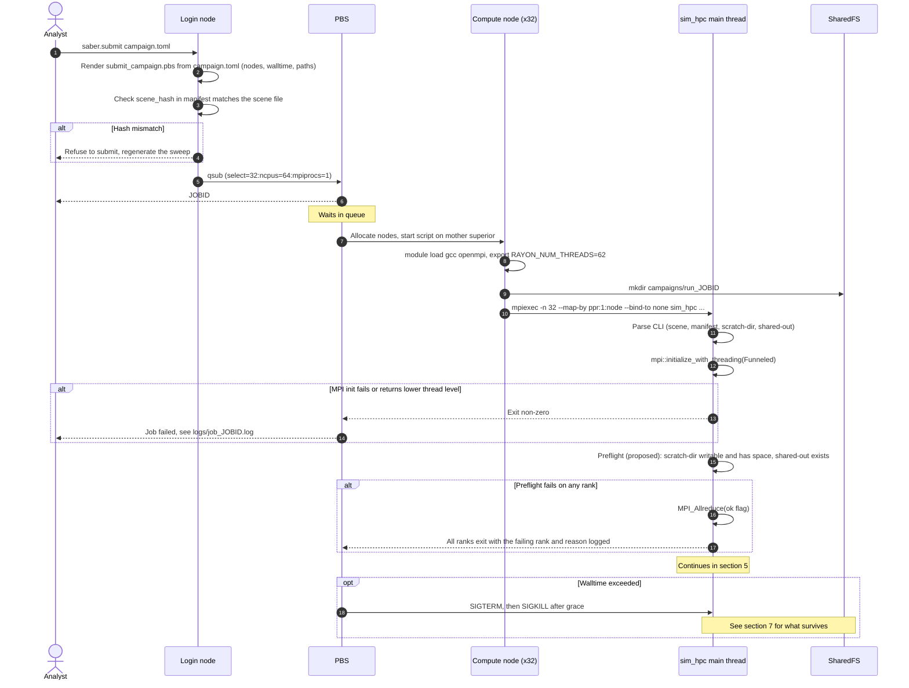

The preflight `Allreduce` keeps one rank with a full `$TMPDIR` from silently stalling the whole job later.

---

## 5. MPI broadcast and dynamic chunking

Rank 0 reads the scene and manifest once and broadcasts the bytes. The draft broadcasts only the scene; this flow also broadcasts the manifest so no node reads Lustre for it (decided 2026-10-30). Every node is guaranteed to use identical manifest bytes, checked by hash. Rank 0 serves chunks from its main thread and also runs a local Rayon pool, so it is a worker node as well as the dispatcher.

Under `Threading::Funneled` only each rank's main thread touches MPI. The Rayon pool reports chunk completion back to its main thread over a local channel.

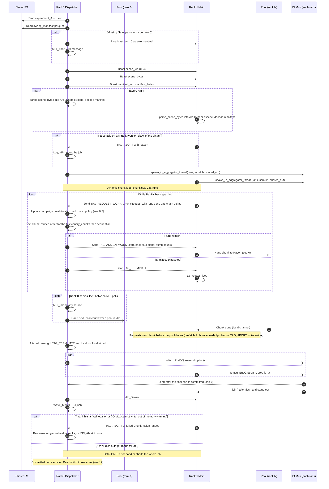

---

## 6. Per-worker tick-0 resolution and tick loop

What one `Worker` does for one run inside a chunk. Each Rayon thread keeps a thread-local `World` and resets it between runs so the `FlightRecorder` and telemetry buffers are reused.

```mermaid
sequenceDiagram
    autonumber
    participant Pool
    participant Worker
    participant Scene as Arc DynamicScene
    participant Resolver as Core.Resolver
    participant Schedule as Core.Schedule
    participant Telemetry as Core.Telemetry
    participant CVerify as Core.Verify
    participant Recorder as Core.Recorder
    participant Watchdog as Core.Watchdog
    participant IO as IO.Mux

    Pool->>Worker: for_each_init, run_id in [start, end)
    Worker->>Worker: Look up manifest row: param_set_id, replicate_seed, params
    Worker->>Worker: Reset World (despawn entities, keep resources and buffer capacity)
    Worker->>Scene: write_to_world(World, entity_map)
    Scene-->>Worker: Entities with SimId and parametric markers
    Worker->>Worker: Insert SimRng(ChaCha8 from hash(param_set_id, replicate_seed)), FixedDeltaTime, params, SimStatus::Running

    critical Tick 0 resolution
        Worker->>Resolver: Run once
        Resolver->>Resolver: BindXParam: look up param_key, write value
        Resolver->>Resolver: LatticeVolumeSpawner: spawn_batch in deterministic order
        Resolver->>Resolver: PositionUncertainty: draw Gaussian from SimRng, in SimId order
        Resolver->>Resolver: Build Parry shapes and terrain BVH, size contact buffers, check compliant contact stability (IB-19)
        Resolver->>Resolver: Remove resolved marker components
    option Missing param_key in row
        Resolver-->>Worker: Error
        Worker-)IO: RunResult status = SetupError, no ticks
    option Compliant contact unstable at this dt (omega*dt above 2.0)
        Resolver-->>Worker: Error
        Worker-)IO: RunResult status = SetupError, no ticks
    option Spawn exceeds expected_entities
        Resolver-->>Worker: Warn, FlightRecorder grows once (only allocation outside tick 0 budget)
    end

    Worker->>Recorder: Ensure capacity K and expected_entities
    Worker->>Telemetry: Reset RunningStats, event buffer, sampler
    Worker->>CVerify: Reset per-run requirement accumulators from *.req.ron

    loop tick = 1 .. max_ticks
        Worker->>Schedule: run_schedule(SimTickSchedule) inside catch_unwind
        Schedule->>Schedule: Environment, Sensors, Control, Actuation
        Schedule->>Schedule: Forces, Integrate (selected integrator, fixed or adaptive substeps to t+dt, contact, see 6.1), Constraints
        Schedule->>Telemetry: Telemetry set (Welford update, SimEvent push)
        Telemetry->>Telemetry: Tier 3 sampler, decimate or ramp up on high gradient
        Schedule->>CVerify: Verify set (update metrics, e.g. min miss distance, max load)
        Schedule->>Recorder: Record set (overwrite slot, advance cursor)
        Schedule->>Watchdog: Watchdog set
        alt Non-finite pos or vel, or energy above E_max
            Watchdog->>Recorder: Set FLAG_NAN_ORIGIN on offending body
            Watchdog->>Worker: SimStatus = CrashedNaN or CrashedEnergy
            Note over Worker: Break to crash capture (see 8)
        else Stop condition met (target hit, settle, ground contact, or a hard requirement violated)
            Watchdog->>Worker: SimStatus = Terminated(condition)
        end
        opt Event buffer reaches batch size
            Telemetry-)IO: IoMsg::RunResult partial (events and snapshots only, bounded channel)
        end
        break SimStatus is not Running
            Worker->>Worker: Exit loop
        end
    end

    alt Reached max_ticks still Running
        Worker->>Worker: SimStatus = at_max_ticks (Completed by default, or Timeout; D19)
    end
    Worker->>Telemetry: Finalize RunningStats into summary row (status, total_ticks, wall_time_ms)
    Worker->>CVerify: Finalize per-requirement metric and pass/fail columns into summary row
    Worker-)IO: IoMsg::RunResult (summary row + remaining event and snapshot batches)
    Worker-->>Pool: Next run_id
```

Determinism notes on this flow:

* Every draw from `SimRng` happens in `SimId` order, never in archetype iteration order, because archetype order can change with spawn history.
* The World reset must not leave stale resources from the previous run. A debug build should hash the reset World and compare against a freshly built one.
* `wall_time_ms` is the only nondeterministic column. It is kept out of any determinism hash.

### 6.1 Contact within a tick

**(D13, 2026-11-01)** SABER uses its own physics kernel with Parry for collision detection. Contacts do not always end a run, so the kernel resolves them itself with three contact models: `Compliant` (spring–damper with friction, evaluated in every RK4 stage), `Impulsive` (restitution and friction at an event-located time of impact) and `EventOnly` (detect and record). The full design is in `physics-engine-tradeoffs.md` §9; the interface is IB-19 in `subsystems-and-interfaces.md`.

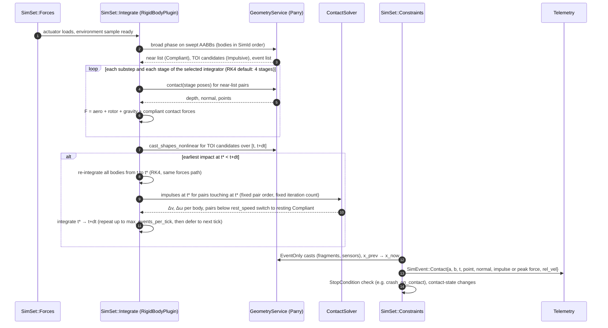

* Impulsive events re-integrate every body to the time of impact, so all bodies share one clock. At most `max_events_per_tick` events are located per tick; the rest are resolved at the end of the tick and logged as `ContactDeferred`.
* Pairs are visited in `(min SimId, max SimId)` order and impulse sweeps use a fixed iteration count, so contact results are bit-identical within a build.
* With an adaptive integrator (D14) the substeps inside the tick are chosen by error control and the last one is clipped to land on t+dt; event location uses the method's dense output. The tick grid never changes.
* A contact can end the run only through a declared stop condition (`crash_on_contact`, `ground_impact`); otherwise the run continues.

---

## 7. Telemetry to the I/O thread and rolling Parquet parts

`IO.Mux` is the only thread on the node that writes campaign data. It drains a bounded channel, so a slow disk throttles workers instead of growing RAM.

Output is written as a series of **parts** rather than one file per node. Every `checkpoint_interval_s` (default 600 s), `IO.Mux` closes the current part, hands it to a helper thread (`IO.Stager`) that copies it to `SharedFS`, and opens the next part on NVMe. Closing a part costs one Parquet footer write per file, and the copy runs in the background, so workers never wait on Lustre. A walltime kill or node failure then loses at most one interval of work per node instead of the whole job. Section 12 shows how `--resume` uses the committed parts.

Part file names are `node_{rank}_a{attempt}_p{part}_{summaries|events|snapshots}.parquet` and `..._crashes.zst`. The existing `*_summaries.parquet` globs still match. A 4-hour, 32-node job at the default interval makes about 24 parts per node, roughly 3,000 files, which stays far below the per-run file counts that hurt Lustre metadata servers. `saber.compact` can merge them into one file per node after the campaign if wanted **(proposed)**.

**Commit rule:** a part is committed when its summaries file appears under its final name on `SharedFS`. The stager copies events, snapshots and crashes first and renames the summaries file last, so a reader that sees a summaries part can trust the rest of that part is there. Each summaries footer carries the part's completed `run_id` ranges and its crash counts per `param_set_id` in Parquet key-value metadata.

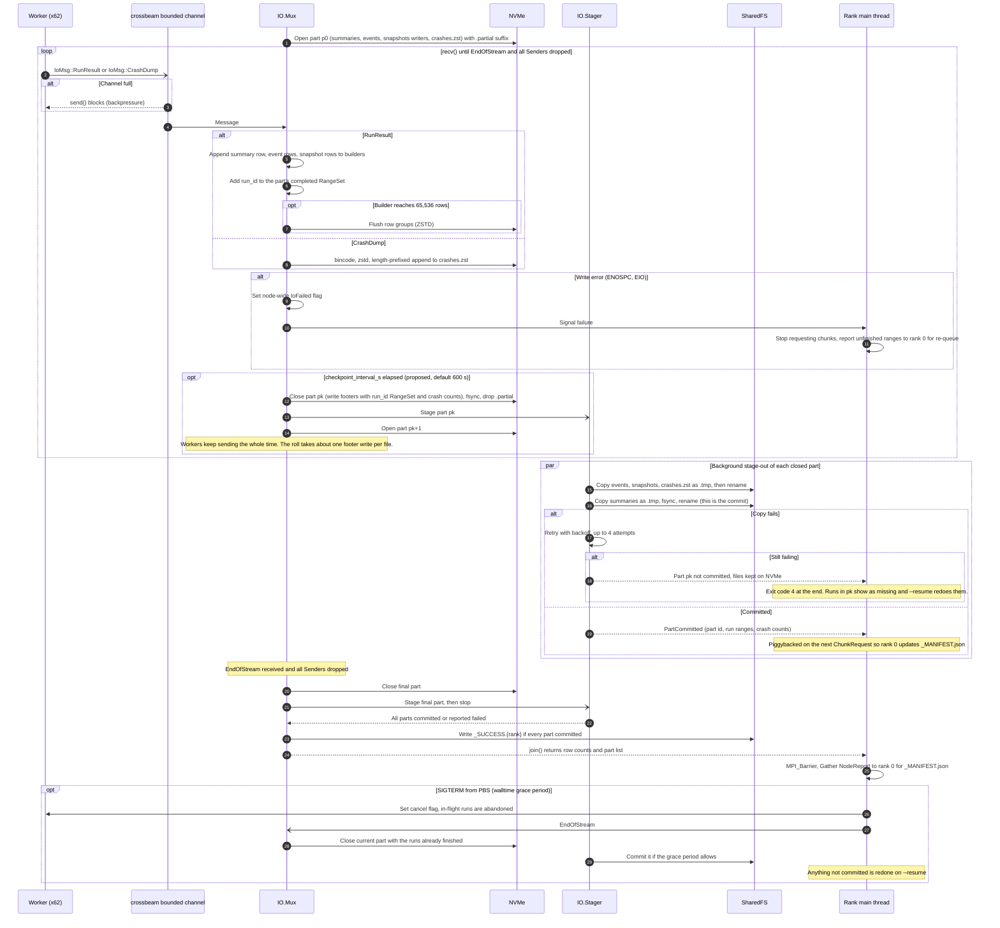

Because every part is renamed into place, a reader on `SharedFS` never sees a half-written file under its final name, and `Analyze` ignores `.tmp` and `.partial` files.

As built (step 3b, `sim_hpc --local`): this flow without the MPI main thread. A part opens with its first run and closes on the interval even while idle; the details are in subsystems IB-06 and IB-07. The SIGTERM path arrives with step 4b.

---


## 8. Crash capture, campaign-wide quota and crash-storm abort

Crash handling has three parts:

1. **Capture** (8.1). A worker turns a watchdog trip or a panic into a crash record, and keeps the ring buffer only if the quota allows.
2. **Campaign-wide quota** (8.1 and 8.2). Crash dumps are capped at `M` per `param_set_id` across the **whole campaign**, not per node. Rank 0 owns the true counts.
3. **Crash-storm abort** (8.2). If crashes across the campaign pass a threshold, rank 0 stops the study, keeps the evidence, and exits early so a malformed scenario doesn't burn the allocation.

The policy lives in `campaign.toml` **(proposed, replaces `execution.crash_dump_quota`)**:

```toml
[crash_policy]
dump_quota_per_param_set = 3     # M, counted campaign-wide
abort_crash_fraction     = 0.25  # abort if more than 25% of finished runs crashed...
abort_min_runs           = 2000  # ...once at least this many runs have finished
abort_max_setup_errors   = 10    # SetupError means a broken scenario or manifest, so trip early
canary_chunks            = 64    # first chunks are spread across the whole manifest
```

The abort trigger is campaign-wide on purpose. One unstable region of parameter space crashing every time is a result worth reporting, not a reason to scrap the study. A malformed scenario shows up differently: crashes or setup errors everywhere, early. Two things make the early signal trustworthy:

* **Canary dispatch.** The manifest is sorted by `param_set_id`, so dispatching chunks in order would sample only one corner of the space at first. Rank 0 instead hands out the first `canary_chunks` chunks in a strided (bit-reversed) order across the whole manifest, then continues sequentially with whatever is left. The first few thousand runs then cover the whole space.
* **Separate `SetupError` limit.** A run that fails tick-0 resolution (missing `param_key`, bad binding) is a configuration problem, not physics, so it gets its own low limit.

### 8.1 Capture on the worker

Workers can't ask rank 0 before keeping a dump, because only the main thread talks MPI and a round trip per crash would stall the pool. Instead each node's `Quota` holds a **view** of the campaign counts: the global counts rank 0 sent with the last `ChunkAssign`, plus the dumps this node kept since then. A worker keeps a dump while that view is below `M`. Several nodes can crash on the same parameter set within one chunk interval, so the campaign can overshoot `M` by a few dumps. That's harmless, and replay and analysis show the `M` lowest-seed dumps so the selection is stable across reruns (subsystems G6).

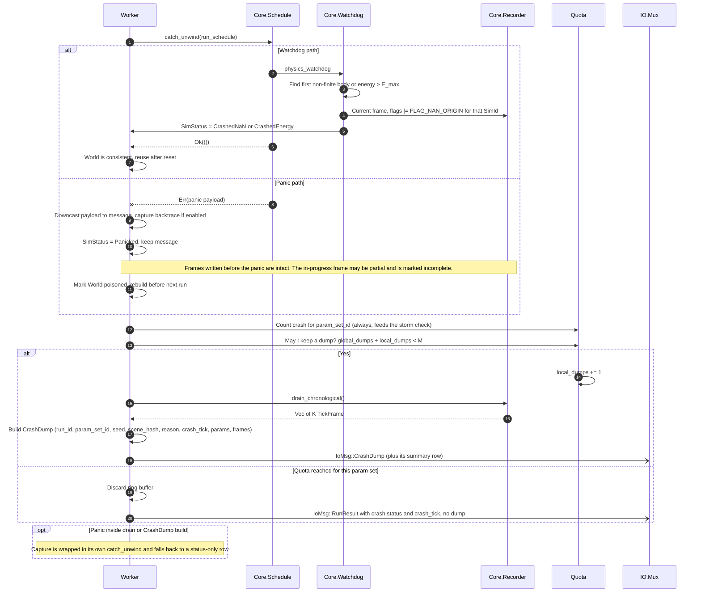

As built (step 3b): one message per run carries the summary row and the optional dump, so a dump never travels without its row. A panic drops the World and the next run on that thread builds a new one; frames are read from the recorder after the panic, so the dump holds every frame committed before it (the in-progress frame is never committed, so none is partial).

### 8.2 Campaign crash policy on rank 0

Crash counts travel to rank 0 on the `ChunkRequest` every rank already sends (`crashes` field in IB-05, extended to a per-`param_set_id` delta). Global dump counts and closed parameter sets come back on `ChunkAssign`. No extra MPI messages are needed in the normal case.

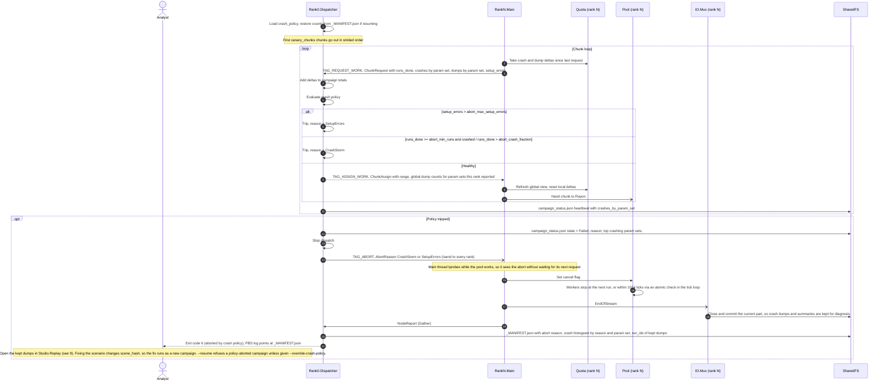

Exit code 6 is new, next to the subsystems doc's codes (0 ok, 2 config, 3 build mismatch, 4 I/O, 5 partial, 70 internal). `TAG_ABORT` previously covered only preflight and build mismatch. It now also carries `AbortReason::CrashStorm` and `AbortReason::SetupErrors`.

---


## 9. Crash replay in the studio

Replay never re-integrates physics by default. It rebuilds the scene so meshes and colliders exist (3D models resolve locally as in section 2.3, with placeholders for missing ones), then drives `Transform` straight from recorded frames. An optional **re-simulate** mode reruns from tick 0 with the same seed to confirm the crash reproduces **(proposed)**, which doubles as a determinism check.

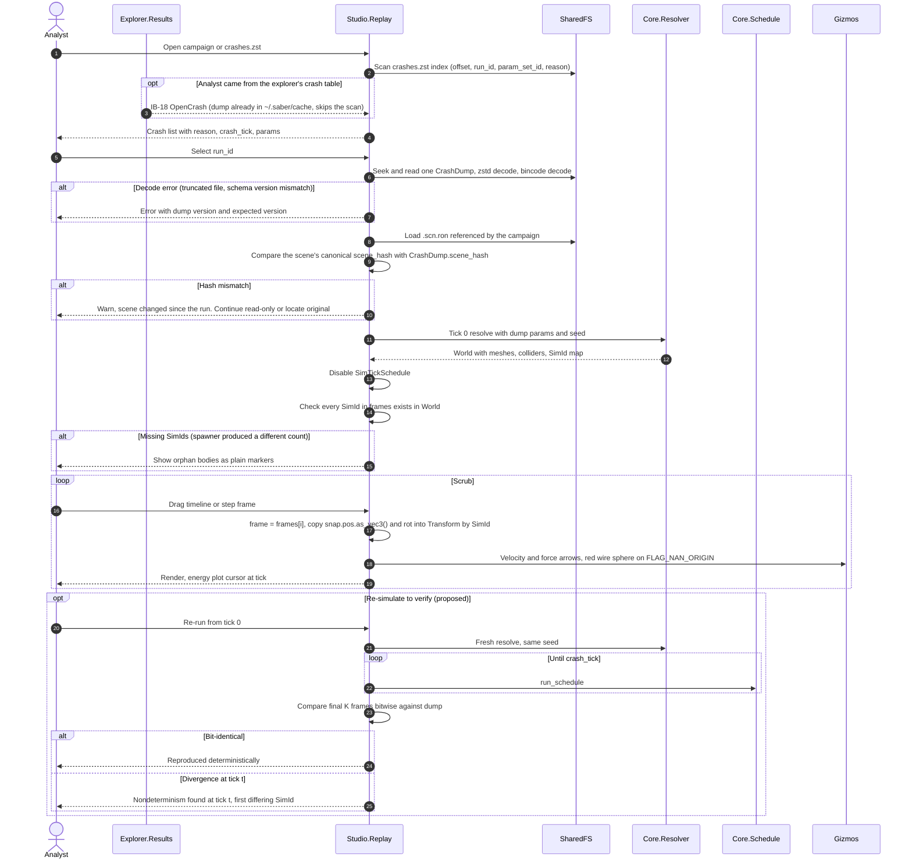

Precision note: rendering uses `as_vec3()` (f32). Large world coordinates lose precision, so the studio should render relative to a floating origin near the camera rather than the world origin. The studio's `RenderBridge` re-anchors that origin on the camera focus target, and the ground grid gets per-decade phases computed in f64 (`sim_studio_ux.md` §7.10).

---

## 10. Post-processing

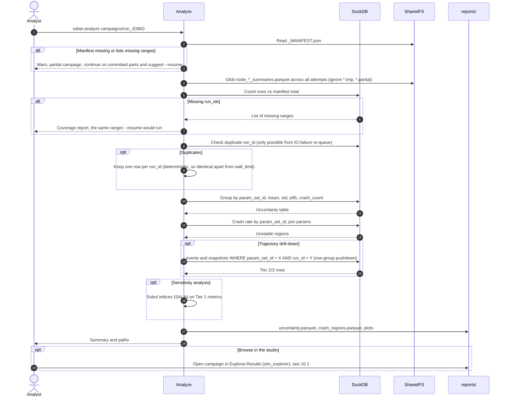

### 10.1 Exploring a campaign in the explorer

Decided 2026-10-31 (subsystems D10), moved to a separate app 2026-11-01 (D12): `sim_explorer` queries campaign Parquet with DataFusion through `sim_query`. For a campaign on the cluster the query runs in `Query.Service` on a compute node, and only Arrow result batches cross the SSH tunnel (IB-17). For a campaign on the workstation the same engine runs embedded in the explorer and the service steps are skipped. Python (above) is unaffected.

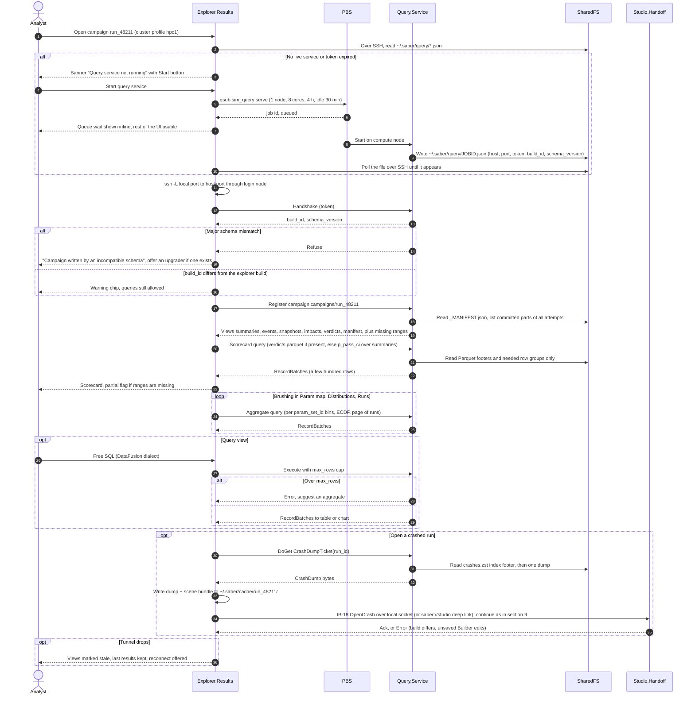

---

## 11. Requirements verification

The draft stops at analysis. Verification answers "does the system meet its requirements", which is the stated goal of SABER. It runs in two stages, matching the `sim_verify` crate in the subsystems document:

1. **Online, per run** in each `Worker`: the `Verify` SystemSet evaluates every requirement in `*.req.ron` against that run and writes metric and pass/fail columns into the summary row (section 6). This is cheap and needs no trajectory storage.
2. **Offline, per campaign** in `saber.verify`: turns per-run results into a statistical verdict per requirement and writes `verdicts.parquet`.

A requirement is a metric, a comparison, a threshold, and a statistical claim, for example "P(miss_distance < 2 m) >= 0.95 at 90% confidence over the operating envelope".

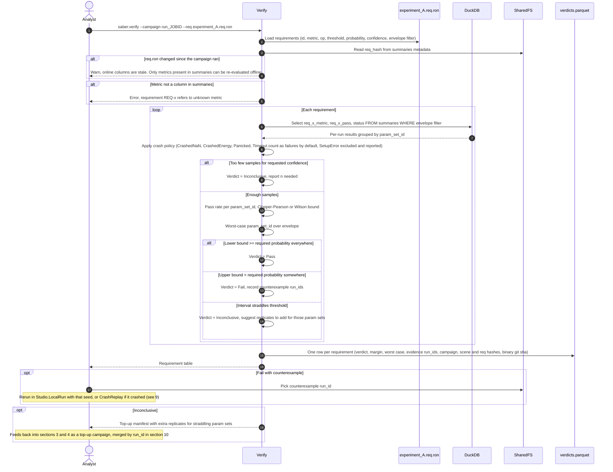

Every verdict carries the campaign, scene and requirements hashes and the binary git sha, so a verdict traces back to exactly what was simulated and checked.

---

## 12. Checkpointing and resume

Resume builds on the rolling parts from section 7. Nothing is checkpointed inside a run, because runs are short relative to a job and deterministic: a run that didn't finish is simply run again from tick 0 and gives the same answer.

Three pieces make it work:

* **Committed parts are the source of truth.** A run counts as done if and only if its `run_id` is in a committed summaries part on `SharedFS`. Each summaries footer lists its `run_id` ranges, so resume reads footers only, never row data.
* **`_MANIFEST.json` is the fast index.** Rank 0 rewrites it atomically as `PartCommitted` reports arrive, and at the end of the job. If it is missing or stale (for example after a node failure aborted MPI), resume rebuilds it from the footers.
* **Attempts never overwrite.** Each submission gets a new `attempt` number, which goes into every part file name. A resumed job can land on different nodes with different rank numbers, and no file from an earlier attempt is ever touched.

Two additions keep jobs from being cut off mid-flight:

* **Drain before walltime.** Rank 0 stops handing out chunks when the remaining walltime drops below `drain_margin_s` (default 5% of walltime). Ranks finish their chunks, the final parts commit cleanly, and the job exits 5 (partial) with an exact resume point. A SIGTERM from PBS still works as the fallback (section 7).
* **Auto-resubmit (optional).** With `auto_resume = N` in `campaign.toml`, `saber.submit` queues the next attempt with `qsub -W depend=afterany:JOBID`, up to N times. It stops early if the previous attempt made no progress or ended in code 2, 3 or 6.

```toml
[checkpoint]
checkpoint_interval_s = 600
drain_margin_s        = 720    # 5% of a 4 h walltime
auto_resume           = 3
```

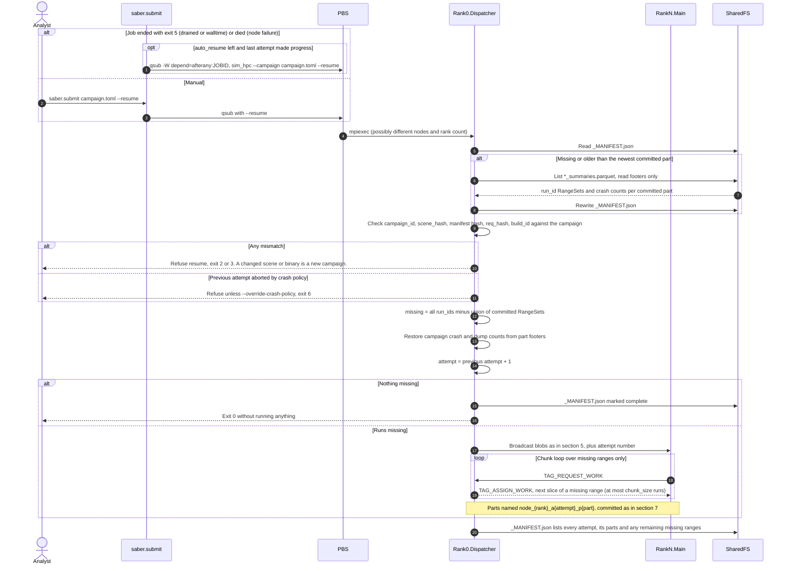

Cost of all this: one Parquet footer per file every ten minutes per node, and a background copy that would have happened at the end anyway. Lost work after a failure is bounded by `checkpoint_interval_s` plus the stage-out time of the last part. Runs from an uncommitted part are redone, never duplicated, because only committed parts count.

---


## 13. Gaps and open questions

These surfaced while drawing the flows. Rows marked "aligned" are already settled with the subsystems design; the rest are decisions for Alex.

| # | Gap | Where it shows | Suggested direction |
| :-- | :-- | :-- | :-- |
| 1 | No stop or abort signal | Section 5 | Aligned: `TAG_TERMINATE` and `TAG_ABORT` |
| 2 | Manifest is not broadcast | Section 5 | Decided: rank 0 broadcasts the manifest bytes with the scene, so no rank reads Lustre for it |
| 3 | No resume after node failure or walltime | Sections 7, 12 | Decided: rolling parts committed every `checkpoint_interval_s`, `--resume` from committed footers, drain before walltime, optional auto-resubmit |
| 4 | `$TMPDIR` data lost if stage-out fails | Section 7 | Mostly solved by rolling parts: only the uncommitted tail is at risk, and resume redoes it |
| 5 | World reuse after panic | Section 8 | Treat the World as poisoned and rebuild it |
| 6 | Crash quota is per node | Section 8 | Decided: campaign-wide counts owned by rank 0 and synced on chunk requests, plus a crash-storm abort (exit 6) |
| 7 | Replay depends on the exact scene file | Section 9 | Store `scene_hash` (and optionally the scene bytes) in every CrashDump and in Parquet metadata |
| 8 | No timeout or setup-error status | Section 6 | Aligned: `Timeout` and `SetupError` status codes |
| 9 | No requirements component | Section 11 | Aligned: `*.req.ron`, online `Verify` SystemSet, offline `saber.verify` writing `verdicts.parquet` |
| 10 | Parameter schema between studio and sweep | Sections 2, 3 | Export a `params.json` sidecar (or fold it into `campaign.toml`) so `SweepGen` can validate keys and bounds |
| 11 | Rank 0 does dispatch and compute on one MPI thread | Section 5 | Poll with `MPI_Iprobe` between local chunk handoffs, or reserve one core on rank 0 for dispatch only |
| 12 | IO failure on one node stalls its chunks | Sections 5, 7 | Report failed ranges to rank 0 for re-queue, which requires duplicate-tolerant analysis (section 10) |
| 13 | Requirements edited after a campaign | Section 11 | Record `req_hash` in summaries; offline re-evaluation only for metrics that were logged |
| 14 | Studio browsing of cluster-only data | Section 10.1 | Decided (2026-10-31): `sim_query serve` runs DataFusion next to the data and streams results over the SSH tunnel; `sim_explorer` embeds the same engine for local campaigns (D12) |
| 15 | Contacts that do not end a run | Section 6.1 | Decided (D13, 2026-11-01): own kernel with Parry detection; compliant, impulsive and event-only contact models (IB-19) |
| 16 | Render data and simulation data in one scene file | Sections 2.2, 2.3 | Decided (D17, 2026-11-02): models live in the `visual:` section with their own `visual_hash`; `sim_hpc` skips the section and `scene_hash` excludes it |
| 17 | Collision from render meshes | Section 2.2 | Decided (D17): never automatic; **Derive collision from model** bakes a `ShapeDesc` at authoring time, with `derived_from` for staleness checks |
| 18 | Model files when replaying on another workstation | Section 2.3 | Decided (D17): campaigns archive the workspace and library models they use, up to 2 GB; above the cap or outside a campaign, placeholders and Locate… |
