# SABER `sim_studio`: UX and UI Design

**Status:** Draft v0.12 (2026-11-04: a bundled symbol font behind Fira as built in step S3-3, so the studio's symbols draw (§10.2, §7.10.4). v0.11, 2026-11-04: the Preview Run's 3D viewport as built in step S3-2: camera focus, State HUD, ground grid and labels (§7.10), and the Preview's controls named in words (§7.5). v0.10, 2026-11-04: the Preview Run as built in step S3-1, without its viewport (§7.5). v0.9, 2026-11-03: the Requirements tab as built in step S2-3 (§7.4). v0.8, 2026-11-03: the bind menu, the Parameters list and adding or removing components as built in step S2-2 (§7.2, §7.3). v0.7, 2026-11-03: the Scenario Builder's document, Outliner, Inspector and Lint as built in step S2-1 (§7.2). v0.6, 2026-11-03: as built through step S1, the studio's frame: states, kit, shell, Launcher, workspaces and starter packs (§6.3). v0.5, 2026-11-02: entities can show 3D models from a built-in library, the workspace or a team library; glTF/GLB import, linking to entities, alignment, collision derived on request, OBJ conversion as a stretch goal (§7.11, subsystems D17, IB-20). v0.4, 2026-11-01: campaign monitoring, results and queries move to a separate egui window, `sim_explorer`, linked to the studio by explicit handoffs (§6.2, subsystems D12, IB-18). v0.3, 2026-10-31: UI toolkit is Bevy Feathers instead of `bevy_egui` (§6.1, subsystems D11); new viewport tools: camera focus dropdown, state HUD, graph-paper ground grid (§7.10). v0.2: Results Explorer queries through `sim_query` / DataFusion, subsystems D10) · **Builds on:** `Architecture.md` (§2, §4, §6.4) · **Companion docs:** [subsystems-and-interfaces.md](subsystems-and-interfaces.md) (crate and file names follow it), [sequence-diagrams.md](sequence-diagrams.md)

> Scope: everything a person sees and touches in `sim_studio`, the Bevy desktop binary, with its UI built on Bevy UI and Bevy Feathers through the `sim_studio_ui` widget kit (§6.1). Campaign monitoring, results and queries live in a separate window, `sim_explorer`, built with egui (§6.2). `Architecture.md` still says `bevy_egui` for the studio; this document supersedes that. `sim_hpc` and the Python scripts have no UI of their own; the studio drives them and reads their output. Names that already exist in `Architecture.md` are used verbatim. Names this document introduces are marked **(new)** and collected in §12 so the sibling design docs can adopt or rename them in one place.

---

## Contents

1. Design goals and principles
2. Personas
3. Key user journeys
4. Core concepts the UI exposes
5. Information architecture and navigation
6. Shell layout and global UI
   - 6.1 UI toolkit: Bevy Feathers (maturity, gaps, widget kit, risks)
   - 6.2 Two applications: `sim_studio` and `sim_explorer` (handoff, IB-18)
   - 6.3 As built (step S1)
7. Workspaces (screen by screen)
   - 7.1 Launcher
   - 7.2 Scenario Builder (system / digital-twin model)
   - 7.3 Parameters and Uncertainty
   - 7.4 Requirements
   - 7.5 Preview Run
   - 7.6 Campaign Setup
   - 7.7 Campaign Monitor (`sim_explorer`)
   - 7.8 Results Explorer (`sim_explorer`)
   - 7.9 Run Replay and Crash Replay
   - 7.10 3D viewport tools: camera focus, state HUD, ground grid
   - 7.11 3D models: library, import and linking to entities
8. Domain packs: aero-ballistics, robotics, drones
9. Interaction details (selection, undo, units, validation, keyboard)
10. Visual design system
11. Accessibility, performance and robustness
12. New names and interface asks for sibling docs
13. Open questions

---

## 1. Design goals and principles

| # | Principle | What it means in the UI |
|---|-----------|-------------------------|
| P1 | **The question is "does it meet requirements?"** | Requirements are first-class objects, not an afterthought in a Python notebook. Every results view leads with a pass/fail scorecard and a probability with a confidence interval. |
| P2 | **One run you can see, a million you can't** | The studio always lets you drop from the aggregate (500k runs) to a single `(param_set_id, replicate_seed)` and watch it in 3D. Determinism (`Architecture.md` §3) is what makes this cheap: any run can be re-simulated locally, bit-identical. |
| P3 | **Author once, run anywhere** | The same `.scn.ron` runs in Preview (in-process `sim_core`), local `sim_hpc` (size == 1), and the cluster. The UI never offers a setting that would break that equivalence (for example, no wall-clock timestep). |
| P4 | **Make cost visible before it's spent** | Campaign Setup shows estimated core-hours, output size and file count before submitting, using the measured wall time from Preview. |
| P5 | **Fail loudly, fail early** | Lint the scenario continuously (unbound `param_key`, missing `SimId`, timestep vs. stiffness). Block export only on errors; warnings stay visible. |
| P6 | **Show the script** | Anything the studio does through the `saber` Python package (`sweep`, `submit`, `analyze`, `report`; successor to the draft's `generate_sweep.py`, `submit_campaign.pbs`, `analyze_results.py`) can be revealed as the exact command / generated file, so power users can take it to a terminal and reproducible pipelines. |
| P7 | **Engineering-tool density, not game-engine chrome** | Dense dock panels, numeric precision on display, units everywhere, keyboard-first. Dark theme by default, light theme for reports and projectors. |

---

## 2. Personas

| Persona | Role and context | Primary goals | Pain points today | Most-used workspaces |
|---------|------------------|---------------|-------------------|----------------------|
| **Maya, Systems / Requirements Engineer** | Owns the requirement baseline for a guided munition or drone program. Not a coder. | Answer "what's P(meet requirement) and where does it fail?" Produce evidence for design reviews. | Results arrive as CSVs and plots she can't interrogate; can't tell which inputs drive failures. | Requirements, Results Explorer, Replay |
| **Raj, Simulation / Modeling Engineer** | Builds the digital twin: geometry, mass properties, aero tables, controllers. Comfortable in Rust/Python. | Fast iteration on the model, confidence it's numerically sound, easy uncertainty tagging. | Edit-run-inspect loop is slow; NaN crashes on the cluster are opaque. | Scenario Builder, Parameters, Preview, Crash Replay |
| **Lena, Analyst / UQ Specialist** | Designs sampling studies, runs sensitivity analysis, writes reports. Lives in Python/DuckDB. | Correct experimental design, Sobol indices, surrogate fits; export to notebooks. | Re-creating manifests by hand; mismatch between manifest columns and scene bindings. | Parameters, Campaign Setup, Results Explorer |
| **Sam, HPC Operator / Power User** | Runs campaigns on the PBS cluster, watches allocation burn. | Submit correctly sized jobs, see progress and crash storms early, cancel bad jobs. | No visibility into a running job other than log tailing. | Campaign Setup, Campaign Monitor |

Secondary: **Program reviewer** (read-only consumer of an exported Evidence Report; does not run the studio).

---

## 3. Key user journeys

### 3.1 Journey map: from model to verdict (Raj + Maya + Lena)

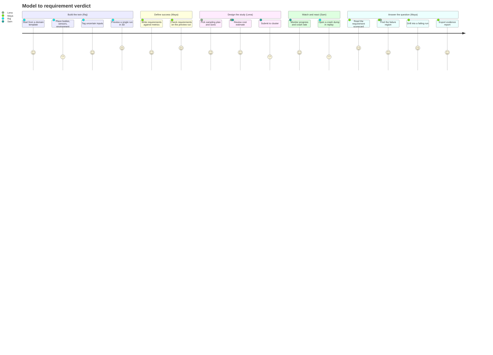

### 3.2 Journey list (each one is traced to screens later)

| ID | Journey | Persona | Start → End | Screens |
|----|---------|---------|-------------|---------|
| J1 | Build a new digital twin from a template | Raj | Launcher → Builder → Preview | 7.1, 7.2, 7.5 |
| J2 | Tag uncertainties and bind sweep parameters | Raj, Lena | Builder inspector → Parameters | 7.2, 7.3 |
| J3 | Author requirements and check them on one run | Maya | Requirements → Preview | 7.4, 7.5 |
| J4 | Configure, estimate and submit a campaign | Lena, Sam | Campaign Setup → Monitor | 7.6, 7.7 |
| J5 | React to a crash storm mid-campaign | Sam, Raj | Monitor → Crash Replay → Builder fix → resubmit | 7.7, 7.9, 7.2 |
| J6 | Get the verdict and find the failure region | Maya, Lena | Results Explorer scorecard → parameter map → run | 7.8 |
| J7 | Drill into one failing (non-crashed) run | Maya | Results → Re-simulate → Run Replay | 7.8, 7.9 |
| J8 | Forensics on a crashed run with no dump (quota exceeded) | Raj | Results → Re-simulate with recorder → Crash Replay | 7.8, 7.9 |
| J9 | Compare two campaigns (design A vs B) | Lena, Maya | Results Explorer compare mode | 7.8 |
| J10 | Hand off to Python | Lena | Any view → "Copy as DuckDB / Polars" | 7.8 |

### 3.3 Journey flow: J6 → J7 → J8 (the drill-down spine)

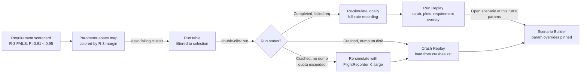

---

## 4. Core concepts the UI exposes

The UI vocabulary maps one-to-one onto the architecture so a user can move between the GUI, the files and the Python scripts without translation.

| UI term | Backing artifact / type | Notes |
|---------|-------------------------|-------|
| **Workspace** | Repo-like folder (`scenarios/`, `campaigns/`, `scripts/`) as in `Architecture.md` §2 | Opened in the Launcher. Studio state lives in `saber.workspace.ron` **(new)**. |
| **Scenario** | `scenarios/<name>.scn.ron` (`DynamicScene`) | The system model / digital twin plus its environment. |
| **Entity** | ECS entity with `SimId(u32)` | `SimId` is shown everywhere an entity is named so it matches the Parquet `sim_id` / `other_sim_id` columns. |
| **Parameter** | A `param_key` string referenced by `Bind*Param` components and spawner `*_param_key` fields | Has a name, unit, nominal value, range or distribution. |
| **Uncertainty** | Stochastic components (`PositionUncertainty`, jitter fields) resolved from `SimRng` at Tick 0 | Per-replicate randomness, distinct from swept parameters. |
| **Requirement** | `requirements/<name>.req.ron` (`sim_verify`) | Predicate over a metric + a probability target. |
| **Metric** | A Tier 1 `RunningStats` field, a Tier 2 `SimEvent` aggregate, or a derived expression (defined in `sim_verify`) | Requirements are written against metrics; metrics determine which reductions the kernel must compute. |
| **Study plan** | `campaigns/<id>/campaign.toml` + `sweep_manifest.parquet` | Sampling method, N parameter sets × R replicates, seeds. |
| **Campaign** | `campaigns/run_<jobid>/` with `node_{rank}_summaries.parquet`, `node_{rank}_events.parquet`, `node_{rank}_crashes.zst` | One execution of a study plan. |
| **Run** | One `(run_id, param_set_id, replicate_seed)` row | The atom the user drills into. |
| **Crash dump** | `CrashDump` in `node_{rank}_crashes.zst` | Contains `FlightRecorder::drain_chronological()` frames. |

---

## 5. Information architecture and navigation

### 5.1 Workspace hierarchy

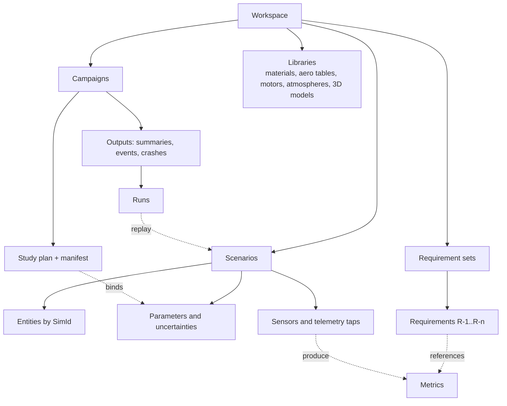

### 5.2 `AppState` (top-level modes)

`Architecture.md` defines `AppState::ScenarioBuilder` and `AppState::CrashReplay`. The studio needs more modes; they are proposed as variants of the same enum so Bevy run conditions (`in_state(...)`) gate systems exactly as in the draft.

```rust
// crates/sim_studio/src/state.rs  (as built, step S1; see §6.3)
#[derive(States, Clone, Copy, Debug, PartialEq, Eq, Hash, Default)]
pub enum AppState {
    #[default]
    Launcher,          // (new) open/create workspace
    ScenarioBuilder,   // existing: authoring + .scn.ron export
    LocalRun,          // interactive in-process sim_core run of one (param_set_id, seed)
    CampaignSetup,     // (new)
    RunReplay,         // (new) replay of Tier 3 snapshots or a re-simulated run
    CrashReplay,       // existing: FlightRecorder forensic scrubber
}
// CampaignMonitor and ResultsExplorer are windows of sim_explorer since v0.4 (§6.2), not studio states.
```

Parameters and Requirements are **panels inside ScenarioBuilder** (they edit the scenario's companion files) rather than separate states, because the 3D viewport stays useful while editing them.

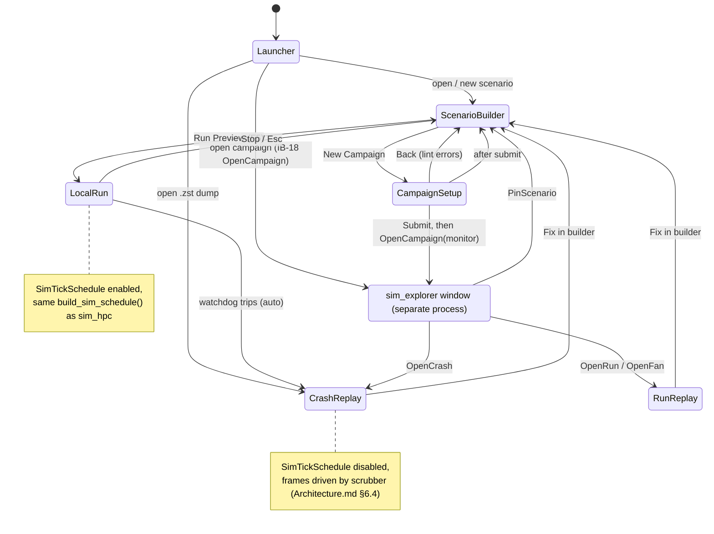

### 5.3 Sub-states inside the Builder

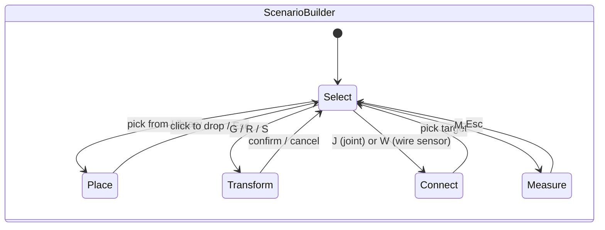

### 5.4 Navigation model

- **Left activity rail** switches workspaces (Builder, Campaigns, Results, Replay). Each rail icon maps to an `AppState`, so the rail is the visual form of the state diagram above. Disabled icons explain why on hover ("No campaign selected").
- **Breadcrumb** at the top shows context: `Workspace / scenarios / drone_gust.scn.ron / Campaign run_48211 / run 120044 (ps 3001, seed 7)`. Each segment is clickable.
- **Deep links** **(new)**: `saber://studio/replay?workspace=...&campaign=run_48211&run_id=120044&tick=812` opens the studio exactly at a run and tick; `saber://explorer/open?campaign=run_48211&view=results` opens the explorer (§6.2.1). `saber.analyze` can print these links.
- **Command palette** (Ctrl+K): every action, every entity by name or `SimId`, every parameter key, every requirement ID.

---

## 6. Shell layout and global UI

All workspaces share one dock shell, `StudioDock` **(new)**, from the `sim_studio_ui` widget kit (§6.1). Version 1 has fixed regions (left, center, right, bottom) with draggable splitters and tab groups; a panel moves between regions from its tab menu or pops out into a floating dialog. Free drag-and-drop docking comes later. The center region is a `ViewportNode` (3D) or a `PlotCanvas`. The layout persists per workspace in `saber.workspace.ron`.

```
┌────────────────────────────────────────────────────────────────────────────────────────────┐
│ ☰ SABER  │ Workspace ▸ scenarios ▸ drone_gust.scn.ron        [Ctrl+K Search…]  ● Lint 0✖ 2⚠ │  ← title bar + breadcrumb
├──┬─────────────────────────────────────────────────────────────────────────────────────────┤
│▣ │ ┌───────────────┐ ┌─────────────────────────────────────────────┐ ┌───────────────────┐ │
│B │ │  LEFT DOCK    │ │                                             │ │   RIGHT DOCK      │ │
│  │ │  Outliner /   │ │            CENTER: 3D VIEWPORT               │ │   Inspector /     │ │
│▣ │ │  Library /    │ │       (or plot canvas in Results)           │ │   Properties      │ │
│C │ │  Parameters   │ │                                             │ │                   │ │
│  │ │               │ │                                             │ │                   │ │
│▣ │ │               │ │                                             │ │                   │ │
│R │ └───────────────┘ └─────────────────────────────────────────────┘ └───────────────────┘ │
│  │ ┌─────────────────────────────────────────────────────────────────────────────────────┐ │
│▣ │ │  BOTTOM DOCK: Timeline / Console / Lint / Requirements / Jobs                         │ │
│P │ └─────────────────────────────────────────────────────────────────────────────────────┘ │
├──┴─────────────────────────────────────────────────────────────────────────────────────────┤
│ f64 sim ✓ │ dt = 1.0e-4 s │ tick 0 │ 37 entities │ units: SI (km display) │ cluster: ok │ ⟳ │  ← status bar
└────────────────────────────────────────────────────────────────────────────────────────────┘
 Rail: B = Builder, C = Campaigns (setup), R = Results (opens or focuses the sim_explorer window), P = Replay
```

**Status bar** is the global "truth line": integrator and `FixedDeltaTime`, current tick, entity count, unit display mode, cluster connection, background job count. Clicking a segment opens the relevant panel.

**Integrator settings (D14).** Clicking the integrator segment opens **Scenario ▸ Simulation**: an integrator dropdown (Semi-implicit Euler, RK2, **RK4** default, Bogacki–Shampine 3(2), Fehlberg 4(5), Cash–Karp 4(5), Dormand–Prince 5(4), Dormand–Prince 8(5,3)), a Fixed / Adaptive toggle (Adaptive only for embedded pairs), substeps per tick for Fixed, and `rtol`, per-quantity `atol`, `h_min` and max substeps for Adaptive, plus the fragment integrator. Two presets sit above the fields: **Quick** (RK4, fixed) and **Accurate** (Dormand–Prince 5(4), adaptive, rtol 1e-8). Preview shows substeps per tick, rejected steps and the running error estimate in the state HUD, and the status bar reads e.g. `DOPRI5 adaptive │ dt = 1.0e-3 s`. See subsystems §5.1 `Core.Integrator`.

**Notifications** are non-modal toasts at the lower right, with a persistent history in the Console tab. Modal dialogs are reserved for destructive or irreversible actions (submit to cluster, cancel job, overwrite scenario).

### 6.1 UI toolkit: Bevy Feathers (decided 2026-10-31)

Alex chose **Bevy Feathers** (`bevy_feathers`, Bevy's editor-oriented widget set) over `bevy_egui` for the studio, knowing it is experimental. This section records what Feathers gives us today, what we build ourselves, and how we contain the breaking changes. Facts below are from the Bevy 0.17 to 0.20 release notes and the 0.19 → 0.20 migration guide; Bevy 0.20.1 (2026-10-28) is the current release.

#### 6.1.1 Maturity snapshot

| Bevy release | Date | What it added for us |
|---|---|---|
| 0.17 | 2025-09 | Feathers introduced behind `experimental_bevy_feathers` ("still incomplete and likely to change"). Headless `bevy_ui_widgets`: `Button`, `Checkbox`, `RadioGroup`, `Slider`, `Scrollbar`. `ViewportNode` (a camera rendered into a UI node, pickable). Picking-based widgets. |
| 0.18 | 2026-01-13 | Headless `Popover` and `MenuPopup` (dropdowns, tooltips), `ColorPlane`, pickable text spans. |
| 0.19 | 2026-06-19 | Upstream text entry (`EditableText`: selection, word/line select, OS clipboard, IME, multiline). Feathers `TextInput`, `NumberInput` (with `LengthMeters`/`AngleDegrees`/`TimeSeconds` units), dropdown menu button, list view, scrollbar, disclosure toggle, pane/subpane/group frames, dialogs. Feathers ported to BSN scenes (`bsn!`). `TransformGizmoPlugin`. Not yet in `EditableText`: placeholder text, undo/redo. |
| 0.20 | 2026-10-08 | Dropdown selection (`FeathersSelect`), lazy menu, scrollable list view, scrubbable `NumberInput` with soft/hard limits, color input, **headless tabs** (`TabList`, `Tab`), contextual theming (`ThemeContext`, `SurfaceLevel`, semantic tokens). `PanOrbitCamera` upstreamed (CAD-style navigation). Retained UI rendering. |

Churn is real: the 0.19 → 0.20 migration guide has roughly 20 UI, text or picking items out of about 90, including `EditableText`/`TextInput` becoming separate components, `NumberInput` value events changing, the old `Button`/`Interaction` being deprecated, flat pointer events, `Val::resolve` signature changes and a reworked `bsn!` syntax. Releases come every four to five months. Bevy has not declared Feathers stable.

#### 6.1.2 Widget coverage against what the studio needs

| Studio need | Feathers / Bevy today | Plan |
|---|---|---|
| Buttons, tool buttons, checkboxes, radios, toggles, sliders | ✓ Feathers | Use directly through the kit (§6.1.3) |
| Dropdowns (unit, method, metric, cluster profile) | ✓ `FeathersSelect`, `FeathersMenu*` (string options) | Use directly |
| Searchable entity / parameter picker (hundreds of bodies, 30 k fragments as groups) | ◐ Popover + `TextInput` + `ListView` exist, no combo box | Build `EntityPicker` **(new)** |
| Single-line text, numbers with units and expressions (`3 km`, `9.81*1.2`) | ◐ `TextInput`, `NumberInput` with three built-in units, no expressions, no undo | Build `QuantityInput` **(new)** on `TextInput`, keep `NumberInput` drag-scrubbing |
| Multiline SQL editor (Query view) | ◐ multiline `EditableText`, no highlighting, no undo | Moved to `sim_explorer` (egui), §6.2 |
| Tabs | ◐ headless `TabList`/`Tab` (0.20), no Feathers styling | Style in the kit |
| Docking, splitters, resizable panes | ✖ only decorative pane frames | Build `StudioDock` + `Splitter` **(new)** |
| Tree (Outliner, workspace browser) | ✖ flat `ListView` only | Build `TreeView` **(new)**: flattened rows + `DisclosureToggle` |
| Tables (Parameters, Requirements, Replay entities; the 500 k-row Runs table and Scorecard are in the explorer) | ✖ no table | Build a simple `DataTable` **(new)** |
| Plots in the studio (time series, timeline tracks); analysis plots are in the explorer | ✖ nothing | Build `PlotCanvas` **(new)**, the largest single studio item |
| Tooltips, toasts, command palette | ◐ Popover primitive only | Build `Tooltip`, `Toast`, `CommandPalette` **(new)** |
| Modal confirmations, floating panels | ✓ `FeathersDialog`, `FeathersFloatingDialog` | Use directly |
| 3D viewport inside the dock | ✓ `ViewportNode` with picking through it | Center region is a `ViewportNode`; lets the dock resize it and allows two viewports later (compare mode) |
| Transform gizmo, orbit camera | ✓ `TransformGizmoPlugin`, `PanOrbitCamera` | Use, wrapped by `StudioCameraRig` (§7.10.1) |
| Theming | ✓ contextual theming + semantic tokens | Map §10.1 tokens onto Feathers semantic tokens |
| Accessibility | ◐ AccessKit through `AccessibilityNode`/`AccessibleLabel`; coverage per widget not documented | Every kit widget sets roles and labels; audit each upgrade |

Net: Feathers covers the form controls well. Since v0.4 the data-heavy views (runs table, analysis plots, SQL editor) live in `sim_explorer` on egui, so the studio only builds a dock, a tree, a small table and time-series plots itself (§6.2.2).

#### 6.1.3 Containment: the `sim_studio_ui` widget kit

All UI code goes through one crate, `sim_studio_ui` **(new)**. Panels never touch `bevy_feathers` or `bevy_ui_widgets` types directly; they call kit functions and listen to kit events. A Bevy upgrade then touches one crate, and if Feathers changes direction we can restyle the kit on the headless widgets (or plain `bevy_ui`) without touching panels.

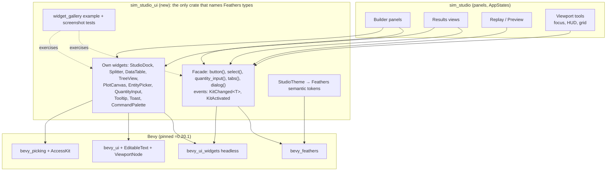

**Rules**

1. Pin Bevy exactly (`bevy = "=0.20.1"`) in the workspace `Cargo.toml`. Never depend on Bevy `main`.
2. Upgrade one minor at a time, on a branch, after the `x.y.1` patch release. Upgrade checklist: compile the kit, run `widget_gallery` screenshot diffs, run the `sim_core` determinism goldens (`final_state_hash` on reference scenarios), bump `build_id`.
3. Panels use kit functions and kit events only. `bsn!` is allowed in panels for layout (`Node`, children), not for widget internals, so a BSN syntax change is a search-and-replace and a widget change is a kit change.
4. Every kit widget sets AccessKit role and label, and keyboard focus works without a mouse.
5. Escape hatch: if a needed widget is months away, build it in the kit on headless widgets. We do **not** mix `bevy_egui` back in.

#### 6.1.4 Risk register

| # | Risk | Likelihood / impact | Mitigation |
|---|---|---|---|
| U1 | Breaking API changes every Bevy release (4 to 5 months) | High / medium | Kit facade (§6.1.3), pinned version, upgrade checklist, budget about 3 to 5 days per upgrade |
| U2 | Own widgets (dock, tree, plots) take longer than planned | Medium / medium (was high / high before the explorer split) | `PlotCanvas` first (Preview and Replay need it), `StudioDock` v1 with fixed regions only, free drag docking later |
| U3 | A Bevy upgrade for the UI also upgrades `sim_core` (same `bevy_ecs`), so old campaigns are from a different build and no longer bit-identical to re-simulate (D1) | Certain / low | Decided (§13 Q7, subsystems D15): old campaigns replay from recorded frames and snapshots; reproducing a study means re-running it on the current build |
| U4 | Text editing gaps (no undo or placeholder in `EditableText`) | Medium / low | App-level undo in `QuantityInput`; placeholder drawn by the kit |
| U5 | Accessibility coverage unknown | Medium / medium | Kit audit with a screen reader each upgrade; color-independent status already required (§10.1) |
| U6 | UI node count with large tables | Medium / medium | Virtualize (pool about 60 row entities), retained UI rendering (0.20) |
| U7 | Feathers stalls or changes direction | Low / high | Kit is ours and sits on headless widgets, which are lower level and more stable; restyle rather than rewrite |

#### 6.1.5 How the kit builds the hard widgets

- **`StudioDock`:** four regions (left, center, right, bottom) separated by `Splitter`s (pointer drag on a 4 px handle, double-click to collapse, sizes in `saber.workspace.ron`). Each region holds a tab group on headless `TabList`. A tab's menu offers "Move to left / right / bottom" and "Pop out" (a `FeathersFloatingDialog`). Free drag-and-drop docking is a later version.
- **`DataTable`:** typed columns, sort, column resize via `Splitter`, multi-select into `Selection`. Hundreds of rows at most (fragments appear as groups), so no virtualization is needed in the studio.
- **`PlotCanvas`:** time series only. Each plot is a `ViewportNode` with its own orthographic camera and render layer. Series are GPU line strips, decimated per pixel column (min/max), so a 128 k-tick channel stays interactive. Axes, ticks and labels are UI text over the node. Picking through the viewport node gives hover read-outs and the tick cursor. The same canvas draws the Replay timeline tracks.
- **`TreeView`:** a flattened, virtualized row list with indentation and `FeathersDisclosureToggle`; drag to re-parent emits an `EditCommand`.
- **`EntityPicker`:** a Popover containing a `TextInput` filter and a virtualized list, grouped into sections, used by the camera focus dropdown (§7.10.1), metric builder and HUD reference.

### 6.2 Two applications: `sim_studio` and `sim_explorer` (decided 2026-11-01)

Alex split the GUI in two (subsystems D12). The **studio** builds, simulates and views one scenario in 3D, on Bevy + Feathers. The **explorer** (`sim_explorer` **(new)**) is a separate window and process for campaign data: monitoring, results, queries and reports, on egui. Each toolkit then does what it is good at. Feathers handles a 3D tool with form controls. egui handles tables, plots and docking, which come ready-made (`egui_extras` tables, `egui_plot`, `egui_dock`).

| | `sim_studio` (Bevy + Feathers) | `sim_explorer` (eframe + egui) |
|---|---|---|
| **Workspaces** | Launcher, Scenario Builder (with Parameters and Requirements panels), Preview (`LocalRun`), Campaign Setup, Run Replay, Crash Replay, 3D fan / impact view | Campaign Monitor, Results Explorer (scorecard, param map, sensitivity, distributions, parallel coordinates, runs table, Query view), compare mode, Evidence Report export |
| **Engines inside** | `sim_core` + `sim_models` (`StudioSimHost`), renderer, `RenderBridge` | `sim_query` (DataFusion, tokio, Arrow Flight client), `sim_verify` functions |
| **Does not contain** | DataFusion, tokio, SSH tunnels to the query service | Bevy, renderer, physics. It never simulates; re-simulation is handed to the studio |
| **Reads** | `.scn.ron`, `.req.ron`, `campaign.toml`, `CrashDump`s and snapshot subsets handed over by the explorer | Campaign Parquet (local or through `sim_query serve`), `campaign_status.json` |
| **Toolkit risk** | Feathers churn (§6.1), now limited to the authoring and 3D side | egui is stable and widely used; upgrades are routine |

Why separate processes rather than two windows in one app: two UI toolkits and two render loops do not share well in one process, the explorer stays usable when a studio simulation is busy or crashes, and Bevy upgrades no longer touch the data side. The explorer can also run on its own, for example on a reviewer's machine with only a campaign folder.

Campaign Monitor moved to the explorer as well, because it is tables and plots fed by the same campaign folder. It hands a crash to the studio exactly as the Results Explorer does.

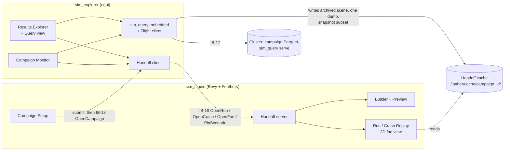

#### 6.2.1 Handoff between the windows (IB-18)

The windows do not share live selection or linked brushing. They exchange **explicit requests**, each one a JSON message:

| Request | Direction | Carries | Studio / explorer does |
|---|---|---|---|
| `OpenCampaign` | studio → explorer | campaign folder or (cluster profile, campaign id), view (`monitor` / `results`) | Focus or launch the explorer at that campaign |
| `OpenRun` | explorer → studio | campaign id, `run_id`, `param_set_id`, `replicate_seed`, status, `final_state_hash`, `build_id`, cache path of the archived scene bundle, optional tick and focus `SimId` | Run Replay from snapshots, or re-simulate at full rate |
| `OpenCrash` | explorer → studio | as `OpenRun` plus `crash_tick`, cache path of the single `CrashDump` (or none, when the quota dropped it, plus the recorder K the user chose) | Crash Replay from the dump, or re-simulate with recorder |
| `OpenFan` | explorer → studio | named subset (list of `run_id`s), cache path of its Tier 3 snapshot extract, colour metric | 3D trajectory fan / impact scatter, coloured by requirement margin |
| `PinScenario` | explorer → studio | archived scene bundle, parameter row | Open the Builder with those parameters pinned in Preview |
| `Ack` / `Error` | both | request id, outcome | Toast in the sending window |

**The explorer does all data fetching.** Before sending a request it writes what the studio needs into the handoff cache (`~/.saber/cache/<campaign_id>/`): the archived `.scn.ron`, `.req.ron` and `campaign.toml` (checked against the campaign's content hash), the single crash dump fetched with `DoGet` for cluster campaigns, or a snapshot extract for a fan. The studio only reads local files, so it needs no query engine and no tunnel.

**Transport.** A running studio listens on a local socket (Unix domain socket in `$XDG_RUNTIME_DIR`, named pipe on Windows), one JSON message per line, accepting only the current user. If no studio is running, the explorer starts it with a deep link (`saber://studio/...`) carrying the same request. Deep links now name the target app: `saber://explorer/open?campaign=run_48211&view=results` and `saber://studio/replay?campaign=run_48211&run_id=120044&tick=812&focus=12`.

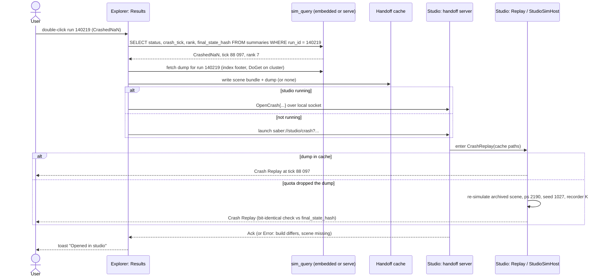

#### 6.2.2 What the split changes for Feathers

The studio no longer needs the 500 k-row runs table, the SQL editor or the analysis plots, which were the largest gaps in §6.1.2:

| Kit widget | Before the split | After |
|---|---|---|
| `DataTable` | Virtualized, Arrow-paged, 500 k rows | Simple table for Parameters, Requirements and Replay entities (hundreds of rows; fragments shown as groups) |
| `PlotCanvas` | Time series, heatmaps, histograms, ECDF, parallel coordinates, lasso | Time series and timeline tracks only (Preview channels, Replay energy and events, PID step response) |
| `CodeEditor` | SQL Query view | Dropped from the studio (Query view is in the explorer) |
| `StudioDock`, `TreeView`, `EntityPicker`, `QuantityInput`, `Tooltip`, `Toast`, `CommandPalette` | Needed | Still needed |

#### 6.2.3 Explorer look and feel

The explorer keeps the layouts in §7.7 and §7.8 and the theme tokens in §10.1, so the two windows read as one product. Tokens are defined once in `theme.toml` and compiled into both apps (Feathers semantic tokens in the studio, `egui::Visuals` in the explorer). Units, number formatting (§9.3), keyboard conventions and the cluster profiles in `saber.workspace.ron` are shared. Accessibility in the explorer comes from egui's AccessKit support.

### 6.3 As built (step S1)

Step S1 builds the frame the screens live in. The screens themselves (Builder, Preview, Campaign Setup, Replay) arrive in S2 to S6; until then each shell state shows its title and the build step that fills it. Where this table and the sections above differ, the table is what the code does.

| Design | As built (S1) | Where |
|---|---|---|
| §5.2 `AppState` | The six variants as designed, `Launcher` first. Every screen entity carries `DespawnOnExit(state)`, so leaving a state removes its UI. | `crates/sim_studio/src/state.rs` |
| §5.4 Activity rail | Four items, B C R P, also on keys 1 to 4 (not while a text field has focus). B opens the Builder, C Campaign Setup, P Crash Replay when a dump is open (Run Replay once runs open in S6). R is the explorer handoff: until step 6b it says so in a toast. A disabled item is muted, and its reason ("No workspace open", "No run or crash dump open") is in its accessible label and in a warning toast on click. A hover tooltip comes with the kit's `Tooltip`. | `state.rs` `Rail`, `ui/shell.rs` |
| §5.4 Breadcrumb | Workspace name ▸ open scenario ▸ state (▸ dump path in Crash Replay). Segments are not yet clickable. | `ui/shell.rs` |
| §6 Shell | Title bar (wordmark, breadcrumb, Dark and Light buttons, Close workspace), rail, `StudioDock`, status bar. The status bar shows `f64 sim ✓`, integrator and dt from the open scenario (for example `Rk4 fixed, 8 substeps │ dt = 1e-3 s`), `tick 0`, entity count, frame, units, `cluster: none`, `jobs 0`. A scenario that does not load says so in the status bar and the Console. | `ui/shell.rs`, `actions.rs` `ScenarioInfo` |
| §6 Notifications | `Toast` messages: info, success, warning, error, each with a mark (ℹ ✓ ⚠ ✖) as well as a color, 4 to 10 s on screen, at most 4 at once, lower right. Every toast goes to `ToastLog` (last 500) and the log, and the Console tab lists the last 50 and appends new ones. No modal dialogs yet (nothing irreversible exists yet). | `sim_studio_ui::toast` |
| §6.1.3 Kit | `sim_studio_ui` is the only crate that names Feathers types. Facade: `heading`, `title`, `label`, `muted`, `mono`, `status_text`, `button`, `primary_button`, `plain_button`, `plain_row`, `text_field` (with `Fields` to read and set by id), `panel`, `row`, `column`, `spacer`; events `KitActivated`, `KitChanged`. `KitCorePlugin` holds the logic that runs without a window; `KitPlugin` adds Feathers and the systems that draw. `widget_gallery` and screenshot diffs are not built yet (S2). | `crates/sim_studio_ui` |
| §6.1.5 `StudioDock` | Fixed regions left, center, right, bottom with 4 px `Splitter`s: drag to resize, double-click to collapse or restore, dragging a collapsed splitter restores it. Sizes are clamped (regions at least 120 px, center at least 200 px) and refit when the window shrinks. Defaults 280, 320 and 200 px. Sizes and collapsed flags save to `saber.workspace.ron` at the end of a drag. Tab groups per region are not built yet; each region holds one panel. | `sim_studio_ui::dock` |
| §7.1 Launcher | Recent workspaces (up to 12, "2h ago" style), Start new (name, parent folder, one button per pack with its one-line description), Recent campaigns (id, crash count, heartbeat state: running N %, done, aborted with its reason, stale when the heartbeat is more than 3 intervals old), and Open by path. Paths are typed or pasted: there is no native file dialog yet. A campaign row shows progress from `campaign_status.json`, not verdicts (`R: 3/4 passing` needs `sim_query`, step 6a). Opening a campaign adds it to the list and says that the explorer opens it from step 6b. | `ui/launcher.rs`, `campaign.rs` |
| §7.9 Crash Replay | Opening a `.zst` crash stream (by path, `sim_studio PATH.zst`, or the Launcher) reads its index and lists the dumps (run, set, seed, status, kind, tick; first 200). A stream from another build gets a warning toast (D15). A summary Parquet path is refused with a clear message. The scrubber is step S6. | `crash.rs`, `ui/shell.rs` |
| §8 Domain packs | Three starter packs: Aero-ballistics (the McCoy shell, RK4 with 8 substeps at 1 ms, requirements: apogee ≤ 1500 m, range ≥ 8000 m with P ≥ 0.9 at 90 % confidence, ground impact within 40 s), Drone (the quad X climbing to a 10 m hold, requirements: final altitude within 0.5 m, never below ground) and Blank (environment only, ENU, 1000 ticks). Robotics is deferred (D13). There is no fixed-wing pack yet (the F-16 test scenario has no environment entity). A pack writes `scenarios/`, `requirements/`, `campaigns/`, `scripts/` and its starter files, and never overwrites a file that exists. | `workspace.rs`, `crates/sim_studio/templates/` |
| §9.4 Workspace file | See the schema below. Written atomically (temporary file, then rename). | `workspace.rs` |
| §10.1 Theme | Dark (default) and Light, switched from the title bar and saved per workspace. Every §10.1 token is a Feathers token named `saber.<token>` with the documented color. The kit also defines what §10.1 leaves open: `bg.chrome` (title, rail and status bars) `#111317` / `#ECEEF2`, `border` `#30363D` / `#D0D7DE`, control fills `#2D333B` / `#E3E7EC`, field fill `#22272E` / `#F0F2F5`, raised surfaces `#252A33` / `#EEF0F3`. Text on the accent (primary buttons) is `#15171C` in Dark, `#FFFFFF` in Light, so it reaches 4.5:1. Control text uses `fg.text`, not Feathers' text-on-accent. | `sim_studio_ui::theme` |
| §11 Accessibility | Every button and row sets an `AccessibleLabel`; status always carries a mark; a test checks 16 text and background pairs reach WCAG AA (4.5:1) in both themes. Keyboard focus rings and Tab order are Feathers' own; a screen-reader audit is still to do (U5). | `crates/sim_studio_ui/tests/kit.rs` |
| Rust toolchain | Bevy 0.20.1 needs rustc 1.97.1, now pinned (step S1-0). The studio uses Bevy with only the features it draws with: UI, picking, Feathers, scenes, state, a window on X11 (loaded at run time, so CI needs no system packages). No audio, gamepads or Wayland yet. | `Cargo.toml`, `rust-toolchain.toml` |

**`saber.workspace.ron`** (format `workspace`, schema 1.0.0). Readers refuse another format or a newer major, and ignore fields they do not know from a newer minor. A missing field takes its default; a non-finite or too-small dock size falls back to the default layout.

```ron
(
    header: (magic: "SABER", format: "workspace", schema_version: "1.0.0",
             saber_version: "0.1.0", build_id: "…"),
    name: "quad_gust_rejection",
    pack: Multirotor,                 // Blank | AeroBallistics | Multirotor
    units: Drone,                     // Si | Ballistics | Drone (display profile, §9.3)
    theme: Dark,                      // Dark | Light
    layout: (left: 280.0, right: 320.0, bottom: 200.0,
             left_collapsed: false, right_collapsed: false, bottom_collapsed: false),
    model_roots: [],                  // team model libraries, read in place (D17, O6)
    open_scenario: Some("scenarios/quad.scn.ron"),
)
```

**Recent list** `~/.saber/studio/recent.ron` (or `$SABER_HOME/studio/recent.ron`), format `studio-recent`: workspaces and campaigns, most recent first, one entry per folder, 12 each. A missing or unreadable file reads as empty. It is per user and never part of a workspace.

**Command line:** `sim_studio [PATH]` opens a workspace folder, its `saber.workspace.ron`, or a crash stream (`.zst`); `--version` prints the `build_id`.

**Tests (verification §8.3):** headless, on synthetic data. The kit's theme, contrast, dock arithmetic and toast log; every pack's workspace and its starter scenario running to its end with every requirement passing; the workspace file and recent list round trips and refusals; state changes driven by commands (open, new, close, rail, crash dump, campaign folder, errors as toasts); and the full UI stack without a window or GPU, driven by activating buttons as a click does.

---

## 7. Workspaces

### 7.1 Launcher

```
┌───────────────────────────────────────────────────────────────────────────────┐
│  SABER                                                                       │
│                                                                               │
│  ┌─ Recent workspaces ───────────────────┐  ┌─ Start new ──────────────────┐  │
│  │ ▸ guided_projectile_v3   2h ago       │  │  [ Aero-ballistics       ]   │  │
│  │ ▸ arm_pick_place         yesterday    │  │  [ Robotics (manipulator) ]  │  │
│  │ ▸ quad_gust_rejection    3 days ago   │  │  [ Drone (multirotor)    ]   │  │
│  └───────────────────────────────────────┘  │  [ Blank scenario        ]   │  │
│                                             └──────────────────────────────┘  │
│  ┌─ Recent campaigns ─────────────────────────────────────────────────────┐   │
│  │ run_48211  quad_gust   ● running 62%   312 crashes   R: 3/4 passing     │   │
│  │ run_48107  projectile  ✓ done          0 crashes     R: 5/5 passing     │   │
│  └────────────────────────────────────────────────────────────────────────┘   │
│  [Open workspace…]   [Open crash dump…]   [Open campaign folder…]             │
└───────────────────────────────────────────────────────────────────────────────┘
```

Templates come from Domain Packs (§8). A template pre-populates the scenario, a starter parameter set, a starter requirement set and a default camera/units profile.

> **As built (S1):** the Launcher as listed in §6.3: typed paths instead of file dialogs, heartbeat progress instead of verdicts on campaign rows until step 6a, and no Robotics button (D13).

### 7.2 Scenario Builder (system and digital-twin model)

This is `AppState::ScenarioBuilder` from the draft, expanded.

```
┌──────────────────────────────────────────────────────────────────────────────────────────────┐
│ Builder ▸ quad_gust.scn.ron                     [▶ Preview F5] [⤓ Export .scn.ron] [Campaign…] │
├──────────────────┬─────────────────────────────────────────────────────┬─────────────────────┤
│ OUTLINER         │  ┌ View ▾ Grid ▾ ⌖Focus:[Quad_A ▾] ◫HUD Snap ┐       │ INSPECTOR           │
│ ▾ World          │  │                                               │ │ Quad_A   SimId 12   │
│   ▸ Environment  │  │           ↑ wind field (arrows)               │ │ ─────────────────── │
│     Atmosphere   │  │                                               │ │ ▾ RigidBodyF64      │
│     WindField ⚙  │  │          ╳──╳                                 │ │   mass   1.42 kg ⚙ │
│   ▾ Vehicles     │  │          │▣ │  ← Quad_A (selected)            │ │   inertia [..] ▸    │
│     Quad_A  #12 ●│  │          ╳──╳                                 │ │ ▾ PositionUncertainty│
│       Motor_1 #13│  │                                               │ │   σ  0.05 0.05 0.02 m│
│       IMU     #17│  │     ○ WP1 ─ ─ ─ ○ WP2 ─ ─ ─ ○ WP3              │ │ ▾ BindMassParam  ⚙  │
│   ▸ Mission      │  │                                               │ │   param_key  mass_q │
│   ▸ Boundaries   │  │   ▦▦▦▦▦▦ graph-paper ground grid (§7.10.3)      │ │   ↳ Parameters tab  │
│                  │  └───────────────────────────────────────────────┘ │ ▾ Controller        │
│ [Library] [Params]│  axis triad · scale bar 10 m · floating origin ✓  │ │   ...               │
│ [Requirements]   │                                                     │ [+ Add component ▾] │
├──────────────────┴─────────────────────────────────────────────────────┴─────────────────────┤
│ LINT  ✖ 0  ⚠ 2   ⚠ WindField.gust_std has no unit   ⚠ dt=1e-3 > 0.2·τ_motor (Motor_1)  [Fix] │
└──────────────────────────────────────────────────────────────────────────────────────────────┘
  ⚙ = value is bound to a parameter or distribution (click to jump)
  ● = has uncertainty
```

**Panels**

| Panel | Purpose | Key interactions |
|-------|---------|------------------|
| **Outliner** | Tree of entities by hierarchy, showing name, `SimId`, and badges (⚙ bound, ● uncertain, ⚠ lint). | Drag to re-parent, multi-select, filter by component type, "show only bound". |
| **Library** | Domain-pack assets: bodies, joints, actuators, sensors, environments, spawners (`LatticeVolumeSpawner`). A **3D Models** tab lists built-in, workspace and team models (§7.11.1). | Drag into viewport or outliner. Search. Drop a model on an entity to give it that look. |
| **Viewport** | 3D scene in a `ViewportNode`. `Position(DVec3)` → `Transform` via the post-update copy from the draft, with a **floating origin** so km-scale ballistic ranges don't jitter in f32. | Orbit/pan/zoom (`StudioCameraRig`), transform gizmo, grid snap, measure tool, frame selected (F), focus dropdown, state HUD, ground grid (§7.10). |
| **Inspector** | Reflect-driven editor for every component on the selection. | Each numeric field has a **bind menu** (⚙): Constant / Sweep parameter / Distribution. Unit-aware input. Multi-edit for multi-select. An **Appearance** section picks and aligns the entity's 3D model (§7.11.2). |
| **Lint** | Continuous validation (see §9.5). | Click to select offender; [Fix] for auto-fixable items. |

**Field bind menu** (the core interaction for P2/J2): every scalar or vector field in the Inspector has a ⚙ button.

```
 mass  [ 1.42 ] kg  ⚙ ▾
                    ┌──────────────────────────────────────┐
                    │ ○ Constant                           │
                    │ ● Sweep parameter  [mass_q      ▾]   │  → creates/uses param_key; adds Bind*Param
                    │ ○ Per-replicate distribution         │  → Normal / Uniform / Triangular / Truncated
                    │      Normal  μ = 1.42  σ = 0.03 kg   │     resolved at Tick 0 from SimRng
                    │ ○ Both (sweep nominal + jitter)      │
                    │                       [Open in Params]│
                    └──────────────────────────────────────┘
```

> Interface note: the draft has one bind component per property (`BindStiffnessParam`). The subsystems doc replaces this with generic `ParamBindings(Vec<ParamBinding { param_key, target, default, bounds }>)` and `Uncertainties(Vec<(path, Distribution, rng_stream)>)`, so one entity can carry several. In the UI each item is a "binding" (⚙) or "stochastic" (●) field.

**As built (steps S2-1, S2-2).** The document, the Outliner, the Inspector, Lint, the bind menu and the Parameters list; the viewport is S3, the Library with domain assets later. The Requirements tab (S2-3) is in §7.4.

| Part | As built |
|---|---|
| Document | `sim_studio::builder::ScenarioDoc`: a reflected copy of the open scenario's entities. Export rebuilds the scenario with `Scenario::from_parts` (subsystems §5.5), keeping file keys, component order and the `visual:` section, so an untouched scene exports with its `scene_hash`. File comments are not kept: Export writes the canonical file. |
| Outliner (left) | Entities in `SimId` order: `#id`, the components' short names (`SimId` and the binding components left out), badges ⚙ (swept parameters), ● (uncertain values) and the worst lint mark on that entity. A click selects; the selected row reads ▸. No tree, drag, filter or multi-select yet (no hierarchy in scenarios yet). |
| Inspector (right) | Every component of the selection, a row per field, flattened by reflection path (`rotors[0].time_constant`, `loops[1].kp`, `position.x`). Numbers are SI and shown in their shortest round-trip form, so the shown text is exact. Floats (finite only), integers (range checked), booleans, text, and enums whose variants carry no data (choices listed) are edited as text; Enter or leaving a field applies it. Enums with data show their variant and their fields (switching such a variant, and adding or removing list items or components, is S2-2). Values update in place after an edit or undo; the Inspector is rebuilt only when the selection moves, so clicking into the next field is not lost. No units on fields yet (§9.3). |
| Center | Until the viewport: file, frame, tick and its end, integrator, library version, `scene_hash`, and whether the document matches the file. |
| Undo (§9.2) | Every applied edit, Undo and Redo in the title bar, Ctrl+Z, Ctrl+Shift+Z or Ctrl+Y (not while typing in a field). A new edit drops the redo history. |
| Saving (§9.4) | Every edit writes `<file>~autosave` (when the scene validates). Opening restores a sidecar newer than the file, with a notice, and the document starts unsaved. Export (button, Ctrl+E or Ctrl+S) writes the `.scn.ron` atomically and drops the sidecar. Closing a workspace with unsaved edits says they stay in the autosave. The breadcrumb shows ● while unsaved. |
| Bind menu (S2-2) | A ⚙ button on every number of the Inspector opens it at the top of the Inspector: what varies the field now (constant, ⚙ swept as `key` with default and bounds, ● drawn per replicate) with Unbind and Remove draw; **Sweep** with a name (default: the field's last name), lower and upper bound (both or neither), the field's value as the default; **per-replicate draw** as Normal, Uniform, Triangular or LogNormal from comma-separated numbers, replacing the value, or added to it when the field is swept ("Both"). Field labels carry ⚙ and ●. Truncation and stream names other than `<SimId>.<target>` are file-only for now. |
| Parameters list (S2-2, §7.3) | Under the Outliner: every swept parameter (⚙ `#id target key = default in [lo, hi]`) then every draw (● `#id target distribution`), with the manifest columns the scene needs. A row opens the bind menu on its field. Not yet a table with units, correlations or previews (§7.3). |
| Components (S2-2) | Each component heading has **Remove** (not `SimId`; refused while a binding or draw targets it). **Add component** lists the registered SABER components the entity lacks that have a starting value (their `Default`, or every field defaulted) and adds one. |
| Lint (§9.5, bottom, above the Console) | After every edit: ✖ the scene's validation (`SimId`s, bindings, uncertainties); ✖ Tick 0's setup in a World with the standard library (a PID loop reading a missing field, for example); ⚠ every `ResolveReport` warning (contact stiffness); ⚠ a fixed integration step longer than 0.2 × a field named `time_constant` or `tau`, with the `dt` or substeps to use; ℹ counts. A click on an item with an entity selects it. Errors refuse Export, not editing. The other §9.5 rules arrive with their features. |

### 7.3 Parameters and Uncertainty panel

Single table of everything that varies. Opens as a tab in the left dock or undocked full width.

```
┌─ PARAMETERS ─────────────────────────────────────────────────────────────────────────────────┐
│ [+ Parameter]  Filter: [all ▾]   Group: [by entity ▾]                     Sweep dims: 4  RNG: 6│
├──────────────┬──────────┬────────┬────────────┬─────────────────┬───────────┬────────────────┤
│ param_key    │ Kind     │ Unit   │ Nominal    │ Range / Dist     │ Used by    │ Preview         │
├──────────────┼──────────┼────────┼────────────┼─────────────────┼───────────┼────────────────┤
│ mass_q       │ Sweep    │ kg     │ 1.42       │ [1.20, 1.80]     │ Quad_A #12 │ ▁▁▁▁▁▁▁▁ uniform│
│ gust_std     │ Sweep    │ m/s    │ 2.0        │ [0, 8]           │ WindField  │ ▁▁▁▁▁▁▁▁        │
│ kp_att       │ Sweep    │ —      │ 4.5        │ log [1, 20]      │ Controller │ ▁▂▃▄▅▆▇█ log    │
│ motor_tau    │ Sweep    │ ms     │ 25         │ [15, 40]         │ Motor_1..4 │                 │
│ init_pos σ   │ RNG      │ m      │ —          │ N(0, 0.05)       │ Quad_A #12 │ ▁▂▅█▅▂▁         │
│ imu_bias     │ RNG      │ rad/s  │ —          │ N(0, 0.002)      │ IMU #17    │ ▁▂▅█▅▂▁         │
├──────────────┴──────────┴────────┴────────────┴─────────────────┴───────────┴────────────────┤
│ Correlations: [ none ▾ ]   (mass_q ↔ motor_tau ρ = …)                     ⚠ 'spacing' unused │
└──────────────────────────────────────────────────────────────────────────────────────────────┘
```

- **Sweep** rows become manifest columns (`param_1, param_2 …` in `sweep_manifest.parquet`); the column name is the `param_key`.
- **RNG** rows are per-replicate perturbations drawn from `SimRng` at Tick 0; they never appear in the manifest, only `replicate_seed` does.
- Mismatch detection: a `param_key` referenced in the scene but absent here is a lint **error**; a parameter defined here but unused is a **warning**.

### 7.4 Requirements panel

Requirements are authored against **metrics**. A metric is something the kernel computes per run (Tier 1) or derives from events (Tier 2). A requirement adds a threshold and a probabilistic acceptance criterion.

```
┌─ REQUIREMENTS  quad_gust.req.ron ──────────────────────────────────────────────────────────┐
│ [+ Requirement]  [Import CSV]  Baseline: rev C                                             │
├──────┬───────────────────────────────┬──────────────────────┬────────────┬────────┬────────┤
│ ID   │ Statement                     │ Metric               │ Criterion  │ Target │ Preview │
├──────┼───────────────────────────────┼──────────────────────┼────────────┼────────┼────────┤
│ R-1  │ Track waypoints within 0.5 m  │ max_xtrack_err [m]   │ ≤ 0.5      │ P≥0.95 │ ✓ 0.21 │
│ R-2  │ Never exceed 35° tilt         │ max_tilt [deg]       │ ≤ 35       │ P≥0.99 │ ✓ 18.4 │
│ R-3  │ Reach WP3 within 40 s         │ t_event(WP3_reached) │ ≤ 40 s     │ P≥0.95 │ ✓ 31.2 │
│ R-4  │ No ground contact             │ count(Collision,     │ = 0        │ P≥0.999│ ✓ 0    │
│      │                               │  Quad_A, Ground)     │            │        │        │
└──────┴───────────────────────────────┴──────────────────────┴────────────┴────────┴────────┘
  Selected R-3 ▸ Metric builder:
     [ t_event ▾ ] ( event = [ WP3_reached ▾ ], entity = [ Quad_A #12 ▾ ] )   unit: s
     Criterion [ ≤ ▾ ] [ 40 ] s      Acceptance  P( pass ) ≥ [ 0.95 ]  at confidence [ 90% ▾ ]
     Crashed runs count as: ( ● fail  ○ excluded  ○ separate )
```

**Metric sources (menu in the metric builder):**

| Source | Examples | Backed by |
|--------|----------|-----------|
| Tier 1 reduction | `max(x)`, `min(x)`, `mean(x)`, `final(x)`, `rms(x)` over any sensor channel; `energy_drift` | `RunningStats` field; the studio tells `sim_core` which reductions to allocate |
| Tier 2 event | `count(event, a, b)`, `t_first(event)`, `exists(event)` | `SimEvent` + `node_{rank}_events.parquet` |
| Derived | `miss_distance = ‖impact_pos − target_pos‖` | Expression over other metrics, evaluated post-hoc in `sim_query` (explorer) or DuckDB (Python) |
| Status | `status == Completed` (codes: Completed, Terminated, CrashedNaN, CrashedEnergy, Panicked, Timeout, SetupError) | `summaries.status` |

**Campaign-level verdict** uses the pass fraction with a Wilson (or Clopper–Pearson) interval; a requirement is **Pass** only if the lower bound ≥ target, **Fail** if the upper bound < target, otherwise **Inconclusive (need more runs)**. The UI states the number of additional replicates needed to resolve it. This three-state verdict is used consistently on every screen.

> Interface note: requirements decide which Tier 1 reductions and Tier 2 triggers run. `sim_verify` compiles a `VerifyPlan` from the `.req.ron` at load time (Rank 0 broadcasts the requirements blob alongside the scene), so one scenario can be checked against several requirement sets without re-export. Campaign Setup shows the derived plan read-only (section 3, Telemetry).

**As built (step S2-3).** A Requirements tab in the Builder. Where this table and the sections above differ, the table is what the code does.

| Part | As built |
|---|---|
| Where | **Scene** and **Requirements** tabs at the top of the Builder's left dock (the design's [Requirements] button). In the Requirements tab the left dock lists the set, its metrics and its requirements; the right dock edits the selection (the metric builder); the center shows the set's summary (`req_set_hash`, its `metric_*` and `req_*` summary columns); its lint joins the scene's at the bottom. Undo, Redo and Ctrl+S act on the set while this tab shows. |
| Which set | The workspace's `requirements/<name>.req.ron` for the open `scenarios/<name>.scn.ron`, else the first set in `requirements/` whose `scenario_hint` names the scenario. Other sets open from the list. **New requirement set** writes an empty set under that name, written for the open scenario; a file that exists is never overwritten. |
| Document | `sim_studio::builder::RequirementDoc` edits the IB-03 `RequirementSet` field by field. An edit is refused, with the reason, when the set would not validate on its own (ids, metric references, reducers that fit their source, the shape of a signal, numbers, campaign rules). Undo and redo; every edit saved to `<file>~autosave` and restored on open when newer. **Save .req.ron** writes the canonical file with this build's header (comments are not kept) and is refused while the set has lint errors. |
| List (left) | The set (`id vversion · for scenario`), then the metrics (`key  Final of entity(1).RigidBody6.position.z`) with **+ Signal metric** and **+ Event metric**, then the requirements (`id  statement`, then what each run checks and the campaign rule, for example `range_m ≥ 8000.0 · P ≥ 0.9 at 90 % confidence`) with **+ Requirement**. Each row carries its worst lint mark; a click selects it. |
| Editor (right) | The selected item's fields. Typed fields apply on Enter or when left; choices are buttons, ● marking the current one. Metric: key (renaming it updates the requirements that read it), source Signal or Event, the signal path or the event name (the declared events are listed), a reducer that fits the source, TimeAbove's threshold. Requirement: id, statement, kind (Threshold, Envelope, Never, Eventually, Custom) and its fields, the campaign rule (AllPass; Probability with p and confidence; Quantile with q, comparison, value and the per-run switch), stop a failing run, traces. Switching kind keeps what the requirement watches: `apogee_m ≤ 1500` becomes the envelope `[-inf, 1500]` on the metric's signal, `never z > 1500` or `eventually z ≤ 1500`, and back. New metrics and requirements start on the first entity's `position.z`. Custom is offered only when a plugin registers a check (the standard library registers none yet). |
| Lint (§9.5) | Each metric and requirement is compiled against the open scenario's Tick 0 the way a run compiles it (`sim_verify::VerifyState::compile`, one item at a time so every error shows): ✖ no entity with that `SimId`, a field that is not there or not a number, an event no plugin declares, an unregistered check. ⚠ the set was written for another scenario; ⚠ the scenario does not set up, so nothing is compiled. ℹ counts and summary columns. Every scene edit lints the set again, so renumbering an entity shows the requirements it breaks. |
| Not yet | The Preview column (Preview Run shows each requirement live in its own right dock since S3-1), Import CSV and Baseline, "Crashed runs count as" (the §8.2 verdict rules decide; IB-03 has no such field), Derived and Status metric sources (Derived needs `sim_query`, step 6a), pickers for signals and events (typed for now). |

### 7.5 Preview Run

`AppState::LocalRun` runs the exact `build_sim_schedule()` in-process for one `(param_set_id, replicate_seed)`. It is the edit-run-inspect loop.

```
┌──────────────────────────────────────────────────────────────────────────────────────────────┐
│ Preview ▸ quad_gust  │ params: [Nominal ▾]  seed: [7  ]🎲 │ ■ Stop  ⏸  ▶ x1 ▾  ⏭ step │ ⟲ Reset  │
├──────────────────┬─────────────────────────────────────────────────────┬─────────────────────┤
│ OUTLINER         │                                                     │ LIVE REQUIREMENTS   │
│ (read-only)      │                 3D viewport, live                    │ R-1 ✓ 0.21 / 0.5 m  │
│                  │  ◫ HUD: Quad_A pos/vel (§7.10.2)                     │ R-2 ✓ 18.4 / 35°    │
│                  │        force/vel gizmos toggle                       │ R-3 … running       │
│                  │                                                     │ R-4 ✓ 0             │
│                  │                                                     │ ─────────────────── │
│                  │                                                     │ PERF                │
│                  │                                                     │ 41 µs / tick        │
│                  │                                                     │ ≈ 2.3 s / run       │
├──────────────────┴─────────────────────────────────────────────────────┴─────────────────────┤
│ PLOTS  [ + channel ]   ── energy  ── max_tilt  ── xtrack_err          t = 12.84 s  tick 128400 │
│  ╭────────────────────────────────────────────────────────────────────────────────────────╮  │
│  │ ~~~~~~~~~~~~~~~~~~~~~~~~/\~~~~~~~~~~~~~~~                                              │  │
│  ╰────────────────────────────────────────────────────────────────────────────────────────╯  │
└──────────────────────────────────────────────────────────────────────────────────────────────┘
```

- **Params selector**: Nominal, Min corner, Max corner, a specific manifest row, or "pinned from Results" (J7).
- **Speed**: x1 (real time), x10, max (no render throttling). Rendering is decoupled: the sim advances N ticks per frame; the viewport samples state. Changing speed never changes results.
- **Perf readout** (µs per tick, s per run) feeds the cost estimator in Campaign Setup.
- If `physics_watchdog_system` sets `SimStatus::Crashed`, the studio transitions to `CrashReplay` with the in-memory `FlightRecorder`, no file round-trip. A toast says "Crashed at tick 128 401: NaN in Quad_A.lin_vel. Opened in Crash Replay."

**As built (step S3-1, controls renamed in S3-2).** The Preview Run; its 3D viewport is in §7.10's as-built table (step S3-2). Where this table and the sections above differ, the table is what the code does. Since S3-2 the controls are words, not icons: the bundled Fira fonts have no ▶ ⏸ ⏭ ⟲ ■ glyphs (§7.10, as built).

| Part | As built |
|---|---|
| Start | **Preview (F5)** in the Builder's title bar, or F5. It runs the open scenario as it is now, unsaved edits included, with the open requirement set when that set lints clean (otherwise a toast says the preview checks no requirements). A scenario that does not validate or set up stays in the Builder with the reason. |
| The run | `sim_studio::preview::PreviewRun` builds the World the way `sim_hpc` builds a run: the standard model library, the set's `VerifyPlugin`, the scenario, then Tick 0 with the parameters and `RunSeed { param_set_id: 0, replicate_seed }`. So a preview's `final_state_hash`, status, ticks, metrics and verdicts equal `sim_hpc --local`'s for the same row (R7). Stepping is in whole ticks; grouping ticks into frames never changes results. |
| Toolbar (center) | **Params: Nominal / Min corner / Max corner** (every swept parameter at its default, or each bounded one at its lower or upper bound; the current one is the primary button); **Seed** with **Use seed** and **Next seed**; **Play**, **Pause**, **Step** (one tick, pauses); **Speed x1 / x10 / max** (x1 follows wall time, x10 ten times faster, max as many ticks as fit in 12 ms per frame; a speed that falls behind drops the backlog instead of catching up); **Reset** (Tick 0 again, same parameters and seed); **Stop** (back to the Builder). Changing parameters or seed rebuilds the run from Tick 0. **Play** on an ended run starts it again. |
| Viewport (center) | Below the toolbar: the 3D viewport (§7.10, as built), its focus line, and a help line. |
| Live state (center) | `t`, tick of `max_ticks`, running x1/x10/max, paused, or ended with its status, the parameter choice and seed; then every body's position, velocity and speed from the flight recorder's latest frame. Rewritten every frame, read from the World without changing it. |
| Outliner (left) | The scenario's entities, read-only. |
| Live requirements (right) | Every requirement of the set: PASS or FAIL once no later tick can change it, … while open (? when the run ended without a verdict), and its value so far (a Threshold's metric, the signal an Envelope, Never or Eventually watches). From `sim_verify::VerifyState::progress`; after the run, the run's own verdicts. |
| Perf (right) | Wall time per tick so far, and the run time it implies at `max_ticks` (the number Campaign Setup's estimate will take). |
| Plots (bottom) | Total energy, then every signal the requirement set watches, then channels added by signal path (`entity(SimId).Component.field`, **+ Channel**, at most 8) and removed with **Remove ⟨signal⟩**. One line per channel with its latest value; drawn on the CPU into an image, redrawn when it changes. Each channel keeps at most 2048 samples, halving its rate when full. The Console stays below. |
| End | A run that ends normally pauses with a toast: its status, tick and how many requirements pass. A crash goes to Crash Replay with the flight recorder's last 600 frames kept in memory (no file), a toast "Crashed at tick N (status): reason. Opened in Crash Replay.", the breadcrumb "preview, seed N", the status and reason, and the bodies of the last three frames. The rail's Replay item opens it again; opening a crash file replaces it. |
| Not yet | A specific manifest row or a run pinned from Results as the parameters (needs a campaign, S6 and 6b); a dice for a random seed; the Crash Replay scrubber over the kept frames (S4). |

### 7.6 Campaign Setup

A single scrolling form with a live summary card. Each section is collapsible; sections with errors expand automatically.

```
┌─ NEW CAMPAIGN  quad_gust ───────────────────────────────────────────┬─ SUMMARY ─────────────┐
│ 1 ▾ Scenario & requirements                                         │ Scenario  quad_gust ✓ │
│     Scenario  quad_gust.scn.ron  (lint ✓, hash 9f3a…)               │ Reqs      4           │
│     Requirements  quad_gust.req.ron  rev C                          │ Param sets 4 096      │
│ 2 ▾ Study design                                                    │ Replicates ×  64      │
│     Method   ( ● Sobol  ○ Latin Hypercube  ○ Full factorial         │ Total runs 262 144    │
│                ○ Monte Carlo  ○ One-at-a-time  ○ From file )        │ ───────────────────── │
│     Param sets N  [ 4096 ]  (power of 2 recommended for Sobol ✓)    │ Est. run   2.3 s      │
│     Replicates R  [ 64   ]  seeds: base [ 1000 ] + i                │ Core-hours  ≈ 168     │
│     Dims: mass_q, gust_std, kp_att, motor_tau      [preview ▸]      │ Wall (32×62) ≈ 5.1 min│
│     ◻ Sobol indices (Saltelli extension, ×(d+2) runs)               │ Output ≈ 1.9 GB       │
│ 3 ▾ Telemetry                                                       │ Files   96            │
│     Tier 1  ✓ (derived from requirements, 11 reductions)            │ ───────────────────── │
│     Tier 2  ✓ events: Collision, WP_reached                          │ Resolve R-4 at P≥.999 │
│     Tier 3  snapshots every [ 100 ] ticks, ramp on gradient ✓       │ needs ≥ 2 996 runs ✓  │
│     Flight recorder K [ 256 ]  crash quota M [ 3 ] per param set    │                       │
│ 4 ▾ Execution target                                                │ [ Show generated ▾ ]  │
│     ( ○ This machine (sim_hpc, size = 1)  ● Cluster profile [hpc1▾])│   sweep_manifest cmd  │
│     Nodes [ 32 ]  ncpus [ 64 ]  RAYON_NUM_THREADS [ 62 ]            │   submit_campaign.pbs │
│     Queue [ prod ▾ ]  Walltime [ 04:00:00 ]  Account [ … ]          │                       │
│ 5 ▸ Notes & tags                                                    │ [  Submit…  ]         │
└─────────────────────────────────────────────────────────────────────┴───────────────────────┘
```

- **Preview ▸** opens a pair-plot of the sampled points so Lena can sanity-check coverage before submitting.
- **Show generated** reveals the exact `saber sweep` invocation and the rendered `submit_campaign.pbs` (P6). Both are also written into `campaigns/<id>/` for reproducibility.
- **Submit…** opens a confirmation modal summarizing core-hours and target, because this spends allocation and can't be undone.
- **Execution target "This machine"** runs `sim_hpc` locally with the same CLI (`--scene --manifest --scratch-dir --shared-out`), so it's a true dress rehearsal (Roadmap Phase 3).

### 7.7 Campaign Monitor (`sim_explorer`)

A view of the explorer window (§6.2). **Open dump** and **Re-simulate** send `OpenCrash` to the studio.

```
┌─ CAMPAIGN run_48211  quad_gust  ● RUNNING  02:41 / 04:00 walltime ──────── [Pause feed] [Cancel job…] ┐
│ Progress  ████████████████████████░░░░░░░░░░░░  162 304 / 262 144  (62%)   ETA 1m 58s               │
│ Throughput 1 380 runs/s   Crashes 312 (0.19%) ▲   Crash dumps saved 41 (quota M = 3)                 │
├──────────────────────────────────────────┬───────────────────────────────────────────────────────────┤
│ NODES (32)                               │ CRASH RATE BY PARAMETER  (live, from heartbeat)            │
│  r00 ■■■■■■■■ dispatcher   chunks 0 q    │  gust_std ▲                                                │
│  r01 ■■■■■■■□ 61/62 busy  5 120 done     │    8 ┤        · ·✖✖✖                                       │
│  r02 ■■■■■■■■ 62/62       5 088 done     │      ┤      · ·✖✖✖✖                                        │
│  …                                       │    0 ┤ · · · · · · ·                                       │
│  r17 ■■■■□□□□ ⚠ slow (stiff region)      │      └────────────────▶ kp_att                             │
├──────────────────────────────────────────┴───────────────────────────────────────────────────────────┤
│ LIVE EVENTS   [crashes ▾]                                                                             │
│  02:39:12  run 140223  ps 2190 seed 1031  CrashedNaN tick 88 102  Quad_A.lin_vel   [Open dump]      │
│  02:39:10  run 140219  ps 2190 seed 1027  CrashedNaN tick 88 097  (no dump: quota) [Re-simulate]    │
│  02:38:55  ⚠ Crash storm: ps 2190, 2191, 2207 ≥ 50% crash rate                       [Inspect region] │
└───────────────────────────────────────────────────────────────────────────────────────────────────────┘
```

- **Crash storm banner** fires when a parameter region exceeds a crash-rate threshold, linking straight to a region view (J5). This is the UI face of the crash quota in `Architecture.md` §6.3.
- **Cancel job…** is confirmed in a modal and runs `qdel` through the cluster profile.
- **Open partial results** is always available; Results Explorer can query a running campaign once node files are staged out.

> Interface note: progress comes from `campaign_status.json` in `$SHARED_OUT` (interface IB-15, `sim_schema::CampaignStatus`): runs done per rank, crash counts per `param_set_id`, chunk queue depth. Rank 0 writes it atomically about every 15 s; the studio reads it over SSH/SFTP and marks the view stale after 3 missed intervals.

### 7.8 Results Explorer (`sim_explorer`)

The main view of the explorer window (§6.2), built with egui (`egui_extras` tables, `egui_plot`, `egui_dock`). Opening a run, a crash, a fan or a pinned scenario hands off to the studio through IB-18 (§6.2.1).

The analysis workspace. Queries run through `sim_query` (Apache DataFusion, subsystems §5.8) over the campaign's committed Parquet parts as listed in `_MANIFEST.json` (`summaries`, `events`, `snapshots`, `impacts`, `verdicts`), so nothing is copied or merged. For a campaign on the workstation the engine runs inside the explorer. For a campaign on the cluster it runs in `sim_query serve` on a compute node and only result batches come back over the SSH tunnel (IB-17), so raw data stays on the cluster. The scorecard reads `verdicts.parquet` when present and computes verdicts from summaries otherwise, with the same `sim_verify` functions the solver uses.

**Query service chip** (header, cluster campaigns only). The explorer is usable as soon as the chip is green; while the job is queued, the header and scorecard skeleton render and every view shows "waiting for query service".

| Chip | Meaning | Action offered |
|------|---------|----------------|
| `⛁ hpc1 · ready · job 48990 · 3 h 12 m left` | Service running, tunnel open | Stop service |
| `⛁ hpc1 · queued (est. 2 min)` | Job submitted, not started | Cancel |
| `⛁ hpc1 · not running` | No live service for this profile | **Start query service** |
| `⛁ hpc1 · stale since 14:02 ⚠` | Tunnel or job lost | Reconnect / restart; last results kept |
| `⛁ hpc1 · build differs ⚠` | Service `build_id` ≠ studio build | Details; queries still allowed |

```
┌─ RESULTS  run_48211 (quad_gust) ─────── Compare with: [ none ▾ ] ──── [Export report ▾] [Copy as DuckDB] ┐
│ SCORECARD                                                                                               │
│ ┌──────┬──────────────────────────┬────────────────────┬───────────────┬──────────────┬───────────────┐ │
│ │ ID   │ Requirement               │ P(pass) [90% CI]   │ Target        │ Verdict      │ Worst margin  │ │
│ │ R-1  │ xtrack ≤ 0.5 m            │ 0.982 [0.981,0.983]│ ≥ 0.95        │ ✓ PASS       │ −0.71 m       │ │
│ │ R-2  │ tilt ≤ 35°                │ 0.997 [0.996,0.997]│ ≥ 0.99        │ ✓ PASS       │ −22°          │ │
│ │ R-3  │ WP3 ≤ 40 s                │ 0.912 [0.910,0.914]│ ≥ 0.95        │ ✖ FAIL       │ +17.2 s       │ │
│ │ R-4  │ no ground contact         │ 0.9989[.9987,.9991]│ ≥ 0.999       │ ◐ Inconclusive│ 1 contact     │ │
│ └──────┴──────────────────────────┴────────────────────┴───────────────┴──────────────┴───────────────┘ │
├──────────────── VIEW: [Param map] [Sensitivity] [Distributions] [Parallel coords] [Runs] [Query] ───────┤
│ Param map   x: [kp_att ▾]  y: [gust_std ▾]  color: [R-3 margin ▾]  agg: [P(pass) per bin ▾]           │
│  ╭──────────────────────────────────────────────────────────╮   ┌─ SELECTION (lasso) ───────────────┐ │
│  │ gust ▲                         ▓▓▓▓▓  ← failure region    │   │ 1 812 runs · 28 param sets        │ │
│  │      │                   ░░▓▓▓▓▓▓▓                        │   │ R-3 pass 0.41                     │ │
│  │      │            ░░░░░░░░░▓▓▓                            │   │ Dominant: gust_std > 5.8,         │ │
│  │      │ ░░░░░░░░░░░░░░░░░░                                 │   │           kp_att < 3.1            │ │
│  │      └──────────────────────────────────▶ kp_att          │   │ [Open runs] [Pin as scenario]     │ │
│  ╰──────────────────────────────────────────────────────────╯   └──────────────────────────────────┘ │
└─────────────────────────────────────────────────────────────────────────────────────────────────────────┘
```

**Views**

| View | Shows | Typical use |
|------|-------|-------------|
| **Scorecard** (always pinned on top) | One row per requirement: P(pass) with CI, verdict, worst margin, runs needed to resolve | Maya's first and last stop |
| **Param map** | 2D binned heatmap over any two sweep params, colored by a requirement margin or P(pass) | Find failure regions (J6) |
| **Sensitivity** | Sobol first-order and total indices per requirement metric (when the Saltelli design was used), else rank-correlation tornado | "Which inputs matter?" |
| **Distributions** | Histogram / ECDF of any metric with the threshold line, split by status | Margins and tails |
| **Parallel coordinates** | One line per param set, brushable axes | Multi-dimensional failure shapes |
| **Runs** | Virtualized table of summaries rows; columns are params + metrics + status | Pick a run to open (J7, J8) |
| **Query** | SQL editor (DataFusion dialect) against `summaries`, `events`, `snapshots`, `impacts`, `verdicts`, `manifest` views, with `sim_verify` functions such as `req_margin`, `cep`, `p_pass_ci`; results feed any chart, capped at `max_rows` | Lena's escape hatch |

**Linked brushing:** a selection in any view filters all others and the Runs table. The selection chip in the header shows the active filter and can be cleared or saved as a named subset.

**Opening a run** (double-click in Runs, or from a selection):

| Run status | Available actions |
|------------|-------------------|
| Completed / Terminated / Timeout | **Replay snapshots** (Tier 3, coarse, instant) · **Re-simulate locally** (full rate, deterministic) |
| CrashedNaN / CrashedEnergy / Panicked, dump present | **Open crash dump** (from `node_{rank}_crashes.zst`) · Re-simulate |
| Same, no dump (quota exceeded) | **Re-simulate with recorder** (choose larger K) → Crash Replay |

Re-simulation uses the scenario hash stored in the campaign to guarantee the same `.scn.ron`, and compares its result against `summaries.final_state_hash` to confirm the run reproduced bit-identically (a mismatch is shown as a warning); if the workspace scenario has changed since, the UI warns and offers to check out the archived copy from `campaigns/<id>/`. If the campaign came from a different `build_id`, bit-identical re-simulation is not offered; the run replays from its recorded frames or snapshots, and **Re-run on current build (approximate)** is available instead (§13 Q7, D15).

**Compare mode (J9):** choose a second campaign; the scorecard gains a Δ column, and the param map can show the difference of P(pass) where parameter spaces overlap.

**Export report ▾:** Evidence Report (HTML/PDF) containing scorecard, selected plots, scenario and study plan hashes, and deep links (§5.4) for each cited run. **Copy as DuckDB / Polars** puts the query behind the current view on the clipboard (J10). Built-in views are generated from one query description, so the copied DuckDB SQL or Polars code runs unchanged in `saber`; SQL typed by hand in the Query view is copied as written, with a note that DataFusion-only functions may need edits.

### 7.9 Run Replay and Crash Replay

Both share one layout; Crash Replay is Run Replay plus forensic tools. Crash Replay matches `Architecture.md` §6.4: load `.scn.ron`, run the Tick-0 resolver with the run's `(param_set_id, seed)`, disable `SimTickSchedule`, drive `Transform` from `TickFrame` snapshots.

```
┌─ CRASH REPLAY  run 140223  ps 2190  seed 1031  CrashedNaN @ tick 88 102 ─────────── [Fix in Builder] [Back] ┐
├──────────────────┬───────────────────────────────────────────────────────────┬──────────────────────────────┤
│ ENTITIES         │                                                           │ SNAPSHOT  Quad_A  SimId 12   │
│ filter: [flags▾] │                                                           │ tick 88 101                  │
│ ▲ Quad_A #12 ⬤NaN│           ◯ red wireframe = FLAG_NAN_ORIGIN               │ pos   (12.03, 4.11, 9.87) m  │
│   Motor_3 #15 ◆C │          ╱  ← velocity gizmo                              │ rot   (…)                    │
│   Ground  #1  ◆C │         ▣ Quad_A                                          │ lin_vel (1.2e3, −4e2, 9e4) ⚠ │
│   Motor_1 #13    │          ╲  ← force gizmo (log scale)                     │ force_mag 3.7e9 N ⚠          │
│                  │                                                           │ flags  COLLIDING | NAN_ORIGIN│
│ ⬤ NaN origin     │      ghost: healthy neighbour ps 2190 seed 1030 (toggle)  │ Δ prev tick  ×1e4 ⚠          │
│ ◆C colliding     │                                                           │                              │
│ ◆K clamped       │                                                           │ [Copy row] [Plot channel]    │
├──────────────────┴───────────────────────────────────────────────────────────┴──────────────────────────────┤
│ ENERGY ▁▁▁▁▁▁▁▁▁▁▁▁▁▁▁▁▁▁▁▁▁▁▁▁▁▁▁▁▁▁▁▁▁▁▁▁▁▁▁▁▁▁▁▁▁▁▁▁▂▃▅█  total_energy (log y)          E_max ┄┄┄┄┄┄┄┄┄┄   │
│ EVENTS  ·      ·         ◆C               ◆C ◆C ◆C◆C◆C                                                       │
│ TIMELINE |◀ ◀◀ ◀ ▶ ▶▶ ▶| ════════════════════════════════════════════════════════════════●═══╡ tick 88 101   │
│          87 846 (frame 0)                                                      [⇥ jump to first non-finite]  │
└──────────────────────────────────────────────────────────────────────────────────────────────────────────────┘
```

**Timeline and scrubbing**

- Scrubber spans `frames[0..K]`; tick numbers are absolute (`TickFrame.tick`), frame index shown on hover.
- Tracks under the scrubber are synchronized: total energy (log toggle, `E_max` line), event markers (collisions from `flags`, Tier 2 events), and any user-added channel.
- **Jump buttons:** first frame with any `FLAG_COLLIDING`, first non-finite value, energy crossing `E_max`, last frame.
- **Playback:** step (←/→), play at 1/2/5/25 frames per second, loop a range (drag on timeline to set in/out).

**Forensic tools (Crash Replay only)**

| Tool | Purpose |
|------|---------|
| **NaN origin highlight** | Red wireframe sphere on `FLAG_NAN_ORIGIN` entities (from the draft); the Entities list sorts them first. |
| **Growth inspector** | Per entity and channel, ratio vs previous tick; values above ×10 flagged ⚠. Finds where blow-up starts, usually several ticks before NaN. |
| **Ghost run** | Re-simulates a healthy replicate from the same `param_set_id` (or nearest healthy param set) and overlays it translucent, synchronized by tick. Shows where the two diverge. |
| **Gizmo scale** | Velocity and force vectors on linear or log scale; magnitudes beyond a cap draw as dashed arrows with a numeric label. |
| **Open in Builder at these params** | Jumps to the Builder with this run's params pinned in Preview, so Raj can tweak `dt`, stiffness or limits and re-run that exact case. |

**Run Replay** (completed runs) shows Tier 3 snapshots at their recorded cadence, or a full-rate re-simulation, and adds **requirement overlays**: the threshold drawn in the plot track and in 3D where meaningful (cross-track corridor tube, tilt cone, impact circle).

### 7.10 3D viewport tools: camera focus, state HUD, ground grid

These three tools live in the shared viewport (Builder, Preview, Run Replay, Crash Replay, and the 3D views of Results). They all read **f64 sim state** and only convert to f32 at the last step, through the `RenderBridge` floating origin (subsystems §5.5, G7).

Viewport toolbar (replaces the toolbar line in the §7.2 wireframe):

```
┌ View: Persp ▾ │ Shade ▾ │ Gizmos ▾ │ Grid ▾ │ ⌖ Focus: [ Quad_A #12        ▾ ] [ Follow ▾ ] │ ◫ HUD │ Snap: grid ┐
```

#### 7.10.1 Camera focus from a dropdown

**What the user does.** Opens the **Focus** dropdown (or presses `Ctrl+F`), types to filter, picks an entry. The camera glides to it and, depending on the mode, keeps tracking it.

```
⌖ Focus: [ shell                         ]
┌───────────────────────────────────────────┐
│ SELECTION                                 │
│   Quad_A                       #12        │
│ BOOKMARKS                                 │
│   ★ Launcher view                          │
│ BODIES                                    │
│   Shell_3                      #40   ●    │
│   Shell_3 (target)             #41        │
│ GROUPS                                    │
│   ▸ Fragments of Shell_3   28 112 alive   │  → centroid, or nearest / fastest fragment
│ POINTS                                    │
│   World origin · Launch point · WP1..WP3  │
│   Impact point (run 120044)               │
└───────────────────────────────────────────┘
  ↑↓ move · Enter focus · Alt+Enter focus and select · Esc close
```

- Built on `EntityPicker` (§6.1.5). Entries show name and `SimId`; filter matches either. Recently focused entries sort first.
- Spawner and fragment populations appear as **groups**, never as 30 k rows (D8). A group can be focused as its centroid, its bounding box (frame), or a member chosen by rule (nearest to camera, fastest, first impact).
- Focus and selection are separate: `CameraFocus` **(new)** is a resource next to `Selection`. `F` frames the selection once; `Shift+F` follows the selection; `Alt+Enter` in the picker focuses and selects.

**Modes** (second dropdown):

| Mode | Camera behaviour | Typical use |
|---|---|---|
| **Frame** | Move once to fit the target, then free orbit | Builder, quick look |
| **Follow** | Orbit pivot locked to the target, world-aligned; user keeps orbit and zoom | Drone hover, robot arm |
| **Chase** | Pivot locked, camera offset rotates with the velocity heading | Projectile, aircraft |
| **Track from here** | Camera stays where it is and turns to keep the target centred | Range camera on a launcher watching a shell |

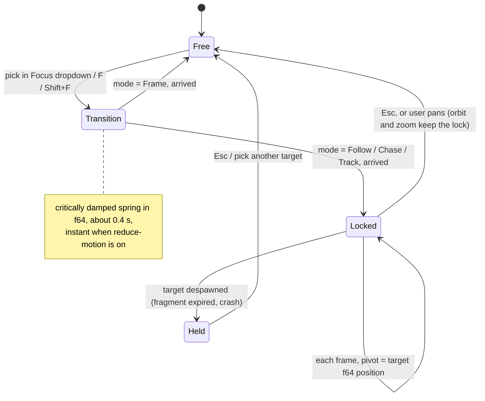

**Precision.** While locked, the floating origin is re-anchored on the focus target every frame, so the thing you are looking at is always near render coordinate zero and gets full f32 precision, even 80 km down range. The camera rig (`StudioCameraRig` **(new)**, wrapping Bevy's `PanOrbitCamera`) keeps its pivot in f64; only the camera offset from the pivot is f32.

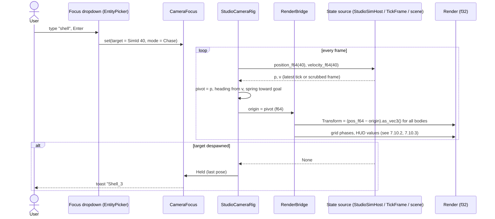

The focus target and mode are saved in camera bookmarks in `saber.workspace.ron`, and studio deep links (§5.4) accept `focus=<SimId>&mode=chase`.

#### 7.10.2 State HUD: large position and velocity indicator

A large, glanceable read-out over the viewport, toggled with the **◫ HUD** toolbar button or `H`. It is per viewport and remembered per workspace.

```
┌─ Shell_3  #40 ───────────────── rel. to: [ World origin ▾ ] ── frame: [ ENU ▾ ] ┐
│  POSITION                          VELOCITY                                      │
│   E   12 403.7  m                   vE    612.40 m/s          ╭───╮  heading     │
│   N    2 118.2  m                   vN     41.07 m/s          │ ↗ │  086.2°      │
│   U    1 874.9  m  (AGL 1 874.9)    vU   −88.31 m/s          ╰───╯  γ −8.2°     │
│   range 12 723.4 m                  |v|   620.13 m/s   M 1.83                    │
│                                                                                  │
│  t = 21.344 s   tick 213 440   ● live                     [Copy] [Plot ▸] [⚙]   │
└──────────────────────────────────────────────────────────────────────────────────┘
```

- **Target:** the camera focus target by default; a pin (⚙) can hold the HUD on another entity.
- **Relative to:** World origin, a point (launch point, waypoint) or any entity. Against an entity the HUD shows relative position and velocity plus **range** and **range-rate** (closing speed), which is what an intercept or a landing approach needs.
- **Frames:** ENU, NED, scenario local; geodetic (lat, lon, alt) when the environment has a geodetic datum. Units follow the field unit profile (§9.3), with significant figures and the full f64 value on hover.
- **Derived rows from Domain Packs:** Mach and dynamic pressure (aero, using the environment's atmosphere), flight-path angle γ and heading, angle of attack for fixed-wing, tilt for multirotors, end-effector position for arms.
- **Sizes:** Large (default, 28 px tabular monospace), Compact (one line), and a projector size. Anchored to a viewport corner, draggable between corners, panel background at 85 % opacity so the scene shows through.
- **Data source** is the same f64 state the camera uses: live tick in Preview, the scrubbed `TickFrame` or snapshot in Replay, initial conditions in the Builder (labelled "t = 0, initial"). It never reads `Transform`. Text refreshes at 10 Hz so the digits are readable while the sim runs at x10; when paused it shows the exact tick.
- **Bad values:** a NaN or infinite field shows `NaN` in `status.fail` with ⚠; in Crash Replay the row with the largest growth ratio (§7.9) gets a ▲ marker.
- **Actions:** click a value to copy it at full precision; **Plot ▸** adds the channel to the plot dock; the velocity dial doubles as a heading indicator.

#### 7.10.3 Ground plane: graph paper to the horizon

The ground is drawn as an **infinite analytic plane**, not a mesh, so it is visible all the way to the horizon at any scale from a robot cell (mm) to an artillery range (100 km).

```
            far: only 10 km lines, fading into the horizon tint
  ─────────────────────────────────────────────────────── horizon
       ╱      ╱       ╱        ╱        ╲        ╲       ╲
     ╱  4 km ╱  6 km ╱        ╱          ╲        ╲  12 km╲
   ╱──────╱───────╱────────╱──────────────╲────────╲───────╲
  ╱ ┼ ┼ ┼╱ ┼ ┼ ┼ ╱ ┼ ┼ ┼ ┼╱ ┼ ┼ ┼ ┼ ┼ ┼ ┼ ┼╲ ┼ ┼ ┼ ┼╲ ┼ ┼ ┼ ╲    near: 100 m minor, 1 km major
                         x: red line, y: green line at the scenario origin
```

**Look.** Light theme is classic graph paper (warm paper tint, blue-green lines); dark theme is blueprint (deep blue, pale lines). Three line weights: minor, major (every 10th) and the scenario axes (x in red, y in green, drawn at the frame origin). New theme tokens `grid.paper`, `grid.minor`, `grid.major`, `grid.axis_x`, `grid.axis_y`, `grid.label` (§10.1).

**How it renders** (`GroundGridPlugin` **(new)**, one full-screen pass):

1. Per pixel, intersect the view ray with the ground datum plane (or terrain, below). Write depth, so bodies and trails occlude correctly; Bevy's infinite reverse-Z projection keeps the far plane at the horizon.
2. **Level of detail per pixel, not per frame.** From the screen-space derivative of the ground position (`fwidth`), compute how many metres one pixel covers. Pick the decade spacing `10^k` whose lines are at least about 8 px apart, and blend it with `10^(k+1)` and `10^(k+2)` by the fractional part of the log. Near the camera you see fine lines, far away only coarse ones, and zooming never makes lines pop. Lines are anti-aliased with the same derivative.
3. **Horizon fade.** Alpha falls with grazing angle and with distance beyond about 50× camera height, fading into a horizon tint. This removes moiré where lines converge.
4. **Below ground** (camera under the datum, or looking at buried fragment impacts): the grid draws at 30 % alpha.

**f64 world, f32 render.** The shader works in render space, where the position is relative to the floating origin. Adding the origin back in f32 would destroy fine lines once the origin is far from zero (at 100 km f32 resolution is about 8 mm, at 1 000 km about 6 cm). Instead the CPU computes, in f64, one **phase per decade level**: `phase_k = origin.xy.rem_euclid(10^(k+1))`, cast to f32. The shader evaluates level `k` as `render_xy + phase_k`. Every value stays below `10^(k+1)`, so line placement error is under one millionth of the spacing at every level, wherever the origin is.

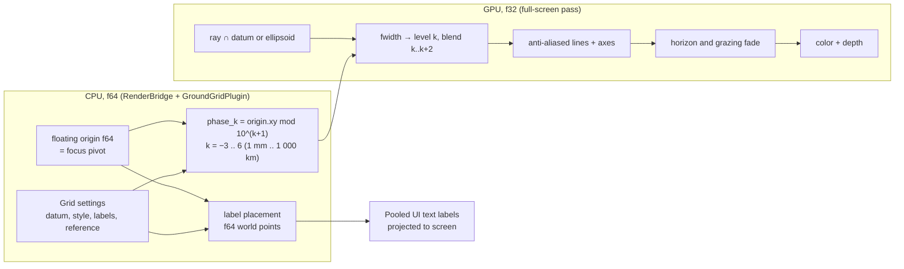

**Distance markings.** *Decided 2026-11-02 (Q8):* the ground plane is labelled every **10 m**. Labels sit on the grid lines at multiples of 10 m and use the field unit profile (`10 m`, `20 m` … `2 km`, `20 km`). Nothing finer than 10 m is labelled, even when finer grid lines are visible. Two modes in the **Grid ▾** menu:

| Mode | Where labels go | Typical use |
|---|---|---|
| **Coordinates** (default) | Each major x-line is labelled where it crosses the line through the focus point, and the same for y, so a ruler runs through what you are looking at | Builder, robotics, drones |
| **Range rings** | Concentric rings around a reference (launch point, target, any entity), labelled with distance; drawn by the same shader with radial distance instead of x and y | Ballistics, fragmentation footprints |

Labels are pooled UI text nodes positioned by projecting f64 world points through the camera, capped at 64. When 10 m labels would be closer than 120 px on screen (camera high up or looking far down range), they thin to every 100 m, then every 1 km and so on, so every label shown is still a multiple of 10 m and the screen never fills with text. Labels fade with their grid level. Labels farther than the horizon fade are hidden.

**Terrain and Earth shape.**
- If the scenario has terrain, the terrain material calls the same grid function on world x and y, so the graph paper drapes over it. The flat datum plane can still be shown underneath as a reference.
- Flat-Earth scenarios use the plane. When the environment uses a round Earth, the grid follows the ellipsoid instead (ray against sphere, solved relative to camera height so the 6 371 km radius never enters f32). At 100 km the difference is about 785 m of drop, which matters for long-range ballistics.

**Settings (Grid ▾):** show grid, style (graph paper, blueprint, minimal), labels (coordinates, range rings, off), ring reference, datum altitude, opacity, follow terrain. **Snap: grid** snaps placements to the minor spacing visible under the cursor, so snapping matches what you see.

**Budget:** the grid pass is under 0.3 ms GPU at 2560×1440; labels add at most 64 UI nodes.

#### 7.10.4 As built (step S3-2)

The Preview Run's viewport. The Builder, Run Replay and Crash Replay get the same viewport in later steps (S4 and a Builder follow-up). Where this table and the sections above differ, the table is what the code does.

| Part | As built |
|---|---|
| Where | The center region of Preview Run, under the run's toolbar: a viewport toolbar, a 420 px high 3D view, a focus line ("Focus #12 · Follow · locked · frame ENU") and a help line. `sim_studio::viewport` holds the f64 logic (no rendering, unit tested); `sim_studio::ui::viewport` draws it. One `ViewportState` resource per window holds the frame, camera, focus and toggles. |
| Rendering | A `Camera3d` renders into the image of a Bevy `ViewportNode`, which also turns pointer input in the view into camera moves. Everything in the view (bodies, ground, gizmo lines) is on render layer 1 so the UI camera does not draw it again. Unlit materials, no lights, no tonemapping. The camera is spawned on entering Preview and despawned on leaving it. |
| Display frame | Always east, north, up (ENU). A scenario in NED is turned to ENU; a scenario in ECEF is shown in the local ENU of the WGS 84 tangent plane through the first body's Tick-0 position. The focus line and HUD name it: "ENU", "ENU (scenario in NED)" or "local ENU (scenario in ECEF)". Render space is east = x, up = y, north = −z. |
| Precision | The floating origin is the camera pivot, re-anchored every frame. Positions are subtracted in f64 and only the difference becomes f32, so a body 100 km down range is drawn to well under a millimetre while the camera looks at it (tested). The rig's pivot, yaw, pitch and distance are f64. |
| Camera | Orbit camera around a pivot: left drag orbits (pitch held within ±89°), right or middle drag pans and drops the focus lock, the wheel zooms by 0.85 per notch. A new run follows its first body; a run rebuilt with other parameters or seed keeps the target if it still exists. |
| Focus | Toolbar buttons **Focus #id** for each body (at most 12, then "… N more"; no dropdown, groups, points or bookmarks yet) and **Mode: Frame / Follow / Chase / Track from here** (the current one is the primary button). Moves use a critically damped spring in f64 (ω = 15/s, about 0.4 s); the spring closes the pivot's offset from the target, so a fast target is caught without lag. Frame also springs the distance to 5 m and then frees the camera; Follow locks the pivot; Chase also turns the camera behind the horizontal velocity; Track from here keeps the eye where it was and turns to the target. A target that is gone, NaN or infinite leaves the camera Held where it was. Keys while no text field is being edited: **F** frame, **Shift+F** follow, **Esc** free, **H** HUD. Ctrl+F and Alt+Enter are not bound. |
| State HUD | A monospace panel over the view's top-left corner, toggled with **HUD** or H: the target's E, N, U position and vE, vN, vU velocity from the frame's origin, range and \|v\|, heading (clockwise from north) and flight-path angle γ, then `t`, tick and live, paused or ended. Thousands grouped by spaces, a real minus sign (−), `NaN!` or `inf!` for bad values. Refreshed ten times a second while running, every frame while paused. Range-rate against another body is computed and tested but has no control to pick that body yet. |
| Ground grid | Drawn with gizmo lines on a paper-colored ground plane (theme tokens `grid.paper`, `grid.minor`, `grid.major`, `grid.axis_x`, `grid.axis_y`), not the analytic shader of §7.10.3. The finest spacing is the power of ten whose lines are at least 8 px apart at the pivot; it is drawn with the next two decades, 25 lines each side per decade, each line drawn once at its coarsest decade (minor, then major). The x axis (red) and y axis (green) are drawn through the frame origin. The ground hides when the camera goes under it. **Grid** toggles it. |
| Distance labels | Coordinates mode only (§7.10.3, Q8): labels sit where the grid's lines cross the lines through the pivot, at multiples of 10 m, never finer, and at least 120 px apart on screen. When 10 m labels would crowd they thin to 100 m, 1 km and so on, the step growing as they get farther from the camera. Text like "20 m", "1.25 km", "−300 m". At most 64, nearest first. |
| Bodies | Each body is an unlit sphere at its attitude, at least 0.2 m in radius and never under 8 px across. With **Gizmos** on, each gets its x, y, z axes (red, green, grey, three marker radii long) and a velocity arrow 30 px long per doubling of speed, capped at 160 px. |
| Theme | Grid, ground, body and clear colors follow the theme's tokens and change with light or dark mode (`sim_studio_ui::ThemeColors` gives screens the colors without naming Feathers types). |
| Words, not icons | The bundled Fira Sans and Fira Mono have no ▶ ⏸ ⏭ ⟲ ■ ◫ ⌖ ● glyphs, which drew as empty boxes in a real render, so this step's buttons and the Preview's controls are words. The kit's ✓ ✖ ⚠ ◐ status marks, the ☰ menu and the ▸ breadcrumb had the same problem since S1; step S3-3 fixed those with a symbol font behind Fira (§10.2). The buttons stay words: they read better, and ⏸ ⏭ ⌖ are in no bundled font. |
| Checks | Unit tests in `crates/sim_studio/tests/viewport.rs` (frames, f32 precision 100 km out, spring, the four focus modes, rig, HUD, grid lines, labels, markers, rebuilds) and a headless UI test that starts a preview, follows a body, checks the labels and presses F, H and Esc. CI has no GPU; the view was also rendered locally on a software Vulkan driver to check that the grid, labels, bodies, arrows and HUD all show. |
| Not yet | The analytic full-screen grid with horizon fade, terrain drape and the round-Earth ellipsoid; range rings; the focus dropdown with groups, points, bookmarks and deep links; HUD sizes, corners, pin and relative-to; copy and Plot actions on HUD values; Mach and other domain rows; force arrows (the flight recorder keeps only force magnitude); the Builder's viewport; models instead of spheres (S5). |

### 7.11 3D models: library, import and linking to entities (new, subsystems D17)

Any entity can show a 3D model: a glTF/GLB file from the **built-in** library that ships with SABER, from the workspace's own `models/` folder, or from a team **library root**. The model is only how the entity looks. Physics comes from the entity's components, and its collision shape is separate (it can be derived from the model once, on request, §7.11.5). Types, file layout and rules are in subsystems §5.10 and IB-20; the flows are in `sequence-diagrams.md` §2.1–2.3.

Three rules shape the UI:

- **Looks never change results.** Swapping, moving or deleting a model never changes `scene_hash`, never invalidates a campaign and never asks for a re-run. The UI says so where it matters (Appearance section, Replay banner).
- **Something is always drawn.** A model that is loading, missing or absent falls back to a placeholder, so the scene is never empty or misleading (§7.11.6).
- **Align once, at import.** Unit, up axis, forward axis and origin are fixed in the model's manifest when it is imported. The per-entity offset is for exceptions, not for routine fixing.

#### 7.11.1 Library ▸ 3D Models tab

```
┌ LIBRARY ──────────────────────────────────────────┐
│ [Assets] [3D Models] [Tables]                     │
│ 🔍 uav                         Source: [All ▾]    │
│ ▾ Built-in (14)                                   │
│   ┌───────┐ ┌───────┐ ┌───────┐ ┌───────┐         │
│   │  ╳    │ │ ⬡  ⬡  │ │  ✈    │ │  ➤    │         │
│   │quad_x │ │hex_x  │ │gen_uav│ │ogive  │         │
│   └───────┘ └───────┘ └───────┘ └───────┘         │
│ ▾ Workspace (3)                                   │
│   ┌───────┐ ┌───────┐ ┌───────┐                   │
│   │  ✈    │ │  ⌂    │ │  ⚠    │ ← file changed    │
│   │uav_v3 │ │hangar │ │rotor_b│   since saved     │
│   └───────┘ └───────┘ └───────┘                   │
│ ▸ Team library  /proj/saber/models (27)          │
│ ───────────────────────────────────────────────── │
│ uav_v3 · 2.40 × 3.10 × 0.55 m · 212 k tris · OBJ  │
│ Used by: UAV_1 #4, UAV_2 #5                       │
│ [⤒ Import model…]                                 │
└───────────────────────────────────────────────────┘
```

| Interaction | Result |
|---|---|
| Hover a tile | Larger thumbnail, size in display units, triangle count, source format, license |
| Drag onto an entity (viewport or Outliner) | Sets that entity's model; the drop target highlights while hovering. One undoable `EditCommand` |
| Drag onto empty viewport | Small menu: **New static body (collides)**, **Scenery (look only)**, **New body from palette…** |
| Drop a `.glb`, `.gltf` or `.obj` file on the window | Opens the Import dialog (§7.11.3) |
| Right-click a tile | Reveal in folder · Re-import · Duplicate to workspace (to customise a built-in) · Select users in scene · Delete (workspace only, blocked while used) |
| Source filter | All / Built-in / Workspace / each library root |

Thumbnails are rendered by the studio on first sight and cached next to the model (`thumb.png`); built-ins ship theirs.

#### 7.11.2 Inspector ▸ Appearance section

```
│ ▾ Appearance                              │
│   Model    [▣ quad_x · built-in   ▾]  ✎   │
│            ✓ loaded · 18 k tris           │
│   Offset   x 0     y 0     z 0.012  m     │
│            roll 0  pitch 0  yaw 0   deg   │
│   Scale    1.00   [🔒 uniform]             │
│   Tint     [none ▾]       Visible [✓]     │
│   [⌖ Align…]   [◫ Show collision]         │
│   ⓘ Appearance only, does not affect      │
│     results.                              │
│ ▾ Contact                                 │
│   Shape   Compound · 6 hulls   ⓘ derived  │
│           from quad_x, convex decomp.     │
│   [Derive from model ▾]   [Edit shape…]   │
```

- **Model picker** is a searchable popover grid (an `EntityPicker` variant) with the same sources as the Library tab, plus **None** and **Default**. When the entity's physics model has a Domain Pack default (for example `rotorcraft/quad_x@1.2` → built-in `quad_x`), the field shows it in grey as "default: quad_x"; picking another model overrides it.
- **Multi-select** sets one model on all selected entities in one command.
- **Moving parts** lists the manifest's bindings (node → signal) with a per-instance override; unbound nodes matching the Domain Pack names (`rotor_1`, `elevator`, …) are offered as one-click bindings. Deferred: not in v1 (§13 Q11); the row is hidden until bindings ship.
- **Show collision** overlays the collision shape as a wireframe in the `bound` colour, so model and contact geometry can be compared.
- The Outliner shows ⚠ on entities whose model is missing or changed.

#### 7.11.3 Import dialog

```
┌ Import 3D model ──────────────────────────────────────────────────────────────────┐
│ File   ~/Downloads/uav_v3.gltf   (+ uav_v3.bin, 4 textures)                       │
├─────────────────────────────────────────┬─────────────────────────────────────────┤
│  PREVIEW                                │ Name      [ uav_v3                ]     │
│                                         │ Id        models/uav_v3                 │
│        z↓  x→ forward  (body frame)     │ Units     [ millimetre ▾ ]  ⓘ guessed   │
│              ┌───────────┐              │ Up        [ +Y ▾ ]   Forward [ +Z ▾ ]   │
│      ════════╪═══ ✈ ═════╪════════      │ Origin    ( ) File origin               │
│              └───────────┘              │           (•) Bounding-box centre       │
│                                         │           ( ) Bottom centre             │
│   1 m ├─────┤                           │           ( ) Pick point in preview     │
│                                         │ Save to   [ Workspace models/ ▾ ]       │
│   2.40 × 3.10 × 0.55 m                  │ Store as  (•) .glb   ( ) .gltf + files  │  ← OBJ only
│   212 k triangles · 4 materials         │                                         │
├─────────────────────────────────────────┴─────────────────────────────────────────┤
│ ⚠ Bounds are 2400 m long at metres. Looks like millimetres → Units set to mm       │
│ ℹ 1 camera and 2 lights in the file will be ignored                               │
│ ℹ 3 animation clips are kept but not played                                       │
│                                                          [Cancel]  [Import]       │
└───────────────────────────────────────────────────────────────────────────────────┘
```

- The preview shows the body-frame axis triad, a 1 m reference bar and the bounding box in display units, and updates live as unit, axes and origin change, so a sideways or 1000× model is obvious before it is imported.
- **Blocking problems** replace the Import button with the reason and a fix, for example: "Meshes use Draco compression, which the studio cannot load. Decompress the file with a local tool and import it again." Remote or absolute texture paths are refused the same way, because SABER never fetches anything (D7).
- A `.gltf` with separate files is packed into one `.glb` in the workspace; the original is left untouched.
- **OBJ (stretch goal):** the same dialog. OBJ has no unit or axes, so Units, Up and Forward start empty and Import stays disabled until they are set. **Store as** chooses `.glb` (default) or `.gltf` + `.bin` + textures; MTL materials are converted to PBR and the preview shows the result.
- The same import runs headless as `saber-cli model import` and `saber-cli model convert` for batches.

#### 7.11.4 Align mode

**Align…** enters a viewport mode for fixing a single entity's model when the manifest is not enough:

- The gizmo edits `VisualModel.offset` only. The body's axis triad, centre-of-gravity marker and collision overlay stay fixed, so you line the model up against the physics, never the other way round.
- Quick buttons: **Rotate +90° about x / y / z**, **Origin to bounding-box centre**, **Origin to bottom centre**, **Reset**. Rotation snaps to 90° by default.
- **Save as model default** writes the offset into the workspace model's `model.ron`, so every entity using it benefits and the per-entity offset returns to zero. Built-ins are read-only; the button becomes **Duplicate to workspace and save**.
- Esc or **Done** leaves the mode; the whole session is one undo step.

#### 7.11.5 Derive collision from model

```
 Contact ▸ Derive from model ▾
 ┌──────────────────────────────────────────────────────────┐
 │ ( ) Bounding box             1 part                      │
 │ ( ) Fitted capsule           1 part  · along x           │
 │ ( ) Convex hull              1 part  · 212 vertices      │
 │ (•) Convex decomposition     max parts [16]  → 6 parts   │
 │ ( ) Triangle mesh            static bodies only  ⓘ       │
 │ ──────────────────────────────────────────────────────── │
 │ Volume 0.41 m³ (mesh 0.38 m³) · max deviation 18 mm      │
 │ ⚠ Collision shapes affect results. This replaces the     │
 │   current shape and changes the scenario's scene hash.   │
 │                                   [Cancel]  [Apply]      │
 └──────────────────────────────────────────────────────────┘
```

The preview overlay updates as the method changes; decomposition runs off the UI thread and can be cancelled. **Triangle mesh** is disabled on dynamic bodies, with a tooltip explaining it is for buildings and terrain. After Apply, the Contact section shows a **derived** chip naming the model and method. If the model file changes later, the chip turns ⚠ "derived from an older version of uav_v3 · Re-derive"; the studio never re-derives on its own. **Estimate mass properties** (in the Rigid Body section) can fill inertia from the derived shape and the entered mass as a one-off edit.

#### 7.11.6 What gets drawn: placeholders, distance and many copies

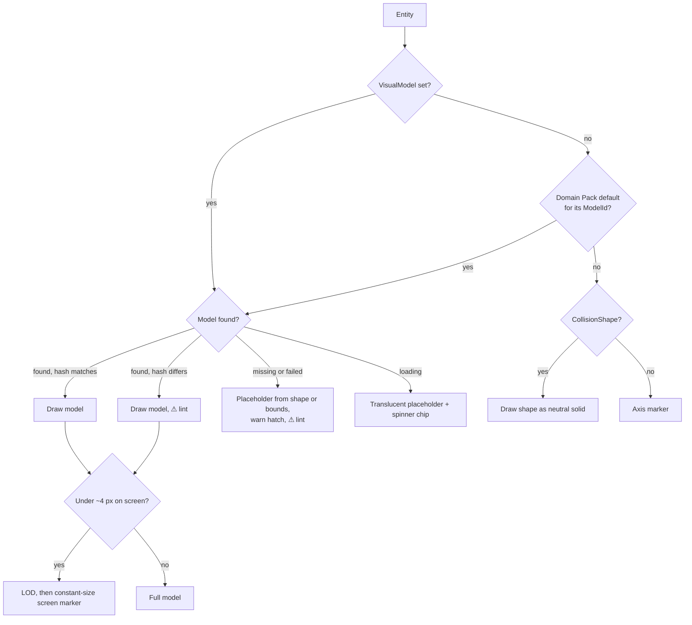

- **Far away:** models switch to their LOD files, then to a constant-size diamond in the entity's colour (name label when selected), so a shell 20 km downrange or a drone at 2 km is still visible and clickable.
- **Many copies** of one model share GPU data: 300 drones of one model cost one mesh.
- **Fragments** are drawn as instanced points (or the tiny built-in fragment mesh), never with the parent's model; the parent's model disappears at the fragmentation tick.
- **Replay on another machine:** if referenced models are not found, Replay opens anyway with placeholders and a banner: "3 models not found · Locate…". Locate accepts a file and matches it by hash, or accepts a different file with a warning. Campaigns archive the models they use (up to 2 GB, §13 Q9), so this mainly happens for scenarios opened outside a campaign or campaigns over the cap.

---

## 8. Domain packs: aero-ballistics, robotics, drones

> **Robotics deferred (D13, 2026-11-01).** Alex dropped robotics as a design consideration for now, so the Robotics pack and `MultibodyPlugin` are not built in v1. The column below is kept as a placeholder. Contact is still part of the other packs: bodies get a collision shape and a contact material (Compliant, Impulsive or EventOnly), and aircraft and drones get landing gear or skid contact points (subsystems IB-19). The Inspector shows these under a **Contact** section, and the compliant-contact stability check from Tick 0 appears as a Preview warning.

A **Domain Pack** **(new)** is the studio-side companion of a `sim_models` plugin (`AeroBallisticsPlugin`, `MultibodyPlugin`, `RotorcraftPlugin`, plus the shared `EnvironmentPlugin`, `SensorPlugin`, `ControlPlugin`). The model plugin owns the physics components; the pack adds Library assets, inspector widgets, default metrics, requirement templates and viewport overlays. The core studio stays domain-neutral.

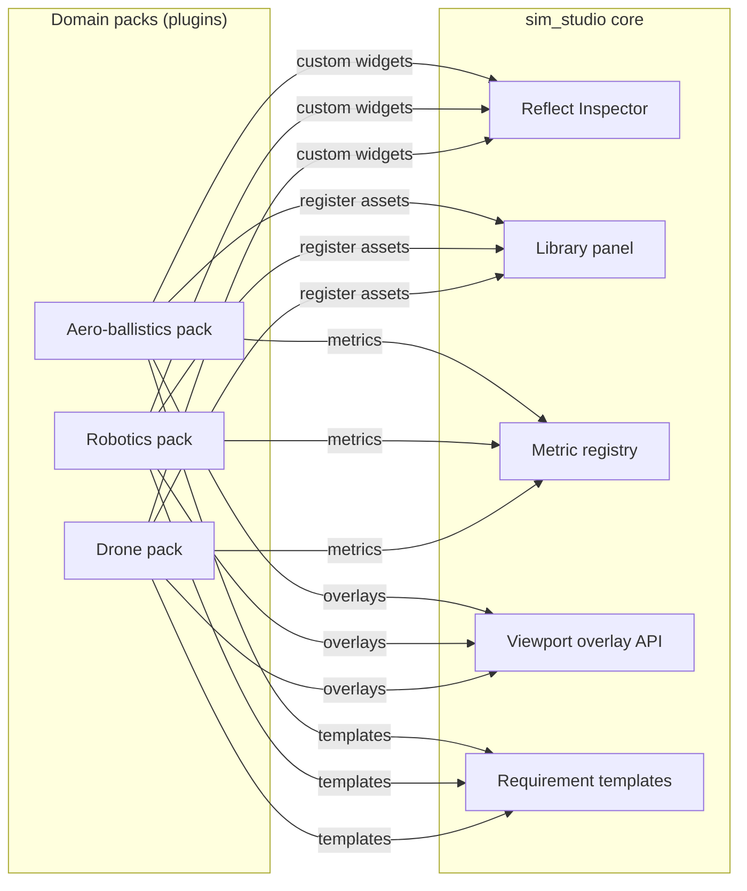

| | Aero-ballistics | Robotics (manipulators, mobile) | Drones (multirotor, fixed-wing) |
|---|---|---|---|
| **`sim_models` plugin** | `AeroBallisticsPlugin` | `MultibodyPlugin` | `RotorcraftPlugin` |
| **Library assets** | Projectile (6-DOF), aero coefficient tables (Mach × α), atmosphere (ISA, tabulated, winds aloft), launcher, target, terrain | Links, revolute/prismatic joints, actuators with limits, grippers, payloads, contact surfaces, obstacles | Airframes, motors/props, battery, IMU/GPS/baro sensors, flight controller, wind/gust field, waypoints, geofence |
| **Special inspector widgets** | Coefficient table editor with curve preview; launch angle/azimuth dial | Joint limit arcs on the gizmo; DH-parameter view; workspace envelope | Motor layout editor; mixer matrix; PID tuning panel with step response from Preview |
| **Default metrics** | Miss distance, CEP, impact velocity/angle, max Mach, apogee, time of flight, max dynamic pressure | End-effector error, joint torque peak, cycle time, contact force peak, self-collision count | Cross-track error, max tilt, time to waypoint, energy used, min battery voltage, geofence breach count |
| **Requirement templates** | "CEP50 ≤ X m", "P(impact within R) ≥ p" | "Pick success P ≥ p", "Torque ≤ rated" | "No geofence breach", "Hover drift ≤ X m in gust σ" |
| **Viewport overlays** | Trajectory fan (Monte Carlo trails), impact scatter with CEP circles, footprint on terrain, km-scale grid with floating origin | Reachability cloud, joint torque heat on links, contact normals | Wind arrows, corridor tube along waypoints, geofence volume, motor thrust bars |
| **Default 3D models** (built-in, §7.11) | Ogive projectile, finned rocket, launcher rail, target board | (deferred) | `quad_x`, `hex_x`, generic trainer and UAV airframes, windsock |
| **Units default** | km, m/s, Mach, deg, mrad | mm, N·m, rad or deg | m, m/s, deg, % throttle |

The **trajectory fan** (aero) and **impact scatter** are 3D views in the studio, opened from the Results Explorer with **Show in 3D** (`OpenFan`, §6.2.1): the explorer extracts Tier 3 snapshots of a sampled subset of runs (for example 500) into the handoff cache, and the studio renders them colored by requirement margin.

---

## 9. Interaction details

### 9.1 Selection model

- Single source of truth: a `Selection` resource **(new)** holding `SimId`s. Viewport, Outliner, Inspector, plots and the Runs table all read and write it.
- Click selects, Shift adds, Ctrl toggles, box-select in viewport, lasso in plots.
- In Replay, selecting a plot curve selects its entity and vice versa.

### 9.2 Undo / redo

- Every Builder edit is a reversible `EditCommand` **(new)** on a command stack (Ctrl+Z / Ctrl+Shift+Z). Commands are coalesced while dragging a gizmo or a slider.
- History panel lists commands; clicking one reverts to it.
- Undo is scoped to the scenario and its companion files (parameters, requirements). Campaign actions are never on the undo stack; they are guarded by confirmation instead.

### 9.3 Units and numbers

- Internal values are SI f64. Display unit is chosen per field (right-click → unit), with a workspace default profile from the Domain Pack.
- Input accepts units and expressions: `3 km`, `250 mm`, `9.81*1.2`, `35 deg`. Invalid units for the field's dimension are rejected inline.
- Displays use significant figures, not fixed decimals, with a tooltip showing the full f64 value. "Copy value" copies full precision.

### 9.4 Saving and files

- Scenario edits auto-save to a sidecar (`.scn.ron~autosave`); explicit **Export .scn.ron** writes the canonical file that campaigns use. The title bar shows ● for unsaved changes.
- Every campaign archives the exact `.scn.ron`, `.req.ron`, `campaign.toml`, manifest and generated PBS script under `campaigns/<id>/`, and stores a content hash. Re-simulation always uses the archived copy.

### 9.5 Validation (lint) rules

| Severity | Rule | Example message |
|----------|------|-----------------|
| ✖ Error | Unbound `param_key` | "BindMassParam on Quad_A #12 references `mass_q`, not defined in Parameters." |
| ✖ Error | Duplicate or missing `SimId` | "Motor_2 and Motor_3 both have SimId 14." |
| ✖ Error | Requirement references unknown metric/event | "R-3 uses event `WP3_reached`; no entity emits it." |
| ✖ Error | Non-deterministic component | "Component uses wall-clock time; not allowed in sim_core." |
| ⚠ Warning | Timestep vs. fastest time constant | "dt = 1e-3 s > 0.2 × τ_motor (25 ms)… consider 5e-4 s." |
| ⚠ Warning | Parameter defined but unused | "`spacing` is not referenced." |
| ⚠ Warning | Missing unit on a parameter | |
| ⚠ Warning | Sobol N not a power of two | |
| ✖ Error | Triangle-mesh collision on a dynamic body | "Hangar #40 is dynamic but uses a triangle-mesh shape; use convex decomposition or make it static." |
| ⚠ Warning | 3D model not found (does not block Export) | "UAV_1 #4 uses models/uav_v3, not found in the workspace or library roots." |
| ⚠ Warning | 3D model file changed since the scenario was saved | "rotor_b changed (hash differs); the look may differ from what was reviewed." |
| ⚠ Warning | Collision derived from an older version of the model | "Contact shape on UAV_1 #4 came from an earlier uav_v3. Re-derive?" |
| ⚠ Warning | Model and collision sizes disagree by more than 2× | "uav_v3 is 1000× larger than its collision shape; check the import unit." |
| ℹ Info | Estimated entities after spawner expansion | "LatticeVolumeSpawner expands to 32 768 bodies at Tick 0." |

Errors block **Export** and **Submit**, not editing or Preview (Preview runs what it can and reports).

### 9.6 Keyboard map (defaults)

| Key | Action | Key | Action |
|-----|--------|-----|--------|
| Ctrl+K | Command palette | F5 / Shift+F5 | Preview run / stop |
| Ctrl+S | Save; Ctrl+E Export `.scn.ron` | F | Frame selected |
| G / R / S | Move / rotate / scale | Space | Play/pause (Preview, Replay) |
| J / W | Joint / wire sensor tool | ← / → | Step one frame/tick |
| M | Measure | Home / End | First / last frame |
| Ctrl+Z / Ctrl+Shift+Z | Undo / redo | N | Jump to first non-finite (Crash Replay) |
| 1–4 | Rail workspaces | Ctrl+L | Copy deep link to current view |
| Ctrl+F | Camera focus dropdown | Shift+F | Follow selection |
| H | Show / hide state HUD | Esc | Release camera lock |

### 9.7 UI-level interaction sequences

These are UI-side sequences only; system-wide sequences live in the sequence-diagram doc.

**Preview run triggered from the Builder**

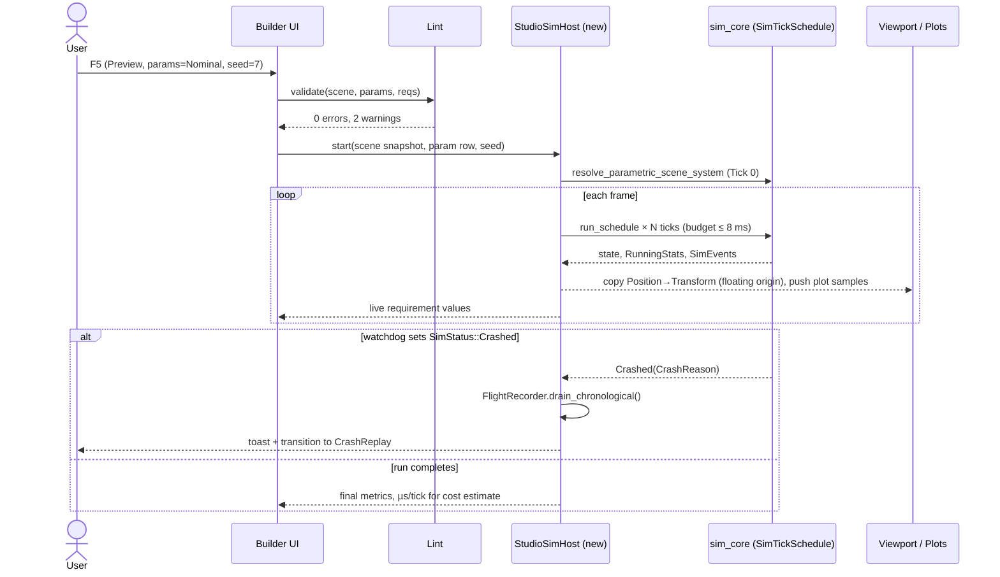

**Open a crashed run from Results (dump or re-simulate):** this crosses from the explorer to the studio; see the IB-18 sequence in §6.2.1. For a cluster campaign the explorer fetches the single dump through `sim_query serve` (IB-17 `DoGet`, using the `crashes.zst` index footer) before handing off.

**Open a cluster campaign when no query service is running**

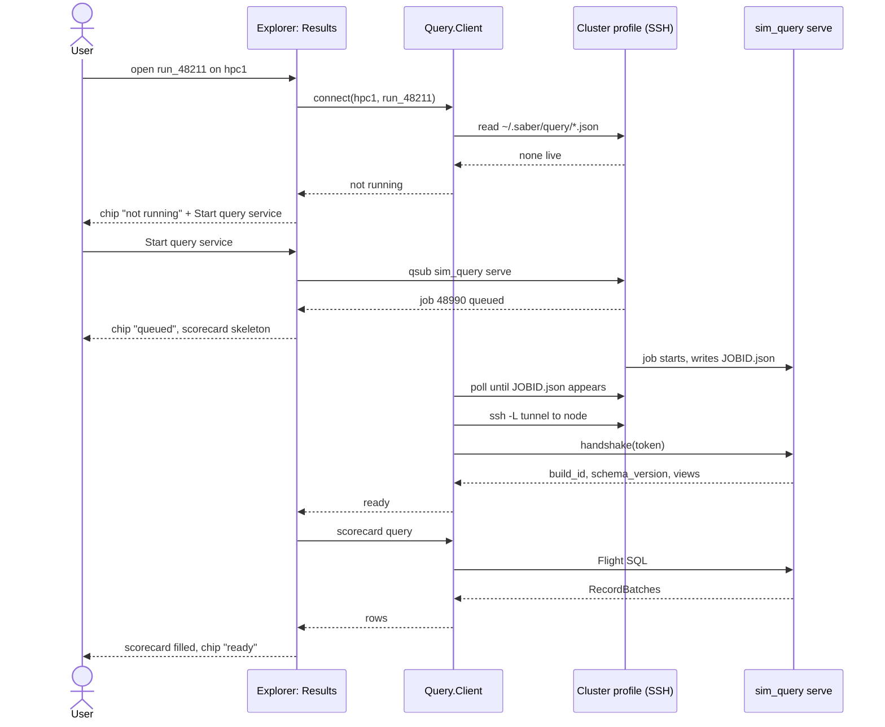

---

## 10. Visual design system

### 10.1 Theme tokens

Defined once in `StudioTheme` (`sim_studio_ui`), which maps each token onto Feathers' semantic tokens and `SurfaceLevel`s (contextual theming, Bevy 0.20); packs and panels use tokens, never raw colors.

| Token | Dark | Light | Use |
|-------|------|-------|-----|
| `bg.app` | `#15171C` | `#F6F7F9` | Window background |
| `bg.panel` | `#1C1F26` | `#FFFFFF` | Dock panels |
| `fg.text` | `#E6E8EC` | `#1B1F24` | Body text |
| `fg.muted` | `#9AA3AF` | `#5B6470` | Labels, units |
| `accent` | `#4C9AFF` | `#1F6FEB` | Selection, focus, primary buttons |
| `status.pass` | `#3FB950` | `#1A7F37` | PASS, healthy |
| `status.fail` | `#F85149` | `#CF222E` | FAIL, crash, NaN origin |
| `status.warn` | `#D29922` | `#9A6700` | Warnings, INCONCLUSIVE |
| `bound` | `#A371F7` | `#8250DF` | ⚙ parameter-bound values |
| `uncertain` | `#39C5CF` | `#1B7C83` | ● stochastic values |
| `grid.paper` | `#0F2238` (blueprint) | `#FBF8EF` (paper) | Ground plane base (§7.10.3) |
| `grid.minor` | `#2A4A6B` | `#CFE3DD` | Minor grid lines |
| `grid.major` | `#5B86B3` | `#8DBFB3` | Major grid lines (every 10th) |
| `grid.axis_x` / `grid.axis_y` | `#E5534B` / `#57AB5A` | `#CF222E` / `#1A7F37` | Scenario x and y axes on the ground |
| `grid.label` | `#C9D7E8` | `#3D5A55` | Distance markings |

> **As built (S1):** every token above, plus the chrome, border, fill and on-accent colors the kit needed, is listed in §6.3.

Status is never conveyed by color alone: PASS ✓, FAIL ✖, INCONCLUSIVE ◐, warning ⚠ always accompany the color. Sequential maps (param maps) use a perceptually uniform, colorblind-safe map (viridis/cividis); diverging maps (margin) are centered on the threshold.

### 10.2 Typography and density

- UI font: Inter (or the Feathers default) at 13 px; numbers in a tabular monospace (JetBrains Mono) so columns align.
- **As built (step S3-3).** The Feathers defaults: Fira Sans (regular and bold) and Fira Mono Medium for numbers and paths. Fira has no glyphs for most symbols the studio writes (✓ ✖ ⚠ ◐ ☰ ▸ ⚙ ℹ ● ≤ …), so `sim_studio_ui::fonts` bundles a 160 KB cut of DejaVu Sans 2.37 (its letterlike, arrow, math, technical, box, block, geometric, symbol and dingbat blocks; `scripts/make_symbol_font.sh`, license beside the file) and puts it behind every text's font: a character Fira lacks comes from it, everything else from Fira. A test lays out every non-ASCII character in the studio's string literals and fails on any empty box, and every screen test checks the same. ⏸ ⏭ ⌖ are in neither font, so the studio does not use them.
- Two density modes: **Compact** (default, 22 px rows) and **Comfortable** (28 px rows) for touch screens and presentations. UI scale 75–200 %.

### 10.3 Viewport conventions

- Right-handed, Z-up for aero and drones, Y-up selectable for robotics; axis triad always visible. World frame shown in status bar (ENU / NED / local).
- Gizmo colors: velocity = accent, force = warn, NaN origin = fail (wireframe sphere, per draft), bound entities get a subtle `bound` outline when "show bindings" is on.
- Scale bar and floating-origin indicator in the viewport corner; the scale bar uses the same decade as the visible major grid lines.
- Camera focus, the state HUD and the ground grid are specified in §7.10.

---

## 11. Accessibility, performance and robustness

**Accessibility**
- Full keyboard operation of every panel (Bevy input focus and tab navigation, used by every kit widget) and visible focus rings.
- Color-independent status (icons + text), colorblind-safe maps, adjustable UI scale, high-contrast theme option.
- AccessKit through Bevy UI (`AccessibilityNode`, `AccessibleLabel`) so screen readers can read tables, scorecard and inspector. Feathers' own coverage is not documented per widget, so the kit sets roles and labels itself and is audited each upgrade (§6.1.4 U5).
- Reduce-motion setting disables animated transitions and auto-play.

**Performance budgets**

| Interaction | Budget |
|-------------|--------|
| UI frame (Builder, 500 entities) | ≤ 16 ms |
| Preview sim step budget per frame | ≤ 8 ms (rest for rendering) |
| Scorecard on 500 k runs (`sim_query` over Parquet, embedded or on the service node) | ≤ 1 s |
| First scorecard after opening a cluster campaign, service already running | ≤ 2 s (tunnel + handshake + query) |
| Param map re-bin on brush | ≤ 150 ms (pre-aggregate per `param_set_id`) |
| Open crash dump (K = 256, 1 k bodies) | ≤ 500 ms |
| Runs table scroll (500 k rows) | 60 fps, virtualized (`DataTable`) |
| Ground grid pass (2560×1440) | ≤ 0.3 ms GPU |
| Camera focus transition | ≈ 0.4 s, instant with reduce-motion |
| State HUD text refresh | 10 Hz, values from the latest tick or frame |
| Scene open with 300 entities using 10 distinct models | First frame with placeholders ≤ 0.5 s; models stream in after |
| Import inspection of a 100 MB GLB | ≤ 2 s to preview, off the UI thread |
| Convex decomposition of a 200 k-triangle model | ≤ 5 s, cancellable, off the UI thread |

Long work stays off the UI thread in both apps: re-simulation and file loading on Bevy's `AsyncComputeTaskPool` in the studio; `sim_query` queries, query-service startup and SSH on the explorer's tokio runtime. The UI shows progress inline and stays interactive. Every long task is cancellable.

**Large scenes:** spawner-expanded bodies (`LatticeVolumeSpawner`) render instanced; above a threshold (for example 50 k) the viewport switches to point-sprite rendering with a "level of detail" note in the status bar.

**Robustness**
- Lost cluster connection: Monitor shows "stale since hh:mm" and keeps the last known state; nothing about the job changes.
- Corrupt or truncated Parquet / `.zst`: the explorer lists affected files, excludes them from aggregates and shows the excluded run count beside every verdict.
- Version skew: campaign stores the `sim_core` version and scenario schema version; opening with a different studio build shows a warning before re-simulating, because bit-identity is only guaranteed for the same build.

---

## 12. New names and interface asks for sibling docs

Names introduced here, so the subsystems and sequence-diagram docs can adopt or rename them.

| Name | Kind | Where it lives | Why the UI needs it |
|------|------|----------------|---------------------|
| `AppState::{Launcher, CampaignSetup, RunReplay}` (adds to `ScenarioBuilder`, `LocalRun`, `CrashReplay`) | Bevy `States` variants | `sim_studio` | Workspaces in §5.2. `CampaignMonitor` and `ResultsExplorer` are now views of `sim_explorer` (v0.4) |
| `sim_explorer` | Rust bin (eframe + egui, embeds `sim_query`) | workspace crate | Campaign Monitor, Results Explorer, Query view, reports (§6.2) |
| IB-18 studio handoff: `OpenCampaign`, `OpenRun`, `OpenCrash`, `OpenFan`, `PinScenario`, `Ack`/`Error` | JSON lines over a per-user local socket, or a deep link when the studio is not running | `sim_schema::handoff` | Explicit requests between the two windows (§6.2.1) |
| Handoff cache | `~/.saber/cache/<campaign_id>/` with archived scene bundle, single dumps, snapshot extracts | workstation | The studio reads only local files |
| Deep link routes `saber://studio/...`, `saber://explorer/...` | URI scheme (replaces the single `saber://open`) | OS + both apps | Each link names the app it opens |
| `theme.toml` | Shared theme tokens | compiled into both apps | One look across Feathers and egui |
| `StudioSimHost` | `sim_studio` module | wraps `sim_core` in-process | Preview and re-simulation |
| `VerifyPlan` (adopted) | Compiled from `.req.ron` at load time | `sim_verify` | Requirements decide which Tier 1 reductions and Tier 2 triggers run |
| `ParamBindings`, `Uncertainties` (adopted) | Generic Reflect components | `sim_core::parametric` | Generic ⚙ bind menu instead of one component per property |
| `campaigns/<id>/campaign.toml` | File | workspace | Study plan archived with each campaign |
| `campaign_status.json` (adopted, IB-15) | Heartbeat file from Rank 0, `sim_schema::CampaignStatus` | `$SHARED_OUT` | Campaign Monitor progress and live crash map |
| `CrashDump` index (adopted, `run_id` → offset) | Footer in `node_{rank}_crashes.zst` | `sim_schema` format, written by `sim_hpc::io_mux` | Open one dump without scanning the whole archive |
| `summaries.crash_tick`, `rank`, `final_state_hash` (adopted), per-requirement metric columns | Parquet columns | `node_{rank}_summaries.parquet` | Scorecard, crash lookup |
| `saber://...` | Deep-link URI scheme (routes per app since v0.4, see below) | OS + `sim_studio`, `sim_explorer` | Links from reports and notebooks |
| `saber.workspace.ron` | File | workspace root | Layout, cluster profiles, unit profile, recent items |
| Cluster profile | Config record (host, account, queue, modules, paths) | `saber.workspace.ron` (secrets in OS keychain) | Campaign Setup / Monitor over SSH |
| `sim_query` (adopted, subsystems §5.8) | Rust crate, DataFusion engine; embedded in `sim_explorer` and run on the cluster as `sim_query serve` | workspace crate | Results Explorer queries, Query view, crash dump fetch |
| Query service record | `~/.saber/query/<jobid>.json`: host, port, token, `build_id`, `schema_version`, expiry | user home on the cluster (mode 600) | Query service chip, SSH tunnel setup (IB-17) |
| Cluster profile `query` block | `placement` (job / login), cores, walltime, idle timeout, `max_rows` | `saber.workspace.ron` | Starting `sim_query serve` |
| `Selection`, `EditCommand` | Studio resources/types | `sim_studio` | Selection sync, undo/redo |
| Domain Pack | Bevy plugin trait | `sim_studio` (and pack crates) | Domain-specific assets, widgets, metrics |
| `sim_studio_ui` | Rust crate: widget kit over Bevy Feathers and headless widgets (`StudioDock`, `Splitter`, `DataTable`, `TreeView`, `PlotCanvas`, `EntityPicker`, `QuantityInput`, `Tooltip`, `Toast`, `CommandPalette`, `StudioTheme`) | workspace crate, used only by `sim_studio` | Only crate that names Feathers types (§6.1.3) |
| `CameraFocus`, `StudioCameraRig` | Studio resource and camera rig (wraps `PanOrbitCamera`, f64 pivot) | `sim_studio` | Focus dropdown and modes (§7.10.1); drives the `RenderBridge` floating origin |
| `StateHud` | Viewport overlay | `sim_studio` | Position and velocity indicator (§7.10.2) |
| `GroundGridPlugin` | Render plugin (full-screen grid pass + label pool) | `sim_studio` | Graph-paper ground (§7.10.3); takes per-decade f64 phases from `RenderBridge` |
| Deep link `focus=`, `mode=` | URI parameters | `saber://studio/...` | Open a view with the camera on an entity |
| `sim_assets` (adopted, subsystems §5.10) | Rust crate: model catalogue, `model.ron` manifests, glTF import, OBJ conversion, collision derivation | workspace crate, linked by `sim_studio` and `saber-cli` only | Library 3D Models tab, Import dialog, Derive collision (§7.11) |
| `VisualModel`, `VisualAssetRef`, `Scenery` | Types in the scenario's `visual:` section, keyed by `SimId` | `sim_assets::visual` | Linking a model to an entity; look-only props |
| `visual_hash` | Hash of the `visual:` section, separate from `scene_hash` | `.scn.ron` envelope | Model changes never invalidate campaigns |
| `Studio.Assets` (`VisualModelPlugin`), `ModelRoot` | Studio plugin and entity | `sim_studio` | Loading, placeholders, LOD, far markers (moving parts later, D17) |
| `model_roots` | List of team library folders | `saber.workspace.ron` | Team library section in the 3D Models tab |
| Domain Pack default models | Map from physics `ModelId` to a built-in model | Domain Pack | Palette items arrive with a look |

---

## 13. Open questions

1. **Requirements format ownership.** Should `.req.ron` be the source of truth, or should SABER import from an external requirements tool (DOORS, Jama, ReqIF) and treat `.req.ron` as a cache?
2. **Who generates the manifest?** The design uses `saber sweep` (Python). Calling Python from the studio needs a managed Python env; a Rust Sobol/LHS generator in `sim_core` would remove that dependency but duplicate logic.
3. **Cluster access model.** *Decided for results (2026-10-31, subsystems D10):* job control and the Campaign Monitor stay on plain SSH; result queries go to an on-demand `sim_query serve` job through an SSH tunnel, so no persistent login-node service is needed. Still open: whether the