# SABER — Subsystem Decomposition & Interface Boundaries

Status: draft v0.2 (2026-10-30) · Builds on `Architecture.md` (Alex's first draft)
v0.2 applies Alex's 2026-10-30 decisions (§11 D1–D8), the campaign-wide crash policy and resume design
from `sequence-diagrams.md` §5, §7, §8 and §12, and adds the fragmentation hook (IB-16).
v0.3 (2026-10-31) applies D10: the studio queries campaign Parquet through `sim_query` (Apache DataFusion),
run on a cluster compute node as `sim_query serve` (§5.8, IB-17). Parquet stays the stored format and
Python keeps DuckDB/Polars.
v0.4 (2026-10-31) applies D11: the studio UI uses Bevy Feathers through a `sim_studio_ui` widget kit
instead of `bevy_egui` (§4, §5.5); viewport focus, state HUD and ground grid feed from `RenderBridge`.
v0.5 (2026-11-01) applies D12: campaign monitoring, results and queries move to a separate egui app,
`sim_explorer` (§5.9), which embeds `sim_query`; it hands runs, crashes and fans to the studio over IB-18.
v0.6 (2026-11-01) applies D13: SABER uses its own physics kernel with Parry (`parry3d-f64`) for collision
detection; `sim_core` gains `GeometryService` and `ContactSolver` (§5.1, §6, IB-19), and robotics is deferred
(`MultibodyPlugin` reserved). Analysis and contact design: `physics-engine-tradeoffs.md`.
v0.7 (2026-11-01) applies D14: selectable integrators (RK4 default; Bogacki–Shampine, Fehlberg, Cash–Karp,
Dormand–Prince 5(4) and 8(5,3)) from one Butcher-tableau stepper, fixed or adaptive substeps that always
land on tick boundaries, error telemetry (§5.1, §6, IB-07, IB-08, `physics-engine-tradeoffs.md` §10).
v0.8 (2026-11-02) applies D17: entities can carry 3D models (glTF/GLB) from a built-in library in the code base,
the workspace or team library roots, through a new `sim_assets` crate (§5.10, IB-20); the scenario's `visual:`
section gets its own `visual_hash`, collision shapes can be derived from a model once at authoring time (IB-19),
and OBJ import with conversion to glTF/GLB is a stretch goal.
v0.9 (2026-11-02) applies D18: the project is renamed SABER, and every `sabers` identifier (Python package,
`saber-cli`, `~/.saber`, `saber://` links, `saber.workspace.ron`, `saber_version`) drops the S.
v0.10 (2026-11-02, build step 1a) adds the `CrashKind` and `IntegratorKind` on-disk enums to `sim_schema`
(§5.4), `SubstepLimit` as a `CrashedSolver` cause (§10.2), and the integrator's `StateLayout` (§5.1). The
build order for the roadmap (§12) is in `docs/build-plan.md`.
v0.11 (2026-11-02, build step 1b) records the kernel as built: `SimAppBuilder` → `SimWorld` with `SimPlugin`,
`ForceModel` and `Environment` (§5.1, IB-08), one `Integrate` system for every authored body (§6), World reuse
(G5), the watchdog's energy bound and the `TickFrame` in `sim_schema` (§5.4), and D19 (was O8): reaching
`max_ticks` ends a run as the scenario's `at_max_ticks`, `Completed` by default (§10.2, §11).
v0.12 (2026-11-02, build step 1c) records the scenario file, Resolver and environment as built: SABER reads and
writes the `scene:` section itself with `bevy_reflect` serde instead of `DynamicScene` (IB-01), `scene_hash` is over
the canonical sim section, `config:` carries the `SimConfig` (§7), uncertainties have named fields with optional
truncation and `Add` (§7), `FileHeader` and `Semver` exist (§5.4), `EnvironmentPlugin` (§5.2), frame origins and
ECEF without rotation until step 5a (§10.3), and the plugin rule against `Query` caches on Tick 1 (IB-08).
v0.13 (2026-11-02, build step 2) records `sim_verify` as built: the requirement file's syntax with a header and
structured conditions (§8.1), sampling, reducers and settled verdicts (§5.3), the early-fail rule (§8.2), the
kernel's per-tick event channel, declared event names and custom-check catalogue (§5.1, IB-08), probes and the
`RunVerdictRow` (IB-09), and the compiled JSON form from `saber-cli` (IB-03).
v0.14 (2026-11-02, build step 3a) records `sim_schema`'s on-disk formats as built: the six tables with their
column order, nullability and dynamic families, the `saber.header` Parquet footer, the row types, the crash-dump
stream with its index footer, `build_id`, and the JSON export for Python (§5.4, IB-02, IB-07, IB-10, IB-12). Events
carry their declared name instead of an `EventType` enum, and the kernel never builds Arrow (§4 rules).
v0.15 (2026-11-02, build step 3b) records `sim_hpc --local` as built: preflight, worker threads with World reuse,
crash and panic capture with the dump quota, `IO.Mux` rolling parts and the summaries-last commit by `IO.Stager`,
`_MANIFEST.json` and the exit codes (§5.6, IB-04, IB-06, IB-07), and the kernel's Tier 2 and 3 run log (§5.1).
v0.16 (2026-11-02, build step 3c) records `saber.sweep` and the local half of `saber.campaign` as built (§5.7):
the samplers, the replicate-seed rule and the sampler footer (IB-02), `campaign.toml` written from Python with
`sim_hpc`'s defaults, and exit codes mapped to campaign statuses (IB-04). Preflight now also refuses a manifest
drawn for another scene (`ManifestError::SceneMismatch`, IB-02), the check seq §4 gave the login node.
v0.17 (2026-11-03, build step 4a) records MPI dispatch and the crash policy as built (§5.6): one rank loop over a
`Transport` (MPI behind the `mpi` feature, one rank for `--local`, threads for tests), the init broadcast with
BLAKE3 checks and the `build_id` gather, the message rules that leave no message unread (IB-05), the crash-storm
and setup-error aborts with exit 6, and the `campaign_status.json` heartbeat with `output.heartbeat_s` (IB-15,
IB-04). `Timeout` counts toward the crash-storm rule (D20, was O8).
v0.18 (2026-11-03, build step 4b) records resume, the walltime drain and SIGTERM as built (§5.6, IB-04, IB-07,
IB-15): rank 0 plans each attempt from the committed summaries footers alone, refuses another campaign's or
build's parts, dispatches only the missing runs with the earlier counts restored, drains before the walltime, and
`saber.campaign` renders PBS and Slurm job scripts whose queued resubmissions run only while resuming helps. A fresh
campaign now refuses an output directory that already holds one. Adds D20 (was O8).
v0.19 (2026-11-03, build step 4c) records `saber.analyze`, `saber.verify` and `saber.report` as built (§5.7,
§8.2, IB-11, IB-12): committed parts of every attempt read as one table, campaign rules in which an inconclusive
run counts against whichever verdict it could overturn (instead of an inconclusive-fraction policy), one-sided
Clopper–Pearson bounds, `verdicts.parquet` with a `saber.verify` footer and a self-contained `report.html`.
Python compiles requirement sets with `saber-cli validate --emit-req-json` (IB-03). Adds O9.
v0.20 (2026-11-03, build step 5a) records the aero-ballistics plugin and Earth rotation as built (§5.2, §10.3,
IB-08): `ProjectileAero` (McCoy 6DOF), `PointMassAero` (3DOF), `Coef` (constant or `C(Mach)` table) and the
`AeroState` telemetry component; `Environment::frame_rotation` with the Coriolis and centrifugal terms in the
kernel, body rates kept inertial, and an opt-in `EarthRotation` scenario component. `LIBRARY_VERSION` 0.1.1.
v0.21 (2026-11-03, build step 5b) records the fixed-wing plugin as built (§5.2, IB-08): `FixedWingAero` as sums
of coefficient terms over named inputs, `ControlSurfaces`, `Propulsion` with the Stevens–Lewis turbofan,
`EngineState`, `AirData` and `TrimCondition`; in the kernel, integrated states owned by force models, the
`SimPlugin::after_setup` hook and `sim_core::dynamics::derivatives` for trim. `LIBRARY_VERSION` 0.1.2.
v0.22 (2026-11-03, build step 5c, part 1) records Dryden turbulence, the actuator plugin and the sensor plugin
as built (§5.2, IB-08): `Wind::Dryden`, generated by the exact discretisation of the MIL spectra and
interpolated within a tick; `Actuators`, whose channels drive any `f64` field by its path through limits, a rate
limit, a first- or second-order lag and backlash; and `Imu`, `Gnss` and `Barometer` with white noise, a bias
random walk, quantisation, divided rates and latency. In the kernel: `FieldPath::write`, `Environment: Any`
with `SimEnvironment::downcast_mut`, and `Default` for `RngStreams`. `LIBRARY_VERSION` 0.1.3. The rotorcraft
and control plugins are part 2 of step 5c.
v0.23 (2026-11-03, build step 5c, part 2) records the rotorcraft and control plugins as built (§5.2, IB-08):
`Rotorcraft` with lumped rotors whose speeds are integrated states behind a first-order motor lag, frame and
rotor drag, spin-up and gyroscopic moments, and `MixerCommand` through the minimum-norm inverse of the
allocation matrix; `PidControl` loops that read and write fields by path, cascade and wrap angles; and the
`Controller` trait as built (a component with observation and command components, run by
`ControllerPlugin<C>`). `LIBRARY_VERSION` 0.1.4.
v0.24 (2026-11-03, build step 5d, part 1) records geometry and compliant contact as built (§5.1, §6, IB-19):
`sim_core::geometry` over Parry `=0.31.1` and `sim_core::contact` with its solver inside `Dynamics`;
`SimEvent` and the event log gain the other entity and a position; `ResolveReport` gains setup warnings;
`SimConfig` gains `contact.max_contact_pairs`.
v0.25 (2026-11-03, build step 5d, part 2) records impulsive contact as built (§5.1, §6, IB-19): impacts
located inside `Integrate`, `impact`, `contact_deferred` and `contact_projected` events, `SimEvent.time`,
and `contact.max_events_per_tick` and `contact.max_projection` in `SimConfig`.
v0.26 (2026-11-03, build step 5d, part 3) records the kernel ray query, range finders and the
persistent-penetration watchdog as built (§5.1, §5.2, IB-19): `Dynamics::ray_cast`, `RangeFinder` in the
`SensorPlugin`, `contact.max_penetration` and `contact.penetration_ticks` in `SimConfig`, and
`CrashKind::Penetration`. `LIBRARY_VERSION` 0.1.5.
v0.27 (2026-11-03, build step 5e, part 1) records the fragment pool's kernel side as built (§5.1, IB-16): slots
as a struct of arrays rather than dormant entities, the `FragmentationModel` trait with `setup`, `triggers`
and `generate`, parent retirement, fragment motion and impacts, `fragmentation` and `fragments_dropped`
events, and `fragments` in `SimConfig`. The impact table, summary column, aggregates and drag importer are
step 5e-2.
v0.28 (2026-11-03, build step 5e, part 2) records the fragment outputs as built (§5.1, §5.4, IB-04, IB-07,
IB-09, IB-13, IB-16): the `FragmentCloud` and `ImpactTally` components and their signals (`impacts(SimId)`
shorthand), the dropped-fragments `Inconclusive` rule, fragment clouds in recorder frames (crash stream 2.0
with an upgrader for 1.x) and Tier 3 snapshots (`ch_frag_*`), the summaries' `fragments_*` family (summaries
1.1), `*_impacts.parquet` from `sim_hpc` with `[output] fragment_impacts`, and
`sim_models::import::fragment_drag`.
v0.29 (2026-11-03, build step S1) records the studio's frame as built (§5.5): kit, states, workspaces, starter
packs, Launcher and shell; details in `sim_studio_ux.md` §6.3. It also records D21 (was O9): `Probability`
requirements are judged pooled by default and per parameter set on request, as step 4c built them.
Companion docs: `sim_studio_ux.md` (GUI UX/UI), `sequence-diagrams.md` (end-to-end flows),
`flight-dynamics-sources.md` (reading list for aircraft and drone models), `physics-engine-tradeoffs.md`
(Rapier vs Avian vs custom kernel, D13, the contact design, and the integrator family, D14).

> **What SABER is for.** Model a physical system (or a digital twin of a real one), simulate it under
> uncertainty with a deterministic physics kernel, and answer the question *"does this system meet its
> requirements, and with what confidence?"* Target domains: aero-ballistics, drones and fixed-wing aircraft; robotics deferred (D13).
>
> The draft architecture covers the *engine* very well (deterministic kernel, HPC fan-out, I/O, crash
> forensics). This document adds the two layers that make it a *system-analysis* tool: a **system
> modeling layer** (`sim_models`) and a **requirements verification layer** (`sim_verify` + `saber.verify`),
> and pins down every interface between subsystems as a contract.

---

## Contents

1. [Glossary & naming conventions](#1-glossary--naming-conventions)
2. [System context (C4 level 1)](#2-system-context-c4-level-1)
3. [Containers (C4 level 2)](#3-containers-c4-level-2)
4. [Crate / package dependency graph](#4-crate--package-dependency-graph)
5. [Components per subsystem (C4 level 3)](#5-components-per-subsystem-c4-level-3)
6. [The tick pipeline](#6-the-tick-pipeline)
7. [Domain model: scenarios, models, twins](#7-domain-model-scenarios-models-twins)
8. [Requirements & verification model](#8-requirements--verification-model)
9. [Interface boundary catalogue (IB-01 … IB-20)](#9-interface-boundary-catalogue)
10. [Cross-cutting: determinism, versioning, errors, units](#10-cross-cutting-concerns)
11. [Gaps in the draft, decisions & open questions](#11-gaps-in-the-draft-decisions--open-questions)
12. [Revised roadmap](#12-revised-roadmap)

---

## 1. Glossary & naming conventions

| Term | Meaning | Identifier |
|---|---|---|
| **Model** | Reusable physics description of a component or subsystem (airframe, rotor, joint, sensor, controller). Lives in `sim_models` as a Bevy plugin + reflected components. | `ModelId` (e.g. `rotorcraft/quad_x@1.2`) |
| **Scenario** | A concrete arrangement of model instances, environment and initial conditions, with *parameter bindings* and *uncertainty specs* instead of fixed numbers. | `*.scn.ron`, `scene_hash` |
| **Digital twin** | A scenario whose model parameters are calibrated against data from a specific real asset (tail number, robot serial). A scenario + a `TwinProfile`. | `twin_id` |
| **Requirement set** | Machine-checkable requirements bound to metrics. | `*.req.ron`, `req_set_hash` |
| **Sweep / manifest** | Table of runs to execute: parameter values + seeds. | `sweep_manifest.parquet` |
| **Campaign** | One executable bundle = scenario + requirement set + manifest + binary build id. The unit of reproducibility. | `campaign.toml`, `campaign_id` |
| **Run** | One `(param_set_id, replicate_seed)` executed to termination in one World. | `run_id` (u64, dense `0..N`) |
| **Param set** | One point in parameter space; replicated with several seeds. | `param_set_id` (u32) |
| **Metric** | A scalar reduced from a run's signals (e.g. miss distance, max joint torque). | `metric_key` |
| **Verdict** | Per-requirement outcome: `Pass`, `Fail`, `Inconclusive`. Per-run and per-campaign. | — |
| **Attempt** | One submission of a campaign. `--resume` starts a new attempt that skips committed runs. | `attempt` (u16, from 0) |
| **Part** | One rolled set of output files per node, written every `checkpoint_interval_s` and committed to the shared FS as a unit. | `part` (u32), file infix `_a{attempt}_p{part}_` |
| **Fragment** | A short-lived 3DOF point-mass body that replaces a fragmenting parent body mid-run (IB-16). | `SimId` from the fragment range |
| **3D model** (visual asset) | A glTF 2.0 file (stored as `.glb`) plus a `model.ron` manifest that gives an entity its look in the studio. Never affects results; not the same thing as a physics **Model**. | `VisualAssetRef`, e.g. `builtin:rotorcraft/quad_x@1` |

**Crates / packages** (names shared with sibling docs):

| Name | Kind | New vs draft |
|---|---|---|
| `sim_core` | Rust lib — deterministic kernel, schedule, RNG, telemetry, recorder, watchdog, geometry and contact (Parry, D13) | draft (+geometry/contact) |
| `sim_models` | Rust lib — domain plugins: `EnvironmentPlugin`, `AeroBallisticsPlugin`, `FixedWingPlugin`, `RotorcraftPlugin`, `SensorPlugin`, `ControlPlugin` (`MultibodyPlugin` reserved, deferred by D13) | **new** |
| `sim_verify` | Rust lib — requirement/metric types, online per-run evaluation | **new** |
| `sim_schema` | Rust lib — Arrow schemas, `CrashDump`, file headers, versioning; also emits JSON schemas for Python | **new** |
| `sim_studio` | Rust bin — authoring and 3D GUI on Bevy + Feathers (`Launcher`, `ScenarioBuilder`, `LocalRun`, `CampaignSetup`, `RunReplay`, `CrashReplay`) | draft (+4 states) |
| `sim_explorer` | Rust bin — campaign data GUI on eframe + egui: Campaign Monitor, Results Explorer, Query view, reports; embeds `sim_query` (D12) | **new** |
| `sim_studio_ui` | Rust lib — studio widget kit over Bevy Feathers and headless `bevy_ui_widgets` (dock, tables, plots, pickers, theme); the only crate that names Feathers types (D11) | **new** |
| `sim_assets` | Rust lib — 3D model catalogue (built-in library, workspace, library roots), `model.ron` manifests, glTF validation and import, OBJ → glTF conversion (stretch), authoring-time collision derivation; linked only by `sim_studio` and `saber-cli` (D17) | **new** |
| `sim_hpc` | Rust bin — headless MPI + rayon runner | draft |
| `sim_query` | Rust lib + bin — DataFusion query engine over campaign Parquet; embedded in `sim_explorer` for local campaigns, `sim_query serve` on a compute node for cluster campaigns (D10) | **new** |
| `saber` | Python package — `saber.sweep`, `saber.campaign`, `saber.analyze`, `saber.verify`, `saber.report` (`saber.twin` deferred, D6) | draft scripts → package |

Sequence-diagram participant names map onto components as: `Studio.Builder`, `Studio.Replay`,
`Core.Resolver`, `Core.Schedule`, `Core.Watchdog`, `Core.Recorder`, `SweepGen`, `PBS`, `Rank0.Dispatcher`,
`RankN.Main`, `Pool`, `Worker`, `Quota` (the node's view of the campaign-wide crash counts), `IO.Mux`,
`IO.Stager`, `NVMe`, `SharedFS`, `Analyze`, `Verify`, `Query.Service`. (The sequence doc calls the submit step `saber.submit`;
it is a function of `saber.campaign`.)

---

## 2. System context (C4 level 1)

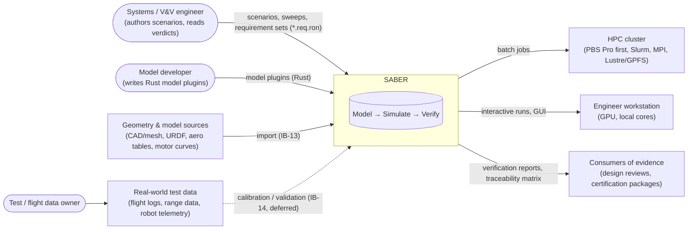

**Scope boundary.** SABER owns: model definitions, scenario authoring, simulation, telemetry, crash
forensics, requirement evaluation and reporting. SABER does **not** own: a requirements repository
(`*.req.ron` files are the source of truth for now, and verdicts do not flow back anywhere, D3), CAD
authoring, cluster scheduling, digital-twin calibration (D6), or long-term data archiving. All campaign data
stays on the cluster and workstation; no component contacts an external service (D7).

---

## 3. Containers (C4 level 2)

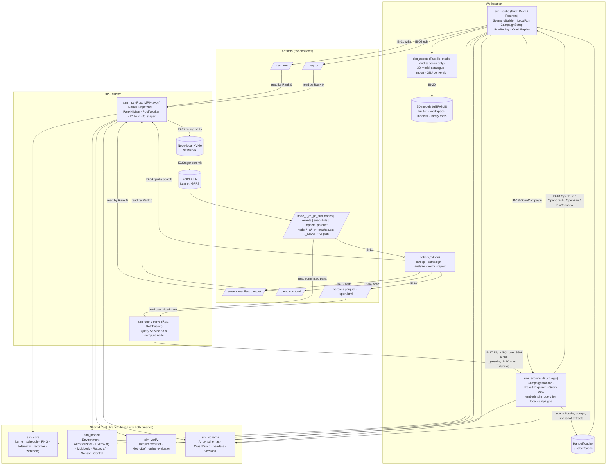

**Key change vs draft:** the GUI is no longer only an *authoring + forensic* tool. `LocalRun` executes the
same `sim_core` schedule interactively (single World, real-time or stepped), which is how users build
confidence in a scenario before spending cluster hours. Campaign outputs and verdicts are read by a second
app, `sim_explorer` (D12), which hands individual runs back to the studio (IB-18). For cluster campaigns it never reads raw Parquet over the network: queries run next to the data in
`sim_query serve` and only result batches cross the SSH tunnel (D7, D10). Layout and interaction are in
the GUI UX doc.

---

## 4. Crate / package dependency graph

Dependencies point downward only. Anything with windowing, rendering, MPI or Python must never be a
dependency of the four libraries.

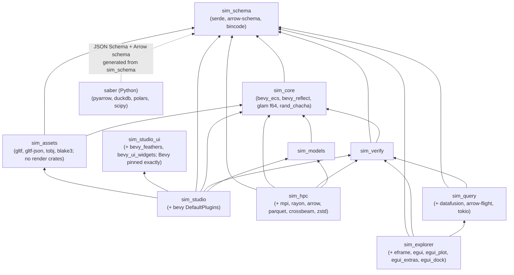

Rules:
- `sim_models` must not depend on `sim_verify` (models emit signals; verification observes them).
- `sim_hpc`, `sim_explorer`, `sim_models` and Python never depend on `sim_assets`: no glTF and no image decoding
  on the cluster (D17). `sim_assets` derives collision shapes through `sim_core::geometry::derive`, so Parry is still
  imported only by `sim_core::geometry`.
- `sim_schema` is the **single source of truth** for every on-disk format. Python never hand-codes a
  column list; it loads `saber/schemas/*.json` generated by
  `cargo run -p sim_schema --features io --bin export-schemas`, and a Rust test fails when the committed files
  are stale.
- The kernel never builds Arrow. `sim_schema`'s `io` feature (Arrow, Parquet and the crash stream) is enabled
  only by `sim_hpc` and `sim_query`; `scripts/check_dep_rules.sh` checks that `sim_core`, `sim_models`,
  `sim_verify` and `sim_testkit` reach no `arrow-*` or `parquet` crate.
- One `arrow` / `parquet` version for the whole workspace, set by the DataFusion release `sim_query` uses.
  `sim_schema`, `sim_hpc` and `sim_query` upgrade together (D10); a mismatch is a build error, not a
  runtime one.
- A `saber-cli` thin Rust binary (or `sim_hpc --validate-only`) is the only way Python validates
  `.scn.ron`/`.req.ron`, so Python never re-implements RON parsing.

---

## 5. Components per subsystem (C4 level 3)

### 5.1 `sim_core` — deterministic kernel

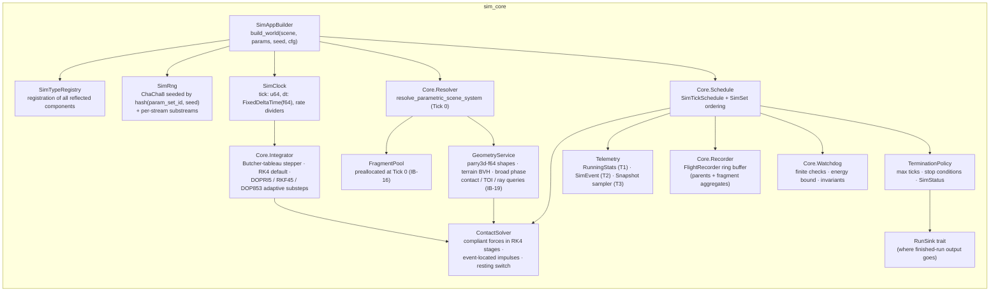

| Component | Responsibility | Key types |
|---|---|---|
| `SimAppBuilder` | Only sanctioned way to construct a World; both binaries call it. Guarantees identical registration and plugin order. Builds a `SimWorld`, which owns the World and its schedule and runs the per-run lifecycle (`start` = Tick 0, `step`/`run`, `output`, `reset`). | `SimConfig`, `SimPlugin`, `SimAppBuilder::build() -> Result<SimWorld, SetupError>`, `SimWorld` |
| `Core.Resolver` | Tick-0 expansion, after the scenario is spawned and before any plugin starts: parse each binding and uncertainty target once into a typed setter, write the manifest row's values (or the defaults) for every entity in `SimId` order, then draw the uncertainties in `SimId` order with one uniform each from the named stream (inverse CDF, §7), then remove both components so the running World holds only resolved values. Spawners arrive with the step that needs them. | `ParamBindings`, `Uncertainties`, `ParamValues`, `Distribution`, `Sampler`, `ResolveReport` |
| `Core.Schedule` | Holds `SimTickSchedule` with `SimSet` chain (§6). Single-threaded executor, set explicitly (Bevy defaults to multi-threaded when any crate in the build enables it). | `SimSet` enum, `SimTickSchedule` |
| `SimClock` | Tick counter + fixed dt + multi-rate dividers so controllers/sensors can run at e.g. 1/10 physics rate deterministically. | `RateDivider(u32)` |
| `Core.Integrator` | One Butcher-tableau-driven explicit RK stepper for every method (RK2, RK4 default, BS3(2), RKF45, CK45, DOPRI5(4), DOP853) plus semi-implicit Euler. Crosses each tick in fixed substeps or adaptive substeps (PI control) that always land exactly on the tick boundary; embedded pairs report a local error estimate in both modes; dense output feeds contact event location. One integrator per World; fragments use their own fixed method (D14). | `IntegratorConfig`, `Integrator`, `Tableau<S>`, `trait OdeSystem`, `StateLayout`, `TickReport`, `IntegratorStats`, `SolverFailure` |
| `SimRng` | Root RNG + **named substreams** (`rng.stream("wind")`) so adding a new noise source doesn't shift every other random draw. | `SimRng`, `RngStream` |
| `Telemetry` | T1 online reductions, T2 events, T3 adaptive snapshots. Writes into pre-allocated per-run buffers. Tick energies are computed here once and shared with the recorder and watchdog. As built (step 2): models emit named `SimEvent { name, sim_id, value }`s into `SimEvents`, which is cleared at the start of every tick (first system of `Environment`) and holds 256 events per tick, counting further ones as dropped instead of allocating; names are `&'static str` declared with `SimAppBuilder::declare_event`. The `events.parquet` row is `sim_schema::EventRow` (3a); writing it is `IO.Mux`'s (3b). As built (step 3b): after the recorder in `SimSet::Record`, `TelemetryLog` copies this tick's events (with the body's position from the frame just recorded) and, every `snapshot_every` ticks from Tick 0, every body's state; buffers are sized at Tick 0 from `TelemetryConfig { max_events, snapshot_every, max_snapshots }` (a campaign setting, not in `sim_config_hash`), so overflow is counted, never allocated, and `RunOutput` adds the final state when it was off the cadence. Adaptive snapshot ramp-up is not built yet. As built (step 5d, part 1): `SimEvent` also carries `other` (the second entity of a contact) and `pos` (where it happened; when absent the log uses the body's position), and the log row fills `other_sim_id`. As built (step 5e-2): a snapshot of a `Fragmentable` body carries its fragment cloud from the same frame (`SnapshotSample::fragments`), and `RunOutput` adds the run's fragment counts and impacts. | `RunningStats` (Welford energy statistics, energy drift, peak force), `TickEnergy`, `SimEvent`, `SimEvents`, `SnapshotSampler` |
| `FieldPath`, `CheckCatalog` | Kernel support for verification that model plugins can reach without depending on `sim_verify` (§4): `FieldPath` reads a number or `bool` from `Component.field.path` through a path parsed once (no allocation per read); `CheckCatalog` holds the named custom requirement checks plugins register with `SimAppBuilder::register_check` (step 2). | `FieldPath`, `FieldReadError`, `CustomCheck`, `CheckState`, `CheckCatalog` |
| `Core.Recorder` | Fixed-capacity ring buffer of `TickFrame`s. Records authored bodies and per-parent fragment aggregates, never individual fragments (IB-16). As built (step 5e-2): every frame carries `TickFrame::fragments`, one `FragmentCloudSnapshot` per `Fragmentable` body in `SimId` order, with room reserved at Tick 0. | `FlightRecorder` |
| `GeometryService` | Only module that imports Parry. Builds Parry shapes from `CollisionShape` and the terrain BVH at Tick 0; runs the swept-AABB sort-and-sweep broad phase; wraps contact, time-of-impact and ray/segment queries for contact, sensors and fragment impacts. All buffers preallocated (D13, IB-19). As built (step 5d, part 1): the module is `sim_core::geometry`; shapes are `CollisionShape { parts }` of `ShapePart { shape: ShapeDesc, pose: Pose }`, built into Parry shapes at Tick 0 (meshes and height fields with their BVH); the broad phase lives in `ContactSolver`. Ray queries serve gear points; from step 5d-3 `Dynamics::ray_cast` also serves range sensors (first collider along a ray, skipping one `SimId`, `RayHit { distance, point, normal, sim_id }`). | `CollisionShape`, `ShapePart`, `ShapeDesc`, `Pose` |
| `ContactSolver` | Contact response for the three models in `physics-engine-tradeoffs.md` §9: `Compliant` (spring–damper + regularised friction, evaluated in every RK4 stage), `Impulsive` (restitution + friction cone at an event-located time of impact), `EventOnly` (detect and record). Emits `SimEvent::Contact`. As built (step 5d, part 1): `sim_core::contact`, owned by `Dynamics`; `Compliant` and `EventOnly` (at tick ends) only, `Impulsive` arrived in 5d-2 (`sim_core::contact::impact`): impacts located inside `Integrate` by re-integrating every body, Newton impulses with Coulomb friction (Poisson and plastic fallbacks when Newton would add energy), the resting switch, deferred impacts, penetration recovery, swept `EventOnly` checks. Forces are added after the force models in every stage; `SimSet::Constraints` fills `Contacts` and emits `contact` and `contact_end`. Details in `physics-engine-tradeoffs.md` §9.7a and §9.7b. | `ContactMaterial`, `DampingLaw`, `ContactPoints`, `GearPoint`, `ContactOverrides`, `ContactConfig`, `Contacts`, `ContactPoint` |
| `FragmentPool` | Fixed-capacity store of dormant 3DOF fragment slots, sized from the scenario and allocated at Tick 0 so fragmentation never allocates mid-run (IB-16). Absent when a scenario declares no fragmentation. As built (step 5e-1): `sim_core::fragments`, a struct of arrays (no per-fragment entity), sized to `config.fragments.capacity` when a `Fragmentable` body exists and to nothing otherwise. As built (step 5e-2): the per-parent `FragmentCloud` and per-target `ImpactTally` components, updated at the end of every tick (IB-16). | `FragmentPool`, `Fragmentable`, `FragmentDrag`, `FragmentationModel`, `FragmentCloud`, `ImpactTally` |
| `Core.Watchdog` | Detects divergence, sets `SimStatus::Crashed*`, tags `FLAG_NAN_ORIGIN`. Checks every body's state is finite, then (when set) that total mechanical energy (translational, rotational and the environment's gravity potential) stays at or below `energy_max_j`. Names the first non-finite body in `SimId` order, or the body with the most energy. | `WatchdogConfig { energy_max_j: Option<f64> }`, `RunStatus` |
| `TerminationPolicy` | Ends the run: tick budget, model-declared stop conditions (impact, landing, goal reached), crash. Stop conditions call `StopRequests::request(name)`; the run ends as `Terminated` at the end of that tick. At `max_ticks` the run ends with `at_max_ticks`, `Completed` by default (D19). | `SimStatus`, `StopRequests`, `MaxTicksOutcome` |
| `RunSink` | Abstracts output so the kernel never knows whether it is in the GUI or on a cluster. | `trait RunSink` (IB-06), `RunOutput`, `MemorySink` |
| `Dynamics` | Tick-0 body table (authored `RigidBody6` and `PointMass3` in `SimId` order), the packed state, the force models and every stage buffer; the `Integrate` system. Gravity comes from the `Environment`, everything else from `ForceModel`s evaluated at each stage. | `RigidBody6`, `PointMass3`, `MassProps`, `BodyState`, `BodyTable`, `trait ForceModel`, `Wrench`, `trait Environment`, `EnvSample` |

### 5.2 `sim_models` — system & digital-twin modeling layer (new)

The draft's kernel is a generic particle/body integrator. Real system analysis needs domain models
composed from reusable parts. Each domain ships as a Bevy `Plugin` that only adds systems into the
`SimSet`s from §6 and registers its reflected components.

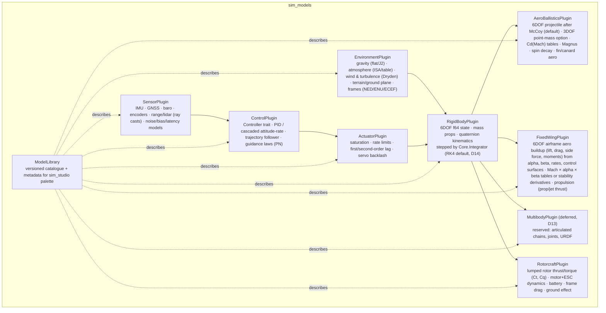

Domain packs, mapped to target systems:

| Target | Plugins | Typical stop conditions | Typical metrics |
|---|---|---|---|
| Aero-ballistics | Environment + RigidBody + AeroBallistics (+ Sensor/Control for guided) | ground impact, apogee, max time | range, miss distance/CEP, impact velocity & angle, max Mach, max q |
| Robotics (deferred, D13) | Environment + Multibody + Actuator + Sensor + Control | goal reached, fall detected, timeout | tracking error RMS, max joint torque, contact forces, stability margin, cycle time |
| Fixed-wing aircraft & drones | Environment + RigidBody + FixedWing + Sensor + Control + Actuator | landing, ground impact, stall/departure, fuel or battery depleted, mission done | path tracking error, alpha/beta excursion, load factor, stall margin, endurance |
| Multirotor drones | Environment + RigidBody + Rotorcraft + Sensor + Control + Actuator | landing, crash, battery depleted, mission done | position error, attitude excursion, battery margin, motor saturation time, wind tolerance |

Fidelity for v1 is fixed by D2: ballistics follow McCoy's *Modern Exterior Ballistics* as a 6DOF rigid
projectile, with a 3DOF point-mass mode for speed (also the model fragments use, IB-16); rotors are lumped
(Ct, Cq per rotor, no blade element); robot arms would be rigid links, but robotics is deferred by D13 and `MultibodyPlugin` is only a reserved name. Aircraft and multirotor sources are collected in `flight-dynamics-sources.md`.

Fixed-wing aircraft get their own `FixedWingPlugin`, kept separate from `AeroBallisticsPlugin` so
airframe and projectile models don't get confused (D9). The two share only lower-level pieces: the
`EnvironmentPlugin` atmosphere and wind, the `RigidBodyPlugin` 6DOF integrator, and a common
coefficient-table type (`AeroTable`, Mach × alpha × beta grids) in `sim_models::tables`. Each plugin
owns its own components (`FixedWingAero`, `ControlSurfaces`, `Propulsion` vs `ProjectileAero`), its own
force system in `SimSet::Forces`, and its own `ModelId` namespace (`fixedwing/…` vs `ballistics/…`), so a
scenario can never attach projectile aero to an airframe or the reverse. Sources: Stevens, Lewis and
Johnson; Beard and McLain; DATCOM and OpenVSP for tables; JSBSim as the cross-check
(`flight-dynamics-sources.md` §2).

**As built (step 1c).** `EnvironmentPlugin` reads up to one each of `Gravity` (`None`, `Flat { g }` in ENU or
NED, `J2` in ECEF: the WGS 84 central field plus J2, no centrifugal term), `Atmosphere` (`Vacuum`,
`Uniform { density, pressure, temperature }`, `Ussa1976` by altitude, isothermal above 86 km) and `Wind`
(`Calm`, `Constant { velocity }`, and from step 5c `Dryden`) from any entities at every Tick 0, after the
Resolver, so their fields can be swept or drawn; a missing one means none, vacuum or calm, and two of one kind
is a `SetupError`. It installs the kernel's `Environment` for the world frame (§10.3). `GroundImpactStop
{ altitude_m }` on a body ends the run as `Terminated` with reason `ground_impact` at the end of the first tick
at or below that altitude; the plugin lists the watched bodies at Tick 0, so a stop added during a run is not
watched. `AeroTable` has one to four named axes of strictly increasing breakpoints, values with the last axis
fastest, multilinear interpolation, and `Clamp` (default) or `Extrapolate` outside the grid.
`sim_models::add_library` adds every library plugin, and `sim_models::LIBRARY_VERSION` (0.1.0 at step 1c,
0.1.1 from step 5a, 0.1.2 from step 5b, 0.1.3 from step 5c, 0.1.4 from step 5c part 2, 0.1.5 from step 5d
part 3) is the version
scenarios check against (IB-01).

**As built (step 5a).** `AeroBallisticsPlugin` (`ModelId` namespace `ballistics/`) acts on two components, and a
`SetupError` names the body that breaks a rule:

- `ProjectileAero { diameter, cd0, cd2, cla, cla2, cma, cma2, cmq, clp, cnpa, cmpa, cl0 }` on a `RigidBody6`
  whose body `x` axis is the axis of symmetry, nose forward. Each coefficient is a `Coef`: `Constant(f64)` or
  `Mach(AeroTable)` with one axis named `mach`, looked up at the Mach number of the air-relative velocity.
  Every coefficient defaults to zero, so a scenario names only those it uses.
- `PointMassAero { diameter, cd0 }` on a `PointMass3`: drag only (the 3DOF option of D2).

With `v_b = q⁻¹(V − wind)`, `v = |v_b|`, `x̂` the body axis, `q_s = ½ρ·πd²/4`, `sin²δ = (v_y² + v_z²)/v²` and
`(p, q, r)` the body rates relative to the world frame, the force and moment in body axes are:

| Term | Body-axis form | Sign convention |
|---|---|---|
| Drag | `−q_s (C_D0 + C_D2 sin²δ) v v_b` | |
| Lift | `q_s (C_Lα + C_Lα2 sin²δ) [v_b × (x̂ × v_b)]` | toward the nose for `C_Lα > 0` |
| Magnus force | `q_s d p C_Npα (x̂ × v_b)` | |
| Overturning moment | `q_s d v (C_Mα + C_Mα2 sin²δ) (v_b × x̂)` | `C_Mα > 0` is statically unstable, as in McCoy |
| Pitch damping | `q_s d² v C_Mq (0, q, r)` | `C_Mq` stands for `C_Mq + C_Mα̇` |
| Spin damping | `q_s d² v C_lp p x̂` | |
| Magnus moment | `q_s d² p C_Mpα [x̂ × (v_b × x̂)]` | |
| Roll drive (fin cant) | `q_s d v² C_l0 x̂` | |

Linearised for small yaw, and dropping the Magnus force and products of small terms as McCoy does, these give
his yaw equation `ξ'' + (H − iP)ξ' − (M + iPT)ξ = 0` per calibre with his `H`, `P`, `M` and `T` (verification
§6.2). A body carries one of the two components; either on a body of the other kind
or on an entity without a body, a non-finite coefficient, a non-positive diameter or a table that is invalid
or not over `mach` is a `SetupError`. The force model copies each body's coefficients at Tick 0, after the
Resolver, so a coefficient can be swept (`ProjectileAero.cla.0` targets a `Constant`). It skips a body with no
air or no airspeed. The plugin inserts `AeroState { mach, dynamic_pressure, total_yaw, spin_rate,
gyro_stability }` on each such body at Tick 0 and updates it in `SimSet::Telemetry` from a list built at Tick 0,
so metrics can read it (`entity(1).AeroState.mach`). `gyro_stability` is McCoy's
`S_g = I_x² p² / (2ρ I_y S d v² C_Mα)`. `AeroState` is run output: the plugin overwrites it at every Tick 0, so a
scenario file need not carry it.

`EnvironmentPlugin` also reads an optional `EarthRotation` (`None`, `Ecef`, or `Local { latitude_deg }` for an
ENU or NED frame whose origin is at that geodetic latitude). The frame then turns at the WGS 84 rate
`ω_E = 7.292115e-5 rad/s`: about `+z` in ECEF, `(0, cos φ, sin φ)` in ENU, `(cos φ, 0, −sin φ)` in NED. The
kernel adds the Coriolis and centrifugal terms (§10.3). Without the component no frame rotates, ECEF
included, so scenarios written before step 5a run unchanged. `Ecef` with J2 gravity gives WGS 84 normal
gravity less its small J4 term. With `Local`, flat gravity is the local plumb line (centrifugal term at the
origin included), and the kernel adds the Coriolis term and the centrifugal term of the offset from the
origin. `Ecef` in a local frame, `Local` in ECEF or a latitude outside ±90° is a `SetupError`.

**As built (step 5b).** `FixedWingPlugin` (`ModelId` namespace `fixedwing/`) acts on a `RigidBody6` whose body
axes are forward, right, down. Its components, each checked at Tick 0 with a `SetupError` naming the body:

- `FixedWingAero { area, span, chord, moment_reference, cx, cy, cz, lift, drag, roll, pitch, yaw }`. Each of the
  eight coefficients is a list of `AeroTerm { value, factors }`, summed. A value is `Constant(f64)` or
  `Table(AeroTable)` whose axes are named after inputs; a factor is `Input(i)`, `Sign(i)` (−1 below zero, else
  +1, for data tabulated over `|β|`) or `Poly(i, [c₀, c₁, …])`. The 21 inputs (`AeroInput`) are α and β in
  radians or degrees, `|β|`, Mach, altitude, airspeed, each control surface in radians or degrees, the
  normalised rates `p̂ = pb/2V`, `q̂ = qc̄/2V`, `r̂ = rb/2V`, and throttle. So a table buildup (Stevens and
  Lewis's F-16), stability derivatives (`C_mq · q̂`) or a mix are all data, not code.
- `ControlSurfaces { elevator, aileron, rudder, flap, throttle }`, radians and 0–1, read once per tick (IB-08),
  so a controller, an actuator model (5c), a scenario or a sweep can set them. The sign convention (positive
  elevator trailing edge down, positive aileron rolls left, positive rudder yaws left) is the data's.
- `Propulsion { engine, thrust_point }`: `Thrust(Vec<AeroTerm>)` in newtons, or `Turbofan { idle, military,
  maximum, angular_momentum }`, Stevens and Lewis's F-16 engine: throttle gearing to a commanded power, a power
  lag whose rate depends on the change asked for, thrust interpolated between the tables by power, and the
  rotor's gyroscopic moment `−ω × h_e`.
- `EngineState { power }`: the turbofan's lag, an integrated state the force model owns (IB-08), inserted at
  Tick 0 at the commanded power unless the scenario gives one.
- `AirData { airspeed, alpha, beta, mach, dynamic_pressure, load_factor, thrust }`: telemetry at the end of
  every tick (`entity(1).AirData.alpha`).
- `TrimCondition { airspeed, flight_path_angle, heading }`: the plugin trims the aircraft for steady straight
  wings-level flight at Tick 0, in `after_setup`: Levenberg–Marquardt over throttle, elevator, aileron, rudder,
  α and β on the World's full right-hand side (`sim_core::dynamics::derivatives`), to residuals below 1e-9.
  The position stays as authored, so altitude and airspeed can be swept. A trim that fails, needs a throttle
  outside 0–1, or runs in ECEF or a rotating frame is a `SetupError`.

Force `F = q̄S[(C_X, C_Y, C_Z) + C_L (sin α, 0, −cos α) − C_D (cos α, 0, sin α)]` (lift and drag in stability
axes) and moment `q̄S(b C_l, c̄ C_m, b C_n) + r_ref × F` about the centre of mass, where `r_ref` is the point the
moment data refer to; then thrust along body `x` at `thrust_point`. `FixedWingAero` and `ProjectileAero` on one
body is a `SetupError` (D9). Coefficients are copied at Tick 0 after the Resolver, so any term can be swept.
The Stevens–Lewis F-16 is in the reference store (`tests/reference/stevens_lewis/f16/`) as a scenario file.

**As built (step 5c, part 1).** Turbulence, servos and sensors.

- `Wind::Dryden { mean, airspeed, heading, intensity, scale }` (local ENU or NED frames only): the MIL-F-8785C
  spectra `Φ_u = σ_u² (2L_u/π) / (1 + (L_uΩ)²)` and `Φ_v = σ_v² (L_v/π)(1 + 3(L_vΩ)²) / (1 + (L_vΩ)²)²` (`w`
  likewise), which are MIL-HDBK-1797's with its lateral and vertical lengths doubled. The field is frozen and
  traversed at `airspeed`, the same everywhere at a given time, along world-fixed axes: `u` horizontal along
  `heading`, `v` to its right, `w` down. Each component is the exact discretisation of its shaping filter
  under continuous white noise, so its samples on the tick grid have exactly the Dryden autocorrelation for
  any tick length; the state starts from the stationary distribution. The plugin draws five normals a tick
  from the `environment/dryden` stream in `SimSet::Environment`, and the wind is interpolated linearly within
  the tick, so every integrator stage sees a continuous wind. A trim at Tick 0 trims into the gust at `t = 0`.
- `Actuators { channels }`: each `Actuator { output, command, hold_start, min, max, rate_limit, lag, backlash,
  position }` drives an `f64` (or `f32`) field of a component on the same entity, named by its path
  (`ControlSurfaces.elevator`, `Rotorcraft.rotors[2].command`). In `SimSet::Actuation` it clamps the
  command, moves the lag toward it (`None`; `FirstOrder { time_constant }` with the rate limit solved in
  closed form; `SecondOrder { natural_frequency, damping }` by the matrix exponential of the error dynamics,
  with the rate limit capping the tick's change), applies backlash of total width `backlash`, clamps to the
  limits, and writes the position at the end of the tick to the field and to `position`. Channels are set up
  in `after_setup`, after every other plugin and any trim: they start at rest at the field's value, which
  must lie within the limits, and `hold_start` commands that value, so servos hold a trimmed aircraft as it
  was. Unknown or non-float fields, a second channel on one field, a channel driving `Actuators`, and bad
  parameters are `SetupError`s. A scenario file need give only `output`; the rest default to no limits, no
  rate limit, no lag and no backlash.
- `Imu`, `Gnss` and `Barometer` components, each with `rate_divider`, `latency` (ticks), a `Noise { white,
  bias, bias_walk, resolution }` per measured quantity (applied to each axis independently) and its outputs
  plus `valid`. In `SimSet::Sensors` a sensor samples the state the tick starts from when the tick is a
  multiple of its divider, and publishes the newest sample at least `latency` ticks old, so a controller in
  the same tick sees it exactly `latency` ticks late. The `Imu` (on a `RigidBody6`, at the centre of mass,
  body axes) reads the inertial rate and the specific force averaged over its sample period, with gravity and
  a turning frame's terms removed; the `Gnss` reads world-frame position and velocity; the `Barometer` reads
  the environment's static pressure and the 1976 standard's pressure altitude of what it measured. The bias
  starts at `bias` and walks by `bias_walk·√T·η` per sample period `T`. Each sensor draws two normals per axis
  per sample from its own stream `sensors/<kind>/<SimId>`, so adding or retuning one sensor never changes
  another's draws. Every sensor field may be left out of a scenario file (a sample every tick, no latency,
  no noise).
- Step 5d-3 adds `RangeFinder { rate_divider, latency, mount, direction, max_range, noise, range, hit, valid }`
  on any body, sampled the same way from its stream `sensors/range/<SimId>`. Its truth is the kernel's ray
  query (`Dynamics::ray_cast`, IB-19) from the mount point along the beam (body axes on a `RigidBody6`, default
  `+z`; world axes on a `PointMass3`), skipping the body's own collider. With nothing within `max_range` it
  reads `max_range` with `hit` false; noise never makes a range negative. Only `max_range` must be given.

**As built (step 5c, part 2).** Rotorcraft and control. Rotor data in the tests are synthetic (TD1).

- `Rotorcraft { rotors, drag_area, rotor_drag }` on a `RigidBody6` (D2: lumped rotors, rigid arms). Each
  `Rotor { position, axis, spin, thrust_coefficient, torque_coefficient, time_constant, min_speed, max_speed,
  inertia, command, speed }` sits at `r` from the centre of mass (body axes), thrusts along the unit `axis`
  (default `−z`, so tilted rotors are allowed) and turns `Ccw` (angular velocity along the axis) or `Cw`. The
  speed `ω` is an integrated state of the force model `rotorcraft/rotors` (IB-08), so every integrator
  crosses it: `ω̇ = (c − ω)/τ` toward the command clamped to `[min_speed, max_speed]`, written back to
  `speed` at the end of each tick. With `v` the air-relative velocity in body axes, the model adds thrust
  `k_T ω² a`, rotor drag `−k_d ω (v − (v·a) a)` at each hub, frame drag `−½ρ|v| (C_D A ⊙ v)`, and the
  moments `r × f`, the reaction `−s (k_Q ω² + I ω̇) a` to the rotor's torque and spin-up, and the gyroscopic
  `−Ω × Σ s I ω a`. `k_T` and `k_Q` are constants (no density or inflow correction). Ground effect, battery,
  blade flapping and motor saturation telemetry are not built yet.
- `MixerCommand { thrust, moment }` on the same entity: in `SimSet::Actuation`, before the actuators, each
  rotor's command becomes `√clamp((B⁺ c)_i, min², max²)`, where `B` maps rotor `ω²` to collective thrust
  along the rotors' mean axis and the three body moments, and `B⁺ = Bᵀ(BBᵀ)⁻¹` is its minimum-norm right
  inverse (exact for four rotors, least squares for six or eight). The mixers are built in `after_setup`, so a
  `MixerCommand` a controller inserts at `start` is mixed. A layout that cannot set thrust and all three
  moments independently is a `SetupError` only when it has a `MixerCommand`; without one, rotor commands are
  whatever a controller, an actuator channel or the scenario writes.
- `PidControl { loops }`: each `PidLoop { measurement, setpoint, output, kp, ki, kd, derivative_filter,
  feedforward, min, max, rate_divider, wrap_angle, integral, value }` reads a numeric field and writes an `f64`
  or `f32` field on its own entity by path (`Imu.gyro.x` to `MixerCommand.moment.x`), every `rate_divider`
  ticks in `SimSet::Control`, in list order. The setpoint is `Constant(v)` (read every step, so it can be
  moved during a run), `Field(path)`, or `Loop(j)`, the output of an earlier loop in the same tick, which
  cascades loops. The derivative acts on the measurement through a first-order filter, so setpoint steps
  do not kick it; the integral stops while the output sits on a limit and the error would push it further
  (conditional integration); `wrap_angle` takes the error and the measurement change the short way round.
  `value` and `integral` are written back as telemetry. Unknown or unwritable paths, a loop driving a
  `PidControl` field, two loops on one output, a `Loop(j)` that is not earlier, and bad numbers are
  `SetupError`s. A scenario gives only `measurement` and what it uses.
- `tests/scenarios/quadrotor.scn.ron` is a worked example: a quad X climbing from 2 m to 10 m on two cascaded
  loops on the GNSS fix (altitude to climb rate, limited to 3 m/s, then climb rate to thrust with `m·g` as
  feedforward) and three rate-damping loops on the IMU gyro, all through the mixer.

`Controller` boundary (in-process, deterministic), as built:

```rust
/// A native controller run inside the tick loop: a component on the entity it controls.
pub trait Controller: Component<Mutability = Mutable> + Sized {
    type Obs: Component + Clone;                  // read from the same entity (a sensor, an estimate)
    type Cmd: Component<Mutability = Mutable> + Default; // written to the same entity (MixerCommand, ControlSurfaces)
    const NAME: &'static str;                     // errors, and its stream control/<NAME>/<SimId>
    fn rate_divider(&self) -> u32;                // runs every N physics ticks
    fn reset(&mut self, rng: &mut RngStream);     // Tick 0, with its own stream
    fn step(&mut self, t: f64, obs: &Self::Obs) -> Self::Cmd; // pure f64, no I/O, no alloc
}
```

`ControllerPlugin::<C>::new()` runs every `C` in `SimSet::Control`, after the PID loops, in `SimId` order. It sets
up in `start` (a controller needs a `SimId` and its `Obs`; a missing `Cmd` is inserted at its default) so the
command component exists before other plugins' `after_setup`. The design sketch had `Obs` and `Cmd` as
reflected values handed over by the kernel; as components on the controlled entity, a controller plugs into
sensors, the mixer, actuators and PID loops with no glue, and its inputs and outputs are visible to field
paths, probes and the recorder.

Controllers are native Rust `Controller` implementations only. Real flight software in the loop is out of
scope (D4).

### 5.3 `sim_verify` — online per-run evaluation (new)

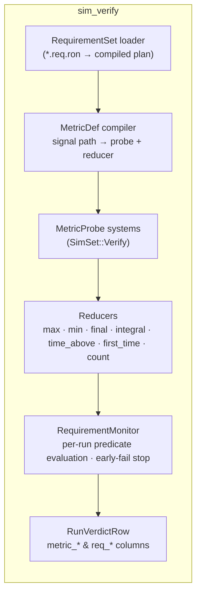

Stage split:
- **Per-run (Rust, in the Worker):** deterministic, per-trajectory predicates: "max lateral accel < 30 g",
  "never enter keep-out zone", "reach waypoint within 12 s". Produces metric values + a per-run
  `Pass/Fail/Inconclusive` per requirement, written as columns in the summary row.
- **Per-campaign (Python, `saber.verify`):** statistical requirements over many runs: "P(miss < 2 m)
  ≥ 0.95 with 90 % confidence", sensitivity of a verdict to parameters, coverage of the operating envelope.

**As built (step 2).** `sim_verify::spec` (no kernel, so the data side builds without Bevy) reads and checks the
file; `sim_verify::monitor` (feature `ecs`) holds `VerifyPlugin`. The plugin is added after the model plugins and
compiles the set against the World at every Tick 0: each distinct signal path becomes one probe (entity by
`SimId`, `FieldPath` parsed once), event names must be declared, `Custom` names must be in the `CheckCatalog`;
any failure is a `SetupError`. In `SimSet::Verify`, while the run is still going, it reads every probe once,
feeds the reducers and moves every open requirement:

- **Sampling.** A signal is sampled at the end of each tick `k = 1..N` (the state that tick produced), at elapsed
  time `k·dt`; Tick 0 is not sampled, because model outputs are only computed by the ticks. Windows and deadlines
  are elapsed seconds since Tick 0.
- **Reducers.** `Max`, `Min`, `Final` (`NaN` with no samples), `Integral` (`Σ x·dt`, each sample holding for its
  tick), `TimeAbove(th)` (`dt ×` samples strictly above `th`) take signals; `FirstTime` (elapsed time of the first
  tick with the event, `+∞` if it never happens) and `Count` take events. A non-finite sample or a tick whose events
  overflowed poisons the metric to `NaN`, which makes it `Inconclusive` (IB-09).
- **Settled verdicts.** A requirement is settled when no later tick can change it: a `Never` whose condition
  held (Fail), an `Eventually` whose condition held in time (Pass) or whose deadline passed (Fail), an `Envelope`
  violated in its window (Fail) or past it (Pass), a `Custom` check that says so. A non-finite reading settles a
  still-open requirement as `Inconclusive`. A `Threshold` is judged from its metric at the end; it counts as
  decided early when the reducer only moves one way (`Max`, `TimeAbove`, `Count` grow, `Min` shrinks, a
  `FirstTime` is fixed once it happened) and the comparison can no longer change.
- **Early stop.** A requirement with `early_stop_on_fail` that is settled (or decided) as failed asks the run to
  stop (`StopRequests`, reason `requirement_failed`, so the run ends `Terminated` at the end of that tick).
- **After the run,** `run_verdicts(world)` (or `VerifyState::finalize(world, status, stop_reason)`) gives the
  `RunVerdictRow` by §8.2. Ticks never allocate; the row is built once per run.

### 5.4 `sim_schema` — formats & versions (new)

| Item | Content |
|---|---|
| `FileHeader` | `magic`, `format`, `schema_version` (semver), `saber_version`, `build_id` (git sha + rustc + target + feature flags), `campaign_id`, `scene_hash`, `req_set_hash`, `created_utc`. As built (step 1c): a serde struct whose last five fields are optional (left out when unset); `FileHeader::check(format, supported)` checks the magic, the format and the version, and `Semver::satisfies` is Cargo's caret rule (same major, at least the required version, and the same minor below 1.0). |
| Arrow schemas | `SUMMARY_SCHEMA` (fixed + dynamic `param_*`, `metric_*`, `req_*` columns), `EVENTS_SCHEMA`, `SNAPSHOTS_SCHEMA`, `VERDICTS_SCHEMA`, `MANIFEST_SCHEMA`. As built (step 3a): one `io::Table` enum (`Summaries`, `Events`, `Snapshots`, `Impacts`, `Manifest`, `Verdicts`) whose `columns()` are the fixed columns in file order with type and nullability, `dynamic()` the families allowed after them (`param_ f64`, `metric_ f64`, `req_ u8`; `ch_ f64` for snapshots; `param_ f64` for the manifest) and `sort_key()`. `arrow_schema(dynamic)` builds the Arrow schema from full dynamic names (families in order) and `check_schema` checks a file's. Every table is schema version `1.0.0`. As built (step 5e-2): summaries `1.1.0` adds a fourth family, `fragments_ u64`, after `req_`: `fragments_written`, `fragments_dropped`, `fragments_impacted`, `fragments_expired` (`SummaryRow::FRAGMENT_COLUMNS`, `SummaryRow::fragments`), present only when the scenario has a `Fragmentable` body, so 1.0 files read unchanged; the snapshot channels of a fragmenting campaign are `FragmentCloudSnapshot::CHANNELS` (`ch_frag_*`, 20 columns). |
| Parquet I/O | As built (step 3a, feature `io`): `write_parquet` (zstd) puts the `FileHeader` JSON in the footer under `saber.header`, plus extra entries (`saber.run_ids`, `saber.crash_counts`, `saber.sampler`); `read_parquet` refuses a file without the header, with another format or schema major, or with columns that do not match, before it reads a row. `TableRow` turns each row type (`SummaryRow`, `EventRow`, `SnapshotRow`, `ImpactRow`, `ManifestRow`, `CampaignVerdictRow`, which need no Arrow) into a record batch and back, refusing unknown enum bytes and half-null vectors. Arrow and Parquet are pinned to 59.x, the release DataFusion 55.2 uses. |
| `CrashDump` | header + run identity + `SimStatus` + `CrashReason` + chronological `Vec<TickFrame>` + optional panic message/backtrace. As built (step 3a): `CrashDump { header, run_id, param_set_id, replicate_seed, params: Vec<(String, f64)>, status, reason, panic, frames }` (the backtrace waits for 3b's `catch_unwind`); `io::CrashWriter` and `io::CrashReader` write and read the stream described in IB-07, format `crashes` `1.0.0`. bincode is pinned (`=2.0.1`) because its bytes are on disk. As built (step 5e-2): `crashes` `2.0.0`, because `TickFrame` gained `fragments: Vec<FragmentCloudSnapshot>` and bincode has no optional fields; `CrashReader` still opens a 1.x stream and decodes its dumps with the 1.x frame layout (no fragments), the upgrader for one previous major (§10.4), checked against the step-3a golden stream kept as `tests/shared/io/crashes_v1.zst`. A writer takes only 2.x. |
| `build_id` | As built (step 3a): `sim_schema::build_id()` is `saber <version> git <sha> <rustc -V> target <triple> profile <profile>`, stamped by `build.rs` (`SABER_GIT_SHA` overrides the git lookup for builds outside a checkout). A library cannot see the final binary's Cargo features, so the id has none yet; `sim_hpc` can append its own with 3b. Bit-identical results are promised only within one `build_id` (D1). |
| `TickFrame`, `BodySnapshot`, `CrashReason` | The flight-recorder frame (`tick`, `t_s`, `total_energy`, bodies in `SimId` order with `sim_id`, `pos`, `quat_wxyz`, `lin_vel`, `ang_vel` (body rates), `force_mag`, `flags`), the `FLAG_*` bits, and `CrashReason { kind, sim_id, tick, detail }`. Plain `f64` arrays, so the crate needs no maths library (step 1b). |
| `SimStatus`, `CrashKind`, `IntegratorKind`, `EventType`, `Verdict` | `#[repr(u8)]` enums with stable discriminants, exported to Python. `CrashKind` is the `kind` of a `CrashReason { kind, sim_id, tick, detail }` and the summaries' `crash_reason u8`: `0 NonFinite`, `1 EnergyBound`, `2 Panic`, `3 StepSizeUnderflow`, `4 SubstepLimit`, `5 ContactCapacity`, `6 Penetration` (step 5d-3); each maps to one crashed `SimStatus`. `IntegratorKind` is the summaries' `integrator u8` (`0 SemiImplicitEuler` … `7 DormandPrince853`, `physics-engine-tradeoffs.md` §10.1). As built (step 3a): `Verdict` is `0 Pass`, `1 Fail`, `2 Inconclusive`, and the `DiskEnum` trait gives each enum's byte and back. There is no `EventType`: an event row carries the name its plugin declared (`ground_impact`, ...) as a string column, which Parquet dictionary-encodes, so a new model adds events without a schema change. |
| `export-schemas` bin | Writes `schemas/*.json` (JSON Schema + Arrow IPC schema) for Python. As built (step 3a): writes `python/saber/schemas/{summaries,events,snapshots,impacts,manifest,verdicts}.json` (columns with type, nullability and a short doc, dynamic families, sort key, format and version), `enums.json` (variant names in byte order) and `formats.json` (magic, footer keys, the schema version of every format, including `scenario`, `requirements` and `crashes`); `--check` only compares. Plain JSON instead of JSON Schema plus Arrow IPC: `saber.schema` builds the Arrow schema from it, and the files stay readable in review. |

### 5.5 `sim_studio` — GUI

States (detail and wireframes in `sim_studio_ux.md`, the GUI UX doc):

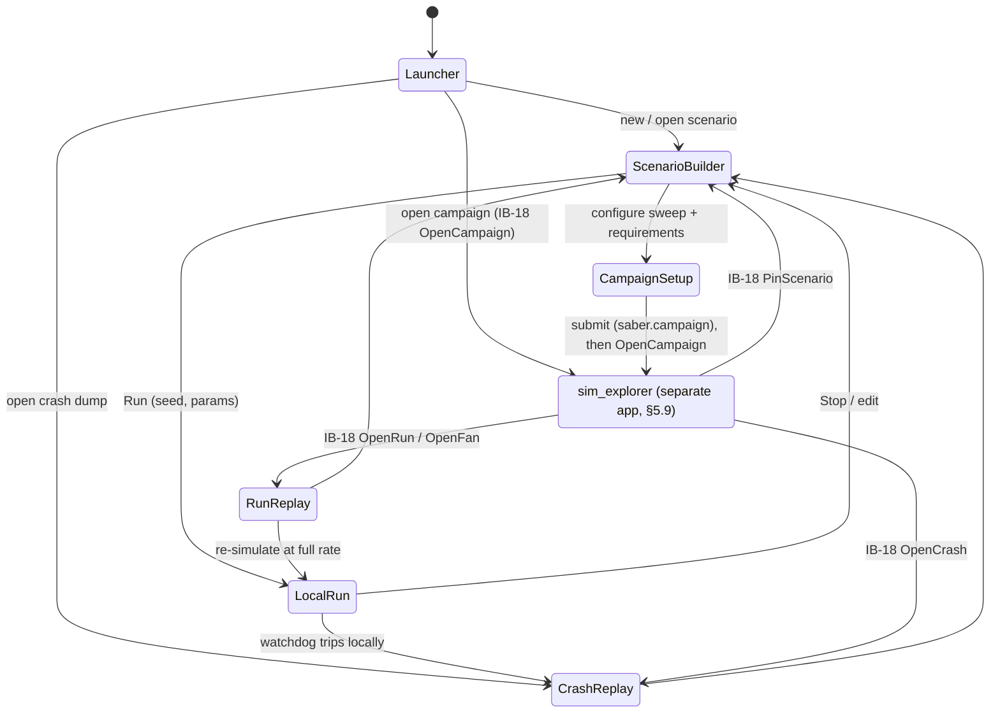

| Component | Responsibility |
|---|---|
| `Studio.Builder` | Entity/model palette from `ModelLibrary`, inspector driven by `bevy_reflect`, parameter-binding & uncertainty editors, requirement editor, `.scn.ron`/`.req.ron` export, validation panel. |
| `Studio.LocalRun` | Owns one sim World built by `SimAppBuilder`, steps `SimTickSchedule` from a `Time<Fixed>`-driven system (N ticks per frame, pausable, single-step), plots live signals, shows live requirement status. |
| `Studio.Replay` | Loads `CrashDump` (from the handoff cache, or a `.zst` the user opens), rebuilds scene via Resolver with the crashed run's params, scrubs frames; can also *re-simulate up to the crash* deterministically for full-fidelity state (see §11 G9). |
| `Studio.CampaignSetup` | Pick scenario + `.req.ron`, configure sampler (calls `saber.sweep`), execution settings → writes `campaign.toml`, runs preflight (`--validate-only`), submits. |
| `Studio.RunReplay` | Replays a completed run from Tier 3 snapshots, or rebuilds and re-simulates it at full rate via LocalRun. |
| `Studio.Handoff` | Local-socket server for IB-18 requests from `sim_explorer` (and deep links when the studio is started by one); validates the cached scene bundle hash and `build_id`, then enters `RunReplay`, `CrashReplay` or the Builder. Sends `OpenCampaign` after a submit. |
| `RenderBridge` | The only place f64 sim state crosses into f32 render state; uses a floating origin (G7). The origin follows `CameraFocus` while the camera is locked on an entity; also hands the state HUD its f64 values and the ground grid its per-decade phases (`origin mod 10^(k+1)`). |
| `Studio.Viewport` | `StudioCameraRig` (f64 pivot, focus modes Frame / Follow / Chase / Track), `StateHud`, `GroundGridPlugin` (infinite graph-paper plane, per-pixel decade LOD, distance labels). Detail in `sim_studio_ux.md` §7.10. |
| `Studio.Assets` | `VisualModelPlugin`: resolves each entity's `VisualModel` through the `sim_assets` catalogue, loads glTF through Bevy's `AssetServer` (cached per content hash, cameras and lights skipped), spawns a `ModelRoot` under the body's render proxy, handles placeholders, LOD and far markers (moving-part bindings later, D17), and hosts the Import dialog and Derive collision (§5.10, `sim_studio_ux.md` §7.11). |
| `Studio.UiKit` | `sim_studio_ui`: Feathers facade plus own widgets (`StudioDock`, `DataTable`, `PlotCanvas`, `TreeView`, `EntityPicker`, `QuantityInput`, `CodeEditor`). Detail and risk register in `sim_studio_ux.md` §6.1. |

**As built (step S1).** The frame only: `Studio.UiKit` has the theme (every `sim_studio_ux.md` §10.1 token as a Feathers token), `StudioDock` with fixed regions, toasts and the widget facade; `sim_studio` has the six `AppState`s, the activity rail, workspaces (`saber.workspace.ron`, schema in `sim_studio_ux.md` §6.3) with starter packs, the per-user recent list (`~/.saber/studio/recent.ron`), the Launcher and the shell. `Studio.Replay` opens a crash stream's index (dumps listed; scrubbing is S6). `Studio.Handoff` is not built: Results says the explorer arrives with step 6b. The studio's logic (`StudioCorePlugin`) runs on `MinimalPlugins`, so tests drive it without a window. Details in `sim_studio_ux.md` §6.3.

### 5.6 `sim_hpc` — headless cluster runner

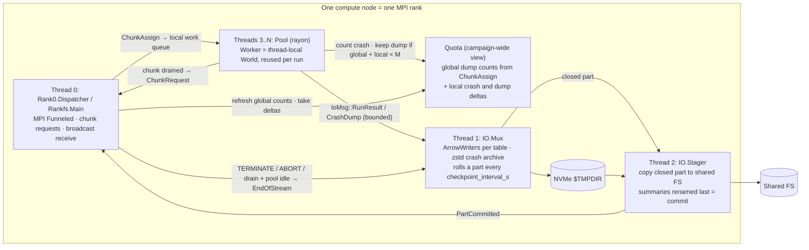

| Component | Responsibility |
|---|---|
| `Preflight` | Rank 0 only, before broadcast: validate `campaign.toml`, scene, req set, manifest compatibility (IB-04). Fail fast before burning allocation. |
| `Rank0.Dispatcher` | Broadcast scene, req set and manifest blobs; serve chunks on demand (the first `canary_chunks` in strided, bit-reversed order, then sequential); own the campaign-wide crash and dump counts and evaluate `[crash_policy]` on every `ChunkRequest`; stop dispatch `drain_margin_s` before walltime; on `--resume`, compute the missing `run_id` ranges from committed footers; write `campaign_status.json` (IB-15) and keep `_MANIFEST.json` current as `PartCommitted` reports arrive. Also runs a worker pool (with one fewer thread). |
| `RankN.Main` | Receive blobs, request chunks with crash, dump and setup-error deltas plus `PartCommitted` reports, feed local queue, refresh the `Quota` view from `ChunkAssign`, `Iprobe` for `TAG_ABORT` while the pool works, forward `TERMINATE`/`ABORT` as a cancel flag. |
| `Pool` / `Worker` | `for_each_init` World reuse; `catch_unwind` per run; World reset between runs (G5). |
| `Quota` | The node's view of the campaign-wide crash counts: global dump counts from the last `ChunkAssign` plus dumps kept locally since. A worker keeps a dump while that view is below `M` (`dump_quota_per_param_set`); every crash is counted for the storm check whether or not it is kept. Can overshoot `M` by a few dumps; replay and analysis show the `M` lowest-seed dumps (G6). |
| `IO.Mux` | Owns all file handles; writes row groups to the current part on NVMe; records each part's `run_id` RangeSet and crash counts; closes the part every `checkpoint_interval_s` (and on drain, abort or SIGTERM) and hands it to `IO.Stager`. |
| `IO.Stager` | Copies each closed part to the shared FS as `.tmp` and renames: events, snapshots and crashes first, summaries last (the commit). Retries with backoff; reports `PartCommitted` or failure to the main thread; writes `_SUCCESS.{rank}` once every part is committed. |

There is no separate `Checkpointer`: checkpointing is the IO.Mux part roll plus the IO.Stager commit, and
resume is a Rank0.Dispatcher function (G11, IB-07).

**As built (step 3b), `sim_hpc --local`.** `Campaign::load` is `Preflight`: it reads `campaign.toml`, checks
`expected_build_id` (the whole `build_id`, or at least seven leading digits of its git commit), loads the scenario
with the model library, parses the requirement set, reads and checks the manifest (IB-02 errors; unbound columns
are warnings), runs Tick 0 with the defaults and compiles the requirement set against it. The local dispatcher
cuts the manifest into `chunk_size` chunks and hands them out in the canary order rank 0 will use (the first
`canary_chunks` bit-reversed across the manifest, then the rest); `threads` worker threads (std scoped threads
pulling from that queue, the shape the MPI receive loop will feed in 4a; rayon is not needed) each build one
World and reuse it with `reset`. A run is `start_with_params` plus `run` inside `catch_unwind`: a watchdog crash
keeps the World, a panic drops it and the next run rebuilds it, and either keeps a `CrashDump` (the recorder's
frames, the panic message) while the node's `Quota` for that `param_set_id` is below `M`. The summary row merges
the kernel's `RunOutput`, the `RunVerdictRow` and the manifest row; `SetupError` and `Panicked` rows carry `NaN`
statistics and `Inconclusive` verdicts. The campaign crash policy (storm abort) is rank 0's and arrives with 4a;
SIGTERM drain and `--resume` with 4b.

**As built (step 4a), MPI dispatch and the crash policy.** Every rank, `--local` included, runs one loop
(`sim_hpc::rank`) over a `Transport` trait (`broadcast`, tagged `send`, `try_recv`, `try_recv_tag`, `recv_tag`):
`Mpi` (rsmpi 0.8 with `MPI_THREAD_FUNNELED`, behind the crate's `mpi` feature, so the default build needs no MPI
library), `Single` (one rank, `--local`) and `Threads` (ranks as threads over channels, for the protocol tests).
`start` is the init phase: rank 0 reads the four files once (`Sources`) and preflights them, then broadcasts an
`Init` header and each file's bytes; rank N checks each file's length and BLAKE3 and preflights the same bytes
(`Campaign::from_sources`), and rank 0 gathers `ReadyAck { rank, threads, build_id, error }` and broadcasts one
verdict, so a refusal anywhere (rank 0's preflight, a damaged broadcast, mixed builds) ends every rank with the
same exit code before any run. `run_rank` is the rest. Each rank's worker threads take runs one at a time from a
local queue of assigned chunks; the main thread asks for the next chunk once no more runs are queued than there are
threads (one request ahead), and its `ChunkRequest` carries the deltas: finished chunks, a `Tally` (runs, setup
errors, runs by `SimStatus`, crashes and kept dumps by `param_set_id`, verdict counts per requirement) and the runs
in parts the stager committed since. Rank 0's main thread serves requests from a `Dispatcher` (plain state: the
chunk order, the campaign totals, which chunk went to which rank) and its own requests without a message; with
several ranks it runs one fewer worker thread. The `Quota` view is the campaign-wide counts from the last
`ChunkAssign` (for the parameter sets the rank reported, and every set whose quota is used up) plus the dumps kept
since. The crash policy runs on every request: more than `abort_max_setup_errors` `SetupError` runs trip
`SetupErrors`; at least `abort_min_runs` finished runs of which more than `abort_crash_fraction` crashed or timed
out trip `CrashStorm` (`Timeout` counts, D20). On a trip the dispatcher answers every further request with
`Terminate`, `Abort` reaches the ranks still waiting for work, every rank stops taking runs (a run in progress
finishes; the 1024-tick in-run check is not built) and commits its open part, so the evidence is kept. Every rank
then sends a `NodeReport` (its full tally, parts, failed parts, finished chunks, kept dumps), rank 0 writes
`_MANIFEST.json` (status `complete`, `partial`, `io_failed` or `aborted`, the abort reason and numbers, the crash
histogram by `SimStatus` and `param_set_id`, the `run_id`s of kept dumps, and per rank the chunks assigned and
done) and broadcasts the exit code, which every rank returns: `6` aborted, then `2` (a rank's output paths do not
resolve), `4` (a write or stage-out failed), `5` (runs missing), `0`. A rank whose output fails asks for no more
work (`done` on its request); its chunks are not re-queued, they are listed as missing for `--resume` (4b). Rank 0
writes `campaign_status.json` (IB-15) when the run starts, every `output.heartbeat_s`, and at the end from the
ranks' final reports.

**As built (step 4b), resume, drain and SIGTERM** (`sim_hpc::resume`, `sim_hpc::rank`). `start` plans the attempt
on rank 0 before the broadcast (`resume::prepare`). A fresh campaign (no `--resume`) is refused with exit 2
(`OutputExists`) when its output directory already holds part files or `_MANIFEST.json`, so attempt 0 never
overwrites anything. `--resume` lists the output directory once, reads every committed `*_summaries.parquet`
footer (never row data) and checks its header against the campaign (`campaign_id`, `scene_hash`, `req_set_hash`
and the footer's `saber.manifest_hash`: exit 2, `ResumeMismatch`; `build_id`: exit 3, `BuildMismatch`; an
unreadable footer: exit 4, `ResumeRead`). The attempt is one more than the largest in `_MANIFEST.json` or in any
part file name. The committed runs are the union of the footers' `run_id` ranges, and the counts (runs, runs by
`SimStatus`, crashes and kept dumps by `param_set_id`) are summed from their footers; `_MANIFEST.json`'s attempts
are kept and an attempt it does not list (a job killed before writing it) is rebuilt from its parts
(`rebuilt_from_footers`). An index whose status is `aborted` refuses with exit 6 (`Aborted`) unless
`--override-crash-policy`, which turns the abort rules off for that attempt (the dump quota still applies). Rank 0's
`Dispatcher` is built over the missing runs only (each missing range cut into slices of at most `chunk_size`, in
the canary order) and starts from the restored counts, so the crash policy and the dump quota stay campaign-wide;
the next attempt number reaches rank N in the `Init` broadcast, and a resumed job may have another rank count.
Nothing missing is an attempt that runs nothing and exits 0. Drain: with a walltime deadline (`--deadline`, else
`SABER_WALLTIME_END`, else `SLURM_JOB_END_TIME`, all Unix seconds), rank 0 stops dispatch once the deadline is
within `checkpoint.drain_margin_s`; every later request gets `Terminate`, the ranks finish the chunks they hold and
commit, and the job exits 5. SIGTERM (or SIGINT) sets a flag: the rank's workers abandon the run in progress (they
check between ticks; an abandoned run writes nothing and the next attempt runs it again), the rank says `done` on
its next request, rank 0 also stops dispatch, the open part closes and commits, and the job exits 5; a second
signal ends the process at once with 128 + the signal. A rank's `RunReport` names the attempt and why dispatch
stopped (`walltime` or `signal`); rank 0's `committed_runs` covers every attempt.

### 5.7 `saber` Python package

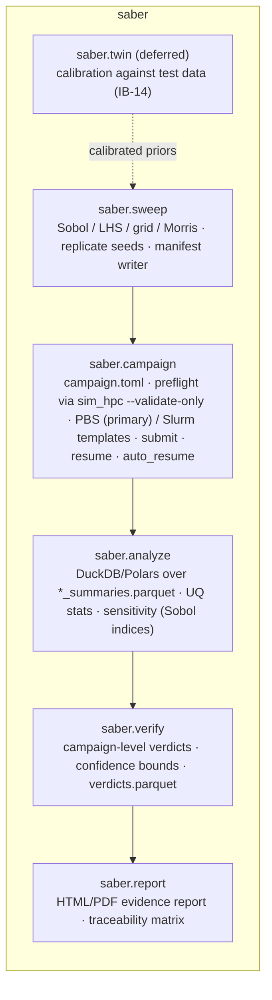

**As built (step 3c), `saber.sweep` and local `saber.campaign`.** `sweep.scene_params(scene)` asks
`saber-cli validate --json` for the scene's `scene_hash` and `ParamBindings` (key, default, bounds), so Python
never parses RON and there is no separate `params.json`. `sweep.generate(scene, params, sampler, replicates, seed)`
needs a definition for every bound key (`Uniform`, `LogUniform`, `Normal` truncated to the bounds, `Levels`, or
`Fixed`/`Default` to hold it; an unbound key is a warning, as in preflight) and refuses a range outside a binding's
bounds, so its manifests pass preflight's bounds check. Samplers: `MonteCarlo`, `LatinHypercube`, `Grid` (full
factorial, last key fastest) and `Morris` (one-at-a-time trajectories on an even-level grid) in numpy, and `Sobol`
through `scipy.stats.qmc` (scrambled by default, with a warning off powers of 2); `sampler=None` holds every
parameter for a replicates-only campaign. `Sweep.write` writes IB-02 through `saber.schema.write_table`.
`saber.campaign.CampaignConfig` mirrors `sim_hpc::CampaignConfig` key for key and writes `campaign.toml` with every
default spelled out; `tests/shared/campaign/defaults.toml` is that output, checked by a Python test and parsed by a
`sim_hpc` test against its own defaults, so the mirrors cannot drift. `prepare` lays out a self-contained campaign
directory (the scene and requirement set copied in, the manifest, `campaign.toml`), `preflight` runs
`sim_hpc --validate-only --json` and `run_local` runs `sim_hpc --local --json`, both mapping exit codes to a
`Status` (IB-04); `LocalRun` reads `_MANIFEST.json` and the committed parts. Binaries are found from an argument,
`SABER_SIM_HPC`/`SABER_CLI`, or `PATH`. PBS and Slurm templates, submit, resume and `auto_resume` came with 4b
(IB-04).

**As built (step 4c), `saber.analyze`, `saber.verify` and `saber.report`.** `analyze.open_campaign` takes a
`campaign.toml` or a shared output directory. A part is committed when its `*_summaries.parquet` has its final
name; `Campaign.summaries()` reads those of every attempt (ordered by attempt, rank, part) as one pyarrow table
sorted by `run_id`, keeps a re-queued `run_id` once and raises `AnalysisError` when two copies' `final_state_hash`
differ. `coverage()` gives the runs in the sweep, those committed and the missing `run_id` ranges (what
`--resume` would run). `uncertainty` gives per `param_set_id` its parameters, runs by outcome and each metric's
mean, standard deviation and 5th, 50th and 95th percentiles over finished runs; `crash_regions` the parameter sets
with crashes or timeouts, worst first. These use pyarrow and numpy: the files are plain Parquet, so DuckDB and
Polars read them as they are, but neither is a dependency. `verify.verify(campaign, requirements=None, *,
crashes="fail", by_param_set=False, envelope=None, recompute=False)` reads the campaign's archived requirement set
through `saber-cli validate --emit-req-json` unless given one, refuses a set whose `req_set_hash` differs from the
one the campaign ran with (unless `recompute=True`, which re-evaluates `Threshold` requirements from their metric
columns and leaves the other kinds `Inconclusive`) and refuses an aborted campaign (`CampaignError`, `ABORTED`).
Each run counts by status: `Completed` and `Terminated` by their `req_<id>` verdict, `Timeout` as `Inconclusive`
(D20), the crash statuses as failures (seq §11's default) or, with `crashes="inconclusive"`, as inconclusive, and
`SetupError` not at all (reported). The rules (§8.2) never let inconclusive runs make a verdict wrong, only
`Inconclusive`: `AllPass` fails on any failure and passes only with no inconclusive run; `Probability` passes when
the one-sided Clopper–Pearson lower bound, with the inconclusive runs as failures, reaches `min_p`, fails when the
upper bound with them as passes is below it, and otherwise reports how many all-passing runs would show it;
`Quantile` takes the empirical quantile (inverted CDF) with the unknown values on the failing side for `Pass` and
on the passing side for `Fail`. Rules judge every counted run together by default; `by_param_set=True` judges
each parameter set on its own and reports the worst (D21). `envelope` keeps runs whose parameters lie in given
ranges. A partial campaign is judged on what committed and says so. The bounds come from a regularized incomplete
beta in the standard library (no scipy), checked against scipy and the binomial tails in tests.
`Verification.write()` writes `verdicts.parquet` next to the parts, with the campaign's hashes in its header and
the policy, counterexamples, upper bounds and warnings in its `saber.verify` footer (IB-12).
`report.write_report(campaign, verification)` writes `report.html` beside it (IB-12), and
`python -m saber.verify CAMPAIGN [--req R] [--crashes inconclusive] [--by-param-set] [--envelope KEY=LO:HI]
[--recompute] [--check]` does all three and prints the verdicts (exit 0, or 1 with `--check` unless every
requirement passed; 2 a set that does not fit or an unreadable file; 6 an aborted campaign, whose report is still
written; 64 usage). Sobol sensitivity indices (seq §10) and the top-up manifest for straddling parameter sets
(seq §11) are not built yet.

### 5.8 `sim_query` — campaign query engine (new, D10)

One crate, two ways to run it. `sim_explorer` links it and queries campaigns on the workstation directly.
For cluster campaigns the same code runs as `sim_query serve` on a compute node, so the data stays on the
cluster and only result batches travel (IB-17). Parquet files are never rewritten or merged: the engine
reads the committed parts in place.

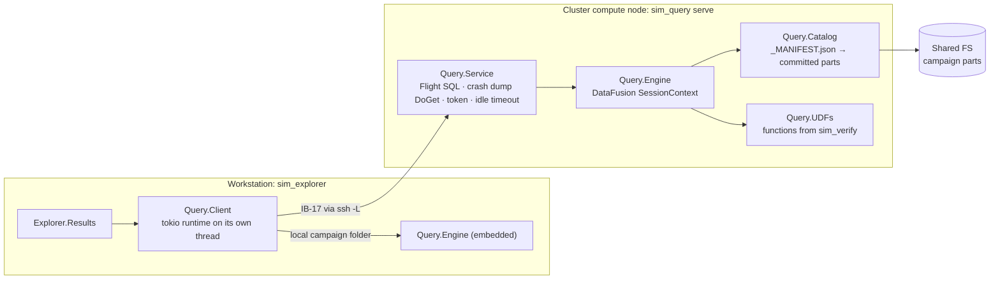

| Component | Responsibility |
|---|---|
| `Query.Catalog` | Reads `_MANIFEST.json` and lists the committed parts of every attempt per table; falls back to globbing `*_summaries.parquet` etc. and skipping `.tmp`/`.partial` when the manifest is missing (same rules as IB-11). Takes one snapshot per query, so a part committed mid-query appears in the next one. |
| `Query.Engine` | DataFusion `SessionContext` with a `ManifestTableProvider` per view (`summaries`, `events`, `snapshots`, `impacts`, `verdicts`, `manifest`). Row-group pruning uses the `param_set_id, run_id` sort order from IB-07. Deduplicates re-queued `run_id`s as IB-11 does. Spills to `$TMPDIR`. |
| `Query.UDFs` | Scalar and aggregate SQL functions registered from `sim_verify` / `sim_schema`, for example `req_margin`, `p_pass_ci`, `cep`, `quat_angle`, so studio numbers come from the same code as the online evaluator. `p_pass_ci` must match `saber.verify`'s aggregation (round-trip test, §12). |
| `Query.Service` | `sim_query serve` binary: Arrow Flight SQL server, `DoGet` for single crash dumps, bearer token, read-only, idle timeout. |
| `Query.Client` | Studio side: Flight SQL client over the SSH tunnel, or direct calls into the embedded engine. Runs on a tokio runtime on a dedicated thread and hands batches to Bevy through a channel, so the egui frame never blocks. |
| `Query.DialectGen` | Builds each view's query from a small AST and renders DataFusion SQL to execute plus DuckDB SQL / Polars code for "Copy as DuckDB / Polars" (UX J10). Free SQL typed in the Query view is DataFusion dialect and may need small edits before it runs in DuckDB. |

Python is unaffected: `saber.analyze` and `saber.verify` keep reading the same Parquet with DuckDB/Polars
(IB-11).

---

### 5.9 `sim_explorer` — campaign data GUI (new, D12)

A separate app and window on eframe + egui (`egui_extras` tables, `egui_plot`, `egui_dock`). It never simulates or renders 3D; anything that needs the kernel or a viewport goes to the studio through IB-18. Layouts are in `sim_studio_ux.md` §6.2, §7.7 and §7.8.

| Component | Responsibility |
|---|---|
| `Explorer.Monitor` | Reads `campaign_status.json` (IB-15) over SSH or the shared FS: per-rank progress, crash counts per `param_set_id`, queue depth, crash storm banner. Crashes go to the studio as `OpenCrash`. |
| `Explorer.Results` | Opens a campaign through `sim_query` (§5.8): embedded engine for local folders, `sim_query serve` over IB-17 for cluster campaigns. Scorecard, param map, sensitivity, distributions, parallel coordinates, virtualized runs table, Query view (SQL), compare mode, Evidence Report export, "Copy as DuckDB / Polars". |
| `Explorer.Handoff` | Fills the handoff cache (scene bundle, single dumps through `DoGet`, snapshot extracts) and sends IB-18 requests; starts the studio by deep link when it is not running. |
| `Query.Client` | As in §5.8, on the explorer's tokio runtime. |

Dependencies: `sim_query`, `sim_verify` (metric and verdict functions), `sim_schema`. No Bevy rendering. `sim_verify` reaches `bevy_ecs` through `sim_core` today; putting its kernel probes (IB-09) behind a default `ecs` feature lets `sim_query` and the explorer build without Bevy at all, so Bevy upgrades (D11) never touch the data side.

### 5.10 `sim_assets` — 3D models for entities (new, D17)

A **3D model** here is a visual asset: a glTF 2.0 file (`.glb` stored, `.gltf` accepted at import) plus a small
manifest, that gives an entity its look in the studio. It is not a physics **Model** (§1). It never changes a
simulation result, and `sim_hpc`, `sim_explorer` and Python never load one. `sim_assets` owns the catalogue,
manifests, validation, import and OBJ conversion; the studio owns loading and drawing (`Studio.Assets`, §5.5).
UX is in `sim_studio_ux.md` §7.11 and the flows are in `sequence-diagrams.md` §2.1–2.3.

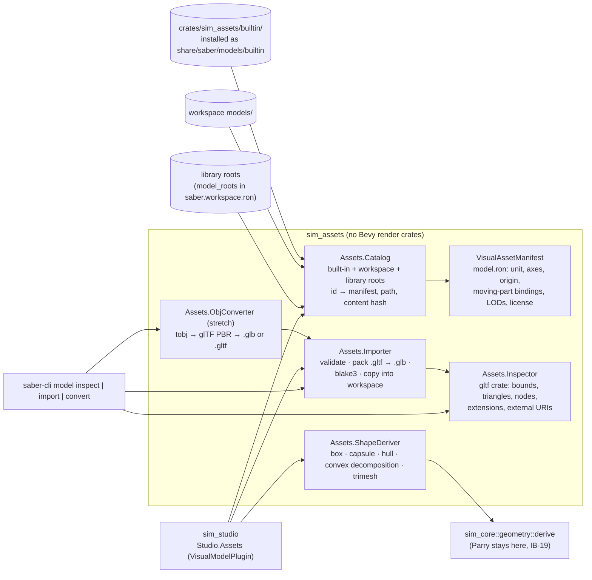

| Component | Responsibility | Key types |
|---|---|---|
| `Assets.Catalog` | Indexes every model from the three sources below, keyed by `(source, id)`; verifies `content_hash` on load; answers "which entities use this model". Read-only over built-ins. | `Catalog`, `CatalogEntry`, `VisualAssetRef` |
| `VisualAssetManifest` | Per-model metadata in `model.ron`: how the file's unit and axes map onto the body frame, the origin offset to the body reference point, optional moving-part bindings and LOD files, license. | `VisualAssetManifest`, `ModelFrame`, `VisualBinding` |
| `Assets.Inspector` | Reads a glTF/GLB without rendering it (`gltf` crate): bounds, triangle and material counts, node names, used and required extensions, external URIs, a unit guess. | `ImportReport` |
| `Assets.Importer` | Validates (rules below), packs `.gltf` + `.bin` + textures into one `.glb`, hashes it, writes `models/<slug>/{model.glb, model.ron}` and registers it. Used by the studio's Import dialog and by `saber-cli model import`. | `ImportSettings`, `ImportError` |
| `Assets.ObjConverter` | Stretch goal: OBJ + MTL → glTF document → `.glb` (default) or `.gltf` + `.bin` + textures. | `ObjImportSettings` |
| `Assets.ShapeDeriver` | Authoring-time only: reads a model's triangles in the body frame (f64) and asks `sim_core::geometry::derive` for a `ShapeDesc`. Never runs inside a simulation. | `DeriveMethod`, `DerivedFrom` |

**Where models come from.**

| Source | Location | Who adds models | Reference | Travels with |
|---|---|---|---|---|
| Built-in | `crates/sim_assets/builtin/<domain>/<slug>/` in the repo, installed beside the studio as `share/saber/models/builtin/`; a few primitives are also embedded in the binary as a fallback | SABER developers, by pull request | `builtin:rotorcraft/quad_x@1` | Every studio install; never copied into a campaign |
| Workspace | `<workspace>/models/<slug>/` | Users, through Import (which copies the file in) | `workspace:models/uav_v3` + hash | The workspace folder (git, ideally LFS for `.glb`); copied into each campaign's archive (D17) |
| Library root | Any folder listed under `model_roots` in `saber.workspace.ron`, for example a team share | Users or a team | `lib:<root>/<slug>` + hash | Read in place; Import can copy a model into the workspace (D17) |

**Built-in library (the "defaults" part of the code base).**

```
crates/sim_assets/builtin/
  catalog.ron                    # generated by build.rs, do not edit
  LICENSES.md                    # every built-in is project-authored or CC0
  primitive/{box,sphere,cylinder,capsule,cone,axes,fragment}/   # also embedded in the binary
  ballistics/{ogive_projectile,finned_rocket}/
  fixedwing/{generic_trainer,generic_uav}/
  rotorcraft/{quad_x,hex_x}/
  environment/{launcher_rail,target_board,windsock}/
      └─ each folder: model.glb  model.ron  thumb.png
```

Adding a default is a pull request that adds one folder and passes `cargo test -p sim_assets`, which checks
every built-in: the manifest parses and its hash matches; the file is already in the body frame (identity
`frame`, origin at the reference point), so built-ins never need per-entity alignment; at most 50 k triangles,
5 MB and 2048² textures; a license field; and the conventional node names that Domain Pack bindings expect
(`rotor_1…n`, `elevator`, `aileron_l`, `aileron_r`, `rudder`, `fin_1…n`, `gear_1…n`). `build.rs` regenerates
`catalog.ron`. Domain Packs map physics `ModelId`s to a default model (for example `rotorcraft/quad_x@1.2` →
`builtin:rotorcraft/quad_x@1`), so a palette item arrives with a look. That map lives on the studio side, so
`sim_models` and `sim_hpc` never reference `sim_assets`.

**Manifest (`model.ron`).**

```ron
VisualAssetManifest(
    schema_version: "1.0.0",
    id: "models/uav_v3",
    version: 1,                                   // built-ins bump this when shape or frame changes
    display_name: "UAV v3 (customer CAD export)",
    file: "model.glb",
    content_hash: "blake3:4be0…",                 // of model.glb, written by the importer or build.rs
    source: Converted(format: Obj, hash: "blake3:91aa…", converter: "sim_assets 0.3.0"),   // or Native
    // File axes → body frame (x forward, y right, z down, as the flight and ballistics models use).
    frame: (unit: Millimetre, up: PosY, forward: PosZ),
    origin: Offset((0.0, 0.0, -0.035)),           // file origin → body reference point, metres after scaling
    bounds: (min: (-1.20, -1.55, -0.30), max: (1.20, 1.55, 0.25)),   // body frame, informational
    triangles: 212_480,
    bindings: [                                   // optional moving parts (deferred, D17; format reserved)
        (node: "prop", drive: Spin(axis: PosX, signal: "propulsion.omega")),
        (node: "elevator", drive: Hinge(axis: PosY, signal: "surfaces.elevator")),
    ],
    lods: [(file: "lod1.glb", below_px: 150)],    // optional coarser files
    suggested_collision: Some(ConvexDecomposition(max_parts: 16)),
    license: "proprietary, internal",
    attribution: None,
)
```

**Linking a model to an entity.** The link lives in the scenario's `visual:` section (IB-01), keyed by `SimId`,
never in the sim section:

```rust
// sim_assets::visual — serialised under `visual:` in *.scn.ron; sim_hpc skips the whole section.
#[derive(Reflect, Clone, Serialize, Deserialize)]
pub struct VisualModel {
    pub asset: VisualAssetRef,
    pub offset: DPose,                          // extra pose on top of the manifest origin, body frame, f64
    pub scale: DVec3,                           // per instance; 1.0 = manifest size
    pub tint: Option<Srgba>,
    pub visible: bool,
    pub bindings: Option<Vec<VisualBinding>>,   // per-instance override of the manifest's bindings
}

#[derive(Reflect, Clone, Serialize, Deserialize)]
pub struct VisualAssetRef {
    pub source: AssetSource,                    // Builtin | Workspace | Library(root_name)
    pub id: String,                             // "rotorcraft/quad_x", "models/uav_v3"
    pub version: u32,                           // meaningful for built-ins
    pub content_hash: Blake3,                   // checked on load; a mismatch is a warning, never an error
}

#[derive(Reflect, Clone, Serialize, Deserialize)]
pub struct Scenery { pub name: String, pub asset: VisualAssetRef, pub pose: DPose, pub scale: DVec3 }
```

```ron
visual: (
    schema_version: "1.0.0",
    models: {
        12: (asset: (source: Builtin, id: "rotorcraft/quad_x", version: 1, content_hash: "blake3:9f1c…"),
             offset: ((0.0, 0.0, 0.0), (0.0, 0.0, 0.0, 1.0)), scale: (1.0, 1.0, 1.0),
             tint: None, visible: true, bindings: None),
    },
    scenery: [ (name: "Hangar", asset: (source: Workspace, id: "models/hangar", version: 1, content_hash: "blake3:…"),
                pose: ((120.0, -40.0, 0.0), (0.0, 0.0, 0.0, 1.0)), scale: (1.0, 1.0, 1.0)) ],
)
```

`Scenery` is look-only: no `SimId`, never simulated, never collides. Something that should be hit (a building, a
launcher) is a static body with a `CollisionShape` and a `VisualModel`.

**Drawing in the studio (`Studio.Assets`).** For each `VisualModel`, the catalogue resolves the reference and
the studio loads the glTF through Bevy's `AssetServer` with loader settings that skip the file's cameras and
lights (setting names to be checked against the pinned Bevy). Handles are cached per `content_hash`, so 300
drones of one model share one mesh and material set and Bevy batches them. The glTF scene is spawned under a
`ModelRoot` child of the body's render proxy, with transform = manifest frame rotation × unit scale × origin ×
instance offset × instance scale; `RenderBridge` keeps placing the body proxy with the floating origin (G7), so
model vertices stay small f32 numbers. Loading is asynchronous: a placeholder (the collision shape drawn
translucent, or the manifest bounds) shows until the model arrives, and stays with a lint warning if it never
does. Bevy's `VisibilityRange` swaps to LOD files and finally to a constant-size screen marker when the body is
under about 4 px, so a shell 20 km away stays findable. Fragments (IB-16) never get a glTF: they are drawn as
instanced points or the tiny built-in `primitive/fragment` mesh, and the parent's `ModelRoot` is hidden at the
fragmentation tick. Moving-part bindings (spinning rotors and props, control surfaces) are deferred (D17): v1 draws
models rigidly and ignores `bindings`, which stay reserved in the manifest. When added, they are driven from live state in Preview and from recorded frames or
snapshots in Replay when the signal was recorded; otherwise the part stays at its rest pose.

**Collision shapes are not taken from render meshes automatically.** A render mesh is usually far denser than
contact needs, often not closed, and gets edited for cosmetic reasons; if it fed physics, changing a model's
look could change results. Instead the studio offers **Derive collision from model**, which runs once at
authoring time and writes an ordinary `CollisionShape` (IB-19) into the sim section:

| Method | Result (`ShapeDesc`) | Allowed on | Typical use |
|---|---|---|---|
| Bounding box | `Cuboid` | any body | props, targets |
| Fitted capsule or cylinder | `Capsule` / `Cylinder` along the principal axis | any body | projectiles, rockets, fuselages |
| Convex hull | `ConvexHull { points }` (simplified to ≤ 256 vertices) | any body | compact bodies, multirotors |
| Convex decomposition | `Compound` of `ConvexHull` parts (Parry's V-HACD, ≤ 32 parts) | any body | airframes with wings, launchers |
| Triangle mesh | `TriMesh { geom: GeomRef }` | static bodies and terrain only | buildings, imported terrain |

Derived shapes carry `derived_from: (asset content_hash, method, params)`. When the model's hash later changes,
the lint says the collision came from an older version and offers to re-derive; it never re-derives silently,
because doing so changes `scene_hash`. Small shapes are stored inline in `.scn.ron`. Triangle meshes go to a
content-addressed sidecar `geometry/<blake3>.geom` (f64 vertices, u32 indices, zstd) that is covered by
`scene_hash`, archived with the campaign and broadcast by Rank 0 with the scene (IB-05). Derivation calls
`sim_core::geometry::derive`, so Parry stays inside `sim_core` and the shape is built by the same pinned Parry
that later uses it. A companion helper, **Estimate mass properties**, fills inertia from the derived shape and a
given mass as a one-off edit, not a live link.

**Import rules (`Assets.Importer`).**

| Check | Result |
|---|---|
| Not glTF 2.0 | Refused |
| External URI that is remote (`http`, `https`), absolute, or escapes the source folder (`..`) | Refused; SABER fetches nothing (D7) |
| Required extension the pinned Bevy cannot load (for example Draco or Meshopt compression) | Refused, with a hint to decompress first with a local tool |
| `.gltf` with `.bin` and texture files | Packed into one `.glb` on import, so one file has one hash |
| Cameras or lights in the file | Info; ignored when loading |
| Skins or animation clips | Info; kept in the file, not played in v1 |
| Size implausible for the chosen unit (bounds over 1 km or under 1 mm) | Warning with a unit suggestion (catches mm exported as m) |
| Over 500 k triangles or 100 MB | Warning (studio budget, `sim_studio_ux.md` §11) |
| Open or non-manifold mesh | Info; matters only for trimesh derivation, which then warns |

**OBJ import and conversion (stretch goal).** `Assets.ObjConverter` reads OBJ and MTL with `tobj`
(triangulated, single index buffer), generates normals when missing, maps MTL to glTF metallic-roughness
(`Kd` → base colour, `map_Kd` → base colour texture, `d`/`Tr` → alpha, `Ns` → roughness ≈ √(2/(Ns+2)),
metallic 0), keeps groups and objects as named glTF nodes so bindings can target them, and writes `.glb`
(default) or `.gltf` + `.bin` + textures with `gltf-json`. OBJ carries no unit or axes, so the importer always
asks for both. The manifest records the OBJ's hash and the converter version. The studio never loads OBJ at
run time; it only loads the converted glTF. Batch use: `saber-cli model convert part.obj --unit mm --up z
--forward x -o part.glb`. Other engineering formats (STEP, IGES, STL, JT, native CAD) are out of scope and are
converted outside SABER (D17).

**Headless rule.** `sim_hpc`, `sim_explorer` and Python never link `sim_assets` and never open a glTF. The
scenario envelope reads `visual` as an opaque value (borrowed raw RON, hashed but never parsed), and `scene_hash` covers only the
sim section and geometry sidecars; the `visual:` section has its own `visual_hash`. Replacing, moving or deleting
a model therefore never changes a campaign, a replay's `scene_hash` check or a determinism result.

**Archiving with campaigns (decided, D17).** At submit, `saber.campaign` copies every workspace and library-root
model the scenario references into `campaigns/<id>/models/` (by content hash, so a model used by many entities is
stored once) and writes `visuals.lock`. Built-ins are referenced by id, version and hash only. The cap is 2 GB per
campaign (`[archive] visual_assets_max_bytes`, default 2 GiB); above it, preflight warns and the user chooses to
raise the cap or submit without the models (Replay then shows placeholders). Replay resolves the archived copy first,
then the workspace.

## 6. The tick pipeline

The draft chains six systems. With domain models, ordering must be expressed as `SystemSet`s so plugins
from different domains slot in without editing `sim_core`. Every set is `.chain()`ed; systems *within* a
set are also chained in registration order (plugin registration order is fixed by `SimAppBuilder`).


```rust
#[derive(SystemSet, Clone, Copy, Debug, PartialEq, Eq, Hash)]
pub enum SimSet { Environment, Sensors, Control, Actuation, Forces, Integrate,
                  Constraints, Telemetry, Verify, Record, Watchdog }
```

Notes:
- `Record` runs **before** `Watchdog` so the frame that diverged is in the buffer when the watchdog flags it.
- `Integrate` (as built in step 1b) is one system for every authored body: `RigidBody6` (6DOF bodies, including
  fragmenting parents) and authored `PointMass3` (3DOF projectiles) are packed in `SimId` order into one state
  (`[p, v, q_wxyz, ω]` per 6DOF body, `[p, v]` per 3DOF body) and cross the tick with the World's one
  integrator (`physics-engine-tradeoffs.md` §10.3). Fragments get their own fixed-method system after it (IB-16,
  step 5e); `Multibody` chains are deferred (D13). The system advances `SimClock` at its end, so systems before it
  see tick `n` and systems after it see tick `n + 1`.
- `Forces` holds the per-tick inputs to the force models (commands, table lookups that do not depend on the
  stage state). The forces themselves are evaluated inside `Integrate` at every stage through `ForceModel::eval`.
- A solver failure in `Integrate` skips `Constraints` for that tick (the set runs only while the run is going);
  `Telemetry`, `Verify`, `Record` and `Watchdog` still run on the last accepted state, so the crashed state is
  recorded.
- Fragmentation (IB-16) is triggered in `Constraints`, after the tick's state is final; new fragments
  integrate from the next tick.
- Multi-step integrators (RK4) run their sub-stages inside `Integrate`; force systems that RK4 needs
  re-evaluated are exposed as plain functions, not separate systems (keeps the schedule flat).
- Integrators (D14): `Integrate` hands the World's packed state to `Core.Integrator`, which crosses
  `[t, t+dt]` in fixed or adaptive substeps and always lands exactly on the tick boundary, so sensors,
  control, telemetry and the recorder keep a fixed tick grid. Inputs are held constant within the tick,
  so every input discontinuity sits on a step boundary. Failing the error test at `h_min` ends the run with
  `CrashedSolver(StepSizeUnderflow)`. Details in `physics-engine-tradeoffs.md` §10.
- Contact (D13, IB-19): `GeometryService` runs the broad phase at the start of `Integrate`; `Compliant`
  contact forces are evaluated inside every RK4 stage through `trait ContactForces`; `Impulsive` contacts are
  event-located inside `Integrate` (integrate all bodies to the time of impact, apply impulses, finish the
  step, at most `max_events_per_tick`); `EventOnly` casts, `SimEvent::Contact` and contact stop conditions
  run in `Constraints`. See `physics-engine-tradeoffs.md` §9.4. As built (step 5d, part 1): the solver is a
  kernel part of `Dynamics` rather than a `trait ContactForces` implementation, and runs after the force
  models in every stage of every substep; its end-of-tick pass is the first system of `Constraints`, so
  plugin systems there already see this tick's `Contacts`. As built (step 5d, part 2): impacts are located
  inside `Integrate` as sketched, by re-integrating every body to probed times (no dense output); the
  penetration push and the swept `EventOnly` checks run at the end of that same `Constraints` pass.

---

## 7. Domain model: scenarios, models, twins

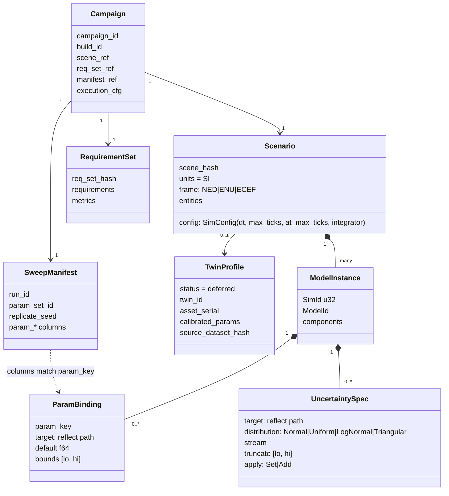

**Generalising the draft's parametric components.** Instead of one marker component per property
(`BindStiffnessParam`, …), use a single reflection-path binding so any model field can be swept:

```rust
#[derive(Component, Reflect, Clone)]
#[reflect(Component)]
pub struct ParamBindings(pub Vec<ParamBinding>);

#[derive(Reflect, Clone)]
pub struct ParamBinding {
    pub param_key: String,            // column in sweep_manifest.parquet, e.g. "drag_scale"
    pub target: String,               // reflect path, e.g. "AeroCoeffs.cd_scale"
    pub default: f64,                 // used by LocalRun when no manifest row is given
    pub bounds: Option<(f64, f64)>,   // validated at preflight & Tick 0
}

#[derive(Reflect, Clone, Copy)]
pub enum Distribution { Normal { mean: f64, std: f64 }, Uniform { lo: f64, hi: f64 },
                        LogNormal { mu: f64, sigma: f64 }, Triangular { lo: f64, mode: f64, hi: f64 } }

#[derive(Component, Reflect, Clone)]
#[reflect(Component)]
pub struct Uncertainties(pub Vec<Uncertainty>);

#[derive(Reflect, Clone)]
pub struct Uncertainty {
    pub target: String,                   // reflect path, e.g. "PointMass3.velocity.x"
    pub distribution: Distribution,
    pub stream: String,                   // SimRng substream
    #[reflect(default)] pub truncate: Option<(f64, f64)>,  // draw only inside [lo, hi]
    #[reflect(default)] pub apply: Apply, // Set (default) or Add to the bound value
}
```

As built (step 1c), a target is `Component.field.path` on the same entity, where `Component` is the short type
path (the full one when the short one is ambiguous) and the path ends at an `f64`. Each uncertainty takes
exactly one 53-bit uniform `u` in (0, 1) from its stream and returns the inverse CDF at `u` (Acklam's normal
quantile with one Halley step on `erfc`); truncation maps `u` into `[F(lo), F(hi)]`, through the mirrored
distribution when that interval is in the upper tail, so a draw never loops and adding an uncertainty never
shifts another stream. A binding's value outside its `bounds`, a manifest row without a bound key, an
unresolvable target, or a truncation with zero probability is a `SetupError` at Tick 0. The draft's
`Truncated(Box<Distribution>, ..)` became the `truncate` field, since a boxed distribution cannot be `Copy`
and only one level of truncation is meaningful.

(These are the generic `BindParam` / `Stochastic` components from the GUI doc; held as `Vec`s so one
entity can carry several bindings.)

**Requirements drive telemetry.** `sim_verify` compiles the `.req.ron` into a `VerifyPlan`, which also
acts as the *telemetry plan*: it switches on exactly the reductions, event triggers and snapshot channels
the requirements reference. The plan is compiled at load time (Rank 0 broadcasts the `.req.ron` blob, IB-05)
rather than embedded in `.scn.ron`, so one scenario can be verified against several requirement sets
without re-export. Studio shows the derived plan in CampaignSetup.

Paths are resolved **once** at Resolver time into typed setters, so the hot loop never touches reflection.

**Two kinds of variation, kept separate:**
- *Epistemic / design parameters* → manifest columns (`param_*`), chosen by `saber.sweep`.
- *Aleatory noise* (sensor noise, turbulence, manufacturing scatter) → `Uncertainties`, drawn from
  `SimRng` per replicate seed.

---

## 8. Requirements & verification model

### 8.1 Requirement file (`*.req.ron`)

```ron
RequirementSet(
    header: (magic: "SABER", format: "requirements", schema_version: "1.0.0"),
    id: "DRN-HOVER-001", version: "0.3.0", scenario_hint: "quad_x_gust.scn.ron",
    metrics: {
        "pos_err_max":   (signal: "entity(1).NavError.horizontal_m", reduce: Max),
        "batt_margin":   (signal: "entity(1).Battery.soc",          reduce: Final),
        "sat_time":      (signal: "entity(1).Motors.any_saturated", reduce: TimeAbove(0.5)),
        "landed_at":     (event: "landing", reduce: FirstTime),
    },
    requirements: [
        ( id: "R-01", text: "Hold position within 0.5 m in 8 m/s gusts",
          kind: Threshold(metric: "pos_err_max", op: Le, value: 0.5),
          per_run: true,
          campaign: Probability(min_p: 0.99, confidence: 0.90),
          trace: ["SYS-REQ-114"] ),
        ( id: "R-02", text: "Land with >= 15% battery",
          kind: Threshold(metric: "batt_margin", op: Ge, value: 0.15),
          per_run: true, campaign: AllPass, trace: ["SYS-REQ-120"] ),
        ( id: "R-03", text: "Never enter keep-out volume",
          kind: Custom(name: "keep_out_KOZ-A"),
          per_run: true, campaign: AllPass, early_stop_on_fail: false ),
        ( id: "R-04", text: "Stay below 120 m AGL",
          kind: Never(signal: "entity(1).RigidBody6.position.z", op: Gt, value: 120.0) ),
        ( id: "R-05", text: "Land within 90 s",
          kind: Eventually(event: "landing", within_s: 90.0) ),
    ],
)
```

Requirement kinds (v1): `Threshold` (metric op value), `Envelope` (signal stays within bounds over
a time window), `Never` / `Eventually(within_s)` (temporal predicates over a signal or event),
`Custom` (named Rust predicate registered by a model plugin). Campaign aggregations: `AllPass`,
`Probability{min_p, confidence}` (Clopper–Pearson lower bound), `Quantile{q, op, value}` on a metric.

As built (step 2): the file carries a `FileHeader` (`format: "requirements"`) like every SABER file (§10.4) and is
read with RON's `implicit_some`, so optional fields need no `Some(..)`. Signals are `entity(SimId).Component.field.path`
ending at a number or `bool`; events are names a plugin declared. `Never` and `Eventually` take a structured
condition, either `signal`, `op` (`Lt`, `Le`, `Gt`, `Ge`) and `value`, or `event`, instead of the draft's predicate
string: there is no zone type yet, so a geometric predicate such as a keep-out volume is a `Custom` check until
one exists. `Envelope` takes `signal`, `lo`, `hi` and an optional window `from_s`/`to_s`. Defaults: `per_run: true`,
`campaign: AllPass`, `trace: []`, `early_stop_on_fail: false`. `per_run: false` is only allowed with a `Quantile`
rule, which reads a `Threshold` requirement's metric. Metrics keep file order and become `metric_<key>` columns;
per-run requirements become `req_<id>` columns. `req_set_hash` is BLAKE3 (context
`SABER 2026-11-02 requirement set hash v1`) over the compact RON of everything but the header.

### 8.2 Verdict semantics

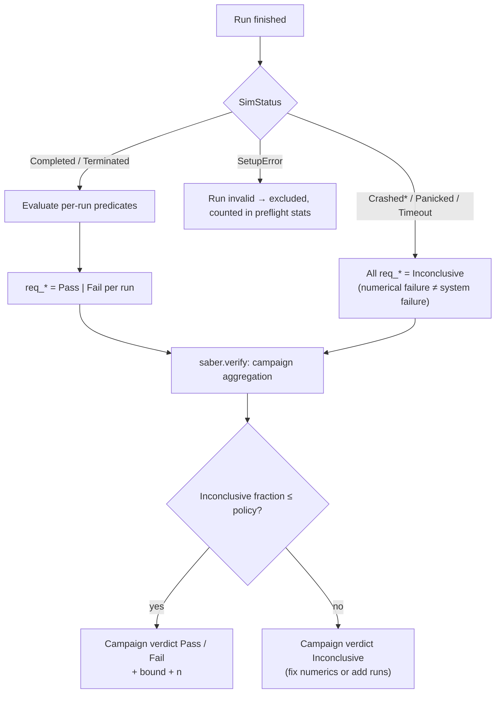

Distinguishing *the system failed the requirement* from *the simulation failed to say* is the most
important semantic rule in the verification layer, and the reason crashes never silently count as passes
or fails.

As built (step 2): a `SetupError` run's row still carries `Inconclusive` verdicts and is excluded downstream by
its status. A run that `early_stop_on_fail` ended (`Terminated`, stop reason `requirement_failed`) is judged only
on what was decided when it stopped: settled requirements keep their verdict, a `Threshold` keeps its verdict if
its comparison was already decided (§5.3), and everything else still open is `Inconclusive` rather than judged on
a cut-short run. At a natural end (`Completed`, or `Terminated` by a stop condition) open requirements close:
`Never` and `Envelope` pass, `Eventually` fails, a `Custom` check answers `at_end`. The `Threshold` rule depends only
on the reducer, the comparison and the metric value, so `saber.verify` can recompute it from the summary columns.

As built (step 4c): the per-run columns stay as above (a crashed run's `req_*` are `Inconclusive`); the campaign
step decides what a status counts as. `Timeout` is `Inconclusive` (D20); the crash statuses count as failures by
default (seq §11) or as inconclusive with `crashes="inconclusive"`; `SetupError` runs are excluded. The diagram's
"inconclusive fraction ≤ policy" check is replaced by a rule with no threshold to tune: an inconclusive run counts
against whichever verdict it could overturn. `AllPass` is `Pass` only with every counted run passing; `Probability`
is `Pass` when the Clopper–Pearson lower bound with inconclusive runs as failures reaches `min_p`, `Fail` when the
upper bound with them as passes is below it, else `Inconclusive`; `Quantile` puts unknown values on the failing
side for `Pass` and on the passing side for `Fail`. So a verdict is `Pass` or `Fail` only if every way the
inconclusive runs could have come out gives it (§5.7).

---

## 9. Interface boundary catalogue

Each boundary lists: **direction**, **contract**, **owner** (who defines and versions it), **validation**,
and **error handling**. Owner = the crate whose types are canonical; all others conform.

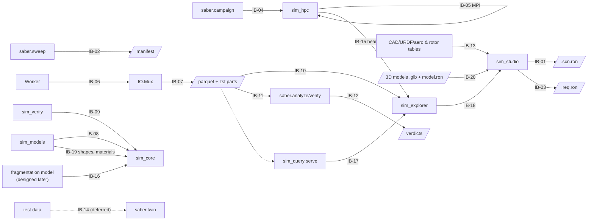

### IB-01 · Scenario file `*.scn.ron` (sim_studio → sim_core/sim_hpc)

| | |
|---|---|
| Direction | Written by `Studio.Builder`; read by `Core.Resolver` in LocalRun, Replay, and Rank 0. |
| Contract | Bevy's reflected scene RON **wrapped** in a SABER envelope: `(header: FileHeader, units: "SI", frame, model_library_version, config: SimConfig, scene: (entities: {…}), visual: (…))`, `visual` optional. Only components registered in `SimTypeRegistry` may appear; render-only data lives under a separate `visual:` section (`VisualModel` per `SimId`, `Scenery`, §5.10) that `sim_hpc` reads as an opaque value and ignores. Triangle-mesh collision shapes reference `geometry/<blake3>.geom` sidecars. |
| Owner | `sim_core` (types, envelope), `sim_schema` (header). |
| Validation | Parse with `SimTypeRegistry`; unknown type paths, missing `SimId`, duplicate `SimId`, binding targets that don't resolve, bounds violations. `scene_hash` = BLAKE3 of the canonicalised sim section plus geometry sidecars; the `visual:` section has its own `visual_hash`, so a model change never changes `scene_hash` (D17). |
| Errors | `SceneError::{Parse{line, col}, BadHeader, VersionMismatch{what, found, supported}, UnknownType{entity, path}, BadValue{entity, path}, MissingSimId{entity}, DuplicateSimId{sim_id}, BadBinding{sim_id, path, reason}, BadConfig}`. In Studio: shown in the validation panel, export blocked. In sim_hpc: preflight abort before any work is dispatched. |
| Versioning | `model_library_version` must be compatible (semver) with the binary's library; migration functions per major version live in `sim_models::migrate`. |
| As built (step 1c) | `sim_core::Scenario` reads and writes the `scene:` section with `bevy_reflect`'s typed serde against the `SimTypeRegistry`, in the shape of Bevy's world RON (entities keyed by a file-local number, components by full type path). Bevy 0.20 moved `DynamicScene` to `bevy_world_serialization`, which pulls `bevy_app`, `bevy_asset` and render types into the kernel and `sim_hpc`; reading the section directly keeps them on `bevy_ecs` alone. Export then import is exact (f64 printed shortest round-trip). `scene_hash` is BLAKE3 (derive-key context `SABER 2026-11-02 scene hash v1`) over compact RON of `units`, `frame`, `model_library_version` and the entities in `SimId` order with components in type-path order, so comments, formatting, entity keys and component order never change it; `config` is not in it but goes, with `scene_hash`, into `sim_config_hash`; `visual_hash` (context `SABER 2026-11-02 visual hash v1`) is over the visual section's text as written. The header's own `scene_hash` is informative: it is filled on export, and `saber-cli validate` notes when it is stale. Model library compatibility uses the caret rule (`Semver::satisfies`). Geometry sidecars join `scene_hash` with step 5d. `saber-cli validate <file> [--json]` parses, checks and runs Tick 0 with the defaults; exit `0` valid, `2` invalid, `64` usage. |

### IB-02 · Sweep manifest `sweep_manifest.parquet` (saber.sweep → sim_hpc)

| | |
|---|---|
| Contract | Columns: `run_id u64` (dense, 0..N, sorted), `param_set_id u32`, `replicate_seed u64`, one `f64` column per `param_key`. Parquet KV metadata: `FileHeader` JSON, `sampler` (method, n, seed), `scene_hash` it was generated against. |
| Owner | `sim_schema::MANIFEST_SCHEMA`; written by Python using the exported schema. |
| As built (step 3a) | `Table::Manifest` / `ManifestRow`; the parameter columns are named `param_<param_key>` (the dynamic family shared with the summaries); footer entries `saber.header` (whose `scene_hash` is the scene it was generated against) and `saber.sampler`. `saber.schema.write_table` writes it from Python (3c). |
| As built (step 3c) | `saber.sweep` writes it (§5.7). Columns follow the scene's binding order, then any unbound keys. `replicate_seed = splitmix64(splitmix64(splitmix64(seed) ^ param_set_id) ^ r)` for replicate `r` (SplitMix64's output function), so a run's seed depends only on the campaign seed and its place in the sweep, and the replicates of one set never share a seed. `saber.sampler` is JSON: `method`, `n` and the sampler's settings (Grid `levels`, Morris `trajectories`, `levels`, `delta`, `points_per_trajectory` and each path's parameter `orders`), `seed`, `replicates`, `swept`, every key's definition under `params`, the seed rule, and the numpy/scipy versions (another version may draw other samples; the file is the record). Preflight also refuses a manifest whose header names another `scene_hash`: `ManifestError::SceneMismatch{manifest, scenario}`, exit 2. |
| Validation | Preflight: every `param_key` bound in the scene exists as a column; no extra unbound `param_*` columns (warning); values within `bounds`; `run_id` dense and unique; `(param_set_id, replicate_seed)` unique. |
| Errors | `ManifestError::{MissingParam(key), OutOfBounds{run_id,key,value}, NonDenseRunIds, DuplicateRun, SceneMismatch}` → abort. |
| Transfer | **Decided:** Rank 0 reads the manifest once and broadcasts its bytes together with the scene; every rank checks the BLAKE3 hash, so no rank reads Lustre for it (G3, seq §5). |

### IB-03 · Requirement set `*.req.ron` (sim_studio / text editor → sim_verify, saber.verify)

| | |
|---|---|
| Contract | §8.1. Signals addressed as `entity(SimId).Component.field` or `event(Name)`; metrics named `metric_key`. |
| Owner | `sim_verify`. Python reads the compiled JSON form produced by `saber-cli validate --emit-req-json` so it never parses RON. |
| Validation | Every signal path resolves against the scenario; every metric referenced by a requirement exists; units consistent; IDs unique. |
| Errors | `ReqError::{UnresolvedSignal, UnknownMetric, DuplicateId, TypeMismatch}` → blocking in Studio and preflight. |
| As built (step 2) | `RequirementSet::from_ron` checks the header, ids, metric references, reducer against source (signal or event), condition shape, numbers and campaign rules; `VerifyState::compile` resolves signals, events and custom checks against a scenario's Tick-0 World. `ReqError::{Parse{line, col}, BadHeader, VersionMismatch, DuplicateId, UnknownMetric, BadMetric, BadRequirement, UnresolvedSignal, TypeMismatch, UnknownCheck}`. `saber-cli validate <set.req.ron> [--scenario <scn>] --emit-req-json` prints the compiled JSON form (`format: "saber-requirements-json"`, `req_set_hash`, `metric_columns`, `requirement_columns`, the scene hash it was resolved against, and the set itself; JSON objects are unordered, so the column lists carry the order); `sim_hpc --validate-only` reuses it with step 3b. Unit checks wait for `ModelMeta.signals` to carry units. |

### IB-04 · Campaign bundle `campaign.toml` + CLI (saber.campaign → sim_hpc)

```toml
[campaign]
id = "drn-hover-2026-10-23-a"
scene = "scenarios/quad_x_gust.scn.ron"
requirements = "requirements/DRN-HOVER-001.req.ron"
manifest = "campaigns/drn-hover-a/sweep_manifest.parquet"
expected_build_id = "a1b2c3d…"

[execution]
chunk_size = 256
flight_recorder_ticks = 256
snapshot_policy = { base_every = 100, adaptive = true, max_per_run = 2000 }
io_channel_capacity = 1024

[crash_policy]                   # replaces execution.crash_dump_quota (seq §8)
dump_quota_per_param_set = 3     # M, counted campaign-wide
abort_crash_fraction     = 0.25  # abort if more than 25% of finished runs crashed...
abort_min_runs           = 2000  # ...once at least this many runs have finished
abort_max_setup_errors   = 10    # SetupError means a broken scenario or manifest, so trip early
canary_chunks            = 64    # first chunks are spread across the whole manifest

[checkpoint]                     # seq §7, §12
checkpoint_interval_s = 600      # IO.Mux rolls and commits a part this often
drain_margin_s        = 720      # stop dispatch this long before walltime (5% of 4 h)
auto_resume           = 3        # resubmit up to N times (PBS depend=afterany / Slurm --dependency)

[output]
scratch_dir = "${TMPDIR}"
shared_out = "campaigns/drn-hover-a/out"
heartbeat_s = 15                 # campaign_status.json (IB-15)
fragment_impacts = true          # *_impacts.parquet (IB-16); default: on when the scenario fragments
```

| | |
|---|---|
| CLI | `sim_hpc --campaign campaign.toml [--resume] [--override-crash-policy] [--validate-only] [--local]`. `--resume` starts a new attempt (`attempt` = previous + 1) that runs only `run_id`s not in a committed summaries part; it refuses if `campaign_id`, `scene_hash`, manifest hash, `req_set_hash` or `build_id` differ. `--override-crash-policy` lets `--resume` continue a campaign that was aborted by the crash policy. `--local` = size 1, no MPI init (Phase 3). |
| Scheduler | `saber.campaign` renders PBS Pro templates first and Slurm templates as a second target (D5). The walltime used for `drain_margin_s` comes from `PBS_WALLTIME`/the Slurm job end time. |
| Owner | `sim_hpc` (config struct), mirrored by `saber.campaign`. |
| Errors | Exit codes: `0` ok (or nothing left to resume), `2` config/validation error (incl. resume mismatch), `3` build_id mismatch, `4` I/O / stage-out failure (some parts not committed), `5` partial (drained before walltime or runs missing; resumable), `6` aborted by crash policy (`CrashStorm` or `SetupErrors`; evidence committed), `70` internal. Python maps exit codes to campaign status. `auto_resume` resubmits after `4`, `5` or a killed job, and stops on `2`, `3` or `6`, or when the last attempt made no progress. |
| As built (step 3b) | `sim_hpc::CampaignConfig` reads every key above (unknown keys are errors) plus `execution.max_events_per_run` (default 4096) and `execution.threads` (default: available parallelism); paths are relative to the file, and `scratch_dir`/`shared_out` expand `${VAR}` (`${TMPDIR}` falls back to the system temp directory). `flight_recorder_ticks` overrides the scenario's `recorder_frames` (not hashed). `snapshot_policy.adaptive` is accepted with a warning and sampling stays at `base_every`. CLI: `--local` and `--validate-only` (`--json` for both, `--threads N`); without `--local` the binary exits `64` until MPI lands (4a), and `--resume` / `--override-crash-policy` exit `64` until 4b. Exit `64` is a usage error. |
| As built (step 3c) | `saber.campaign` maps exit codes to statuses: `0` completed, `2` invalid, `3` build mismatch, `4` I/O error, `5` partial, `6` aborted, `64` usage, `70` (or any other code) internal, and a signal (a negative code from Python, or 129–159 from a shell) killed; `4`, `5` and killed are resumable. With `--json`, `sim_hpc` prints one object: on a refusal `{ok: false, exit, kind, error}` with `kind` one of `Config`, `Scene`, `Requirements`, `Manifest`, `SceneMismatch`, `BuildMismatch`; `--validate-only` adds `req_set_hash` and `param_keys` to step 3b's fields; `--local` adds `campaign_id` and `threads`. |
| As built (step 4b) | CLI: `sim_hpc --campaign c.toml [--local \| --validate-only] [--resume [--override-crash-policy]] [--deadline UNIX_S] [--threads N] [--json]`; `--override-crash-policy` without `--resume` is a usage error (64). Without `--resume` an output directory that already holds a campaign is refused (exit 2, `OutputExists`), also by `--validate-only`; with it, `--validate-only` adds `attempt`, `committed_runs` and `missing_runs` (the plan, refused as the run would be). The walltime deadline is `--deadline`, else `SABER_WALLTIME_END`, else `SLURM_JOB_END_TIME`. `--json` adds `attempt`, `committed_runs` and `missing_runs` (every attempt), and `stopped` (`walltime`, `signal` or null). New refusal kinds: `OutputExists`, `ResumeMismatch` (2), `BuildMismatch` (3, from a part footer), `ResumeRead` (4), `Aborted` (6). `saber.campaign`: `preflight` and `run_local` take `resume` and `override_crash_policy` (`run_local` also `deadline`); `Resources` (nodes, cpus per node, walltime, queue, account, threads, setup lines, launcher and its flags, the cluster's `sim_hpc` path, extra directives), `render_job` (PBS Pro, or Slurm with `scheduler="slurm"`; one rank per node; the job exports `SABER_WALLTIME_END` from the walltime) and `submit` (preflight, `qsub` or `sbatch --parsable`, then `auto_resume` resubmissions each with `depend=afterany` / `--dependency=afterany` on the one before). A resubmission reads the job directory's `ledger.tsv` (each job's start with the committed part count, and its end with `sim_hpc`'s exit from the JSON report, since a launcher killed by SIGTERM exits with its own code) and exits 0 at once if the attempt before it ended `0`, `2`, `3`, `6`, `64` or `70`, or committed no new parts. `submit` refuses a `drain_margin_s` as long as the walltime. |
| As built (step 4a) | Without `--local` or `--validate-only`, `sim_hpc --campaign c.toml` is one rank of an MPI job (`mpiexec -n N sim_hpc --campaign c.toml [--threads N] [--json]`); a binary built without the `mpi` feature refuses that with `64`. Every rank exits with the code rank 0 broadcasts; only rank 0 prints. `--json` adds `ranks`, `abort` (`{reason, detail}`), an `error` sentence for an abort, and `status` (the heartbeat's path). New key `output.heartbeat_s` (default 15, positive, at most a day), mirrored by `saber.campaign.Output`. |
| As built (step 5e-2) | New key `output.fragment_impacts` (bool, optional), mirrored by `saber.campaign.Output`: whether the campaign writes `*_impacts.parquet` (IB-16). Unset, it is on exactly when the scene has a `Fragmentable` body; set on a scene without one, `sim_hpc` warns and writes no file (a part opens the file only at its first run that broke up). A fragmenting scene also adds the four `fragments_*` summary columns and the 20 `ch_frag_*` snapshot channels (IB-09, IB-16). |

### IB-05 · MPI wire protocol (Rank0.Dispatcher ↔ RankN.Main)

| Phase | Op | Payload |
|---|---|---|
| Init | `Bcast` | `BlobHeader{kind, len, blake3}` then bytes, for: campaign, scene, req set, manifest (full bytes, decided G3), and `attempt: u16` |
| Init | `Gather` | `ReadyAck{rank, worker_threads, build_id}`; Rank 0 aborts all on build_id mismatch |
| Work | `Send TAG_REQUEST_WORK` | `ChunkRequest{rank, completed: Option<ChunkId>, runs_done, crashes: Vec<(param_set_id, u32)>, dumps: Vec<(param_set_id, u32)>, setup_errors: u32, committed: Vec<PartCommitted>}`. Crash, dump and setup-error counts are **deltas** since the last request. `PartCommitted{part, run_ranges: RangeSet, crashes_by_param_set}` comes from IO.Stager. |
| Work | `Send TAG_ASSIGN_WORK` | `ChunkAssign{chunk_id, start_run_id, end_run_id, global_dumps: Vec<(param_set_id, u32)>}` (half-open range; dump counts only for the param sets this rank reported). The first `canary_chunks` chunks are handed out in strided (bit-reversed) order across the manifest, then sequentially. On resume, chunks are slices of missing ranges only. |
| Drain | `Send TAG_TERMINATE` | none; sent when the manifest is exhausted or `drain_margin_s` is reached; rank drains pool, sends `EndOfStream` to IO.Mux |
| Fatal | `Isend TAG_ABORT` / `MPI_Abort` | `AbortReason::{Preflight, BuildMismatch, BroadcastHash, CrashStorm, SetupErrors}`. `CrashStorm` and `SetupErrors` come from the crash policy (seq §8.2): ranks set a cancel flag, commit the current part so the evidence is kept, then report. Never sent for a single run failure. |
| Finish | `Gather` | `NodeReport{rank, attempt, parts, rows, bytes, chunk_ids}` → `_MANIFEST.json` |

Rules: payloads are fixed-layout `#[repr(C)]` structs or bincode with `sim_schema` versions; Rank N
requests **ahead** (keeps one chunk queued locally) to hide latency and `Iprobe`s for `TAG_ABORT` while
its pool works; Rank 0 records `chunk_id → rank` so a lost rank's chunks can be listed in `_MANIFEST.json`.
No extra MPI messages are needed for the crash policy or checkpointing in the normal case: everything
piggybacks on `ChunkRequest`/`ChunkAssign`.

**As built (step 4a)** (`sim_hpc::protocol`, `sim_hpc::transport`). Messages are bincode (serde, standard
config); every rank runs the same binary, and `Init` carries `PROTOCOL = 1`. Tags: `1 RequestWork`,
`2 AssignWork`, `3 Terminate`, `4 Abort`, `5 Gather`, `6 Report`. Byte messages are received with a matched probe,
broadcasts send the length and then pieces of at most 1 GiB.

| Phase | Op | Payload as built |
|---|---|---|
| Init | `Bcast` | `Init::Go { protocol, attempt, base, blobs: [BlobHeader { kind, len, blake3 }] }` then one broadcast per blob (campaign, scene, requirements if any, manifest), or `Init::Refused(Refusal { exit, kind, error })` when rank 0's preflight fails (then nothing follows) |
| Init | `Gather` + `Bcast` | `ReadyAck { rank, threads, build_id, error: Option<Refusal> }`; rank 0 broadcasts `Option<Refusal>`: the first rank's error (`BroadcastHash` exits `70`), or `BuildMismatch` (`3`) when two `build_id`s differ |
| Work | `RequestWork` | `ChunkRequest { rank, completed: [chunk_id], delta: Tally, committed: RangeSet, done }`; `Tally { runs, setup_errors, status_counts, crashes_by_param_set, dumps_by_param_set, req_tallies }` |
| Work | `AssignWork` | `ChunkAssign { chunk_id, start, end, global_dumps }`, a reply |
| Drain | `Terminate` | `Terminate { abort: Option<AbortMsg> }`, a reply and the rank's last: manifest exhausted, the rank said `done`, or the policy tripped |
| Fatal | `Abort` | `AbortMsg { reason, detail }`, unsolicited, to the ranks still waiting for work when the policy trips |
| Finish | `Report` + `Bcast` | `NodeReport { rank, threads, exit, tally, setup_messages, committed, failed, io_error, chunk_ids, dump_run_ids }`, then `Final { exit }` from rank 0 |

No message is left unread at `MPI_Finalize`: every request is answered exactly once, by `AssignWork` or by
`Terminate` (the last); `Abort` goes at most once and only to a rank not yet sent `Terminate`, and rank 0 sends it
before any later reply, so a rank that sees `Abort` while a request is out waits for that reply; a rank's
`NodeReport` is its last message, sent once its last request is answered, and rank 0 keeps serving requests until
every report is in. A first broadcast that does not decode can only come from another build, and the collectives
after it cannot be matched, so that rank panics (ending the MPI job) rather than wait. Re-queuing a failed rank's
chunks to healthy ranks is not built; they are missing in `_MANIFEST.json` and `--resume` (4b) runs them.

### IB-06 · Worker ↔ IO.Mux channel (in-process, per node)

```rust
pub enum IoMsg {
    RunResult {
        summary: SummaryRow,                  // T1 + metric_* + req_* + status
        events: Option<RecordBatch>,          // T2, Arrow, built from pre-allocated builders
        snapshots: Option<RecordBatch>,       // T3
        impacts: Option<RecordBatch>,         // fragment impacts (IB-16), only for fragmenting runs
    },
    CrashDump(Box<CrashDump>),                // only if the Quota view is below M
    EndOfStream { rank: i32 },
}

/// sim_core-facing abstraction; sim_hpc implements it with the channel,
/// sim_studio implements it with an in-memory store for LocalRun.
pub trait RunSink {
    fn finish_run(&mut self, out: RunOutput) -> Result<(), SinkError>;
}
```

| | |
|---|---|
| Channel | `crossbeam_channel::bounded(io_channel_capacity)`. **Bounded = backpressure**: if NVMe is slow, workers block rather than OOM the node. |
| Ownership | Worker moves buffers into the message; IO.Mux returns emptied `RecordBatch` builders through a second "recycle" channel so steady state is allocation-free. |
| Errors | IO.Mux write failure → sets a node-wide `IoFailed` flag; workers finish the current run then stop; RankN.Main reports to Rank 0; exit code 4. Disconnected channel = IO thread panicked → same path. |
| As built (step 3b) | `IoMsg::{Run(Box<RunRecord>), EndOfStream}` over `std::sync::mpsc::sync_channel(io_channel_capacity)` (bounded, so backpressure as designed, without crossbeam). A `RunRecord` carries the summary row, event and snapshot rows and the optional crash dump of one run, so a dump never arrives without its row; `IO.Mux` buffers rows and writes a batch per table every 65,536 rows and at part close. Rows are moved per run; recycling builders back to the workers is left for when profiling asks for it. `RunSink` stays the kernel's interface for the studio; `sim_hpc` reads `RunOutput` directly. |

### IB-07 · Output files (IO.Mux → NVMe → shared FS)

Output is written as rolling **parts** (seq §7). Every `checkpoint_interval_s` IO.Mux closes the current
part on NVMe and IO.Stager copies it to the shared FS while the next part fills. Each file carries the
infix `_a{attempt}_p{part}_`, so a resumed attempt on different nodes or rank numbers never touches an
earlier file, and the `*_summaries.parquet` globs still match.

| File | Schema (canonical in `sim_schema`) |
|---|---|
| `node_{rank}_a{attempt}_p{part}_summaries.parquet` | draft columns + `campaign_id`, `rank u32`, `attempt u16`, `part u32`, `chunk_id`, `final_state_hash u64`, `sim_config_hash u64`, `integrator u8`, `substeps_total u64`, `steps_rejected u64`, `h_min_used f64`, `h_max_used f64`, `err_est_max f64`, `err_est_mean f64` (D14), `crash_tick u64?`, `crash_reason u8?`, `param_*`, `metric_*`, `req_* u8` (Verdict). **Footer KV metadata:** `FileHeader`, the part's completed `run_id` RangeSet and its crash counts per `param_set_id`. |
| `node_{rank}_a{attempt}_p{part}_events.parquet` | Tier 2 only: draft columns (+ `FragmentationEvent`, IB-16); sorted by `param_set_id, run_id, tick` |
| `node_{rank}_a{attempt}_p{part}_snapshots.parquet` | Tier 3, **split out from events** (G2): `run_id, tick, sim_id, pos_xyz, quat_wxyz, vel_xyz, angvel_xyz` + model-declared extra channels. Fragments appear only as per-parent aggregate channels (IB-16). |
| `node_{rank}_a{attempt}_p{part}_impacts.parquet` | Fragment impacts on bodies and ground (IB-16): `run_id, t_s, tick, fragment_sim_id, parent_sim_id, target_sim_id, point_world_xyz, point_target_body_xyz, rel_vel_xyz, fragment_mass`; sorted by `run_id, tick`. Written only when a part contains fragmenting runs and `fragment_impacts` is on. |
| `node_{rank}_a{attempt}_p{part}_crashes.zst` | Frame-stream: `[FileHeader][len u32][zstd(bincode CrashDump)]…`, with an index footer `(run_id → offset)` |
| `_SUCCESS.{rank}` | written by IO.Stager once every part of this rank's attempt is committed |
| `_MANIFEST.json` | by Rank 0, rewritten atomically as `PartCommitted` reports arrive and at job end: every attempt, its parts, row counts and hashes, committed and missing `run_id` ranges, campaign crash counts, and on a policy abort the reason, crash histogram and `run_id`s of kept dumps. It is an **index**; the summaries footers are the source of truth and resume rebuilds the index from them if it is missing or stale. |

**As built (step 3a).** Columns in file order (`?` nullable):

* summaries: `run_id u64, param_set_id u32, replicate_seed u64, campaign_id utf8, rank u32, attempt u16, part u32,
  chunk_id u32, status u8, stop_reason utf8?, total_ticks u64, wall_time_ms f32, mean_energy, var_energy,
  energy_drift_max, peak_force, final_state_hash u64, sim_config_hash u64, integrator u8, substeps_total u64,
  steps_rejected u64, h_min_used, h_max_used, err_est_max?, err_est_mean?, crash_tick u64?, crash_reason u8?`, then
  `param_*`, `metric_*` (`f64`) and `req_*` (`u8`). New against the draft: `stop_reason` (the stop condition of a
  `Terminated` run) and `energy_drift_max`; `peak_force` stands in for `max_impulse` until contact (5d); the error
  estimates are null for methods without one.
* events: `param_set_id u32, replicate_seed u64, run_id u64, tick u64, t_s, event utf8, sim_id u32?,
  other_sim_id u32?, pos_x?, pos_y?, pos_z?, value` (the draft's `entity_a`, `entity_b` and `magnitude` are
  `sim_id`, `other_sim_id` and `value`).
* snapshots: `param_set_id u32, run_id u64, tick u64, t_s, sim_id u32, pos_xyz, quat_wxyz, vel_xyz, angvel_xyz`, then
  `ch_*`.
* impacts: as above, with `target_sim_id` and `point_target_body_xyz` null for the ground. As built (step 5e-2):
  `target_sim_id` is the target's own `SimId`, the ground's too (IB-16 as built), so it is never null when `sim_hpc`
  writes it; `point_target_body_xyz` is null for a static collider.
* `crashes.zst`: `[u32 len][FileHeader JSON]`, then per dump `[b'D'][u32 len][zstd(bincode CrashDump)]`, then the
  index `[b'I'][u32 len][bincode Vec<CrashIndexEntry>]` (`run_id, param_set_id, replicate_seed, status, kind, tick,
  offset, len`) and a 16-byte trailer `[u64 index offset]["SABERIDX"]`. A stream without the trailer (a killed
  writer) is indexed by scanning, keeping every whole dump.

Floats are `f64` unless marked. Footer keys are `saber.header`, `saber.run_ids` (`[[first, last], ...]`) and
`saber.crash_counts` (`{"param_set_id": count}`); writing them is `IO.Mux`'s job (3b).

**As built (step 5e-2).** `IO.Mux` opens a part's `impacts.parquet` with the part's first run whose parent broke up
(`fragments_written > 0`) when the campaign writes impacts, and lists it before the summaries, so the commit rule is
unchanged; a part without such a run has no impacts file. Rows go in run by run, each run's in the order found
(tick, then slot). `PartRows` counts `impacts`. Resume picks up a committed part's impacts file like its other
files. A fragmenting campaign's summaries carry the `fragments_*` columns and its snapshots the `ch_frag_*`
channels (on the parent's rows, `NaN` on the others).

**As built (step 3b).** `IO.Mux` opens a part when its first run arrives (so an idle node writes no empty parts),
writes all four files of it in the scratch directory `<scratch_dir>/saber-<campaign_id>/a<attempt>-r<rank>/`
as `.partial`, and closes it `checkpoint_interval_s` after it opened (also while idle) and at the end of the
stream: footers, fsync, rename. Every part has a `crashes.zst`, empty when nothing crashed. `IO.Stager` copies
events, snapshots and crashes, then summaries, each as `.tmp` with fsync and rename, retrying 4 times with
doubling backoff, deletes the scratch copies of a committed part, keeps a failed part in scratch, and writes
`_SUCCESS.{rank}` only when every part committed. `_MANIFEST.json` (written atomically at the end of the attempt
for now; kept current per commit with 4a) holds `campaign_id`, `build_id`, `scene_hash`, `req_set_hash`,
`manifest_hash`, `runs`, `status` (`complete`, `partial`, `io_failed`), `committed` and `missing` run ranges,
crash, dump and setup-error counts, and per attempt and rank the committed parts (files, run ranges, crash
counts, rows per table) and the failed ones.

**As built (step 4b).** The summaries footer adds `saber.status_counts` (`{"SimStatus name": n}`),
`saber.dump_counts` (`{"param_set_id": kept dumps}`) and `saber.manifest_hash` (16 hex digits), so resume restores
the campaign's counts from footers alone (`sim_schema::io::read_parquet_footer` reads a footer without its rows).
`_MANIFEST.json` is written at the end of each attempt (not per commit; a killed job's attempt is rebuilt from its
footers by the next `--resume`). Its top level covers the whole campaign (committed and missing ranges, crash and
status counts, kept dumps of every attempt); `attempts` lists every attempt with `status`, `runs`, `stopped`,
`override_crash_policy`, `abort` and its ranks' parts. A part whose summaries never committed may leave its other
files under their final names; readers take a part only with its summaries file (`saber.campaign.LocalRun.files`
lists parts from `_MANIFEST.json`).

**Commit rule.** A part is committed when its summaries file appears under its final name. IO.Stager
copies events, snapshots, impacts and crashes as `.tmp` and renames them first, then copies, fsyncs and renames
the summaries file last. A run is done if and only if its `run_id` is in a committed summaries footer.
Readers ignore `.tmp` and `.partial` files.

Errors: stage-out failure retries with backoff (4 attempts), then leaves the part on NVMe, reports it as
not committed and the job exits `4`; its runs show as missing and `--resume` redoes them. Lost work after
a failure is bounded by `checkpoint_interval_s` plus the stage-out time of the last part.

### IB-08 · Model plugin API (sim_models → sim_core)

| | |
|---|---|
| Contract | A model is a `SimPlugin` (`sim_core`'s own trait: the kernel uses `bevy_ecs` without `bevy_app`) that (1) registers reflected components in `SimTypeRegistry`, (2) adds systems **only** into `SimSet`s, (3) declares `ModelMeta{id, version, params, signals, stop_conditions, events}` for the library catalogue and for IB-03 signal resolution, (4) contributes dynamics only as pure right-hand-side functions (`ForceModel`, `ContactForces`, and model states registered with `Core.Integrator`), never by stepping state itself, so every model works with every integrator (D14), (5) obeys the hot-loop rules: f64, no allocation after Tick 0, no wall clock, RNG only via its named `RngStream`, no I/O, and no per-run state in system `Local`s (they survive World reuse; per-run state lives in resources that `SimPlugin::start` re-initialises at Tick 0). A system with a `Query` parameter fills Bevy's archetype cache on its first run after Tick 0 spawned the scenario, which allocates on Tick 1 of every fresh World, so model systems are exclusive (`fn(&mut World)`) and read lists of entities built in `SimPlugin::start`, as the kernel's own systems and `EnvironmentPlugin`'s ground-impact check do (step 1c). |
| As built (step 2) | Plugins declare the event names they emit (`SimAppBuilder::declare_event`) and may register custom requirement checks (`register_check(name, fn() -> Box<dyn CustomCheck>)`); `sim_core::with_resource` is the allocation-free way for an exclusive system to update its own resource. `EnvironmentPlugin` emits `ground_impact` (value: the body's altitude). |
| As built (step 1b) | `trait SimPlugin { fn name(&self) -> &'static str; fn build(&self, app: &mut SimAppBuilder); fn start(&self, world: &mut World) -> Result<(), SetupError> }`. `trait ForceModel { fn setup(&mut self, world: &mut World, bodies: &BodyTable) -> Result<(), SetupError>; fn prepare(&mut self, world: &mut World, bodies: &BodyTable); fn eval(&self, stage: &Stage, out: &mut [Wrench]) }`: `setup` at Tick 0 (allocation allowed), `prepare` once per tick (copy inputs held constant over the tick, draw this tick's random numbers), `eval` at every stage, pure, adding force (world frame) and moment (body frame) only for the bodies the model acts on. Model-registered integrated states arrived in step 5b. |
| As built (step 5a) | `Environment::frame_rotation()` (default zero) makes the world frame turn (§10.3), and `Stage::frame_rotation()` and `Stage::rates_relative_to_frame(i)` give force models what they need in a turning frame. `AeroBallisticsPlugin` is the first library force model: it copies its coefficients in `setup`, has no `prepare`, and updates its `AeroState` telemetry from a Tick-0 list in an exclusive `SimSet::Telemetry` system. |
| As built (step 5b) | A force model may own integrated states: `ForceModel::state_len` (read after `setup`, fixed for the run), `read_states`/`write_states` (World to packed vector at the start of each tick and back at its end) and `state_rhs(stage, dxdt)`, pure like `eval`, which sees its states as `Stage::model_states()`. They are packed after the bodies, one `StateClass::Model` error group per model, so every integrator crosses them (D14); a solver failure on them names no body. `SimPlugin::after_setup` runs at Tick 0 after the body table, integrator and force models are set up and before the first frame is recorded, for initial-condition solvers. `sim_core::dynamics::derivatives(world)` (and `SimWorld::derivatives`) evaluates the right-hand side once at the current state: each body's `ṗ`, `v̇`, `q̇`, `ω̇` and net applied wrench, and each model's states and rates; it runs every model's `prepare` first and allocates, so it belongs to Tick 0 and tests, not to the tick loop. `FixedWingPlugin` uses all three (engine power lag, trim). |
| As built (step 5c) | `FieldPath::write(world, entity, value)` writes an `f64` or `f32` field through the same pre-parsed path as `read`, without allocating, so a model can drive another plugin's inputs by name (actuators). `Environment` has `Any` as a supertrait and `SimEnvironment::downcast_mut::<T>()` reaches the concrete model, so a system in `SimSet::Environment` can advance per-tick state such as turbulence; within the tick `sample` stays a fixed function of position and time. `RngStreams` implements `Default` (an empty placeholder) so tick systems take it out of the World with `sim_core::with_resource`: `World::resource_scope` allocated on the first ticks of each run in the allocation tests. |
| As built (step 5c, part 2) | Systems added to one `SimSet` run in the order their plugins were added, and `sim_models::add_library` fixes that order: Environment, AeroBallistics, FixedWing, Rotorcraft, Actuator, Sensor, Control. So in `SimSet::Actuation` the rotorcraft mixer runs before the servo channels, and in `SimSet::Control` the PID loops run before any `ControllerPlugin<C>` added after the library. A plugin that inserts components other plugins look for does so in `start`; plugins that build per-run tables over such components (the mixer) do so in `after_setup`. |
| Owner | `sim_core` (trait + sets), `sim_models` (implementations). |
| Enforcement | A conformance test harness in `sim_core::testing`: determinism (2 Worlds, same seed, bit-equal), allocation counter (`dhat`/counting allocator) after Tick 0, NaN-injection watchdog test. Every model plugin must pass it in CI. |

### IB-09 · Verification probes (sim_verify → sim_core)

| | |
|---|---|
| Contract | `sim_verify` compiles a `RequirementSet` into a `VerifyPlan` resource: typed probes (resolved signal accessors), reducer slots (pre-allocated `f64` state), predicate trees. Systems run in `SimSet::Verify`. Optional `early_stop_on_fail` asks `TerminationPolicy` to end the run with `SimStatus::Terminated`. |
| Output | `RunVerdictRow { metrics: [f64; M], verdicts: [Verdict; R] }` merged into `SummaryRow`. |
| Errors | Probe reading a non-finite value → that requirement becomes `Inconclusive` for the run (and watchdog will usually also trip). |
| As built (step 5e-2) | `parse_signal` also takes `impacts(SimId).count`, `.mass` and `.max_ke`, short for `entity(SimId).ImpactTally.<field>` (IB-16). A run that dropped fragments makes every metric (`NaN`) and requirement (`Inconclusive`) that reads a `FragmentCloud` or `ImpactTally` signal inconclusive, leaving the others alone. |
| As built (step 2) | `VerifyPlugin::new(Arc<RequirementSet>)`; the compiled plan and per-run state are the `VerifyState` resource, rebuilt at every Tick 0. Probes read through `FieldPath` (a reflection lookup on a pre-parsed path, no string parsing or allocation per tick; a typed fast path can follow with `ModelMeta.signals`). `RunVerdictRow { metrics: Vec<f64>, verdicts: Vec<Verdict> }` in column order, from `run_verdicts(world)` after the run; merging it into the summary row comes with the summaries schema (3a, 3b). Early stop uses `StopRequests` with reason `requirement_failed`. |

### IB-10 · Crash dump → sim_studio Replay (via sim_explorer and the handoff cache for campaign dumps)

| | |
|---|---|
| Contract | `CrashDump { header, run_id, param_set_id, replicate_seed, params: Vec<(String,f64)>, status, reason: CrashReason{kind, sim_id, tick, detail}, panic: Option<String>, frames: Vec<TickFrame> }`. |
| Flow | `sim_explorer` locates the dump via the `node_*_a*_p*_crashes.zst` index footer (for cluster campaigns `sim_query serve` reads the footer and returns the one dump through IB-17 `DoGet`), writes it to the handoff cache and sends IB-18 `OpenCrash`; a `.zst` opened directly in the studio is listed there. Lists dumps (the `M` lowest-seed dumps per `param_set_id` first, since the campaign-wide quota can overshoot `M` slightly); selecting one rebuilds the scenario via Resolver using `params` + seed, verifies `scene_hash` and `build_id` match (warn if not), then scrubs frames. |
| Errors | Hash mismatch → banner "scene changed since campaign"; still replayable from frames, re-simulate disabled. |
| As built (step 3a) | `CrashReader::open` checks the stream header, reads the index from the trailer (or scans an unfinished stream), and `read(entry)` / `read_run(run_id)` seek to one dump and check its `run_id` against the index. The header travels inside each dump as JSON, so a dump copied to the handoff cache stays self-describing. |

### IB-11 · Campaign outputs → saber.analyze / saber.verify

| | |
|---|---|
| Contract | Read committed parts listed in `_MANIFEST.json` (or glob `*_summaries.parquet` etc. as in the draft, skipping `.tmp`/`.partial`); Python loads column types from exported schemas and checks `FileHeader.schema_version`. Parts from all attempts are read together. A `run_id` that appears twice (re-queued after a node I/O failure) is deduplicated by `run_id`; determinism makes the copies identical, and a differing `final_state_hash` is reported as an error. |
| Errors | Missing `run_id` ranges in `_MANIFEST.json` → analysis runs but the report is stamped *partial* with those ranges. A policy-aborted campaign (exit `6`) is reported as aborted, with its crash histogram, never as a verdict. |
| As built (step 4c) | `saber.analyze` (§5.7). Committed means a `*_summaries.parquet` under its final name, so `.tmp` and `.partial` files and the other files of a part whose summaries never committed are skipped; the missing ranges are computed from the committed `run_id`s against the sweep's run count (`_MANIFEST.json` `runs`, else the manifest file), so a campaign that lost a part after `_MANIFEST.json` was written is still stamped partial. Columns and types are checked through `saber.schema` against the exported schemas. `saber.verify` refuses an aborted campaign; `saber.report` reports it with its abort reason and runs by status. |

### IB-12 · Verdicts & report (saber.verify → sim_explorer ResultsExplorer, humans)

| | |
|---|---|
| Contract | `verdicts.parquet`: `campaign_id, req_id, aggregation, n_runs, n_pass, n_fail, n_inconclusive, estimate, lower_bound, confidence, verdict u8, trace_ids list<str>`. Plus `report.html` with traceability matrix (requirement → metric → evidence query). |
| Owner | `sim_schema::VERDICTS_SCHEMA`. As built (step 3a): `Table::Verdicts` / `CampaignVerdictRow`; `lower_bound` and `confidence` are null for `AllPass`; sorted by `req_id`. |
| As built (step 4c) | `saber.verify` writes it (§5.7): `aggregation` is the rule as written (`Probability(min_p: 0.99, confidence: 0.9)`, with ` per param set` appended for `by_param_set`); `estimate` is the pass rate of the conclusive runs (for `Quantile`, the quantile of the known values); `lower_bound` and `confidence` are set for `Probability` only, the lower bound counting inconclusive runs as failures. The header carries the campaign's `campaign_id`, `scene_hash`, `req_set_hash` and `build_id`. The footer key `saber.verify` (`sim_schema::io::VERIFY_KEY`) holds JSON: the crash and timeout policy, `by_param_set`, the envelope, runs judged, excluded `SetupError` runs, `partial` and the missing ranges, the requirement set's id, version and hash, warnings, and per requirement its upper bound, up to ten failing `run_id`s, the worst parameter set, the all-passing runs a straddling `Probability` would need, and a note. `report.html` is one file with inline CSS and no scripts or external resources: the hashes and a *complete*, *partial* or *aborted* stamp, coverage, the traceability matrix (requirement, trace ids, check, metric and its definition, rule, runs by outcome, estimate, bounds, verdict, failing runs, and the evidence query as DuckDB SQL over the committed summaries parts), the policy, runs by status, uncertainty and unstable regions. |

### IB-13 · External model & requirement import (→ sim_studio / sim_models)

| Source | Importer | Output |
|---|---|---|
| URDF / MJCF | `sim_models::import::urdf` (deferred with robotics, D13) | `MultibodyPlugin` entities + visual meshes |
| 3D model (glTF/GLB; OBJ as a stretch goal) | `sim_assets::import` (IB-20); OBJ through `Assets.ObjConverter` to `.glb` | `models/<slug>/` with `model.ron`; linked per entity in the `visual:` section; collision only if derived on request (IB-19). STEP, IGES, STL and native CAD are converted outside SABER (D17) |
| Fragment drag table (CSV) | `sim_models::import::fragment_drag` | `FragmentDrag` table with ballistic coefficient (and Cd vs Mach if given), converted to SI, shared by all fragments (IB-16). As built (step 5e-2): a header row of `mach` and one of `bc_kg_m2`, `bc_lb_in2` (× 703.0696) or `cd` (with a `# mass_per_area_kg_m2:` or `_lb_in2:` line giving `m / A`, so `BC = (m / A) / C_d`); one row without `mach` is a constant. Returns the `FragmentDrag` and the convention it came from; a BC referred to a standard projectile's drag law (`# drag_law: G1`) is refused, since its Mach dependence needs that projectile's table. Errors carry the line. |
| Aero coefficient tables (CSV) | `sim_models::import::aero_table` | `AeroTable` (Mach × alpha × beta grids) for `ProjectileAero` or `FixedWingAero` |
| DATCOM / OpenVSP-VSPAERO output | `sim_models::import::fixedwing_derivs` | `FixedWingAero` stability derivatives and tables |
| Motor/prop data (CSV) | `import::rotor_table` | `Ct, Cq` curves |

Imported data is copied into the scenario (content-addressed) so a campaign never depends on an external
file at run time. Requirements are not imported: `*.req.ron` is authored directly and is the source of
truth until a requirements repository exists (D3).

### IB-14 · Digital-twin calibration & validation (test data ↔ saber.twin)

| | |
|---|---|
| Contract | Test log → normalised Parquet (`time_s, signal…`) + `TestRunMeta` (asset serial, conditions). `saber.twin` runs `sim_hpc --local` sweeps and fits parameters (least squares / Bayesian) producing a `TwinProfile` (calibrated values + posteriors) that `saber.sweep` can sample from. Validation report compares simulated vs measured signals with chosen metrics (RMSE, Theil's U). |
| Status | **Deferred** (D6). Not in the current scope; the optional `TwinProfile` field stays reserved in the scenario envelope so adding calibration later is not a format break. |

### IB-15 · Campaign heartbeat `campaign_status.json` (Rank0.Dispatcher → Explorer.Monitor, saber.campaign)

| | |
|---|---|
| Contract | Written atomically (write temp + rename) by Rank 0 to `$SHARED_OUT/campaign_status.json` every `heartbeat_s` (default 15 s): `{campaign_id, attempt, started_utc, updated_utc, state: Starting|Running|Draining|Done|Failed, abort_reason?: CrashStorm|SetupErrors, runs_total, runs_done, runs_committed, setup_errors, chunks_outstanding, queue_depth, per_rank: [{rank, runs_done, crashes, last_seen_utc}], crashes_by_param_set: {id: count}, status_counts: {SimStatus: n}, req_tallies: {req_id: {pass, fail, inconclusive}}}`. Per-rank counts arrive piggybacked on `ChunkRequest` (IB-05), so no extra MPI traffic. |
| Owner | `sim_schema::CampaignStatus` (JSON Schema exported for Python and Studio). |
| Errors | Readers treat `updated_utc` older than 3 × `heartbeat_s` as *stale* (job may be dead; check scheduler). A rank whose `last_seen_utc` lags is flagged *suspect*. |
| As built (step 4a) | `sim_schema::CampaignStatus` (serde; no JSON Schema export yet) with the fields above plus `format: "saber-campaign-status"`, `heartbeat_s`, `ranks`, `crashes` and `abort_detail`; `per_rank[].last_seen_utc` is `null` before a rank's first request, and status names are `SimStatus` variant names. `heartbeat_s` is `output.heartbeat_s` in `campaign.toml`. Rank 0 writes it when the run starts, every `heartbeat_s`, and at the end with the ranks' final counts (`Done`, or `Failed` after an abort or with runs not committed); `Starting` is not written yet. `--local` writes it too. `saber.campaign.read_heartbeat` reads it, with `Heartbeat.stale()` for the 3 × rule. |
| As built (step 4b) | A resumed attempt reports its own `attempt`; `runs_done`, `runs_committed`, `crashes`, `setup_errors`, `crashes_by_param_set` and `status_counts` cover every attempt (earlier attempts' counts restored from their footers). `state` is `Draining` once rank 0 stops dispatch before the walltime or on SIGTERM; an attempt that ends with runs missing ends `Failed` (its exit code, `5`, says it can be resumed). |


### IB-16 · Fragmentation hook (fragmentation model → sim_core)

The fragmentation physics (what triggers a breakup and how fragments are generated) is designed separately
and later. This boundary fixes what the kernel, telemetry and HPC path must provide so that physics can be
dropped in without reworking them. A fragmentation event **replaces** a parent body with short-lived 3DOF
fragments; there is no FEA.

**Scope (Alex, 2026-10-30):**

| Topic | Decision | Design consequence |
|---|---|---|
| Size | About 30,000 fragments **per event** is a soft upper limit. Usually at most one event per run, often none. | Pool capacity is configurable and defaults to 30,000 slots; overflow is counted, not fatal (Errors). |
| Re-fragmentation | Fragments never break up again. | Single-level pool; `Fragmentable` is rejected on fragments at validation. No cascading `SimId` ranges. |
| Fragment–fragment collisions | Possible in principle, ignored in practice. | No pairwise fragment checks; per-tick cost is linear in alive fragments. |
| Impacts | Impact location and time of fragments **on other bodies** must be recorded. | Fragment-vs-body impact detection each tick, and a per-fragment `impacts` output table. |
| Fragment state | Mass and velocity (plus position). A drag table is supplied for all fragments and includes a ballistic coefficient. | Small pool slots; one shared fragment drag table imported into the scenario; no per-fragment area or shape. |

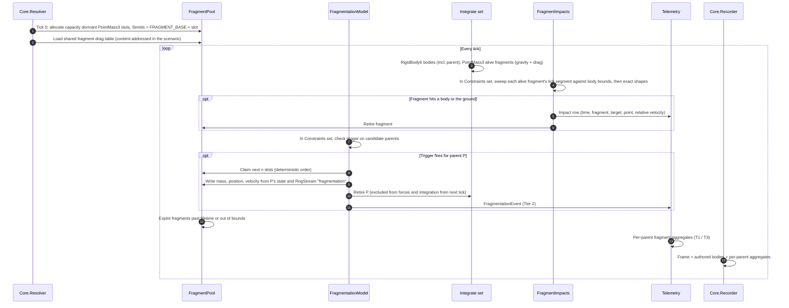

| | |
|---|---|
| Contract | `trait FragmentationModel: Send + Sync` registered by a model plugin, run in `SimSet::Constraints`: `fn triggers(&self, parent: &BodyState, t: SimTime) -> bool` and `fn generate(&self, parent: &BodyState, rng: &mut RngStream, out: &mut FragmentWriter)`. `FragmentWriter::push(mass, pos, vel)` writes into claimed pool slots only and counts anything past capacity. Parents opt in with a `Fragmentable { model_id, expected_fragments }` component in the scenario; fragments can never carry it. |
| Pool | `FragmentPool` is allocated at Tick 0 with `scenario.fragment_pool_capacity` slots (default 30,000; raise it if a model expects more, since the 30k limit is soft). It is sized for one event, which is the expected case; a second event in the same run shares the remaining slots. Slots are pre-spawned dormant entities with `PointMass3 { mass, pos, vel }` + `FragmentSlot { alive, parent: SimId, spawn_tick }`. Activation flips `alive`; no entity is spawned, despawned or moved between archetypes mid-run, so the no-allocation-after-Tick-0 rule holds. About 72 B per slot: 30k slots ≈ 2.2 MB per World, ≈ 135 MB for 62 Worlds per node. Scenarios without a `Fragmentable` body get no pool. |
| Identity | Authored bodies keep their scenario `SimId`s, which must be below `FRAGMENT_BASE` (proposed `0x8000_0000`). Fragments get `FRAGMENT_BASE + slot`. Slots are claimed in order of (tick, parent `SimId`, fragment index within the parent), so the same run always gives the same `SimId` to the same fragment. |
| DOF and forces | Per-entity DOF in `Integrate`: the parent is a 6DOF `RigidBody6` until it is retired; fragments are 3DOF `PointMass3` (the same point-mass integrator as the ballistic 3DOF option, D2). Fragment forces are gravity and drag only. Drag comes from the shared `FragmentDrag` table imported from the supplied drag file (IB-13), which includes a ballistic coefficient, so fragments need no reference area: drag deceleration is `ρ·|v_rel|² / (2·BC)` against the air-relative velocity, with `BC = m / (Cd·A)` in kg/m² and air density and wind from `EnvironmentPlugin`. If the table gives Cd against Mach alongside a reference BC, the importer folds the Mach dependence in. The importer converts BC units (kg/m², lb/in²) and the reference drag law, if any, to SI kg/m² at import and records the source convention. No fragment–fragment interaction. The parent is retired, not despawned, so its `SimId` stays valid for verification probes. |
| Impacts | `FragmentImpacts` runs in `SimSet::Constraints` after integration. Each alive fragment's straight segment from last tick to this tick is tested against every authored body that has a collision shape, plus the ground/terrain: a broadphase on bounding spheres (bodies sorted by `SimId`, a uniform grid when there are many bodies), then an exact segment-vs-shape test. Testing the segment, not just the end point, stops fast fragments from tunnelling through thin targets. The first hit ends the fragment (it is retired); the impact time is interpolated within the tick. Hits are found in fragment slot order, so the result is deterministic. |
| Telemetry | Tier 2: `FragmentationEvent{tick, parent_sim_id, n_fragments, n_dropped, slot_range, total_mass, total_ke}` in `events.parquet`. **Impacts:** one row per fragment impact in `impacts.parquet` (IB-07): `run_id, t_s f64, tick, fragment_sim_id, parent_sim_id, target_sim_id (0 = ground), point_world_xyz, point_target_body_xyz, rel_vel_xyz, fragment_mass`. Tier 1 and Tier 3: per-parent aggregates instead of per-fragment rows: `n_alive`, `n_impacted`, mass-weighted centroid and velocity, position covariance, max range from the event point, total KE. Per-target aggregates `impacts(SimId).count`, `.mass`, `.max_ke` are declared in `ModelMeta.signals` so requirements can address them. Fragment trajectories (per-fragment snapshots) are not written. |
| Volume | At most ~30k impact rows per fragmenting run (each fragment ends at its first impact), roughly 2 MB per run after zstd. A 100k-run campaign where every run fragments is on the order of 200 GB of impact data, so `campaign.toml` gets `[output] fragment_impacts = true` (default on when the scenario has a `Fragmentable` body) to switch the table off for exploratory sweeps. |
| Recorder | `FlightRecorder` records authored bodies plus the per-parent aggregates only. Recording every fragment would need about 30,000 × 256 ticks × 62 Worlds × 80 B ≈ 40 GB per node. A crashing fragment is still identifiable (`FLAG_NAN_ORIGIN` carries its `SimId`), and its full state is recovered by deterministic re-simulation in Studio (G9). |
| Errors | Pool exhaustion: fragments beyond capacity are dropped, counted in `FragmentationEvent.n_dropped` and a `fragments_dropped` summary column, and requirements that read fragment or impact signals become `Inconclusive` for that run. Preflight warns if `expected_fragments` exceeds `fragment_pool_capacity`. A non-finite fragment state trips the watchdog as for any body. |
| Status | Hook only, no fragmentation model in v1. Still open for the physics design: trigger criteria, the mass and velocity distributions of fragments, and when a fragment's lifetime ends if it hits nothing. |
| As built (step 5e, part 1) | **Kernel side.** `sim_core::fragments`. Slots are a struct of arrays in the `FragmentPool` resource, not pre-spawned entities: entities with `PointMass3` would join the body table and the main integrator, and a struct-of-arrays loop is what physics §7 R8 asked for. The pool is sized to `config.fragments.capacity` (default 30 000) at Tick 0 when the run has a `Fragmentable` body, and to nothing otherwise. `Fragmentable { model_id, expected_fragments }` names a model registered with `SimAppBuilder::add_fragmentation_model`; the trait is `FragmentationModel { id, setup(world, parents), triggers(&FragmentParent, t), generate(&FragmentParent, &mut RngStream, &mut FragmentWriter) }`, where `FragmentParent { sim_id, state, mass }`. `setup` lets a model read its parents' components at Tick 0. `FragmentWriter::push(mass, position, velocity)` returns the new `SimId` or `None` when the pool is full (counted as dropped). Breakups are checked at the end of every tick, after contact, parents in `SimId` order; each parent draws from its own stream `fragmentation/<SimId>`, so one parent's breakup never shifts another's draws. A parent is retired after its breakup: it keeps its `SimId` and last state (zero derivatives from the next tick) and leaves contact, gear and ray queries. Fragments move after the bodies in `Integrate`, once per tick with `config.integrator.fragments`, under gravity, drag from the parent's `FragmentDrag { mach, ballistic_coefficient }` (BC in kg/m² against Mach, linear, held at the ends; a parent without one gives drag-free fragments) and, in a rotating world frame, the Coriolis and centrifugal terms. Impacts are found in `Constraints` by casting each alive fragment's straight path over the tick against every non-retired collider, relative to each body's motion over the tick, and kept in memory as `FragmentImpact { time, tick, fragment, parent, target, point, point_body, relative_velocity, mass }`. Static colliders keep their own `SimId` as the target, not 0. `config.fragments.lifetime` (s, off by default) ends fragments that hit nothing. Events: `fragmentation` (value: fragments written, at the parent) and `fragments_dropped` (value: the number dropped). Claimed fragments join the state hash. A non-finite fragment, or a model writing one, ends the run `CrashedNaN`. The output side is step 5e-2 (next row). |
| As built (step 5e, part 2) | **Outputs.** *Aggregates:* at Tick 0, right after the scenario is spawned and resolved and before any plugin starts (so a requirement set resolves signals on them), every `Fragmentable` body gets a `FragmentCloud` and, in a run with one, every entity with a `SimId` and a `CollisionShape` an `ImpactTally`. Both are updated at the end of every tick after impacts, expiry and breakups. `FragmentCloud { fragments, dropped, alive, impacted, expired, mass, centroid, velocity, covariance { xx, yy, zz, xy, xz, yz }, max_range, kinetic_energy }`: sums over the flying fragments (0 when none flies); mass-weighted means and covariance over them (two passes, so a cloud far from the origin keeps its spread), following the parent before the breakup and keeping their last values once nothing flies; `max_range` the largest distance from the breakup point of a flying fragment at a tick end, an impact point or where a fragment expired. `ImpactTally { count, mass, max_ke }` with `max_ke = ½ m |v_rel|²` against the surface hit. *Signals:* `entity(P).FragmentCloud.<field>` and `impacts(T).count`, `.mass`, `.max_ke` (short for `entity(T).ImpactTally.<field>`); `ModelMeta.signals` does not exist yet, so the components themselves are the declaration. *Inconclusive rule:* in a run that dropped fragments, every metric reading a `FragmentCloud` or `ImpactTally` signal is `NaN` and every requirement reading one (directly or through its metric) is `Inconclusive`; the rest are judged as usual. *Tier 1:* the summaries' `fragments_written`, `fragments_dropped`, `fragments_impacted`, `fragments_expired` columns, present when the scenario fragments; per-parent values reach the summaries as metrics over the cloud's signals (`Final`, `Max`, ...), since the number of parents varies by scenario. *Tier 3:* the parent's snapshot rows carry its cloud as `ch_frag_*` channels. *Recorder:* every frame carries the clouds (`TickFrame::fragments`), so crash streams are schema 2.0. *Impacts:* `sim_hpc` writes the run's `FragmentImpact`s as `*_impacts.parquet` rows when `[output] fragment_impacts` is on (default: on when the scenario has a `Fragmentable` body; preflight finds out at its Tick 0); `target_sim_id` is the target's own `SimId`, the ground's too. *Import:* `sim_models::import::fragment_drag` (IB-13). The standard library still registers no `FragmentationModel` (O1), so a scenario with a `Fragmentable` body runs only with a library that adds one. |

---

### IB-17 · Campaign query service (sim_query serve → Explorer.Results)

| | |
|---|---|
| Contract | Arrow Flight SQL over gRPC. The explorer sends DataFusion SQL against the views of one campaign directory (`summaries`, `events`, `snapshots`, `impacts`, `verdicts`, `manifest`) and receives Arrow `RecordBatch` streams. `DoGet` with `CrashDumpTicket{campaign_id, run_id}` returns one `CrashDump` (IB-10). Results are capped at `max_rows` (default 1 M); larger answers must be aggregated on the service side. |
| Placement | `sim_query serve` runs as a small PBS (or Slurm) job submitted by the explorer through the cluster profile: default 1 node, 8 cores, 4 h walltime, exits after 30 min idle. `placement = "login"` is allowed where site policy permits. At start it writes `~/.saber/query/<jobid>.json` (mode 600): `{host, port, token, build_id, schema_version, expires_utc}`. The explorer reads it over SSH and opens `ssh -L` through the login node. |
| Security | Read-only. Serves only campaign directories under the cluster profile's `$SHARED_OUT` roots. One bearer token per service job. Listens on the node's internal interface. Makes no outbound connections (D7). |
| Owner | `sim_query` (view names, UDF names and signatures); column types from `sim_schema`. |
| Validation | The handshake reports `build_id` and `schema_version`. Same-major is required; a `build_id` different from the explorer's is shown as a warning, since UDF results come from the service's `sim_verify`. |
| Errors | No service running or token expired → explorer offers **Start query service** and shows the queue wait. Tunnel lost → views marked *stale*, last results kept. Over `max_rows` → error suggesting an aggregate. Missing `run_id` ranges in `_MANIFEST.json` → every result carries a *partial* flag, as in IB-11. |

---

### IB-18 · Studio handoff (sim_explorer ↔ sim_studio, new, D12)

| | |
|---|---|
| Direction | Explorer → studio: `OpenRun`, `OpenCrash`, `OpenFan`, `PinScenario`. Studio → explorer: `OpenCampaign`. Both: `Ack` / `Error` with the request id. |
| Contract | `sim_schema::handoff::Request` (serde, JSON, one message per line, `schema_version` field). `OpenRun { campaign_id, run_id, param_set_id, replicate_seed, status, final_state_hash, build_id, bundle: PathBuf, tick: Option<u64>, focus: Option<SimId> }`; `OpenCrash` adds `crash_tick`, `dump: Option<PathBuf>`, `recorder_k`; `OpenFan { campaign_id, subset_name, run_ids, snapshots: PathBuf, color_metric }`; `PinScenario { bundle, params: Vec<(String, f64)> }`; `OpenCampaign { location: Local(PathBuf) \| Cluster { profile, campaign_id }, view: Monitor \| Results }`. |
| Data | The explorer writes everything the studio needs into the handoff cache `~/.saber/cache/<campaign_id>/` first: scene bundle (`.scn.ron`, `.req.ron`, `campaign.toml` from the campaign archive), single `CrashDump` files (IB-10), snapshot extracts (Parquet, `snapshots` schema) for fans. The studio reads only local files and never talks to `sim_query`. |
| Transport | Per-user local socket (Unix domain socket in `$XDG_RUNTIME_DIR`, mode 600; named pipe with a user-only ACL on Windows). If nothing listens, the sender starts the other app with a deep link (`saber://studio/...` or `saber://explorer/...`) carrying the same request. No network listener (D7). |
| Owner | `sim_schema` (message types and versions); `sim_studio` and `sim_explorer` conform. |
| Validation | Studio checks the bundle's content hash against the campaign's `scene_hash`, and `build_id` against its own; a mismatch is reported in `Ack` and shown as a warning (per D15: replay from frames, or an approximate re-run on the current build). |
| Errors | Missing cache file, unknown `schema_version` or a busy studio (unsaved Builder edits) → `Error` with a reason; the explorer shows it as a toast and keeps the cache for a retry. |

### IB-19 · Geometry and contact (sim_models / scenario → sim_core, new, D13)

| | |
|---|---|
| Direction | Scenario and model plugins declare shapes and materials; `sim_core::geometry` (Parry) and `ContactSolver` own detection and response. |
| Contract | Components `CollisionShape { shape: ShapeDesc, local_pose }`, `ContactMaterial { model: Compliant\|Impulsive\|EventOnly, restitution, friction, stiffness, damping, exponent, rest_speed }`, `ContactPoints` (strut-axis gear/skid/wheel points). `ShapeDesc` covers primitives, `ConvexHull { points }`, `Compound`, and `TriMesh { geom }` (static bodies and terrain only, vertices in a `geometry/<blake3>.geom` sidecar); shapes derived from a 3D model are baked at authoring time and carry `derived_from` (D17, §5.10). Model plugins add contact loads only through `trait ContactForces` (pure, per RK4 stage). Pair model = more specific of the two materials, overridable per pair in the scenario. Events: `SimEvent::Contact{a, b, t, point, normal, impulse_or_peak_force, rel_vel}`, `SimEvent::ContactDeferred`. Stop conditions may reference contact (`crash_on_contact`, `ground_impact`). |
| Owner | `sim_core` (types, Parry wrapper); `sim_schema` (event schema). Parry is pinned exactly and is part of `build_id`. |
| Validation | `Core.Resolver` at Tick 0: shapes valid and non-degenerate, `max_contact_pairs` sized, compliant stability `ω·dt ≤ 2.0` (else `SetupError`, warning above 0.5), `0 ≤ e ≤ 1`, `μ ≥ 0`. |
| Errors | Pair buffer overflow → `CrashedSolver(ContactCapacity)`; persistent penetration above `max_penetration` or energy gain across an impulse → watchdog crash; more than `max_events_per_tick` impacts → deferred and logged, run continues. |
| As built (step 5d, part 1) | `CollisionShape { parts: Vec<ShapePart { shape, pose }> }` (several parts instead of `Compound`; `HalfSpace`, `HeightField { rows, cols, size_x, size_y, heights }` and `TriMesh { vertices, indices }` inline rather than in a sidecar, static only). `ContactMaterial` adds `damping_law` (`HuntCrossley` or `Linear`) and `slip_speed`. `ContactPoints { points: Vec<GearPoint> }`, each `GearPoint { attach, axis, stroke, material, rolling, forward, steer, rolling_resistance, brake, brake_friction }` with its own material only. Per-pair materials are `ContactOverrides { pairs: [ContactOverride { other, material }] }` on either entity; without one, two materials combine (series stiffness and damping, geometric-mean friction) and must share exponent and damping law. No `trait ContactForces`: the kernel's solver adds the forces. Events are the declared names `contact` (value: approach speed, with `other` and the point) and `contact_end` (value: peak normal force). `config.contact.max_contact_pairs` (default 1024) is in `sim_config_hash`. Stiffness warnings go to `ResolveReport.warnings`. `Impulsive`, `ContactDeferred`, `max_penetration` and the impulse energy check arrive with 5d-2. |
| As built (step 5d, part 2) | `Impulsive` pairs (every material impulsive; geometric-mean restitution and friction, the larger rest speed) have impacts located inside the tick and resolved with Newton impulses and Coulomb friction in 32 fixed sweeps, falling back to Poisson's rule, then a plastic impact, when Newton would add energy; below `rest_speed` they rest on their compliance. Events: `impact` (value: approach speed, with the time of impact, the point and the other entity), `contact_deferred` (past `config.contact.max_events_per_tick`, default 4), `contact_projected` (overlap pushed out, at most `config.contact.max_projection` per tick, default 1 mm), and `contact` with its time for an `EventOnly` touch inside a tick. `SimEvent` gains `time`. Energy growth after the fallbacks ends the run `CrashedEnergy`. The persistent-penetration watchdog and range sensors are step 5d-3. Details in `physics-engine-tradeoffs.md` §9.7b. |
| As built (step 5d, part 3) | `Dynamics::ray_cast(world, origin, direction, max, exclude) -> Option<RayHit { distance, point, normal, sim_id }>`: the first collider along a ray, statics included, skipping one `SimId`, without allocating; the `SensorPlugin`'s `RangeFinder` uses it. The persistent-penetration watchdog: `config.contact.max_penetration` (m, `None` by default, so off) and `config.contact.penetration_ticks` (default 10), both in `sim_config_hash`; a body pair overlapping deeper than the limit at the end of more than that many ticks in a row ends the run `CrashedSolver(Penetration)`. Gear points are not checked. Details in `physics-engine-tradeoffs.md` §9.7c. |

### IB-20 · 3D model assets (model files → sim_assets → Studio.Assets, new, D17)

| | |
|---|---|
| Direction | Model files (built-in library, workspace `models/`, library roots) → `Assets.Catalog` → `Studio.Assets` (Bevy `AssetServer`). The scenario's `visual:` section is written by `Studio.Builder` and read only by the studio. |
| Contract | glTF 2.0 stored as `.glb` (`.gltf` + files accepted at import and packed), with `model.ron` (`VisualAssetManifest`: `id`, `version`, `content_hash`, `source`, `frame { unit, up, forward }`, `origin`, `bounds`, `bindings`, `lods`, `license`). Entities link through `VisualModel { asset: VisualAssetRef { source, id, version, content_hash }, offset, scale, tint, visible, bindings }` keyed by `SimId`; look-only props are `Scenery`. Unit, axes and origin are applied from the manifest at load, not baked per instance. |
| Owner | `sim_assets` (manifest, reference and `visual:` section types, validation, conversion); `sim_studio` (loading, spawning, LOD); `sim_core::geometry` for shapes derived from a model (IB-19). |
| Validation | Import rules in §5.10 (glTF 2.0, local URIs only, supported extensions, unit plausibility, size budgets). The catalogue verifies `content_hash` when it loads a model. Built-ins are checked by `cargo test -p sim_assets` in CI. |
| Errors | Missing model → placeholder from the collision shape or bounds plus a lint warning; export and submit are not blocked. Hash mismatch → warning "model changed since the scenario was saved", still drawn. Unsupported file → import refused with a reason. Load failure at run time → placeholder and a toast. None of these reach `sim_core` or `sim_hpc`. |
| Versioning | `VisualAssetManifest.schema_version` and `visual.schema_version` are semver. A built-in's integer `version` bumps when its shape or frame changes, so `@1` keeps its meaning. Visual changes change `visual_hash`, never `scene_hash`. |

---

## 10. Cross-cutting concerns

### 10.1 Determinism contract
**Scope (D1):** results must be bit-identical **within one cluster build** (`build_id`), not across
platforms. Bit-identical results for a `(build_id, scene_hash, param row, seed)` require:
- Same binary (enforced via `build_id` gather at init, IB-05).
- Pinned target CPU features; no `-C target-cpu=native` on heterogeneous clusters; FMA either always or
  never (`#[cfg]`-controlled), because fused vs unfused multiply-add changes bits.
- No `libm`/`std` transcendental differences across nodes (same binary covers this), no HashMap iteration
  in sim systems (use `IndexMap`/sorted `Vec`), entity iteration sorted by `SimId` where order affects
  math (e.g. force accumulation).
- RNG via named substreams only.
- Fragment slot claiming in a fixed order (IB-16).
- Contact pairs ordered by `(min SimId, max SimId)`, fixed sequential-impulse iteration counts, no
  float-threshold convergence loops (IB-19).
- 3D models never feed the simulation: the `visual:` section is outside `scene_hash`, and a collision shape
  derived from a model is stored as plain f64 data in the sim section, so the kernel never reads a glTF (D17).
- Cross-*platform* (workstation vs cluster) bit-equality is **not required**. Studio re-simulation of a
  cluster run checks its recomputed final `TickFrame` hash against the summary's `final_state_hash`; if
  they differ (different build or platform), Studio says so and falls back to the recorded frames.
  Forensics that must be exact run the cluster build (for example `sim_hpc --local` on a login node).

### 10.2 Error taxonomy

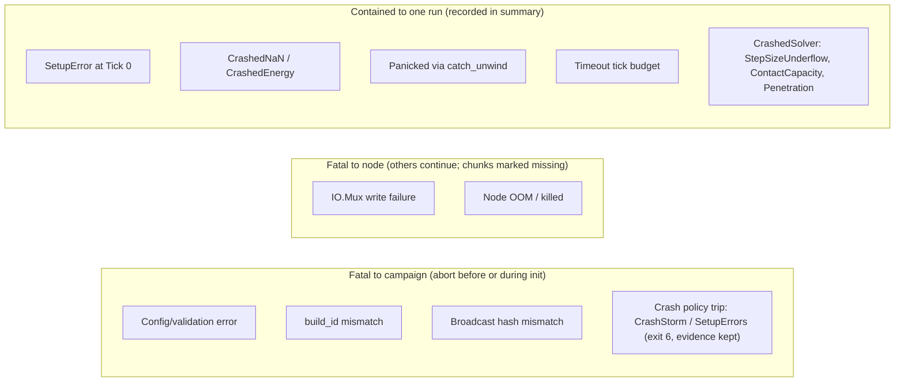

`SimStatus` (`#[repr(u8)]`): `0 Completed` (reached `max_ticks` with `at_max_ticks: Completed`, the default; D19), `1 Terminated` (stop condition / early-fail), `2 CrashedNaN`,
`3 CrashedEnergy`, `4 Panicked`, `5 Timeout` (reached `max_ticks` with `at_max_ticks: Timeout`), `6 SetupError`, `7 CrashedSolver` (new, D13/D14: adaptive step
underflow, more than `max_substeps_per_tick` step attempts in a tick, contact buffer overflow; detail in
`crash_reason`). A non-finite integrator error norm is a `CrashedNaN`, not a solver crash. Crashed runs of this kind follow the same crash
capture and campaign crash policy as `CrashedNaN`.

### 10.3 Units & frames
SI throughout the kernel; the Studio may display other units. Every scenario declares a world frame
(`NED`, `ENU`, or `ECEF` for long-range ballistics). ENU and NED have their origin at mean sea level, so
altitude is `z` in ENU and `−z` in NED; in ECEF altitude is the WGS 84 geodetic height (Heikkinen's closed
form). Flat gravity needs ENU or NED and J2 gravity needs ECEF. A frame turns only when the scenario carries
`EarthRotation` (step 5a, §5.2); otherwise every frame, ECEF included, is treated as inertial. A turning frame
is described by its angular velocity `Ω` in world components (`Environment::frame_rotation`). The kernel then
integrates `v̇ = F/m + g − 2Ω × v − Ω × (Ω × p)` and the attitude relative to the frame,
`q̇ = ½ q ⊗ (0, ω − q⁻¹Ωq)`, while `body_rates` stay inertial so Euler's equations are unchanged; aerodynamic
models use the rates relative to the frame (`Stage::rates_relative_to_frame`). The reported energy is then the
Jacobi integral, `½mv² + mΦ − ½m|Ω × p|² + T_rot`. Signal metadata (`ModelMeta.signals`) carries unit
and frame so requirement thresholds can be unit-checked at validation (IB-03).

### 10.4 Versioning
Every file carries `FileHeader.schema_version`. Readers accept same-major; `sim_schema` provides
upgraders for one previous major. `build_id` ties results to the exact binary. The workspace `arrow` /
`parquet` version follows `sim_query`'s DataFusion release (§4); Parquet files stay readable across those
upgrades because the file format, not the Rust crate version, is the contract.

---

## 11. Gaps in the draft, decisions & open questions

### Gaps (with proposed resolution in this doc)

| # | Gap in Architecture.md | Proposed resolution |
|---|---|---|
| G1 | No requirements model or pass/fail evaluation, the core purpose of SABER. | `sim_verify` + `saber.verify`, §8, IB-03/09/12. |
| G2 | Tier 3 snapshots share `events.parquet` with Tier 2 but have different columns; "3 files × 32 nodes" omits crashes vs snapshots. | Separate `snapshots.parquet`; 4 files/node + markers. |
| G3 | Manifest is never broadcast or partitioned; workers can't look up params for `run_id`. | **Decided (2026-10-30):** Rank 0 broadcasts the full manifest bytes with the scene (500k × 10 f64 ≈ 40 MB), hash-checked on every rank (IB-02, IB-05). |
| G4 | `parse_scene_bytes` → `DynamicScene` needs an identical `TypeRegistry`; not stated. | `SimTypeRegistry` built by `SimAppBuilder`; `build_id` check at init. |
| G5 | World reuse between runs (`for_each_init`) needs a reset path; leftover entities/resources break determinism. | `SimWorld::reset()` despawns every entity created after the World was built (not `World::clear_entities()`, which in Bevy 0.20 also removes resources, since resources are entities); the next `start` re-initialises every per-run resource and keeps buffer capacity. Test R2 runs A, then B, then A again in one World. |
| G6 | `CrashQuota` "first M" is per node and nondeterministic across reruns (thread race). | **Decided (2026-10-30):** the quota is campaign-wide. Rank 0 owns the counts, synced as deltas on `ChunkRequest`/`ChunkAssign`; each node's `Quota` is a view. Overshoot by a few dumps is accepted; replay and analysis show the `M` lowest-seed dumps, so the selection is stable across reruns. Plus a crash-storm abort (`[crash_policy]`, exit 6) with canary strided dispatch (IB-04, IB-05, seq §8). |
| G7 | f64 → f32 `Transform` copy loses precision at ballistic ranges (10–100 km). | Floating origin in `RenderBridge` (camera-relative f64 subtraction before casting). |
| G8 | Verlet integration only; no rotational dynamics, multibody or stiff contact. | **Decided (D13, 2026-11-01):** own kernel, RK4 for 6DOF and 3DOF; contact via Parry detection plus custom compliant/impulsive response (IB-19); multibody deferred with robotics. |
| G9 | Crash replay shows only last K frames of a few bodies; no way to inspect earlier state. | Deterministic **re-simulation** in Studio (rebuild from params+seed, run to `crash_tick − K`, then step live). Ring buffer becomes the fallback when determinism can't be confirmed. |
| G10 | `SimStatus`, `CrashReason`, `CrashDump`, `SimEvent` types referenced but undefined. | Defined in `sim_schema` (§5.4, IB-10). |
| G11 | No checkpoint/resume: a walltime kill loses the whole campaign's tail. | **Decided (2026-10-30):** rolling parts committed every `checkpoint_interval_s` by IO.Stager, `--resume` as a new attempt that skips `run_id`s in committed summaries footers, `_MANIFEST.json` as the index, drain before walltime, optional `auto_resume` (IB-04, IB-07, seq §7, §12). |
| G12 | Rank 0 is both dispatcher and worker under `Funneled`; dispatcher latency unspecified. | Dispatcher on thread 0 polls with `MPI_Iprobe`; pool on Rank 0 uses one fewer thread. |
| G13 | Multi-rate control/sensor loops not supported by a single fixed dt. | `RateDivider` in `SimClock` (§5.1). |
| G14 | Hard-coded paths (`./scenarios/experiment_A.scn.ron`, `/tmp`) in sim_hpc. | All paths from `campaign.toml` (IB-04). |
| G15 | No GUI path for interactive single runs, campaign setup/monitoring, or browsing results. | `LocalRun`, `CampaignSetup`, `RunReplay` studio states; `sim_explorer` Monitor and Results (D12); heartbeat IB-15. |
| G16 | Fragmenting bodies (up to ~30k short-lived fragments per event, usually one event per run) would break the no-alloc rule, the `SimId` scheme and recorder memory. | Hook only (IB-16): `FragmentPool` preallocated at Tick 0, deterministic `SimId` range, per-entity DOF, no re-fragmentation or fragment–fragment collisions, fragment impacts on bodies recorded in `impacts.parquet`, aggregate telemetry otherwise, recorder keeps parents + aggregates. Trigger and generation physics designed separately. |
| G17 | No fixed-wing airframe model in `sim_models` (from `flight-dynamics-sources.md`). | **Decided (2026-10-30):** a separate `FixedWingPlugin`, not a mode of `AeroBallisticsPlugin` (D9, §5.2). |
| G18 | Entities have no way to look like the real system; IB-13 lumped glTF, OBJ and STL under "Bevy asset loader" with no catalogue, unit or axis handling, hashing, or rule for collision. | **Decided (D17, 2026-11-02):** `sim_assets` with built-in, workspace and library-root models, `model.ron` manifests, `visual:` section outside `scene_hash`, collision derived only on request (§5.10, IB-20). |

### Decisions (Alex, 2026-10-30 and 2026-10-31)

D1–D8 were the open questions Q1–Q8 in v0.1. D9 settles the fixed-wing question raised in `flight-dynamics-sources.md`. D10 (2026-10-31) picks the studio's query engine. D13 and D14 (2026-11-01) pick the physics approach and the integrators; D16 (2026-11-02) trims contact scope. D17 (2026-11-02) adds 3D models for entities. D18 (2026-11-02) renames the project. D19 (2026-11-02) settles what the tick budget means.

| # | Topic | Decision | Consequence in this doc |
|---|---|---|---|
| D1 | Reproducibility | Bit-identical **within one cluster build** only; cross-platform bit-equality is too strict. | §10.1; `build_id` gather at init (IB-05); Studio re-sim checks `final_state_hash` and falls back to recorded frames. |
| D2 | Fidelity | Ballistics: 6DOF following McCoy's *Modern Exterior Ballistics*, with 3DOF point-mass as an option. Rotors: lumped model. Robot arms: rigid links; flexible arms may be added later. | §5.2 plugin scopes; 3DOF is also the fragment model (IB-16). |
| D3 | Requirements | No requirements repository for now (worth doing later, out of the current scope). Verdicts do not flow back. | `*.req.ron` is the source of truth; ReqIF/CSV requirement import dropped from IB-13; `report.html` + `verdicts.parquet` only. |
| D4 | Flight software in the loop | Not needed. Flight models come from published sources (McCoy for gun-launched projectiles; aircraft and multirotor sources in `flight-dynamics-sources.md`). | Native Rust `Controller`s only (§5.2); no external-controller adapter. |
| D5 | Scheduler | PBS is the primary target; Slurm compatibility is desirable. | `saber.campaign` templates: PBS first, Slurm second; `auto_resume` uses each scheduler's job dependency (IB-04). |
| D6 | Digital-twin calibration | Later, not in the current scope. | IB-14 and `saber.twin` deferred; `TwinProfile` stays reserved in the scenario envelope. |
| D7 | Data handling | No export concern, but data should live on the cluster and SABER must not contact external services. | §2 scope; all outputs on cluster FS and the workstation; no telemetry or network services. |
| D8 | Scenario size | Usually up to a few hundred bodies. Later: fragmenting bodies, where a body is deleted and replaced by up to 30,000 short-lived 3DOF fragments (no FEA; physics designed separately). | Recorder memory is small at a few hundred bodies (500 × 256 × 62 × 80 B ≈ 0.6 GB/node); the fragmentation hook is IB-16. |
| D9 | Fixed-wing aircraft | Fixed-wing aircraft get their own plugin, kept separate from the ballistics plugin so the two don't get confused. | `FixedWingPlugin` in §3, §5.2 and the domain packs; shares only the environment, rigid-body integrator and table type with `AeroBallisticsPlugin`; added to P5. |
| D10 | Campaign data exploration | Parquet stays the stored format. The GUI (since D12 the `sim_explorer` app) queries it with Apache DataFusion (not DuckDB), and for cluster campaigns the query runs in a `sim_query serve` job next to the data. Python keeps DuckDB/Polars. | `sim_query` crate (§1, §4, §5.8); IB-17; Explorer.Results and IB-10 route through it; one workspace Arrow version (§4, §10.4); P6. |
| D11 | Studio UI toolkit | Bevy Feathers instead of `bevy_egui`, accepting that it is experimental and breaks between Bevy releases. | `sim_studio_ui` kit isolates Feathers (§1, §4, §5.5); Bevy pinned exactly and upgraded one minor at a time with determinism goldens, because `sim_core` shares `bevy_ecs` and each upgrade is a new build (D1). Policy for re-simulating old campaigns is O2. |
| D12 | GUI split | Campaign data exploration (monitor, results, queries) is a separate window and app, `sim_explorer`, built with egui; the studio keeps Bevy + Feathers for building, viewing and simulating a scenario. | `sim_explorer` crate (§1, §3, §4, §5.9); `sim_query` moves from the studio to the explorer; IB-18 handoff; studio states lose `CampaignMonitor` and `ResultsExplorer`; IB-10, IB-12, IB-15, IB-17 now end at the explorer. |
| D13 | Physics engine | Build SABER's own physics kernel and use Parry (`parry3d-f64`) for collision detection; no Rapier or Avian. Robotics is dropped as a design consideration for now. First contact sometimes ends a run but often does not, so the kernel needs contact response. | `GeometryService` and `ContactSolver` in `sim_core` (§5.1); contact in the tick pipeline (§6); IB-19; G8; `MultibodyPlugin` and URDF import deferred; P5b; analysis in `physics-engine-tradeoffs.md`. |
| D14 | Integrators | Several integrators, RK4 as the default, plus embedded pairs such as Dormand–Prince and Fehlberg, so scenarios can choose quick runs or accurate runs with error estimation. | `Core.Integrator` (§5.1): one Butcher-tableau stepper (RK2, RK4, BS3(2), RKF45, CK45, DOPRI5(4), DOP853) + semi-implicit Euler; fixed or adaptive substeps landing on tick boundaries (§6); error columns and `sim_config_hash` in summaries (IB-07); models supply only RHS functions (IB-08); `7 CrashedSolver` status (§10.2); `physics-engine-tradeoffs.md` §10. |
| D15 | Campaigns from older builds | After a Bevy (or any) upgrade, older campaigns are replayed from their recorded frames and snapshots only; no archived binaries are kept for bit-identical re-simulation. Reproducing a study means re-running it on the current build, expecting the same physics and statistically similar results. | Studio disables bit-identical re-simulation when `build_id` differs and offers "Re-run on current build" (labelled approximate, compared by metrics, not `final_state_hash`); IB-10, IB-18; `sim_studio_ux.md` §13 Q7 closed. |
| D16 | Contact scope | No built-in contact material library, and no penetration or deformable-terrain models, for now (Alex, 2026-11-02; was O3). Implicit integrators are not needed either, given the adaptive explicit methods (was O4). | `ContactMaterial` values are entered per body in the scenario (IB-19); terrain is rigid, contact is surface-only; `physics-engine-tradeoffs.md` §12. |
| D17 | 3D models | Entities can be linked to 3D models in glTF 2.0 / GLB, Bevy's native format. Defaults live in the code base and users can bring their own. OBJ import with conversion to glTF and GLB is a nice-to-have stretch goal. Other engineering model formats are out of scope; conversion happens elsewhere (Alex, 2026-11-02). Campaigns keep a copy of the workspace and library-root models they use, up to 2 GB per campaign (was O5). Spinning rotors and moving control surfaces come later; v1 models are rigid (was O7). Extra library folders (`model_roots`) stay as an option; Import still copies into the workspace by default (was O6). | `sim_assets` crate (§1, §3, §4, §5.10) with the built-in library in `crates/sim_assets/builtin/`; `Studio.Assets` (§5.5); `visual:` section with its own `visual_hash` (IB-01); IB-20; derived collision shapes (IB-19); IB-13 row; G18; roadmap P2v and P6b; `sim_studio_ux.md` §7.11; `sequence-diagrams.md` §2.1–2.3. |
| D18 | Project name | The project is SABER (was SABERS), and identifiers follow: Python package `saber`, `saber-cli`, `~/.saber/`, `saber://` deep links, `saber.workspace.ron`, `FileHeader.saber_version` (Alex, 2026-11-02). | Renamed across all design docs; the code uses the new names from the first commit. |
| D19 | Reaching the tick budget | What a run that reaches `max_ticks` still running ends as is a scenario setting, `at_max_ticks`, `Completed` by default: fixed-duration runs end `Completed` and get Pass/Fail verdicts; scenarios that expect an impact or landing set `Timeout`, so missing it is `Inconclusive` (Alex, 2026-11-02; first half of O8). | `SimConfig::at_max_ticks` and `MaxTicksOutcome` (§5.1); `SimStatus` 0 and 5 (§10.2); seq §6. Whether `Timeout` counts against the crash policy was O8, decided as D20. |
| D20 | `Timeout` and the crash policy | A run that ends `Timeout` counts toward the campaign's crash-storm rule, and is `Inconclusive`, not a failure, in `saber.verify`'s statistics (Alex, 2026-11-03; was O8). | `sim_hpc::protocol::counts_toward_storm` (§5.6, step 4a); seq §8.2 and §11; `saber.verify` (step 4c). |
| D21 | Pooled or per-set `Probability` | A `Probability` requirement is judged over all of a campaign's counted runs pooled (the chance over the sweep's sampled inputs) by default; judging each parameter set on its own and reporting the worst (an operating envelope) is available on request (Alex, 2026-11-03; was O9). | `saber.verify` default `by_param_set=False`, `by_param_set=True` per set (§5.7, step 4c, unchanged); seq §11. |

### Still open

| # | Question | Where |
|---|---|---|
| O1 | Fragmentation physics: trigger criteria, fragment mass and velocity distributions, fragment lifetime when nothing is hit. | IB-16 (designed separately) |

---

## 12. Revised roadmap

Phases from the draft, with new work inserted where it unblocks verification early. `docs/build-plan.md`
breaks these phases into reviewable steps, one pull request each, in build order.

```mermaid
gantt
    dateFormat  X
    axisFormat  P%s
    section Kernel
    P1 sim_core determinism + sim_schema types      :p1, 0, 1
    P1b SimSet pipeline + RigidBody + Environment     :p1b, 0, 1
    section Verify
    P2 sim_verify per-run + req.ron                   :p2, 1, 2
    section Studio
    P2s Builder + LocalRun + CrashReplay              :p2s, 1, 2
    P2v sim_assets + built-in models + glTF import    :p2v, 1, 2
    section HPC
    P3 sim_hpc local (rayon + IO.Mux + RunSink)       :p3, 2, 3
    P4 MPI + manifest bcast + crash policy + resume   :p4, 3, 4
    section Analysis
    P4a saber.analyze + saber.verify + report       :p4a, 3, 4
    section Domains
    P5 AeroBallistics McCoy 6DOF+3DOF, FixedWing, Rotorcraft :p5, 4, 5
    P5b GeometryService + ContactSolver (Parry, IB-19) :p5b, 4, 5
    P6 sim_explorer + sim_query (embedded, then serve) + IB-18 :p6, 5, 6
    P6b OBJ to glTF converter (stretch, D17)          :p6b, 5, 6
    section Later
    P7 Fragmentation physics on IB-16 (separate design) :p7, 6, 7
    P8 Twin calibration, requirements repo, robotics/Multibody (deferred) :p8, 7, 8
```

Exit criterion per phase stays the draft's style: a concrete test (determinism, allocation count,
round-trip of every IB file through Rust and Python, a 2-node PBS job and the same job under Slurm, a job
killed mid-run and resumed with no duplicated or missing `run_id`s, a deliberately broken scenario that
trips the crash policy with exit 6, an end-to-end campaign whose `verdicts.parquet` matches a
hand-computed expectation, and a scorecard that `sim_query` returns identically embedded, through
`sim_query serve`, and from `saber.verify`). The `FragmentPool` and
per-entity DOF land with P1b/P5 so P7 does not touch the kernel.
