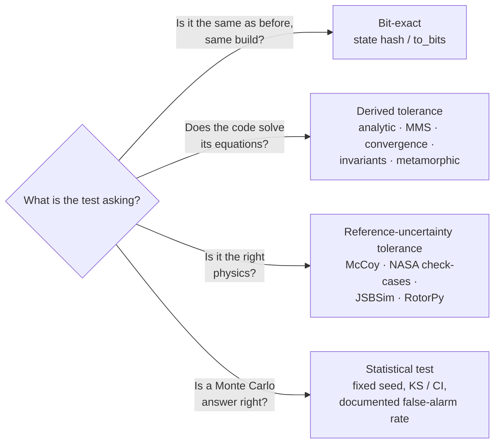
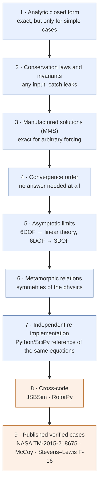
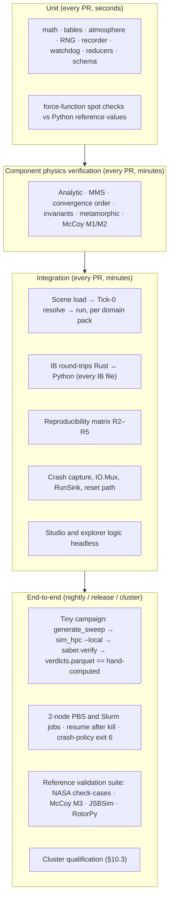
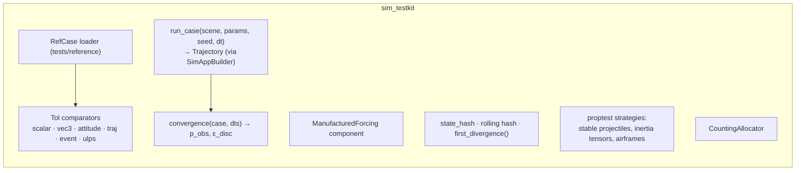
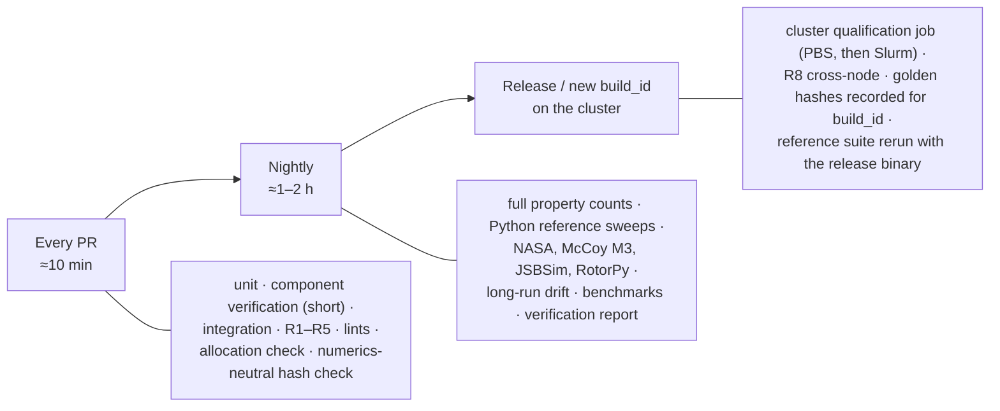
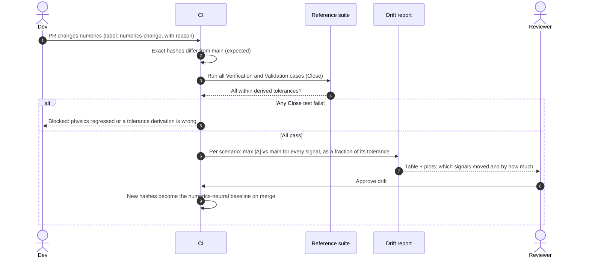

# SABER: Verification and Test Strategy

Version 0.4 (2026-11-01; v0.2 adopts the custom engine + Parry decision (D13) and drops robotics; v0.3 adds selectable integrators (D14); v0.4 aligns names and tests with `physics-engine-tradeoffs.md` §9–§11; v0.5 (2026-11-02) follows D15: no exact cross-build re-runs, §11.1; v0.6 (2026-11-02) records Alex's answers to T3 and T6 as decisions TD1 and TD2, §13, with TD1 covering all published data; v0.7 (2026-11-02, build step 1a) states how `close` treats infinities, checks DOP853 against its published decimals because its nodes are irrational, and matches the estimate tests to local extrapolation, §3.2, §5.4.1; v0.8 (2026-11-02, build step 1b) states the state hash field by field, how the rolling hash is switched on, and what the rigid-body tests found, §4.1, §4.2, §7.2; v0.9 (2026-11-02, build step 1c) names the USSA 1976 and WGS 84 oracles actually used and the scenario-file tests, §7.1; v1.0 (2026-11-02, build step 2) lists the per-run verification tests as built, §7.8; v1.1 (2026-11-02, build step 3a) adds the golden output files read by both Rust and Python, §8.3; v1.2 (2026-11-02, build step 3b) lists the local runner's tests, R3 and R4 as built, §8.3; v1.3 (2026-11-02, build step 3c) adds the Python-driven local campaign and the shared `campaign.toml` defaults, §8.3, §8.4; v1.4 (2026-11-03, build step 4a) records R5 on 1, 2 and 4 ranks, as threads and under `mpiexec`, and the crash-storm and init-refusal tests, §8.3, §8.4). Companion to `subsystems-and-interfaces.md` (names, IBs, determinism contract §10.1),
`sequence-diagrams.md` and `flight-dynamics-sources.md`.

This document answers one question: **how do we know SABER computes the right numbers, without
watching a simulation and deciding it "looks right"?** It covers unit, integration and end-to-end tests,
the floating-point comparison policy, bit-reproducibility tests, and where reference answers come from
(analytic solutions, McCoy, the NASA check-cases, cross-code comparison).

SABER uses its **own f64 physics engine with Parry (`parry3d-f64`) for collision detection** (Alex,
2026-11-01). Robotics and multibody chains are not a design consideration for now, and first contact does
not necessarily end a run, so contact response is tested as ongoing physics, not only as a stop event
(§7.5). Every physics test still drives the kernel through `SimAppBuilder` and reads state through
components and `ModelMeta.signals`, never through engine internals, so the suite survives refactors of the
engine itself.

---

## Contents

1. [The short answer](#1-the-short-answer)
2. [Three kinds of "equal"](#2-three-kinds-of-equal)
3. [Floating-point comparison policy](#3-floating-point-comparison-policy)
4. [Bit-reproducibility tests](#4-bit-reproducibility-tests)
5. [Where correct answers come from: the oracle ladder](#5-where-correct-answers-come-from-the-oracle-ladder)
6. [Using McCoy, in general and not just for his plotted cases](#6-using-mccoy-in-general-and-not-just-for-his-plotted-cases)
7. [Per-domain verification catalogue](#7-per-domain-verification-catalogue)
8. [Test tiers: unit, integration, end-to-end](#8-test-tiers-unit-integration-end-to-end)
9. [Test infrastructure: `sim_testkit`, reference cases, `saber.testing`](#9-test-infrastructure)
10. [CI cadence and the cluster qualification run](#10-ci-cadence-and-the-cluster-qualification-run)
11. [Changing numerics on purpose: the golden update flow](#11-changing-numerics-on-purpose-the-golden-update-flow)
12. [Definition of done for a physics feature](#12-definition-of-done-for-a-physics-feature)
13. [Names this document introduces, and open questions](#13-names-this-document-introduces-and-open-questions)

---

## 1. The short answer

Separate the two questions that "is the physics right?" mixes together, and test each with the tool that
fits it:

| Question | Name | Comparison | Example |
|---|---|---|---|
| Did anything change? | **Reproducibility** | Bit-exact, within one `build_id` only | Same seed twice gives the same `final_state_hash`. |
| Does the code solve the equations we wrote down? | **Verification** | Tolerance with a *derived* bound | RK4 on a torque-free spinning body matches the closed-form precession to `C·dt⁴`. |
| Are those the right equations for the real object? | **Validation** | Tolerance set by the reference's own uncertainty | 6DOF 155 mm trajectory sits inside McCoy's published curve to digitization accuracy. |

Five practices make this work without visual inspection:

1. **Never hard-code an expected float that came from SABER itself.** Expected values come from an
   independent oracle (analytic, published, another code, or a convergence argument). SABER's own past
   output is only used as a bit-exact tripwire, never as proof of correctness.
2. **Derive every tolerance** from discretization error, round-off and reference uncertainty (§3.3), and
   write the derivation next to the number.
3. **Test rates, not just values.** Convergence-order tests (halve `dt`, error falls by `2^p`) and
   asymptotic tests (shrink the yaw, 6DOF approaches linear theory) are robust to floating-point noise and
   catch almost every integrator and force-model bug.
4. **Test invariants and symmetries** that must hold for any input: energy, momentum, quaternion norm,
   rotating the whole scenario rotates the answer, mirroring the spin mirrors the drift.
5. **Keep bit-exactness for determinism only**, and test it where it is actually promised (D1): same
   build, any thread count, any node, any chunk assignment, with or without resume.

Humans still look at plots, but in a generated report (§10) for discovery, not as the pass/fail gate.



---

## 2. Three kinds of "equal"

Every assertion in the suite declares which kind it is. The kind decides the comparator and what happens
when it fails.

| Kind | Comparator | Holds across | A failure means | Stored expectation |
|---|---|---|---|---|
| **Exact** | `a.to_bits() == b.to_bits()` or state hash | Same `build_id` only | Nondeterminism bug, or an intended numerics change (§11) | Recomputed per build; a hash from `main` on the same CI image for "numerics-neutral" PRs |
| **Close** | `Tol` (§3.2) | Builds, platforms, engines | A real error, or a tolerance that was too tight (fix the derivation, not the number) | Reference data from an oracle, with its tolerance spec |
| **Statistical** | Hypothesis test or interval at fixed seed | Builds and platforms | Wrong distribution, or a false alarm at the documented rate | Distribution parameters from the oracle |

Rules that follow:

- An **Exact** assertion is never used against reference data from outside SABER.
- A **Close** assertion never uses a tolerance below its round-off floor (§3.3). If a test only passes at
  `1e-15`, it is really an Exact test and belongs in §4.
- A **Statistical** test always fixes its seed, so it is deterministic in CI. The seed is not tuned until
  it passes; the false-alarm rate is chosen in advance (default `α = 1e-3` per test) and a failure is
  re-run with three more fixed seeds before anyone touches code.

---

## 3. Floating-point comparison policy

### 3.1 What goes wrong with naïve comparisons

| Problem | Example | Policy |
|---|---|---|
| `==` on floats across builds | FMA on/off, a reordered sum, a different `libm` | Exact only within one build (§4). |
| Absolute tolerance on quantities spanning decades | `1e-6` m is huge for a contact penetration check and meaningless at 40 km range | Mixed `atol + rtol`, per quantity, in SI. |
| Relative tolerance near zero | Lateral drift starts at 0; relative error is infinite | `atol` floor per quantity, sized to the physics (e.g. 1 mm). |
| ULP distance | Good for elementary functions, useless near zero or after many operations | ULPs only for `sim_core::math` wrappers (`sin`, `atan2`, table lookups). |
| Point-wise trajectory comparison with mismatched sample times | Reference at 0.1 s, SABER at `dt = 1/1200` | Resample the SABER trajectory onto the reference grid with the same interpolant the reference used, then compare. Never interpolate the reference. |
| Comparing angles and attitudes component-wise | Quaternion `q` and `-q` are the same attitude; Euler angles wrap and gimbal-lock | Attitude error angle `θ = 2·acos(|⟨q_a, q_b⟩|)`; angles compared modulo 2π. |
| Chaotic or near-chaotic motion | Tumbling brick, intermediate-axis flip, fragments | Compare only up to a horizon well before the Lyapunov time; past it, compare invariants and statistics (§5.5). |
| Events quantized by tick | Impact time, `FirstTime`, `TimeAbove` | Tolerance of one tick (or half, with the interpolated impact time from IB-16). |

### 3.2 The comparator: `Tol`

One comparator, implemented identically in Rust (`sim_testkit`) and Python (`saber.testing`), so a
reference case gives the same verdict wherever it is checked:

```text
close(a, b; atol, rtol)  ⇔  a == b  or  (a, b finite and |a − b| ≤ max(atol, rtol · max(|a|, |b|)))
```

Equal values, including equal infinities, are close; an infinity is close only to the same infinity
(without that rule `|∞ − x| ≤ rtol·∞` would pass); NaN is never close. Both implementations are checked
against the shared vectors in `tests/shared/tol_vectors.json`.

It is **symmetric** on purpose. `numpy.isclose` is not (`atol + rtol·|b|`), and `approx`/`float-cmp`
semantics differ again, so neither is used directly.

Vector, attitude and trajectory forms:

| Comparator | Definition | Default use |
|---|---|---|
| `Tol::scalar(atol, rtol)` | above | coefficients, energies, final ranges |
| `Tol::vec3(atol, rtol)` | on `|a − b|` with `max(|a|, |b|)` | positions, velocities |
| `Tol::attitude(rad)` | `θ` from §3.1 | quaternions |
| `Tol::traj(norm, tol)` | after resampling, `norm ∈ {Max, Rms}` over time of the per-sample error | whole trajectories; `Max` for safety-type quantities, `Rms` for shape |
| `Tol::event(ticks)` | `|t_a − t_b| ≤ ticks·dt` | event times |
| `Tol::ulps(n)` | ordered-integer distance of `to_bits` | math wrappers only |

Failures print the worst sample, its time, both values, the tolerance, and which term (`atol` or `rtol`)
was binding. That output is what someone debugging at 2 a.m. needs; a bare `assertion failed` is not.

### 3.3 Deriving a tolerance instead of guessing it

Every Close tolerance is the sum of three terms, and the reference case file (§9.2) records each one:

```text
tol  =  ε_ref  +  k · ε_disc  +  ε_round
```

| Term | Meaning | How to get it |
|---|---|---|
| `ε_ref` | Uncertainty of the reference itself | Analytic: 0. Tabulated: half the last printed digit. Digitized figure: ~0.5–1 % of the axis span (measure it by digitizing the same curve twice). NASA check-cases: the spread among the participating tools. Cross-code: that code's own convergence estimate. |
| `ε_disc` | Discretization error of the SABER run | **Richardson estimate from the test itself:** run at `dt` and `dt/2`; `ε_disc ≈ |x_dt − x_dt/2| / (2^p − 1)` for an order-`p` method. `k = 3` gives margin without hiding a bug. For an **adaptive** integrator, run at error tolerance `tol` and `tol/10` instead and use their difference (§5.4.1). |
| `ε_round` | Round-off floor | `≈ c · √N · ε_mach · |x|` for `N` steps (`ε_mach = 2.2e-16`), with `c ≈ 10` for a well-conditioned state. For 10⁶ RK4 steps at `|x| = 10⁴ m`, about `2e-9` m: negligible next to the other terms, which is the point. |

Because `ε_disc` is measured, the tolerance tracks the time step automatically: change `dt` in a scenario
and the test stays meaningful. A tolerance that has to be loosened by hand is a finding, not a fix: it
means one of the three terms is wrong, and the change needs the same review as a physics change.

### 3.4 Order of operations that the kernel guarantees

These make Close tolerances tight and Exact tests possible, and they are already in the determinism
contract (§10.1 of the subsystems doc). The tests in §4.3 enforce them:

- Force accumulation sorted by `SimId`.
- Fixed FMA policy per build (`#[cfg]`), never `-C target-cpu=native`.
- No `HashMap` iteration, wall clock or `thread_rng` in sim systems.
- Reductions (`RunningStats`, fragment aggregates) in a fixed order. Welford, not naïve sum-of-squares.
- Python-side aggregation (DuckDB parallel `SUM`) is **not** order-stable, so analysis tests are Close
  tests, never Exact.

---

## 4. Bit-reproducibility tests

Bit-equality is promised only for a `(build_id, scene_hash, param row, seed)` tuple (D1). Within that
promise, it is tested hard, because it underpins crash re-simulation (G9), resume (G11) and the stable
crash-dump selection (G6).

### 4.1 The state hash

`state_hash(world)` is BLAKE3 over `sim_config_hash` (scene, integrator kind and settings, physics doc §10.5), then, for each body sorted by `SimId`: `SimId`, then the `to_bits()` of
every f64 in its integrated state (position, attitude, velocities, plus model states such as rotor ω,
battery SoC, controller integrators), then the `SimClock` tick and the RNG stream positions. It is the
same function that produces `final_state_hash` in `summaries.parquet`, so tests and production agree.

Notes:
- `-0.0` and `+0.0` hash differently. That is correct for a determinism hash.
- NaN payloads are hashed as-is; a run with NaN has already been flagged by the watchdog.
- A per-tick rolling hash (`hash_k = H(hash_{k−1} ‖ state_k)`) is available in test builds. When two runs
  disagree, a bisection over ticks finds the first divergent tick and system in seconds.
- As built (step 1b): the hash is the first 8 bytes (little-endian) of a BLAKE3 keyed-derivation hash over
  `sim_config_hash`; then per authored body in `SimId` order its `SimId`, a DOF tag (`6` or `3`) and the
  `to_bits()` of its packed state (`p`, `v`, `q` as `[w, x, y, z]`, `ω` for 6DOF; `p`, `v` for 3DOF); then the
  tick; then `(stream id, word position)` for every random stream drawn from in the run, in stream-id order.
  Streams that were registered but never drawn are left out, which is what lets R10 hold for a plugin that
  registers a stream. `sim_config_hash` covers the scene hash and every `SimConfig` field that changes
  results (`dt`, start time, `max_ticks`, `at_max_ticks`, integrator kind, mode and tolerances, the energy
  bound), fed field by field rather than through a text format; the recorder size is left out.
  `SimWorld::enable_rolling_hash(keep_history)` switches the rolling hash on; it costs one state hash per tick.

### 4.2 The reproducibility matrix

| ID | Test | Varies | Must be equal | Tier |
|---|---|---|---|---|
| R1 | Same World twice | nothing | per-tick hash | unit (sim_core) |
| R2 | World reuse A → B → A (G5) | reset path | hash of A both times | unit |
| R3 | Thread count | `RAYON_NUM_THREADS` 1 / 4 / 62 | every `final_state_hash` by `run_id` | integration (sim_hpc local) |
| R4 | Chunk assignment | chunk size 1 / 7 / 256, shuffled dispatch | same | integration |
| R5 | MPI layout | 1, 2, 4 ranks (oversubscribed on one machine in CI) | same, plus identical `summaries` rows except wall time and rank | integration |
| R6 | Resume | kill at a random commit point, `--resume` | union of attempts has each `run_id` once with the same hash as an uninterrupted run | E2E |
| R7 | Studio re-sim | `sim_hpc --local` vs `sim_studio` LocalRun, same build | `final_state_hash` | E2E |
| R8 | Cross-node | the same 200 runs pinned to every node of a cluster partition | same | cluster qualification (§10) |
| R9 | Added noise source | add a new `RngStream` user | all *other* streams' draws unchanged | unit |
| R10 | Plugin added but unused | register an extra plugin with no entities | hash unchanged | unit |
| R12 | Build mismatch (D15) | open a campaign whose `build_id` differs from the studio's | bit-identical re-simulation is disabled, replay uses recorded frames, and "Re-run on current build" is offered and labelled approximate; never a `final_state_hash` comparison | integration (studio headless) |
| R11 | Adaptive integrator | `DormandPrince54` / `Fehlberg45` in Adaptive mode, run twice and across thread counts | identical accepted/rejected step sequence and hash; integrator kind and settings are in `sim_config_hash` | unit, integration |

R9 and R10 matter more than they look: they prove the substream and registration design actually
isolates models, so adding a sensor model does not silently reshuffle every Monte Carlo campaign.

### 4.3 Guarding the hazards statically

Tests find nondeterminism after it happens; lints stop it from being written:

- `clippy.toml` `disallowed-methods` / `disallowed-types` in `sim_core` and `sim_models`:
  `rand::thread_rng`, `std::time::Instant::now`, `SystemTime::now`, `std::collections::HashMap`/`HashSet`
  (use `IndexMap` or sorted `Vec`), `f64::mul_add` outside the FMA-policy module, `rayon` inside a World.
- A build-script check that fails if `target-cpu=native` or an unexpected `target-feature` is set for the
  `sim_hpc` release profile.
- A test that the Bevy schedule executor is `SingleThreaded` and that the `SimSet` order matches the
  canonical list, so a plugin cannot reorder the pipeline.

### 4.4 What bit-exactness does *not* tell you

A bit-identical result is reproducibly computed, not correct. A wrong drag sign is perfectly
deterministic. That is why §5 exists and why no Exact golden ever stands in for a physics check.

---

## 5. Where correct answers come from: the oracle ladder

A test oracle is anything that tells you the right answer independently of the code under test. Use as
many rungs as apply. **Each physics feature needs at least two independent rungs** (§12), because each
rung is blind to a different class of bug.



Rungs 1–7 are **verification** (the code solves its equations). Rungs 8–9 are partly **validation** (the
equations match an accepted model of the real object), and their tolerances are looser because the
references disagree with each other at some level.

### 5.1 Analytic closed forms

Small, exact, fast. They live in the unit and component tiers and run on every PR. Examples per domain
are in §7. The key requirement is that each one exercises a *real* code path (the production integrator
and force system), configured into a regime where the answer is known, not a special test-only path.

### 5.2 Conservation laws and invariants

| Invariant | When it holds | Check |
|---|---|---|
| Total energy | no drag, no thrust, no contacts with loss | drift bounded by `C·t·dt^p` for RK4; bounded and oscillating for symplectic integrators |
| Linear momentum | no external force | Close at round-off floor |
| Angular momentum (inertial) | no external torque | Close; this is the torque-free rigid-body check |
| Rotational kinetic energy, and `|L|` in body frame | torque-free | both constant: catches inertia-tensor frame errors |
| Quaternion norm | always | `|1 − |q|| < 1e-12` after renormalization each step |
| Mass | always, except fragmentation | `Σ fragment mass + retired parent mass` accounting equals parent mass exactly per the model |
| Energy budget with dissipation | drag on | `ΔE_mech + ∫ P_drag dt ≈ 0`, with `P_drag = F_drag·v_rel` accumulated by a test probe; turns a non-conservative case into a conservation check |

The energy-budget form is the general trick: almost any dissipative system becomes checkable once the
work done by every non-conservative force is accumulated alongside the state.

### 5.3 Method of manufactured solutions (MMS)

The standard way to verify a solver when no closed form exists:

1. Pick any smooth trajectory you like, e.g. `x*(t) = (a sin ωt, b t², c e^{−λt})` and an attitude
   `q*(t)` from a chosen angular-velocity history.
2. Compute analytically the force and torque that would make the equations of motion produce it:
   `F*(t) = m ẍ*(t)` (plus whatever the model's own forces contribute at `x*(t)`, subtracted), and
   `τ*(t) = I ω̇* + ω* × I ω*`.
3. Inject `F*`, `τ*` through a test-only `ManufacturedForcing` component in `SimSet::Forces`.
4. Run the production integrator and compare against `x*(t)`, `q*(t)`, then repeat at `dt/2`, `dt/4` and
   check the error falls at the method's order.

MMS checks the integrator, frame transforms and inertia handling with an exact answer for arbitrary,
nasty motion (high rates, large attitude changes, coupled axes), which closed forms never provide. The
manufactured source is derived symbolically in Python (SymPy) and emitted as Rust test data, so the
derivation is itself independent of the Rust code.

### 5.4 Convergence-order tests

The most valuable single test type for a physics engine, and the direct answer to the floating-point
concern: it does not need an expected value at all, and it is insensitive to round-off as long as the
time steps are in the truncation-dominated range.

```text
e(dt)  = |x_dt − x_ref|              (x_ref from analytic/MMS, or from dt/8 if none)
p_obs  = log2( e(dt) / e(dt/2) )
pass   ⇔  |p_obs − p_expected| ≤ 0.3   over three successive halvings
```

| Integrator | `p_expected` |
|---|---|
| Velocity Verlet / semi-implicit Euler (positions) | 2 / 1 |
| RK4 (6DOF, 3DOF), the default | 4 |
| Dormand–Prince 5(4), Fehlberg 4(5), others in the table, in fixed-step mode | the order of the solution they propagate (§5.4.1) |
| Quaternion integration with renormalization | the integrator's order, *if* the attitude update is consistent; a drop to 1 or 2 is the classic symptom of a wrong exponential map or a rate evaluated at the wrong sub-stage |
| `Impulsive` contact, event-located at `t*` (physics doc §9.4) | the integrator's order on both sides of the event: checked, because it shows event location is right |
| `Compliant` contact evaluated at every stage | the integrator's order while `ω·dt` resolves the contact frequency (physics doc §9.5) |
| `ContactDeferred` (more than `max_events_per_tick` impacts) | 1 for that tick; tests only check it is logged and bounded |

When no exact reference exists, self-convergence with three step sizes (`dt`, `dt/2`, `dt/4`) gives
`p_obs = log2(|x_dt − x_dt/2| / |x_dt/2 − x_dt/4|)`. An order drop catches a force evaluated with stale
state between RK4 stages, a table interpolant with a kink, a rate divider applied in the wrong place, or
an event handled at the wrong sub-step, none of which a fixed-tolerance test reliably catches.

### 5.4.1 Multiple integrators (D14)

Integrators are selectable per scenario, or per campaign through `campaign.toml [integrator]` (D14,
`physics-engine-tradeoffs.md` §10). RK4 is the default. The `IntegratorKind` set is `SemiImplicitEuler`,
`Rk2Midpoint`, `Rk4`, `BogackiShampine32`, `Fehlberg45`, `CashKarp45`, `DormandPrince54` (the
recommended accurate mode) and `DormandPrince853` (reference runs). Every kind except
`SemiImplicitEuler` is one generic explicit stepper driven by a `Tableau`. Each runs in `Fixed(substeps)`
mode, where an embedded pair still reports an error estimate, or in `Adaptive` mode, with substeps that
always land exactly on the tick boundary. So most tests are written once and run against every tableau.

| Test | What it checks | Comparison |
|---|---|---|
| **Tableau order conditions** | For each tableau, the algebraic order conditions (`Σ bᵢ = 1`, `Σ bᵢcᵢ = ½`, `Σ bᵢcᵢ² = ⅓`, …) up to `order` for `b` and `embedded_order` for `b_hat`, plus `cᵢ = Σⱼ aᵢⱼ`, FSAL consistency (last row of `a` equals `b`) where `fsal` is set | Exact, in rational arithmetic, over every rooted tree up to the order: each coefficient is written once as its exact source value and the f64 is derived from it; the test checks the conditions exactly, checks that each f64 is the correctly rounded value, and checks that some condition of the next order fails (the declared order is the true one). DOP853's nodes involve √6, so it is held as the published 30-digit decimals and its conditions hold to 1e-20. A coefficient typo fails here, before any physics runs. |
| **Fixed-step order** | Each kind in `Fixed` mode on the §5.3 manufactured problems, a Kepler orbit and a torque-free asymmetric top. Observed order equals the nominal order of the propagated solution: 1, 2, 4, 3, 4 (Fehlberg propagates 4th order), 5, 5, 8 | §5.4 slope test. DOP853 needs larger `dt` to stay above the round-off floor; the test picks its `dt` range for that reason. |
| **Embedded estimate order** | Local error estimate over one step scales as `h^{q+1}`, with `q = embedded_order` except DOP853, whose composite estimator scales as `h⁸` (`q = 7`, `Tableau::err_order`) | slope test on a single step |
| **Estimate reliability** | On analytic problems the estimate is never systematically smaller than the true local error (at least a tenth of it). For `Fehlberg45`, which propagates the solution its estimate measures, it also tracks the true error within a factor of about 10. The other pairs propagate the higher-order solution (local extrapolation), so their estimate measures the lower-order solution's error and overstates the propagated one's by a growing factor as `h` shrinks | ratios, over a spread of start states |
| **Adaptive accuracy** | Adaptive runs meet the requested `rtol`/`atol` against a tight-tolerance DOP853 reference (or the analytic answer), within a stated multiple; across `rtol = 1e-4 … 1e-10`, log error vs log tolerance has a slope near 1 | slope test plus an upper bound |
| **Tick alignment** | Every tick ends at exactly `t₀ + n·dt` (bitwise), whatever the substeps; the controller's `h` carries over between ticks | Exact |
| **Controller bounds** | Rejected steps are retried smaller; growth and shrink limits respected; `h_max ≤ dt`; `max_substeps_per_tick` bounds the work; failing the error test at `h_min` ends the run as `CrashedSolver(StepSizeUnderflow)` on a deliberately stiff or discontinuous case, not an endless loop | exact counts and statuses on scripted problems |
| **FSAL and restarts** | FSAL reuse gives the expected function-call count; after an `Impulsive` impulse the FSAL stage is discarded and the step restarts at `t*` | exact call counts |
| **Dense output** | DOPRI5, DOP853 and BS32 dense output matches the true solution inside a step at its stated order; the Hermite fallback for the other methods at order 3 | slope test on `θ ∈ (0, 1)` |
| **Cross-integrator agreement** | Every Close reference case in `tests/reference/` runs with each kind it lists, at an accuracy setting tight enough for its tolerance | same tolerance spec |
| **Fragments stay fixed-step** | `PointMass3` fragments use their own fixed integrator (`fragments:` setting) and never influence the main bodies' adaptive step | step sequence of the main bodies is bit-identical with and without a fragmentation event |
| **Telemetry columns** | `integrator`, `substeps_total`, `steps_rejected`, `h_min_used`, `h_max_used`, `err_est_max`, `err_est_mean` (IB-07) equal the values counted by the scripted controller cases | Exact |

**Adaptive steps and the fixed tick.** Sensors, control, telemetry and the recorder stay on the fixed
tick; adaptive substeps live inside each tick and the last one is clipped to the boundary (physics doc
§10.2). A quick mode therefore means a loose tolerance or `Fixed(substeps: 1)`, not a larger tick.
**Decided (TD2, Alex, 2026-11-02):** adaptive steps are always handled inside a tick and never span
ticks, matching the physics design, because inputs change at tick boundaries.

**Determinism with adaptive steps.** Within one build the controller is pure f64 arithmetic plus the
pinned `powf`, so the accepted and rejected step sequence is reproducible; R1 and R11 check it. Across
builds an adaptive run can take a different step sequence after a one-ulp difference, so cross-build
comparisons of adaptive runs differ by up to about the requested tolerance, not by round-off. The drift
report (§11) and cluster qualification (§10.3) compare adaptive runs with a tolerance derived from the
run's own `rtol`/`atol`.

**Numerical quality in campaigns.** `err_est_max` lets a requirement state "`err_est_max ≤ 1` for every
run counted as Pass" (physics doc §10.6). `CrashedSolver` runs are Inconclusive, like any other crash
(§7.8), so a run whose solver gave up never counts as a pass or a fail.

### 5.5 Asymptotic limits

When a simpler theory is exact in some limit, test that the error **goes to zero at the right rate** as
the limit is approached, rather than at one point with a fixed tolerance:

| Full model | Simpler theory | Small parameter | Expected error scaling |
|---|---|---|---|
| 6DOF projectile | McCoy linear theory (epicyclic yaw) | initial yaw `α₀`, and range window `Δs` | `O(α₀²)` in frequencies and damping |
| 6DOF projectile, stable, small yaw | 3DOF point mass with the same `C_D(M)` | yaw amplitude | range difference `O(α²)` (yaw drag) |
| Fixed-wing at trim | linearized short-period / phugoid modes | perturbation size | eigenvalue error `O(δ)` |
| Multirotor near hover | linear hover model | perturbation size | same |
| Rotating-Earth drop | flat-Earth plus Coriolis first-order formula | `ω_E t` | `O((ω_E t)²)` |

This generalizes the "check against a published plot" idea to *any* configuration in the regime where the
simpler theory applies (§6).

### 5.6 Metamorphic relations

Metamorphic tests transform the input in a way whose effect on the output is known, then check the
relation. They need no expected value and they run as property tests over randomized scenarios
(`proptest`), so they cover inputs nobody thought to write down.

| Relation | Transform | Expected |
|---|---|---|
| Rotation invariance | Rotate world, initial state, wind, gravity by `R` (flat Earth, no terrain) | Output rotated by `R`, Close |
| Translation invariance | Shift origin (flat Earth, uniform atmosphere) | Output shifted |
| Mirror symmetry | Reflect across a plane, reverse spin sense | Drift and Magnus side force mirror |
| Time reversal | Conservative system, run forward then reverse velocities | Returns to start, Close at `ε_disc` |
| Mass and force scaling | Scale mass, inertia and all forces by `k` | Identical motion |
| Unit invariance | Import the same aero table in imperial and SI | Bit-identical after import (importer normalizes), Close otherwise |
| Entity relabelling | Permute `SimId`s of non-interacting bodies | Each body's trajectory unchanged, bit-exact (its own sum order is unchanged) |
| Splitting | Run 1 body alone vs alongside non-interacting bodies | That body's trajectory bit-exact |
| Rate divider | Controller at divider 1 with a zero-order hold of 10 vs divider 10 | Equal |
| Collision shape pose | Move a body and its Parry shape together by a rigid transform | Same contact points and normals, transformed |

### 5.7 Independent re-implementation

For each model plugin, a short Python reference (`saber.testing.reference`) implements the *same
equations* with SciPy `solve_ivp` (`DOP853`, `rtol = 1e-12`) straight from the source text (McCoy's
6DOF equations, Beard and McLain's derivative model, Mahony et al.'s rotor model). It is written from the
book, not translated from the Rust.

This catches implementation errors (a transposed inertia tensor, a wrong sign in the Magnus moment, a
degree/radian slip in a table) but not specification errors, because both follow the same equations.
Rungs 8 and 9 cover specification errors. It is slow and that is fine: it runs nightly on a few hundred
randomized states and short arcs.

A cheaper form of the same idea, used per PR: **force-function spot checks**. For a frozen state
(position, velocity, attitude, rates, Mach, air density), compare every force and moment term SABER
computes against the Python reference's value at that state. No integration, so the tolerance is near
round-off, and the failure names the exact term.

### 5.8 Cross-code comparison

| Domain | Code | What to compare | Tolerance source |
|---|---|---|---|
| Fixed-wing | JSBSim (same aircraft, same initial state, same atmosphere) | trajectory, trim, mode eigenvalues | JSBSim's own `dt` convergence and the known modelling differences |
| Multirotor | RotorPy | hover, step responses, wind disturbance | same |
| Atmosphere, gravity | published tables (USSA 1976, WGS 84) | point values | table precision |

All run locally, offline, consistent with D7. Their outputs are generated once per reference version and
stored in the reference store (§9.2), so CI does not need JSBSim installed on every runner.

### 5.9 Published verified cases

- **NASA TM-2015-218675** (Murri et al., *Check-cases for Verification of 6-DOF Flight Vehicle
  Simulations*): atmospheric and rigid-body check-cases run by six independent tools, with tabulated
  output. Use them as is, and use **the spread among the six tools as `ε_ref`**. That spread is the honest
  answer to "how close is close enough": if six mature simulators disagree at 1e-4, demanding 1e-8 from
  SABER is meaningless. These go in the nightly suite as the first gate for the `RigidBodyPlugin`,
  `EnvironmentPlugin` and rotating-Earth options.
- **McCoy**, see §6.
- **Stevens, Lewis and Johnson F-16 model** (tables in the appendix) for `FixedWingPlugin` trim and
  responses, cross-checked against JSBSim's F-16.
- **DAVE-ML check data** embedded in any imported aero model (AIAA S-119): the import test evaluates the
  model at the embedded check points.

---

## 6. Using McCoy, in general and not just for his plotted cases

McCoy's figures are a good validation reference, but digitized curves only pin down a handful of
projectiles at a handful of conditions, at roughly 1 % accuracy. The stronger use of the book is that it
provides **theory that predicts what any 6DOF projectile run must do in a known regime**. That turns a
few plots into a general test generator.

### 6.1 Three levels of McCoy-based checks

| Level | Reference | Applies to | Tolerance | Tier |
|---|---|---|---|---|
| M1 | Closed forms: vacuum trajectory, flat-fire approximations, constant-`C_D` point-mass solutions | any projectile, in the matching regime | §3.3, analytic `ε_ref = 0` | unit / component |
| M2 | **Linear theory** of pitching and yawing motion: epicyclic frequencies and damping, gyroscopic stability `S_g`, dynamic stability `S_d`, yaw of repose and drift direction | **any** projectile with any coefficient set, in the small-yaw regime | asymptotic (§5.5) | component, randomized |
| M3 | Published trajectories and figures for specific projectiles (tabulated coefficients vs Mach, 6DOF vs point-mass comparisons, yaw histories) | those projectiles only | digitization `ε_ref` (~1 %) plus `ε_disc` | nightly validation |

### 6.2 M2 in detail: linear theory as a general oracle

Linear theory gives the complex yaw `ξ = β + iα` of a spinning projectile over a short arc as the sum of
a fast and a slow epicyclic mode plus the yaw of repose:

```text
ξ(s) ≈ K_F e^{(λ_F + iφ'_F)s} + K_S e^{(λ_S + iφ'_S)s} + ξ_repose
```

with the turning rates and damping exponents given in closed form from the mass properties and the
aerodynamic coefficients at the current Mach (`C_Mα`, `C_Lα`, `C_D`, `C_Mq + C_Mα̇`, `C_npα`):

```text
P   = (I_x / I_y) · (p d / V)
M   = (ρ S d / 2m) · k_y⁻² · C_Mα
φ'_{F,S} = ½ (P ± √(P² − 4M))
S_g = P² / 4M
λ_{F,S} = −½ [ H ∓ P(2T − H) / √(P² − 4M) ]       with H, T from C_Lα, C_D, C_Mq+C_Mα̇, C_npα
```

(Notation as in McCoy's linearized pitching and yawing chapter. Check the exact definitions of `H` and
`T` and the sign conventions against the book before coding: they differ between authors, and the test
must use the same conventions as the coefficient tables.)

The test, for any projectile definition and launch state:

1. Run the 6DOF model from a small initial yaw rate, over a range window `Δs` short enough that Mach,
   spin and density change little (e.g. under 2 % change in `V`).
2. Fit the epicyclic model to the simulated `ξ(s)` by nonlinear least squares (five complex parameters).
3. Compare fitted `φ'_F, φ'_S, λ_F, λ_S` with the closed-form values.
4. Repeat with initial yaw halved twice. The discrepancy must shrink like `α₀²`, and at the smallest
   amplitude be within the `Δs` approximation error.

**As built (step 5a).** The oracle is derived from the plugin's own force and moment laws
(subsystems §5.2), so it needs no outside sign convention. For flight along `+x` with complex yaw
`δ = δ_y + iδ_z` (the body axis less its component along the velocity), per metre of arclength,

```text
δ'' + A δ' − B δ = 0,   A = b − D − M_q − iP̃,   B = (D + M_q + iP̃) b + M_α + i M_p
b = a_L − i a_N,  a_L = q_s C_Lα/m,  a_N = (q_s/m)(pd/v) C_Npα,  D = q_s C_D/m,
M_q = q_s d² C_Mq/I_y,  M_α = q_s d C_Mα/I_y,  M_p = q_s d² p C_Mpα/(I_y v),  P̃ = I_x p/(I_y v),  q_s = ½ρS
```

with `δ(0) = 0` and `δ'(0) = −i(ω_y + iω_z)/v` for a launch along the velocity with transverse rate
`(ω_y, ω_z)`. Per calibre, `Re(A d) = H` and `B d² = M + iPT` once the Magnus force (`a_N`) and the product
`(D + M_q)·a_L` are dropped, which is McCoy's equation with his `H`, `P`, `M`, `T`. The test evaluates
`δ(s) = K(e^{r₁s} − e^{r₂s})` from the exact roots of `r² + Ar − B = 0` instead of fitting, so the comparison is
direct. With drag, a spin damping `C_lp = −C_D I_x/(m d²)` keeps `p/v`, and so `A` and `B`, constant over the whole
window. Measured: the relative gap is `2.2 α²` at peak yaw `α` = 0.1, 0.05 and 0.025 rad (ratio 3.99 per
halving), with and without drag.

Because the closed form uses only the coefficients the model consumes, this works for every projectile in
the model library, new or old, and it runs as a property test over randomized but stable coefficient sets
(`S_g > 1`, dynamically stable). It catches wrong moment signs, wrong reference lengths, `I_x`/`I_y`
swaps, the Magnus moment acting about the wrong axis, a spin damping term with the wrong sign, and
Mach-table lookup at the wrong velocity (ground vs air-relative), which are the bugs that produce
"plausible-looking but wrong" trajectories.

Further McCoy-derived predictions checked the same way:
- **Stability boundaries**: a coefficient set with `S_g` just below 1 must diverge in yaw; just above must
  not. Scan `S_g` and check the boundary lands at 1 within the scan step.
- **Yaw of repose and drift**: right-hand spin gives rightward drift (Northern-hemisphere-independent part);
  drift magnitude matches the linear-theory estimate for flat fire within the asymptotic tolerance.
- **6DOF vs 3DOF**: for a stable round at small yaw, the 6DOF range differs from the point-mass range by
  the yaw-drag contribution only; the difference must scale with mean squared yaw.

### 6.3 M3: using the published figures

- Digitize each figure twice (WebPlotDigitizer or similar, offline) and store both digitizations with the
  figure reference. `ε_ref` is the larger of their disagreement and 0.5 % of the axis span.
- Coefficients McCoy tabulates (versus Mach) go into the reference store as aero tables, with source and
  page recorded, so the M3 runs use exactly the published model.
- Compare with `Tol::traj(Max, ε_ref + 3ε_disc)` on the figure's own axes (range vs height, range vs yaw).
- These cases are **validation**. A failure is investigated, but the first question is whether the
  digitization or the coefficient transcription is wrong, which is why both are stored with provenance.
- Which projectiles have complete enough data (mass properties plus full coefficient tables plus a
  plotted result) needs checking in the book. That inventory is open item T1 (§13).

---

## 7. Per-domain verification catalogue

The minimum oracle set per plugin. Each line names the rung from §5.

### 7.1 `sim_core` and `EnvironmentPlugin`

| Item | Oracle | Rung |
|---|---|---|
| Quaternion algebra, exponential map, frames NED/ENU/ECEF round-trip | identities, property tests | 1, 6 |
| USSA 1976 atmosphere | published table at standard altitudes. As built: the PDAS COESA 1976 tables (pdas.com `atmosTable1SI`, `atmosTable2SI`) to one unit in their last printed digit from 0 to 20 km (above that they drift from the standard by more than their print precision), and the standard's own layer-base pressures (22632.1, 5474.89, 868.019, 110.9063, 66.9389, 3.95642 Pa) to half a unit | 9 |
| WGS 84 gravity, J2 | published values; flat-Earth limit. As built: the WGS 84 normal gravity (Somigliana) at the equator and poles to 1e-7 relative once the J4 radial term is added to the model's J2 field (J2 alone within 2e-5), the gradient of the J2 potential, a short drop under J2 against the flat-Earth closed form, and the geodetic-height round trip | 9, 5 |
| Rotating Earth: dropped mass eastward deflection `≈ ⅓ ω g t³ cos φ` | first-order formula, asymptotic. As built (step 5a): the kernel against the inertial solution seen from a frame turning at `(0.1, −0.2, 0.5)` rad/s, for point masses and rigid bodies with and without gravity, the Jacobi integral conserved, and the attitude `R(Ωt)⁻¹ q₀ exp(ωt)` with inertial body rates unchanged; through the plugin, the drop from 1 km at 0°, 45° and −60° within 1e-3 of `⅓ ω g t³ cos φ` and to 1e-9 m of the exact rotating-frame solution in ENU and NED; in ECEF with J2, WGS 84 normal gravity at the equator to 2e-5, the first-tick Coriolis velocity and the eastward drop to 3e-3 | 1, 5 |
| Dryden turbulence | spectrum of a long seeded realization vs the MIL-HDBK-1797 PSD (statistical) | Statistical |
| `AeroTable` interpolation | exact at breakpoints, linear between, clamping/extrapolation policy, monotonic input stays monotonic | 1, 6 |
| `SimRng` substreams | R9, distribution tests (KS) on each sampler. As built: KS at α = 1e-3 with 20 000 draws for every distribution plain and truncated, the far-tail truncated-normal mean against Simpson's rule, monotone in `u`, one 64-bit draw per sample | 4.2, Statistical |
| Scenario file and Resolver (IB-01) | export then import bit-exact; `scene_hash` unchanged by comments, layout, entity keys and component order and changed by any value; every `SceneError` variant from a broken file; bindings take defaults or manifest values, uncertainties drawn in `SimId` order, a reused World resolves afresh; a scenario loaded from disk runs to ground impact at the closed-form tick | unit, 1 |
| `FlightRecorder` | order, wrap, zero allocations after Tick 0 | unit |
| Watchdog | injected NaN and energy spike flag the right entity and tick | unit |

### 7.2 `RigidBodyPlugin` (6DOF and 3DOF)

| Check | Oracle |
|---|---|
| Free fall, vacuum projectile | closed form |
| Torque-free symmetric top: precession rate `Ω = (I_x − I_y) ω_x / I_y` in body frame | closed form |
| Torque-free asymmetric body: `L` and `T_rot` constant; intermediate-axis instability grows, major/minor axes stable | invariants, qualitative-but-numeric (growth rate sign) |
| Arbitrary forcing | MMS: smooth translation plus rotation about a fixed axis `n` by `θ(t)` (so `ω = θ̇ n` and `q = exp(θ n / 2)`), with a full inertia tensor so the gyroscopic term is exercised |
| Order | convergence through the kernel, nominal order for SIE, RK2, BS32, RK4, RKF45 and CK45 on the 6DOF MMS case; DOPRI5 shows order about 6 there (its fifth-order error constants are small on this motion until round-off takes over), so the test asks for at least its nominal order |
| Vertical fall with quadratic drag, constant density: `v(t) = v_t tanh(g t / v_t)` | closed form (also the fragment 3DOF path) |
| Horizontal flight, no gravity, quadratic drag: `v(t) = v₀ / (1 + k v₀ t)` | closed form |
| NASA check-cases (sphere, brick, cylinder) | published, nightly |

### 7.3 `AeroBallisticsPlugin`

M1–M3 from §6, plus force-function spot checks (§5.7) for every term in McCoy's 6DOF force and moment
buildup, plus the metamorphic mirror test (spin sense reverses drift and Magnus side force).

As built (step 5a), all with a synthetic 155 mm-class shell (TD1):

| Check | Oracle | Tolerance |
|---|---|---|
| M1: constant-`C_D` flight without gravity, point mass and a 6DOF shell at zero yaw: `x = ln(1 + kv₀t)/k`, `v = v₀/(1 + kv₀t)`, and the spin `p₀ exp(q_s d² C_lp x / I_x)` | closed form | 1e-9 m |
| M1: point mass dropped in air, `v_t tanh(gt/v_t)` and `(v_t²/g) ln cosh(gt/v_t)` | closed form | 1e-8 m |
| Vacuum: a shell with every coefficient flies bit-for-bit the run without the model; Mach 0 | identity | exact |
| Wind is a change of frame: launching at `V₀ + W` into wind `W` shifts the calm flight by `Wt`, with a `C_D(Mach)` table across a breakpoint (catches Mach from the ground speed) | metamorphic | 1e-8 m |
| M2: small-yaw motion against the exact linear solution (§6.2), three amplitudes and with drag | asymptotic | gap below `3α²`, ratio 3.2–4.8 per halving |
| M2: McCoy's first-order `φ'_{F,S}` and `λ_{F,S}` against the exact roots; `S_g` from `AeroState` | closed form | 1e-4 (rates), 1e-2 (damping) |
| Gyroscopic stability boundary: with `H = T = 0`, a scan of `S_g` over 0.9–1.1 diverges exactly below 1 | linear theory | the scan step |
| Drift: right-hand spin drifts right (−y firing along +x in ENU); reversing the spin mirrors position, velocity and the body rates (a pseudovector) | sign, metamorphic | 1e-9 m |
| Every force and moment term against the vector form (`v_b × (x̂ × v_b)`, `x̂ × v_b`, …), one coefficient at a time and summed; directions of drag, lift and the overturning moment | independent computation | 1e-12 |
| Setup rules: model on the wrong body kind or on no body, both models on one body, bad diameter, non-finite coefficient, table not over `mach` or not increasing | error kinds | exact |
| The shell scenario file (Earth rotation at 45° N, `C_D(Mach)`, a swept `C_Lα`) round-trips, validates in `saber-cli`, and flies to ground impact drifting right; zero allocations per tick | integration | exact |

Not yet: the drift magnitude against the linear-theory estimate, 6DOF against 3DOF range (yaw drag), and M3
(T1).

### 7.4 `FixedWingPlugin`

| Check | Oracle |
|---|---|
| Trim: solved trim state has zero state derivatives | algebraic, near round-off |
| Linear modes: numerically linearize SABER at trim (finite differences of the force model), eigenvalues vs the stability-derivative approximations for short period and phugoid | rungs 1, 5 |
| Beard and McLain Aerosonde, Stevens–Lewis–Johnson F-16 | published, rung 9 |
| Same aircraft in JSBSim | rung 8 |
| Control surface sign conventions | metamorphic: positive elevator per convention gives nose-down pitching moment; mirror aileron mirrors roll |

### 7.5 Contacts: custom engine with Parry (D13)

Robotics, joints and resting stacks are out of scope (D13). A run may continue after first contact, so
contact is tested as ongoing physics. Each pair resolves to one of three contact models
(`physics-engine-tradeoffs.md` §9.2): `Compliant` (Hunt–Crossley spring–damper plus regularised Coulomb
friction, evaluated at every integrator stage), `Impulsive` (restitution and friction impulse at an
event-located `t*`) and `EventOnly` (detection and recording only).

**Collision detection (Parry).** These tests check that SABER uses Parry correctly, not Parry's own
geometry:

| Check | Oracle |
|---|---|
| Distance, contact point and normal for ball, capsule, cuboid, cylinder, convex hull and compound shapes against a plane and each other, at random poses | closed-form geometry, near round-off (f64 Parry) |
| Heightfield and trimesh terrain: contact against analytic surfaces (plane, slope, sphere cap) | closed form |
| Time of impact (`cast_shapes_nonlinear`) for a fast, spinning body against a thin plate: no tunnelling | analytic crossing time |
| Gear contact points: ray-cast strut compression `stroke − hit distance` on flat and sloped ground | closed form |
| Shapes posed from `DVec3`/`DQuat`, never from the f32 render `Transform`; contact results unchanged far from the origin (10–100 km) | metamorphic rigid-transform test (§5.6) |
| Broad phase: stable `(min_x, SimId)` order; shuffling body insertion order gives a bit-identical run | R1-style exact |
| Pair, manifold and event buffers sized at Tick 0; exceeding `max_contact_pairs` gives `CrashedSolver(ContactCapacity)`; zero allocations with contacts active, including trimesh and heightfield queries (open point O-P3) | exact status, counting allocator |

**Contact response.** The loosest tolerances in the suite, by necessity:

| Check | Model | Oracle |
|---|---|---|
| Bouncing ball: apex heights `h·e²ⁿ` and bounce times | `Impulsive` | closed form, event-located, at the integrator's order (§5.4) |
| Low-speed bouncing switches to resting `Compliant` below `rest_speed`, with no Zeno run-away in event count | `Impulsive` → `Compliant` | bounded event count; settles at the static deflection `m g / k` |
| Head-on sphere–sphere impact | `Impulsive` | closed form: momentum at round-off, KE loss fraction `1 − e²` |
| Oblique impact with friction: rebound angle and spin, sliding vs sticking regime | `Impulsive` | closed-form impulse solution |
| Spinning projectile glancing off a frictionless plane: angular momentum about the contact point conserved | `Impulsive` | invariant |
| No energy gain across any impulse (`e ≤ 1`) | `Impulsive` | invariant, also a watchdog check |
| Simultaneous impacts at one `t*`: fixed `(SimId a, SimId b)` sweep order and iteration count | `Impulsive` | exact repeatability; momentum conserved |
| More than `max_events_per_tick` impacts: remainder deferred, `ContactDeferred` logged, run continues | `Impulsive` | exact count |
| Block on a slope with Coulomb friction: slides iff `tan θ > μ`, stop distance | `Compliant` | closed form (regularised friction adds a known small creep: the tolerance comes from `v_ε`) |
| Landing-gear drop test: peak strut compression and rebound | `Compliant` | closed-form spring–damper solution (linear case), numerical ODE reference (Hunt–Crossley case) |
| Resting on the ground for `N` seconds: no jitter, no slow sinking | `Compliant` | invariant: drift and penetration budget |
| Tick-0 stiffness check: `ω·dt > 2` gives `SetupError`, `0.5 < ω·dt ≤ 2` gives a warning | `Compliant` | exact, at the boundary values |
| Penetration recovery after a deferred event or an initial overlap: capped per tick and logged | any | exact |
| Fragment and sensor hits recorded with interpolated time, no response | `EventOnly` | §7.7 |
| Post-contact continuation: a projectile glances off the ground and keeps flying under aero forces | `Impulsive` | closed-form rebound, then the §7.2–7.3 checks on the continued flight |

### 7.6 `RotorcraftPlugin`, `ActuatorPlugin`, `SensorPlugin`, `ControlPlugin`

| Check | Oracle |
|---|---|
| Hover: `Σ k_T ω_i² = m g`, zero net torque for a symmetric mixer | algebraic |
| Motor first-order lag step response `ω(t) = ω_c (1 − e^{−t/τ})` | closed form |
| Mixer allocation round-trip (thrust/torques → ω² → thrust/torques) | algebraic |
| Saturation, rate limit, backlash | piecewise closed forms on synthetic commands |
| Sensor noise: mean, variance, bias random walk growth `σ² ∝ t` | statistical |
| Sensor latency: delayed by exactly `n` ticks | exact |
| PID: closed-loop response of a known linear plant matches the analytic transfer function | closed form |
| RotorPy hover, step and gust responses | cross-code |

### 7.7 Fragmentation hook (IB-16)

Physics is open (O1), but the hook is testable now: pool claims in the stated order (exact), `SimId`s
stable across reruns (exact), mass accounting, no allocation after Tick 0 with a 30k event, overflow
counted in `n_dropped`, segment-vs-shape impact test finds hits that end-point tests miss (a fast fragment
through a thin plate), impact time interpolated within the tick (Close, `Tol::event(0.5)` against the
analytic crossing time), and BC drag matches the closed forms in §7.2.

### 7.8 `sim_verify` and `saber.verify`

| Check | Oracle |
|---|---|
| Each reducer (`Max`, `Min`, `Final`, `Integral`, `TimeAbove`, `FirstTime`, `Count`) | synthetic signals with hand-computed answers, including edge ticks |
| Verdict truth table (§8.2 of the subsystems doc), crash (including `7 CrashedSolver`) → Inconclusive | exhaustive over `SimStatus` |
| Clopper–Pearson bound | SciPy `beta.ppf`, Close at `1e-12` |
| Coverage of the bound | statistical: simulate many Bernoulli campaigns, bound must cover `p` at ≥ nominal rate |
| Per-run Rust verdict equals Python recomputation from `summaries.parquet` | Exact on booleans |
| As built (step 2) | A scripted signal with `dt = 0.25` (exact elapsed times): every reducer including the strict `TimeAbove` edge, an event that never happens (`+∞`, `0`), a non-finite sample and an overflowed event tick (`Inconclusive`), every comparison, `Envelope` windows at their edges, `Never`/`Eventually` on signals and events with deadlines, custom checks, the §8.2 table over all eight `SimStatus` values, early stop with the decided/undecided rule, World reuse; every `ReqError` from a broken file or at Tick 0; the projectile scenario's apogee against the sampled parabola and its time of flight equal to the impact tick; zero allocations per tick with every monitor kind |

---

## 8. Test tiers: unit, integration, end-to-end



### 8.1 Unit

Pure functions and single systems, `cargo test` and `pytest`, no World unless the system needs one.
Everything in §7 tagged "algebraic", "closed form" or "exact" that runs in under a second. Force-function
spot checks use reference values generated by the Python reference and committed as small Parquet files.

### 8.2 Component physics verification

One plugin plus `sim_core`, a real World built through `SimAppBuilder`, short runs. This is where the
oracle ladder lives: analytic cases, MMS, convergence order, invariants, metamorphic property tests, McCoy
M1 and M2. Kept under about five minutes total by using short arcs and coarse property-test counts on PRs
(e.g. 32 cases per property), with 1,024 per property nightly.

### 8.3 Integration

Subsystems together, and the interface boundaries:

| Area | Tests |
|---|---|
| Domain packs | Each pack's reference scenario (from `sim_studio_ux.md` Domain Packs) loads, resolves, runs to its stop condition, and produces the expected signal set. |
| IB files | Every IB file is written by its producer and read by every consumer (Rust and Python), with schema validation against `sim_schema`. Includes `FileHeader`, upgraders for the previous major, and `_MANIFEST.json`. As built (step 3a): `tests/shared/io/` holds one golden file per table and a `crashes.zst`, written by `crates/sim_schema/tests/io.rs` (`SABER_UPDATE_GOLDENS=1`) from synthetic rows that cover nulls, `NaN`, every dynamic family and every enum column. Rust reads them back to the same rows and Python (`python/tests/test_schema_arrow.py`) to the same values; rows are compared rather than bytes, because the Parquet writer stamps its version into the file. Readers are also tested to refuse a missing or unparsable header, another format, another schema major, a wrong column type, an unknown dynamic family, an unknown enum byte and a half-null vector, and the crash stream to seek to one dump, to keep whole dumps of an unfinished stream and to refuse a damaged trailer. A further test fails when `python/saber/schemas/*.json` is stale. Files written by Python and read by Rust arrive with `saber.sweep` (3c). As built (step 3c): the other direction, Python writing and Rust reading, is the manifest: `python/tests/test_campaign_local.py` writes one with `saber.sweep` and `sim_hpc` runs it. `tests/shared/campaign/defaults.toml` is `campaign.toml` as Python writes it with every default; a Python test checks Python still writes it and a `sim_hpc` test parses it and compares it with Rust's defaults. |
| Reproducibility | R2–R5 from §4.2. MPI tests run with `mpiexec -n 4 --oversubscribe` on one CI machine. As built (step 3b): `crates/sim_hpc/tests/local.rs` runs a 20-run projectile campaign on 1 thread, then on 3 and 8 threads, with chunk sizes 1, 5, 7 and 256, in canary and two shuffled orders, and with parts rolled after every run; every summary row is identical by `run_id` except `wall_time_ms`, `chunk_id` and `part` (R3, R4). As built (step 4a): `crates/sim_hpc/tests/ranks.rs` runs the same 20 runs on 1, 2 and 4 ranks as threads of one process (the IB-05 protocol over channels, init broadcast included), and `crates/sim_hpc/tests/mpi.rs` (feature `mpi`, CI's MPI job) launches the binary with `mpiexec -n 1, 2, 4 --oversubscribe`; both check every summary row against one thread's, by `run_id`, except `wall_time_ms`, `rank`, `chunk_id` and `part` (R5), plus `_MANIFEST.json` (every rank listed, every chunk assigned once) and the final heartbeat (`Done`, every run done and committed). |
| Fault injection | `FailingSink` (IO error at part `k`), a scenario that panics at tick `n`, a NaN at tick `n`, walltime drain signal, a rank killed mid-chunk. Each checks the documented outcome in §10.2 of the subsystems doc. As built (step 3b): a test plugin panics at tick 3 for one parameter set (status `Panicked`, crash tick 2, a dump with frames 0–2 and the message, and every other run bit-identical to the same campaign without the plugin, so rebuilt Worlds behave like fresh ones); a watchdog energy bound crashes one parameter set (`CrashedEnergy`, one dump kept under `M = 1`, footer crash counts); a shared output under a regular file makes stage-out fail (exit `4`, parts kept in scratch); preflight refuses out-of-bounds, missing and duplicate manifest rows, an unresolvable requirement, a broken scenario and a build mismatch (exit `3`). A tiny campaign checks every committed row against the closed-form apogee and time of flight, the verdicts against them, events, the snapshot cadence, the footers, `_SUCCESS.0` and `_MANIFEST.json`. |
| Performance invariants | Counting global allocator: zero allocations in `SimTickSchedule` after Tick 0 (including a 30k fragment event). `criterion` benchmarks for ticks/s per domain pack with a regression threshold (e.g. > 10 % slower fails, on a dedicated runner). |
| Studio | Bevy `App` with `MinimalPlugins` and no renderer: `AppState` transitions, `.scn.ron` export → import round-trip is exact, LocalRun hash equals `sim_hpc --local` (R7). Screenshot tests are deliberately avoided; they are brittle and test pixels, not physics. |
| Explorer | `sim_query` returns identical scorecards embedded, through `sim_query serve`, and from `saber.verify` (roadmap exit criterion), on a fixed campaign fixture. |

### 8.4 End-to-end

| Test | Pass criterion |
|---|---|
| Tiny campaign, local | `verdicts.parquet` equals a hand-computed expectation for a scenario designed so the answer is known (e.g. a vacuum projectile with a range threshold split exactly by the parameter sweep, so the pass fraction is known analytically). As built (step 3c), up to the summaries: `python/tests/test_campaign_local.py` draws a Latin hypercube over the projectile's `muzzle_vz` with `saber.sweep`, prepares, preflights and runs it with `saber.campaign` through `sim_hpc --local`, and checks every committed summary against the vacuum parabola (apogee `vz²/2g` within 0.01 m, flight time `2vz/g` within 0.02 s, the `R-quick` verdict from the flight time), the manifest's parameters and seeds run by run, and the same `final_state_hash` per run on 1 and 3 threads; preflight refusals (a manifest drawn for another scene, another build) reach Python as statuses. CI runs it in the end-to-end job against freshly built binaries (`SABER_REQUIRE_BINARIES=1`, so it cannot silently skip). As built (step 4c), the whole row: `test_verdicts_match_a_hand_computed_expectation` sweeps `muzzle_vz` over the levels 20, 30, 40, 60 and 160 m/s with 4 replicates against `python/tests/data/projectile_verify.req.ron`, where the parabola puts each requirement's threshold between levels and the 160 m/s shots outlast the scenario's 30 s (`Timeout`, so inconclusive, D20); `saber.verify` through the archived set and `saber-cli`, and the `verdicts.parquet` it writes, read back through `saber.schema`, must equal the table worked out by hand in the test (counts, estimates, Clopper–Pearson lower bounds to 1e-4, each also checked against its binomial tail, verdicts, trace ids), with the same campaign judged inside an envelope through `python -m saber.verify` and again after a part is deleted (stamped partial). The crash-storm test checks that an aborted campaign is refused by `saber.verify` and reported with its histogram. |
| Campaign statistics | `python/tests/test_verify.py` (standard library only): the regularized incomplete beta against closed forms; the Clopper–Pearson bounds against `(1 − c)^(1/n)` for all-passing runs, the rule of three, the textbook 8-of-10 interval, their defining binomial tails computed with `math.comb`, and scipy where installed; `runs_needed` (59 for 0.95 at 0.95); each campaign rule on hand-made outcomes, including inconclusive runs on each side, crashed runs in `Quantile`, and the worst parameter set; the requirement JSON fixture, which a binary-gated test regenerates with `saber-cli`; the report's layout and escaping, its evidence SQL, and the command line's usage errors. `python/tests/test_verify_arrow.py` (pyarrow): a hand-written campaign of two attempts with a re-queued run, a timeout, a crash, a setup error, a missing run and uncommitted `.tmp`/`.partial` files, read by `saber.analyze` and judged by `saber.verify` with every verdict worked out in the test, under both crash policies, an envelope and per parameter set; `verdicts.parquet` and its footer read back; a changed requirement set refused without `recompute`; an aborted campaign refused and reported. |
| 2-node PBS and Slurm | Same outputs as local (R5) except rank and wall-time columns. |
| Resume | R6 plus no duplicated or missing `run_id`. |
| Crash storm | Deliberately unstable parameter region trips `[crash_policy]`, exit code 6, evidence kept. As built (step 4a): an energy bound that three of four muzzle speeds break; on 3 ranks (`tests/ranks.rs`, and `tests/mpi.rs` under `mpiexec`), locally (same file) and from Python (`test_campaign_local.py`), every rank exits 6 with `CrashStorm`, fewer runs than the manifest are committed and each committed one has its summary, crash dumps are kept (at most `M` × ranks per parameter set, G6), `_MANIFEST.json` says `aborted` with the reason and the kept dumps' `run_id`s, and the heartbeat says `Failed`; with `abort_crash_fraction = 1` the same campaign completes. Also: rank 0's preflight refusal and a damaged broadcast end every rank with one exit code (`2`, `70`) before any run, mixed `build_id`s refuse with `3` (unit test of the gather verdict), and a rank whose scratch cannot be created asks for no work (exit 4, every run missing). The `SetupErrors` rule and `Timeout` counting are unit tests of the dispatcher. |
| Reference validation | All NASA, McCoy M3 and cross-code cases pass within their recorded tolerances. |
| Long-run drift | Hours-long simulated time for a conservative scenario: energy and quaternion drift within budget. |

---

## 9. Test infrastructure

### 9.1 `sim_testkit` (new dev-dependency crate)



- Depends on `sim_core`, `sim_models`, `sim_schema`; never on a physics engine directly.
- `Trajectory` is the same Arrow schema as `snapshots.parquet`, so a test trajectory can be opened in
  `sim_explorer` or Python when a test fails. Failing tests write their trajectory and the reference to
  `target/test-artifacts/` for that reason.

### 9.2 Reference store: `tests/reference/`

One directory per case, versioned with the code, small files only (Parquet, zstd):

```text
tests/reference/
  nasa_tm2015/case_01_dropped_sphere/
    case.ron            # scenario, params, what is compared, tolerance spec, provenance
    reference.parquet   # t, quantities (from the TM's tabulated data)
    spread.parquet      # min/max across the six NASA tools → ε_ref
  mccoy/fig_xx_yy_155mm_yaw/
    case.ron
    digitized_a.parquet
    digitized_b.parquet
    coefficients.aero.ron
  analytic/torque_free_top/
    case.ron            # no reference file: the oracle is a registered Rust/Python function
```

```ron
RefCase(
    id: "mccoy/fig_xx_yy_155mm_yaw",
    kind: Validation,                        // Verification | Validation
    provenance: Digitized(source: "McCoy, Modern Exterior Ballistics, Fig. xx.yy, p. nnn",
                          tool: "WebPlotDigitizer 4.x", by: "…", date: "…"),
    scenario: "scenarios/ref/m107_155mm.scn.ron",
    compare: [
        (signal: "entity(1).Yaw.total_deg", vs: "yaw_deg", over: "range_m",
         tol: Traj(norm: Max, atol: 0.05, rtol: 0.0),
         tol_derivation: "ε_ref = 0.04 deg (two digitizations), ε_disc ≈ 3e-4 deg (Richardson), ε_round negligible"),
    ],
    order_check: Some(4),                    // run at dt, dt/2, dt/4 and check p
)
```

`tol_derivation` is mandatory. Review of a tolerance change is a review of that string.

### 9.3 `saber.testing` (Python)

Same `Tol` semantics as §3.2, the Python reference models of §5.7, the SymPy MMS generators of §5.3,
statistical helpers with fixed seeds, and loaders for `tests/reference/`. Python analysis tests
(`saber.analyze`, `saber.verify`) run against a small committed campaign fixture.

---

## 10. CI cadence and the cluster qualification run



**CI data rule (TD1, Alex, 2026-11-02):** CI uses only synthetic data and published test data: open
sources (NASA TM-2015-218675 tables, JSBSim and RotorPy models and outputs, USSA 1976, UIUC propeller
data) and published books and papers, including the McCoy M3 digitizations and coefficient tables and the
Stevens–Lewis–Johnson F-16 tables. All of these stay in `tests/reference/` and run in CI. All other data,
including campaign data and anything unpublished, is handled separately, outside CI. Each `RefCase`
records its `provenance` (§9.2), and a CI check rejects a case without a published or synthetic source.

### 10.1 Per PR

Fast tiers plus the **numerics-neutral check**: if the PR is labelled numerics-neutral (refactors,
telemetry, GUI), the state hashes of a fixed set of scenarios must equal `main`'s on the same CI image and
toolchain. If they differ, the PR is either not neutral (go to §11) or has introduced nondeterminism
(R1–R5 will usually say which).

### 10.2 Nightly verification report

A generated HTML report (written locally, no external services, D7) with, per reference case: pass/fail,
the tolerance and which term dominated, the overlay plot of SABER vs reference, the convergence plot
(`log e` vs `log dt` with the expected slope drawn in), and the trend of the error over the last 30
nightlies. The trend line is what catches slow erosion that stays inside tolerance. This is where humans
look at plots, after the numbers have already decided pass or fail.

### 10.3 Cluster qualification

Because bit-identity is only promised within one cluster build (D1), every new `build_id` that will run
campaigns is qualified **on the cluster**, as an ordinary PBS job (Slurm when that path is in use):

1. Run the reproducibility set R3–R5 and R8 (the same runs pinned to every node of the partition, catching
   a node with different microcode, a different `libm` in a container, or a mis-set CPU flag).
2. Run the reference validation suite with the release binary.
3. Record a qualification record next to the binary: `build_id`, per-scenario state hashes, reference
   suite results. Campaigns check that their `build_id` has a passing record; `saber.campaign` warns
   (or refuses, by config) otherwise.
4. Compare against the previous build's record with the drift report (§11).

---

## 11. Changing numerics on purpose: the golden update flow

Exact goldens will change whenever the physics, the toolchain, Bevy (D11) or the FMA policy changes. The
risk is that someone regenerates them reflexively. The flow makes a numerics change visible and forces
the Close tests to vouch for it:



The drift report classifies each scenario as *bit-identical*, *moved within 10 % of tolerance*,
*moved within tolerance*, or *out of tolerance*, so a reviewer sees at once whether a "small cleanup" moved
a ballistic impact point by 1 µm or 1 m. The same report compares two cluster builds (§10.3 step 4).

### 11.1 Old campaigns after a build change (D15)

No archived binaries are kept, so a campaign from an older build is never re-run bit-identically. Its
recorded frames and snapshots are replayed as they are, and reproducing a study means re-running it on
the current build and expecting the same physics with statistically similar results. The tests follow
that split:

| Comparison | Method | Pass criterion |
|---|---|---|
| Single scenario, old vs new build (drift report, qualification step 4) | Close, per signal, with the case's derived tolerance (adaptive runs: from their own `rtol`/`atol`, §5.4.1) | within tolerance; never `final_state_hash` |
| Whole campaign, old vs new build ("Re-run on current build" in the studio, and a nightly check on a fixed reference campaign) | Statistical, per summary metric and per requirement: two-sample KS or Anderson–Darling on metric distributions, and a difference-in-proportions interval on pass rates, at fixed `α` with a multiple-comparison correction across metrics | no metric or verdict rate differs significantly; campaign verdicts (Pass / Fail / Inconclusive) unchanged |
| Matched runs, same `(param_set_id, seed)` | Close per run, but only for non-chaotic metrics (e.g. impact range of a stable round); chaotic metrics are compared only as distributions | within tolerance |
| Studio approximate re-run | R12, plus the metric comparison above on the re-run subset | labelled approximate, results shown as metric differences |

A statistically significant change is not automatically a bug: it is reported with the drift report's
per-scenario results so a reviewer can tell an intended physics change from a regression.

---

## 12. Definition of done for a physics feature

A new force term, model or integrator is done when:

1. **Two independent oracle rungs** (§5) cover it, at least one of which is not "another code" (closed
   form, invariant, MMS, convergence or asymptotic).
2. **Convergence order** is checked if it touches integration.
3. **Force-function spot checks** cover each new term against the Python reference.
4. **A metamorphic property** covers its symmetry (mirror, rotation, scaling), where one exists.
5. **Reproducibility** R1, R9, R10 still pass; no new disallowed methods.
6. **Zero allocations** after Tick 0 still holds.
7. **Reference cases** carry provenance and a `tol_derivation`.
8. **Units and frames** of every new signal are declared in `ModelMeta.signals` and checked by a test.

A verification matrix (generated from test tags) lists each plugin feature against the rungs that cover
it, and the nightly report flags any feature with fewer than two.

---

## 13. Names this document introduces, and open questions

### New names

| Name | Kind | Purpose |
|---|---|---|
| `sim_testkit` | Rust dev-dependency crate | comparators, `run_case`, convergence, MMS forcing, hashes, `RefCase` loader, proptest strategies, counting allocator |
| `saber.testing` | Python subpackage | same comparators, Python reference models, SymPy MMS generators, statistical helpers |
| `tests/reference/` with `case.ron` (`RefCase`) | directory and file | reference data with provenance and tolerance derivation |
| `Tol` | type | the symmetric comparator family (§3.2) |
| `state_hash`, rolling hash, `first_divergence` | functions | determinism tests; `state_hash` = `final_state_hash` |
| `ManufacturedForcing` | test-only component | MMS injection in `SimSet::Forces` |
| R11, rational tableau definitions | test ID, test data | tests for the `Tableau` stepper (§5.4.1); `Tableau`, `IntegratorKind`, `CrashedSolver` and the integrator summary columns are defined in `physics-engine-tradeoffs.md` §10 |
| R1–R10 | test IDs | reproducibility matrix (§4.2) |
| M1–M3 | test levels | McCoy-based checks (§6) |
| Qualification record | file per `build_id` | cluster qualification result (§10.3) |
| `numerics-neutral` / `numerics-change` | PR labels | golden update flow (§11) |

### Decisions

| # | Topic | Decision (Alex, 2026-11-02) | Consequence |
|---|---|---|---|
| TD1 | CI data (was T3) | CI uses only synthetic data and published test data (open-source or published books and papers, so McCoy and the F-16 tables are in). All other data is handled separately. | §10 data rule: everything in `tests/reference/` runs in CI, including McCoy M3 and the F-16 cases; CI rejects a `RefCase` without a published or synthetic provenance; campaign and unpublished data stay outside CI. |
| TD2 | Adaptive steps (was T6) | Adaptive steps are always handled inside a tick. | §5.4.1 tick-alignment tests are the contract; no dense output feeding tick-rate systems. Matches `physics-engine-tradeoffs.md` §10.2. |

### Open

| # | Question | Notes |
|---|---|---|
| T1 | Which McCoy projectiles have complete data (mass properties, full coefficient tables, a plotted 6DOF result) for M3? | Needs a pass through the book; 155 mm M107 and 7.62 mm M80 are likely candidates from memory and need checking. |
| T2 | Exact `H`, `T` definitions and sign conventions for the M2 linear-theory oracle | Narrowed (step 5a): the M2 oracle is derived from the plugin's own force laws (§6.2), and McCoy's `H`, `P`, `M`, `T` fall out of it with `C_Mα > 0` statically unstable. What remains is checking that the coefficient tables transcribed for M3 use the same signs, chiefly `C_Npα` and `C_Mpα`. |
| T4 | Access to STANAG 4355 for a modified-point-mass reference | Distribution may be restricted (`flight-dynamics-sources.md` §5). |
| T5 | Default contact materials and their sources (physics doc O-P1) | Sets the material parameters the §7.5 reference cases use. |
